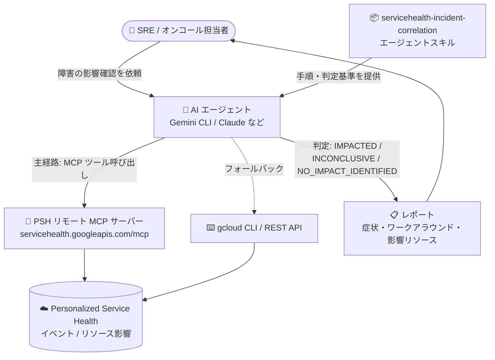

# Personalized Service Health: servicehealth-incident-correlation エージェントスキルのサポート

**リリース日**: 2026-11-19

**サービス**: Personalized Service Health

**機能**: servicehealth-incident-correlation エージェントスキル

**ステータス**: Feature (リソースレベルの影響特定は Preview)

📊 [このアップデートのインフォグラフィックを見る](https://takech9203.github.io/google-cloud-news-summary/20261119-service-health-incident-correlation-agent-skill.html)

## 概要

Personalized Service Health が、エージェントスキル `servicehealth-incident-correlation` をサポートした。このスキルは、Google Cloud のインシデントが特定のプロジェクトに影響しているかどうかを確認し、公開されているインシデントの症状 (symptoms) とワークアラウンドを報告するための手順を AI エージェントに提供するものである。スキルは [google/skills](https://github.com/google/skills) リポジトリで公開されており、`npx skills add` コマンドでインストールできる。

エージェントスキルは、AI エージェントに特定の知識と手順を再利用可能な形で与えるための標準化された仕組みで、スクリプト、リファレンス資料、テンプレートなどのリソースを含む。このスキルを使用するエージェントは、スキルなしのエージェントよりも高い精度でインシデント相関のタスクを実行できる。スキルの中核原則は「最もコストが高い誤りは誤った全面クリア (false all-clear) の報告」であり、読み取り専用の調査に特化している。対象ユーザーは、オンコール対応や障害切り分けに AI エージェント (Gemini CLI、Claude、Antigravity など) を活用する SRE・運用チームである。

**アップデート前の課題**

- AI エージェントに Personalized Service Health での障害調査を依頼しても、プロジェクト ID の特定方法、イベントのフィルタ構文、`MERGED` や `FALSE_POSITIVE` などのイベント状態の解釈をエージェントが知らず、調査の精度が安定しなかった
- `RELATED` の関連度を「影響なし」と誤解釈する、リソースレベルの影響リストが空であることを「影響なし」と誤って断定するなど、誤った全面クリア報告のリスクがあった
- インシデント相関の手順 (スコープ特定 → イベント取得 → 相関 → 判定 → 報告) を利用者が都度プロンプトで指示する必要があった

**アップデート後の改善**

- 標準化されたスキルをインストールするだけで、エージェントがインシデント相関の体系的なワークフロー (5 ステップ) に従って調査を実行できるようになった
- `IMPACTED` / `INCONCLUSIVE` / `NO_IMPACT_IDENTIFIED` という明確な判定基準に基づき、誤った全面クリアを避ける安全側の報告が行われるようになった
- Personalized Service Health のリモート MCP サーバーを主要な通信経路とし、MCP が使えない場合は gcloud CLI / REST API へフォールバックする手順もスキルに含まれる

## アーキテクチャ図



AI エージェントはスキルの手順に従い、Personalized Service Health リモート MCP サーバー (フォールバックとして gcloud / REST API) からイベントと影響情報を取得し、プロジェクト単位の影響判定とレポートを生成する。

## サービスアップデートの詳細

### 主要機能

1. **5 ステップのインシデント相関ワークフロー**
   - スコープ特定: プロンプト、アラートペイロード、リソースパスからプロジェクト ID を特定 (ホストの gcloud デフォルトプロジェクトには依存しない)。プロダクト、ロケーション、リソース、基準時刻を抽出
   - イベント取得: `projects/{project_id}/locations/global` を親として、`state=ACTIVE` や `update_time` ウィンドウなどの範囲を限定したフィルタ付きでイベントを取得 (ページネーション対応)
   - 相関: プロダクトとロケーションの一致判定を実施。`MERGED` イベントは親インシデントまで追跡し、`EMERGING` はアクティブ扱い、`FALSE_POSITIVE` / `AUTO_CLOSED` はマッチ対象外とする。時間ウィンドウのルール (ウィンドウ開始の最大 4 時間前までのマッチ、基準時刻の 1 時間以内にクローズした場合は「直近クローズ」として `INCONCLUSIVE`) も定義
   - 判定: `IMPACTED` (関連度が `IMPACTED` または `RELATED`)、`INCONCLUSIVE` (API 呼び出し失敗、プロダクト未対応、プロジェクト ID 不明など)、`NO_IMPACT_IDENTIFIED` (ただし全面クリアとは表現しない) の 3 種類
   - 報告: 判定トークン、プロジェクト ID の取得元、イベントサマリー、プロダクト / ロケーション別の詳細ステータス表、リソースレベルの影響、最新の症状とワークアラウンド、PSH コンソールへのリンクを含むレポートを生成

2. **Personalized Service Health リモート MCP サーバーとの連携**
   - 主要な通信経路は `https://servicehealth.googleapis.com/mcp` のリモート MCP サーバー (Streamable HTTP)
   - MCP ツール: `list_project_events` (イベント一覧)、`get_project_event` (症状・ワークアラウンドを含むイベント詳細)、`list_project_impacts` / `get_project_impact` (Preview のリソースレベル影響)
   - MCP が利用できない場合は gcloud CLI (`gcloud service-health events list`) や REST API へのフォールバック手順をリファレンスとして同梱

3. **リソースレベルの影響特定 (Impacted resource identification、Preview)**
   - イベントの関連度が `IMPACTED` の場合、影響を受けている具体的なリソース (Cloud SQL インスタンス、GKE クラスタなど) を `Impact` リソース (`projects/{PROJECT_ID}/locations/global/impacts/{IMPACT_ID}`) として特定できる
   - `Impact` には影響リソースのフルリソース名 (`assetName`)、Cloud Asset Inventory のリソースタイプ (`assetType`)、関連イベント、説明、タイムスタンプが含まれる
   - スキルはこの情報を「参考情報」として扱い、影響リストが空でも「影響なし」とは判定しない

## 技術仕様

### スキルの前提条件

| 項目 | 詳細 |
|------|------|
| プロジェクト指定 | すべての呼び出しで明示的な `{project_id}` が必要 (`gcloud config set project` には依存しない) |
| 課金 | プロジェクトでアクティブな課金アカウントが必要 |
| API | `servicehealth.googleapis.com` の有効化が必要。リソースレベルの影響はインシデント開始の 24 時間以上前の有効化が必要 |
| 認証 | `gcloud auth login`、Application Default Credentials、または `GOOGLE_APPLICATION_CREDENTIALS` |
| IAM ロール | `roles/servicehealth.viewer` (閲覧)、`roles/mcp.toolUser` (リモート MCP 利用時) |
| MCP OAuth スコープ | `https://www.googleapis.com/auth/servicehealth.read-only` (読み取り専用) |

### スキルに含まれるリファレンスファイル

| ファイル | 用途 |
|---------|------|
| `references/attribution.md` | コマンド実行前に必ず参照 (利用の帰属情報) |
| `references/coverage.md` | PSH プロダクトカバレッジのスナップショット (ライブドキュメントが参照できない場合のフォールバック) |
| `references/errors.md` | API 呼び出し失敗時のエラーと解決方法 |
| `references/rest-fallback.md` | MCP が利用できない場合の REST API / gcloud フォールバック手順 |
| `references/report-examples.md` | レポート作成時の記述例 |

## 設定方法

### 前提条件

1. Node.js / npm が利用可能な環境 (スキルのインストールに `npx` を使用)
2. エージェントスキルに対応した AI エージェント環境
3. 対象プロジェクトで Service Health API が有効化済みであること

### 手順

#### ステップ 1: スキルのインストール

```bash
npx skills add google/skills --skill servicehealth-incident-correlation
```

google/skills リポジトリからスキルをエージェント環境にインストールする。

#### ステップ 2: Service Health API の有効化

```bash
gcloud services enable servicehealth.googleapis.com --project=PROJECT_ID
```

リソースレベルの影響情報を受け取るには、インシデント開始の 24 時間以上前に API を有効化しておく必要がある。後から有効化した場合、過去 90 日分のプロジェクトレベルイベントはバックフィルされるが、リソースレベルの影響はバックフィルされない。

#### ステップ 3: 認証と IAM ロールの設定

```bash
gcloud auth login
# または
gcloud auth application-default login
```

調査を実行するプリンシパルに `roles/servicehealth.viewer` を、リモート MCP サーバーを使用する場合は `roles/mcp.toolUser` を付与する。

## メリット

### ビジネス面

- **障害切り分けの迅速化**: 「この障害は自社側か Google 側か」の一次判定をエージェントが体系的な手順で実行し、オンコール対応の初動を短縮できる
- **誤判断リスクの低減**: 「誤った全面クリアが最もコストが高い」という設計原則に基づき、不確実な場合は `INCONCLUSIVE` を返すため、プラットフォーム障害の見逃しによる無駄なロールバックや復旧作業を避けられる

### 技術面

- **標準化された再利用可能な手順**: フィルタ構文の制約 (繰り返しフィールドには `=` ではなく `:` を使用するなど)、イベント状態の解釈ルール、時間ウィンドウの扱いなど、PSH API 利用上の落とし穴がスキルに織り込まれている
- **読み取り専用で安全**: スキルは read-only であり、OAuth スコープも `servicehealth.read-only` のため、エージェントに広い権限を与えずに運用できる
- **フォールバック経路の確保**: MCP サーバーが使えない環境でも gcloud CLI / REST API での調査手順が同梱されている

## デメリット・制約事項

### 制限事項

- リソースレベルの影響特定 (Impacted resource identification) は Preview であり、対応プロダクトが限定されている。対応外のプロダクトやコントロールプレーン / リージョンレベルの障害では、イベントは `IMPACTED` でも `impacts.list` が空リストを返す
- リソースレベルの影響を受け取るには、インシデント開始の 24 時間以上前に Service Health API が有効化されている必要がある
- スキルの対象はプロジェクト単位の障害確認・トリアージであり、ローカルのコード / ビルドエラー、通常のアラート、PSH アラート設定、公開ステータス (プロジェクト非依存) の確認は対象外

### 考慮すべき点

- ヘッドレス (非対話) フローでプロジェクト ID が特定できない場合、スキルは即座に `INCONCLUSIVE` を返す。アラートペイロードなどにプロジェクト ID を含める設計が必要
- `NO_IMPACT_IDENTIFIED` は「影響なしの保証」ではない。インシデント宣言は症状の発生より遅れる可能性があるため、他の情報源と併用した判断が推奨される
- `list_project_events` のフィルタでは `relevance`、ロケーション、開始 / 終了時刻によるフィルタリングはできない

## ユースケース

### ユースケース 1: オンコールボットによるロールバック前の障害切り分け

**シナリオ**: 本番プロジェクトで Spanner への接続タイムアウトと 503 エラーが急増。デプロイ起因かプラットフォーム障害かを判断してからロールバックを実行したい。

**実装例**:
```
プロンプト例:
「projects/payment-service-prod で Spanner の 503 エラーと接続タイムアウトが
発生している。ロールバックの前に、既知の Google Cloud インシデントが
影響していないか確認して」

エージェントの動作 (スキルの手順に従う):
1. プロンプトからプロジェクト ID (payment-service-prod) を特定
2. list_project_events を filter="category=INCIDENT state=ACTIVE" で呼び出し
3. 影響プロダクト (spanner.googleapis.com) と症状を相関
4. 該当イベントがあれば get_project_event で症状・ワークアラウンドを取得
5. 「Status: IMPACTED -- ...」形式で判定とワークアラウンドを報告
```

**効果**: プラットフォーム障害時の不要なロールバックを回避し、公開済みワークアラウンドに基づく適切な初動対応ができる。

### ユースケース 2: アラート受信時の自動影響確認

**シナリオ**: Cloud Logging ベースの Service Health アラートや監視アラートを受信した際、CI/CD トリアージエージェントがアラートペイロード内のプロジェクト ID とリソースパスからスコープを特定し、影響を自動確認する。

**効果**: 影響を受けた具体的なリソース (`assetName` / `assetType`) まで特定 (Preview、対応プロダクトのみ) した構造化レポートが自動生成され、人手による Service Health ダッシュボードの確認作業を削減できる。

## 関連サービス・機能

- **Personalized Service Health リモート MCP サーバー**: スキルの主要な通信経路。`https://servicehealth.googleapis.com/mcp` エンドポイントで `list_project_events` / `get_project_event` などのツールを提供
- **Service Health API (v1 / v1beta)**: イベント (`projects.locations.events`) とリソースレベルの影響 (`projects.locations.impacts`、v1beta Preview) を提供する基盤 API
- **Cloud Logging**: Service Health イベントはログとして記録され、アラートポリシーの条件として利用できる
- **Model Armor**: PSH MCP サーバーのツール呼び出しと応答をスクリーニングするオプションのセキュリティ機能
- **Application Integration エージェントスキル**: 同じ google/skills リポジトリで提供される Google Cloud プロダクトのエージェントスキル群の一例

## 参考リンク

- 📊 [インフォグラフィック](https://takech9203.github.io/google-cloud-news-summary/20261119-service-health-incident-correlation-agent-skill.html)
- [公式リリースノート](https://docs.cloud.google.com/release-notes#November_19_2026)
- [Service Health agent skills (公式ドキュメント)](https://docs.cloud.google.com/service-health/docs/agent-skills-overview)
- [servicehealth-incident-correlation スキル (google/skills リポジトリ)](https://github.com/google/skills/tree/main/skills/cloud/servicehealth-incident-correlation)
- [Personalized Service Health の概念 (Impacted resources)](https://docs.cloud.google.com/service-health/docs/concepts)
- [Personalized Service Health MCP サーバーの使用](https://docs.cloud.google.com/service-health/docs/use-service-health-mcp)

## まとめ

`servicehealth-incident-correlation` エージェントスキルにより、「この障害は Google Cloud 側のインシデントか」という切り分け作業を、AI エージェントが標準化された手順と安全側の判定基準で実行できるようになった。オンコール対応に AI エージェントを組み込んでいるチームは、`npx skills add google/skills --skill servicehealth-incident-correlation` でスキルを導入し、あわせて対象プロジェクトで Service Health API を事前に有効化しておくことを推奨する。

---

**タグ**: Service Health, Personalized Service Health, Agent Skills, AI エージェント, MCP, インシデント対応, SRE, オブザーバビリティ
