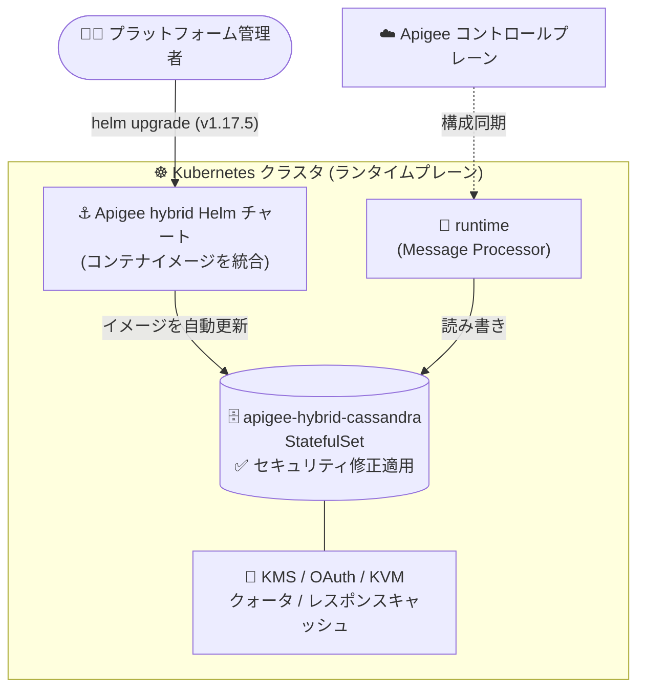

# Apigee hybrid: v1.17.5 パッチリリース (apigee-hybrid-cassandra のセキュリティ修正)

**リリース日**: 2026-11-20

**サービス**: Apigee hybrid

**機能**: v1.17.5 パッチリリース (apigee-hybrid-cassandra コンテナイメージのセキュリティ修正)

**ステータス**: Announcement / Security (パッチリリース)

📊 [このアップデートのインフォグラフィックを見る](https://takech9203.github.io/google-cloud-news-summary/20261120-apigee-hybrid-v1-17-5.html)

## 概要

2026 年 11 月 20 日、Google Cloud は Apigee hybrid ソフトウェアの更新バージョン v1.17.5 をリリースしました。本リリースはパッチリリースであり、パッチリリースで使用されるコンテナイメージは Apigee hybrid の Helm チャートに統合されています。Helm チャートを使用してパッチにアップグレードするとイメージも自動的に更新されるため、通常は手動でのイメージ変更は不要です。

本リリースの内容は、ランタイムデータストアを担う **`apigee-hybrid-cassandra` コンテナイメージに対するセキュリティ修正** (Bug ID: N/A) です。Cassandra は Apigee hybrid のランタイムプレーンにおいて、KMS (API キー・OAuth トークン)、KVM、クォータ、レスポンスキャッシュなどの永続データを保持する中核コンポーネントであり、StatefulSet として Kubernetes クラスタ上で稼働します。機密性の高いデータを扱うコンポーネントであるため、Apigee hybrid v1.17 系を運用しているプラットフォームチーム・API 管理者は、計画的に本パッチの適用を進めることが推奨されます。

v1.17 系では、11 月 18 日の v1.17.4 (Pod Topology Spread Constraints 対応、CVE-2026-114938 緩和など) に続く短い間隔でのパッチ提供であり、セキュリティ修正が継続的に配信されていることがうかがえます。

**アップデート前の課題**

- v1.17.4 以前の `apigee-hybrid-cassandra` コンテナイメージには、本リリースで修正対象となったセキュリティ上の問題が存在していた
- コンテナイメージスキャンで `apigee-hybrid-cassandra` に脆弱性が検出された場合、ユーザー側で個別にイメージを差し替える手段がなく、公式パッチの提供を待つ必要があった

**アップデート後の改善**

- `apigee-hybrid-cassandra` のセキュリティ修正が適用され、ランタイムデータストアのセキュリティ態勢が改善された
- パッチリリースのコンテナイメージは Helm チャートに統合されているため、Helm チャートのアップグレードのみで修正済みイメージが自動適用され、手動でのイメージ変更は不要

## アーキテクチャ図



v1.17.5 では、Helm チャートによるアップグレードだけで、ランタイムデータストアである Cassandra (`apigee-hybrid-cassandra`) のセキュリティ修正済みイメージが自動的に適用されます。Cassandra は KMS、OAuth、KVM、クォータ、レスポンスキャッシュなどの永続データを保持します。

## サービスアップデートの詳細

### 主要機能

1. **v1.17.5 パッチリリースの提供**
   - 2026 年 11 月 20 日にリリースされた Apigee hybrid v1.17 系の最新パッチ
   - パッチリリースのコンテナイメージは Apigee hybrid Helm チャートに統合されており、Helm チャートでのアップグレードによりイメージも自動更新される。通常、手動でのイメージ変更は不要
   - コンテナイメージサポートの詳細は「[Apigee release process](https://docs.cloud.google.com/apigee/docs/release/apigee-release-process#apigee-hybrid-container-images)」を参照

2. **`apigee-hybrid-cassandra` のセキュリティ修正 (Bug ID: N/A)**
   - ランタイムデータストアである Cassandra のコンテナイメージに対するセキュリティ修正
   - リリースノートでは個別の CVE 番号は公表されていない

## 技術仕様

### リリース概要

| 項目 | 詳細 |
|------|------|
| バージョン | Apigee hybrid v1.17.5 |
| リリース日 | 2026 年 11 月 20 日 |
| リリース種別 | パッチリリース |
| 修正内容 | `apigee-hybrid-cassandra` のセキュリティ修正 (Bug ID: N/A) |
| コンテナイメージ | Helm チャートに統合 (Helm チャートによるアップグレードで自動更新) |
| アップグレード手順 | [Upgrading Apigee hybrid to v1.17.5](https://docs.cloud.google.com/apigee/docs/hybrid/v1.17/upgrade) |

### 修正対象コンポーネント: Cassandra (apigee-hybrid-cassandra)

| 項目 | 詳細 |
|------|------|
| 役割 | ランタイムプレーンのローカル永続ストレージ (ランタイムデータストア) |
| 保持データ | KMS (API キー・OAuth トークン)、KVM、OAuth、クォータ、レスポンスキャッシュ、Monetization データなど |
| 実装形態 | Kubernetes StatefulSet (`apigee-cassandra-default` Pod 群) |
| スコープ | 組織 (1 つ以上の組織で共有) |
| 設定オブジェクト | `overrides.yaml` の `cassandra` プロパティ |

## 設定方法

### 前提条件

1. Apigee hybrid v1.17.x を Helm チャートで管理していること (新規インストールの場合は「[The big picture](https://docs.cloud.google.com/apigee/docs/hybrid/v1.17/big-picture)」から開始)
2. 現行クラスタ構成を反映した `overrides.yaml` が利用できること
3. アップグレード前に Cassandra データベースと Helm チャートディレクトリのバックアップを取得していること (推奨)

### 手順

#### ステップ 1: v1.17.5 へのアップグレード

```bash
# Helm チャートを v1.17.5 に更新し、各チャートを順にアップグレード
# (パッチリリースのためコンテナイメージはチャートに統合されており、自動的に更新される)
helm upgrade operator apigee-operator/ \
  --install \
  --namespace APIGEE_NAMESPACE \
  --atomic \
  -f overrides.yaml
```

operator、datastore (Cassandra)、telemetry、redis、ingress-manager、org、env、virtualhost の各チャートを公式手順の順序でアップグレードします。詳細は「[Upgrading Apigee hybrid to v1.17.5](https://docs.cloud.google.com/apigee/docs/hybrid/v1.17/upgrade)」を参照してください。

#### ステップ 2: Cassandra Pod の更新確認

```bash
# Cassandra Pod のステータスとイメージを確認
kubectl get pods -n APIGEE_NAMESPACE -l app=apigee-cassandra
kubectl get pods -n APIGEE_NAMESPACE -l app=apigee-cassandra \
  -o jsonpath='{.items[*].spec.containers[*].image}'
```

アップグレード後、Cassandra StatefulSet の Pod が正常 (Running/Ready) であること、およびイメージが v1.17.5 のものに更新されていることを確認します。

## メリット

### ビジネス面

- **セキュリティリスクの低減**: API キーや OAuth トークンなどの機微データを保持する Cassandra のセキュリティ修正により、データストア層のリスクが低減され、監査・コンプライアンス対応の負担が軽減される
- **運用コストの抑制**: Helm チャートのアップグレードのみで修正が適用されるため、個別のイメージ管理や手動差し替え作業が不要

### 技術面

- **適用の容易さ**: パッチリリースのコンテナイメージは Helm チャートに統合されており、通常のアップグレードフローだけで修正済みイメージが自動反映される
- **脆弱性スキャン指摘への対応**: コンテナイメージスキャンで `apigee-hybrid-cassandra` に指摘がある環境では、本パッチ適用により解消が期待できる

## デメリット・制約事項

### 考慮すべき点

- リリースノートでは修正された脆弱性の個別の CVE 番号は公表されていない (Bug ID: N/A)。詳細が必要な場合は今後のドキュメント更新やサポート経由での確認が必要
- Cassandra は StatefulSet のため、アップグレード時はローリング更新の進行と各 Pod の Ready 状態を確認しながら進めることが望ましい
- アップグレード前には Cassandra データのバックアップ取得が推奨される
- v1.17.4 (2026 年 11 月 18 日) の機能追加・修正を未適用の場合は、v1.17.5 への更新であわせて取り込まれるため、両リリースの変更内容を確認した上で検証・適用を計画する

## ユースケース

### ユースケース 1: 定期的な脆弱性対応としてのパッチ適用

**シナリオ**: セキュリティチームのコンテナイメージスキャンで Apigee hybrid の Cassandra イメージに脆弱性が検出され、SLA 内での修正が求められている。

**効果**: v1.17.5 への Helm チャートアップグレードのみで、`apigee-hybrid-cassandra` のセキュリティ修正済みイメージが自動適用され、スキャン指摘事項の解消が期待できる。

### ユースケース 2: 機微データを扱う API 基盤のセキュリティ態勢維持

**シナリオ**: 金融・医療など規制産業の API 基盤として Apigee hybrid を運用しており、OAuth トークンや API キーを保持するデータストア層の脆弱性管理を厳格に行う必要がある。

**効果**: KMS・OAuth・KVM などの機微データを保持する Cassandra に対するセキュリティ修正を早期適用することで、データストア層のセキュリティ態勢を継続的に維持できる。

## 料金

本アップデートはパッチリリースであり、料金体系の変更はありません。Apigee の料金はサブスクリプション (Standard / Enterprise / Enterprise Plus) または従量課金 (Pay-as-you-go) で提供されます。詳細は[料金ページ](https://cloud.google.com/apigee/pricing)を参照してください。

## 利用可能リージョン

Apigee hybrid のランタイムプレーンはユーザー管理の Kubernetes クラスタ (GKE、他クラウド、オンプレミス) 上で稼働するため、本リリース自体に固有のリージョン制約はありません。サポート対象プラットフォームは[公式ドキュメント](https://docs.cloud.google.com/apigee/docs/hybrid/supported-platforms)を参照してください。

## 関連サービス・機能

- **Apache Cassandra (apigee-hybrid-cassandra)**: 本リリースの修正対象。ランタイムプレーンで KMS、OAuth、KVM、クォータ、レスポンスキャッシュなどの永続データを保持する分散データストア
- **Helm**: Apigee hybrid のインストール・アップグレード・構成管理の標準ツール。パッチリリースのイメージ更新も Helm チャート経由で自動化される
- **Google Kubernetes Engine (GKE)**: Apigee hybrid ランタイムプレーンの主要な稼働基盤
- **外部データストアモード (External datastore mode)**: v1.17.1 以降で利用可能な、Cassandra を別クラスタで運用する構成。Cassandra を分離運用している場合も本パッチの適用対象となる

## 参考リンク

- 📊 [インフォグラフィック](https://takech9203.github.io/google-cloud-news-summary/20261120-apigee-hybrid-v1-17-5.html)
- [公式リリースノート](https://docs.cloud.google.com/release-notes#November_20_2026)
- [Apigee hybrid v1.17.5 へのアップグレード手順](https://docs.cloud.google.com/apigee/docs/hybrid/v1.17/upgrade)
- [新規インストール (The big picture)](https://docs.cloud.google.com/apigee/docs/hybrid/v1.17/big-picture)
- [Apigee リリースプロセス (コンテナイメージサポート)](https://docs.cloud.google.com/apigee/docs/release/apigee-release-process#apigee-hybrid-container-images)
- [Apigee hybrid の Cassandra 構成](https://docs.cloud.google.com/apigee/docs/hybrid/v1.17/cassandra-config)
- [料金ページ](https://cloud.google.com/apigee/pricing)

## まとめ

Apigee hybrid v1.17.5 は、ランタイムデータストアである `apigee-hybrid-cassandra` のセキュリティ修正に特化したパッチリリースです。Cassandra は API キーや OAuth トークンなどの機微データを保持する中核コンポーネントであるため、v1.17 系を運用中の環境では検証環境での確認を経て早期に適用することを推奨します。コンテナイメージは Helm チャートに統合されているため、通常のチャートアップグレードのみで修正を取り込めます。

---

**タグ**: #ApigeeHybrid #Apigee #Cassandra #Security #PatchRelease #Helm #Kubernetes #APIManagement
