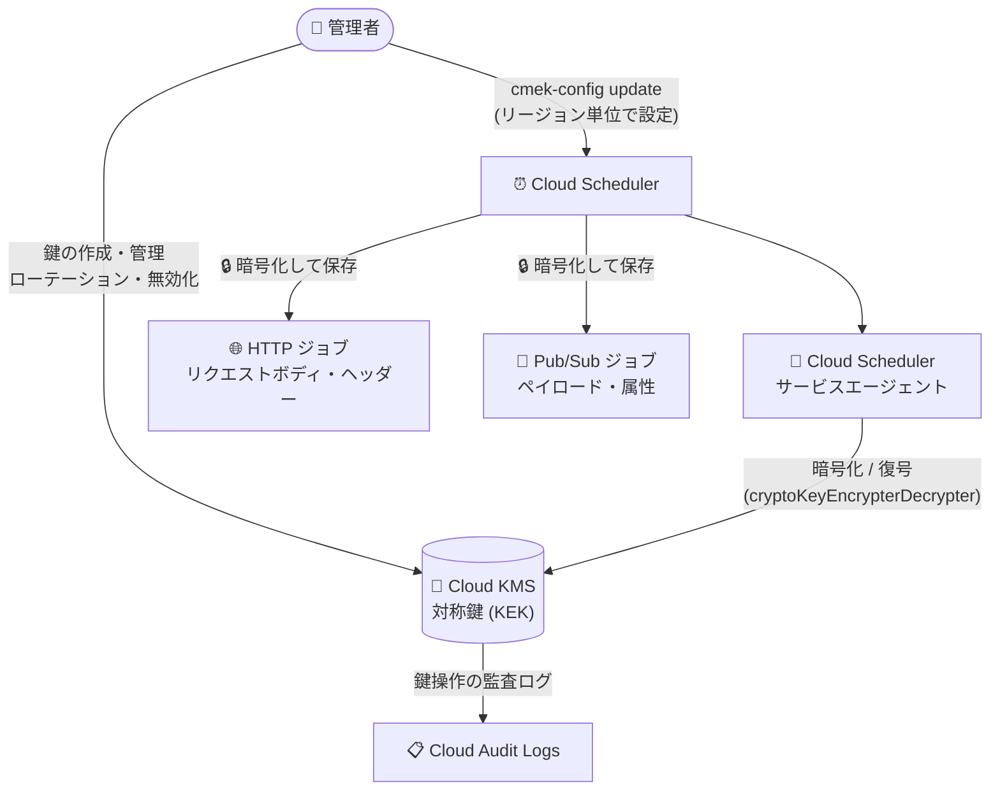

# Cloud Scheduler: 顧客管理の暗号鍵 (CMEK) サポートが GA

**リリース日**: 2026-11-20

**サービス**: Cloud Scheduler

**機能**: 顧客管理の暗号鍵 (CMEK) サポート

**ステータス**: GA (一般提供)

📊 [このアップデートのインフォグラフィックを見る](https://takech9203.github.io/google-cloud-news-summary/20261120-cloud-scheduler-cmek-ga.html)

## 概要

Cloud Scheduler における顧客管理の暗号鍵 (CMEK: Customer-Managed Encryption Keys) のサポートが一般提供 (GA) になりました。Cloud Key Management Service (Cloud KMS) で管理する対称鍵を使用して、HTTP ジョブおよび Pub/Sub ジョブのデータを保存時 (at rest) に保護できます。

デフォルトでは、Cloud Scheduler は Google が管理する鍵でデータを自動的に暗号化します (Google デフォルト暗号化)。CMEK を使用すると、データを保護する鍵暗号鍵 (KEK) を Google ではなく利用者自身が Cloud KMS 上で所有・管理できるようになり、鍵の保護レベル、ロケーション、ローテーションスケジュール、使用・アクセス権限、暗号境界を自らコントロールできます。金融、医療、公共など、暗号鍵の管理に関する厳格なコンプライアンス要件を持つ組織にとって重要なアップデートです。

CMEK の設定はプロジェクトおよびリージョン単位で行います。HTTP/HTTPS ターゲットのジョブではリクエストボディとカスタムヘッダーが、Pub/Sub ターゲットのジョブではメッセージペイロードと属性が保護されます。

**アップデート前の課題**

- Cloud Scheduler のジョブデータは Google が所有・管理する鍵による暗号化 (Google デフォルト暗号化) のみで、利用者が暗号鍵のライフサイクルを制御できなかった
- 暗号鍵の無効化・破棄によるデータアクセスの即時遮断 (crypto-shredding) を Cloud Scheduler のジョブデータに適用できなかった
- CMEK の利用を必須とする組織ポリシーを運用する環境では、Cloud Scheduler の採用がコンプライアンス上の課題になり得た

**アップデート後の改善**

- Cloud KMS で管理する対称鍵により、HTTP / Pub/Sub ジョブのデータを保存時に保護できるようになった
- 鍵の使用状況を Cloud Audit Logs で監査でき、鍵の無効化・破棄やサービスエージェントの権限剥奪によるアクセス制御が可能になった
- 組織ポリシー制約 (`gcp.restrictNonCmekServices`、`gcp.restrictCmekCryptoKeyProjects`) と統合され、組織全体で CMEK 利用を強制・制限できるようになった
- CMEK を有効化すると、該当リージョンの既存ジョブも指定した鍵で暗号化される

## アーキテクチャ図



管理者が Cloud KMS 上の対称鍵をリージョン単位で Cloud Scheduler に設定すると、Cloud Scheduler のサービスエージェントがその鍵を使用して HTTP / Pub/Sub ジョブのデータを保存時に暗号化・復号します。鍵の操作は Cloud Audit Logs で監査できます。

## サービスアップデートの詳細

### 主要機能

1. **HTTP / Pub/Sub ジョブデータの CMEK 保護**
   - HTTP/HTTPS ターゲット: リクエストボディとカスタムヘッダーを暗号化
   - Pub/Sub ターゲット: メッセージペイロードと属性を暗号化
   - App Engine ターゲットのジョブは保護対象外

2. **リージョン単位の CMEK 設定**
   - Cloud KMS 鍵はプロジェクトおよびサポート対象リージョンごとに指定
   - 有効化は長時間実行オペレーションとして非同期に実行され、既存ジョブも新しい鍵で再暗号化される
   - `--clear-kms-key` で無効化すると、以降は Google デフォルト暗号化に戻る

3. **組織ポリシーとの統合**
   - `constraints/gcp.restrictNonCmekServices`: 新規リソース作成時に CMEK を必須化
   - `constraints/gcp.restrictCmekCryptoKeyProjects`: 使用できる Cloud KMS 鍵を承認済みプロジェクトに制限
   - App Engine ターゲットのジョブはこれらの制約の対象外

4. **アクセス遮断と障害時の動作**
   - 鍵バージョンの無効化で、その鍵で保護されたデータへのアクセスを一時停止 (再有効化で復旧可能)
   - 鍵の破棄は恒久的なアクセス遮断となり、データが復旧不能になる可能性がある
   - Cloud KMS の一時的なエラーは指数バックオフで内部リトライされ、`CmekRetryFailure` としてログに記録される

## 技術仕様

### CMEK 設定の仕様

| 項目 | 詳細 |
|------|------|
| 鍵の種類 | Cloud KMS の対称鍵 (symmetric key) |
| 設定単位 | プロジェクト × リージョン |
| 鍵リングのロケーション | 保護対象の Cloud Scheduler リージョンと同一リージョンである必要あり |
| 保護対象 (HTTP) | リクエストボディ、カスタムヘッダー |
| 保護対象 (Pub/Sub) | メッセージペイロード、属性 |
| 保護対象外 | App Engine ターゲットのジョブ |
| 鍵プロジェクト | Cloud Scheduler とは別プロジェクトの鍵も指定可能 |
| 中間鍵のキャッシュ | プロジェクト/リージョンごとに最大 5 分間再利用され、復号オペレーション数を抑制 |

### 必要な IAM ロール

| ロール | 対象 | 用途 |
|--------|------|------|
| Cloud KMS CryptoKey Encrypter/Decrypter (`roles/cloudkms.cryptoKeyEncrypterDecrypter`) | Cloud Scheduler サービスエージェント (`service-PROJECT_NUMBER@gcp-sa-cloudscheduler.iam.gserviceaccount.com`) | 鍵による暗号化・復号 |
| Cloud KMS Admin | 管理者 (鍵側プロジェクト) | サービスエージェントへの鍵アクセス権付与 |
| Cloud Scheduler Admin | 管理者 | CMEK の有効化・無効化 |
| Cloud Scheduler Viewer または Admin | 管理者 | CMEK 設定・オペレーション状態の確認 |

## 設定方法

### 前提条件

1. 鍵を保管するプロジェクトで Cloud KMS API (`cloudkms.googleapis.com`) を有効化する (Cloud Scheduler と同一プロジェクトでも別プロジェクトでも可)
2. 保護対象の Cloud Scheduler リージョンと同一リージョンに鍵リングと対称鍵を作成する
3. Cloud KMS の監査ログ設定を確認する

### 手順

#### ステップ 1: サービスエージェントに鍵へのアクセスを付与

```bash
gcloud kms keys add-iam-policy-binding KEY_NAME \
  --keyring=KEY_RING \
  --location=LOCATION \
  --project=KMS_PROJECT_ID \
  --member="serviceAccount:service-PROJECT_NUMBER@gcp-sa-cloudscheduler.iam.gserviceaccount.com" \
  --role="roles/cloudkms.cryptoKeyEncrypterDecrypter"
```

Cloud Scheduler のサービスエージェントに、鍵を使用した暗号化・復号の権限を付与します。

#### ステップ 2: リージョンの CMEK 設定を更新

```bash
gcloud scheduler cmek-config update \
  --location=LOCATION \
  --kms-key-name=KEY_NAME \
  --kms-keyring=KEY_RING \
  --kms-project=KMS_PROJECT_ID
```

有効化は長時間実行オペレーションとして非同期に実行されます。`gcloud scheduler operations describe` で進捗を確認できます。

#### ステップ 3: 設定を確認

```bash
gcloud scheduler cmek-config describe --location=LOCATION
```

指定したリージョンに設定されている Cloud KMS 鍵を確認します。無効化する場合は `gcloud scheduler cmek-config update --location=LOCATION --clear-kms-key` を実行します。

## メリット

### ビジネス面

- **コンプライアンス対応**: 暗号鍵の自社管理を要求する規制・業界標準 (金融、医療、公共など) に Cloud Scheduler を利用したワークロードでも対応可能
- **組織全体でのガバナンス強制**: 組織ポリシー制約により、CMEK 未使用のリソース作成をブロックし、承認済みプロジェクトの鍵のみ許可できる

### 技術面

- **鍵ライフサイクルの完全な制御**: 保護レベル、ロケーション、ローテーション、アクセス権限を利用者が管理
- **監査可能性**: 鍵の有効化・無効化・使用が Cloud Audit Logs に記録される
- **アクセス遮断手段の確保**: 鍵の無効化・破棄やサービスエージェントの権限剥奪により、ジョブデータへのアクセスを遮断可能
- **既存ジョブの自動移行**: CMEK 有効化時に、該当リージョンの既存ジョブも指定した鍵で暗号化される

## デメリット・制約事項

### 制限事項

- App Engine ターゲットのジョブは CMEK の保護対象外 (組織ポリシー制約の対象からも除外)
- 鍵リングは保護対象の Cloud Scheduler リージョンと同一リージョンに作成する必要がある
- 鍵をローテーションしても、既存ジョブは自動的に再暗号化されず、新しいプライマリバージョンへ自動切り替えもされない

### 考慮すべき点

- 使用中の鍵バージョンを無効化・破棄すると、そのリージョンのジョブ管理オペレーションと実行が失敗する
- 鍵を破棄した場合、保護されていたデータは復旧不能になる可能性がある
- 既存ジョブが CMEK 向けに移行されていない場合に `FAILED_PRECONDITION` エラーが発生することがあり、権限修正後もサポートリクエストが必要になる場合がある
- Cloud KMS の一時的なエラーはリトライされるが、リトライ不能なエラーは即座に失敗する

## ユースケース

### ユースケース 1: 規制業界でのバッチジョブスケジューリング

**シナリオ**: 金融機関が、機密情報を含むリクエストボディを持つ HTTP ジョブで日次バッチ処理をトリガーしている。社内規程により、保存データの暗号鍵は自社管理が必須。

**実装例**:
```bash
# リージョン asia-northeast1 の Cloud Scheduler ジョブを CMEK で保護
gcloud scheduler cmek-config update \
  --location=asia-northeast1 \
  --kms-key-name=scheduler-key \
  --kms-keyring=scheduler-keyring \
  --kms-project=central-kms-project
```

**効果**: ジョブのリクエストボディとヘッダーが自社管理の鍵で暗号化され、鍵の使用履歴を監査ログで追跡できる。規程違反なく Cloud Scheduler を採用可能。

### ユースケース 2: 組織全体での CMEK 必須化

**シナリオ**: 企業のセキュリティチームが、組織内のすべてのプロジェクトで Cloud Scheduler リソースに CMEK の使用を強制し、鍵は中央管理プロジェクトのものだけを許可したい。

**効果**: `gcp.restrictNonCmekServices` と `gcp.restrictCmekCryptoKeyProjects` の組織ポリシー制約により、鍵なしのリソース作成や未承認プロジェクトの鍵使用を自動的にブロックできる。

## 料金

CMEK の利用自体に Cloud Scheduler 側の追加料金はなく、Cloud KMS の鍵オペレーションに対する料金がプロジェクトに課金されます。なお、中間鍵がプロジェクト/リージョンごとに最大 5 分間キャッシュ・再利用されるため、復号オペレーションの回数は抑制されます。Cloud KMS のクォータに影響するのは Cloud HSM または Cloud EKM 鍵を使用する場合のみです。

詳細は [Cloud KMS の料金ページ](https://cloud.google.com/kms/pricing) および [Cloud Scheduler の料金ページ](https://cloud.google.com/scheduler/pricing) を参照してください。

## 利用可能リージョン

CMEK はサポート対象リージョンごとに設定します。サポート対象リージョンの一覧は [公式ドキュメント](https://docs.cloud.google.com/scheduler/docs/use-cmek) を参照してください。

## 関連サービス・機能

- **Cloud Key Management Service (Cloud KMS)**: CMEK で使用する対称鍵の作成・管理・ローテーションを行う。鍵の操作は Cloud Audit Logs に記録される
- **Cloud Tasks**: 同じくサーバーレスなタスク実行サービスで、CMEK をサポート。Cloud Scheduler と同様にリージョン単位で CMEK を設定する
- **組織ポリシーサービス**: `gcp.restrictNonCmekServices` / `gcp.restrictCmekCryptoKeyProjects` 制約により、組織全体で CMEK 利用を強制・制限できる
- **Pub/Sub**: Cloud Scheduler の Pub/Sub ターゲットジョブのメッセージペイロードと属性が CMEK の保護対象となる

## 参考リンク

- 📊 [インフォグラフィック](https://takech9203.github.io/google-cloud-news-summary/20261120-cloud-scheduler-cmek-ga.html)
- [公式リリースノート](https://docs.cloud.google.com/release-notes#November_20_2026)
- [ドキュメント: Use customer-managed encryption keys (CMEK)](https://docs.cloud.google.com/scheduler/docs/use-cmek)
- [Cloud KMS CMEK の概要](https://docs.cloud.google.com/kms/docs/cmek)
- [Cloud KMS 料金ページ](https://cloud.google.com/kms/pricing)

## まとめ

Cloud Scheduler の CMEK サポートが GA となり、HTTP / Pub/Sub ジョブのデータを自社管理の Cloud KMS 鍵で保護できるようになりました。暗号鍵の自社管理が求められる規制業界やエンタープライズ環境でも、Cloud Scheduler を安心して採用できます。CMEK 要件のある組織は、対象リージョンの `cmek-config` 設定と組織ポリシー制約の適用を検討してください。

---

**タグ**: Cloud Scheduler, CMEK, Cloud KMS, セキュリティ, 暗号化, GA
