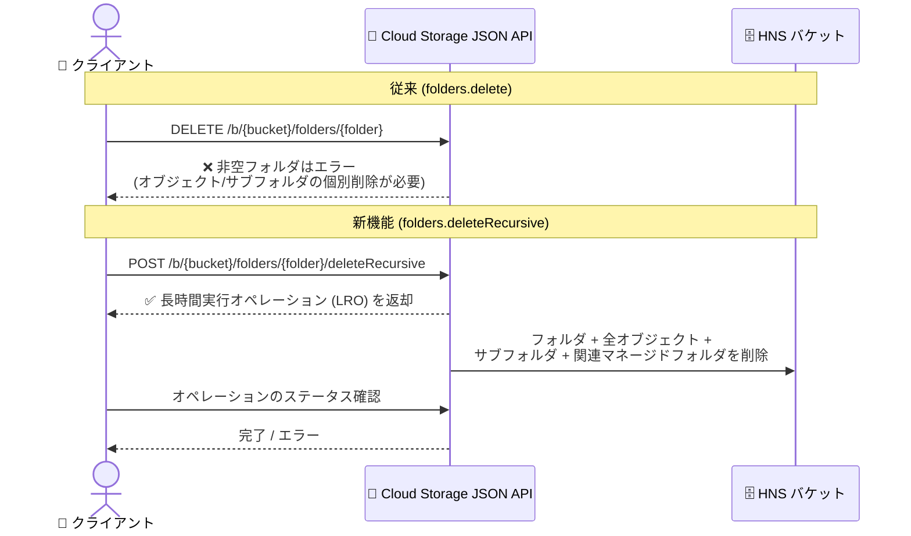

# Cloud Storage: 階層型名前空間バケットでのフォルダ再帰削除 (folders.deleteRecursive)

**リリース日**: 2026-11-20

**サービス**: Cloud Storage

**機能**: JSON API `folders.deleteRecursive` メソッドによる非空フォルダの再帰削除

**ステータス**: GA (Feature)

📊 [このアップデートのインフォグラフィックを見る](https://takech9203.github.io/google-cloud-news-summary/20261120-cloud-storage-hns-recursive-folder-delete.html)

## 概要

階層型名前空間 (Hierarchical Namespace、HNS) が有効な Cloud Storage バケットで、JSON API の新しい `folders.deleteRecursive` メソッドを使用して、**中身が空でないフォルダとそのすべてのコンテンツを単一の長時間実行オペレーション (LRO) で削除**できるようになりました。

これまで JSON API の `folders.delete` メソッドは空のフォルダしか削除できず、非空フォルダを API 経由で削除するには、配下のオブジェクトやサブフォルダを個別に削除してから、フォルダをボトムアップで削除していく必要がありました。今回のアップデートにより、1 回の API 呼び出しでフォルダツリー全体の削除を開始でき、削除の進行状況は長時間実行オペレーションとして追跡できます。

HNS バケットを分析基盤 (Hadoop/Spark ワークロード)、ML データセット管理、ファイルシステム的なデータ整理に利用しているユーザーにとって、フォルダのライフサイクル管理が大幅に簡素化されるアップデートです。

**アップデート前の課題**

- JSON API の `folders.delete` メソッドは「フォルダや オブジェクトを含まない空のフォルダ」しか削除できなかった
- 非空フォルダを削除するには、配下のオブジェクトをすべて削除し、サブフォルダを末端から順に削除する処理をクライアント側で実装する必要があった
- 再帰削除は Google Cloud コンソールや gcloud CLI (`gcloud storage rm --recursive`) では可能だったが、JSON API を直接利用するアプリケーションでは同等の単一操作が提供されていなかった

**アップデート後の改善**

- 単一の `folders.deleteRecursive` リクエストで、非空フォルダとその配下のすべてのオブジェクト・サブフォルダを削除できるようになった
- 削除処理は長時間実行オペレーション (LRO) として実行され、ステータスを追跡できる
- フォルダに関連付けられたマネージドフォルダ (associated managed folders) も、削除対象フォルダと併せて削除される

## アーキテクチャ図



従来は非空フォルダの削除がエラーになり中身の個別削除が必要でしたが、新しい `deleteRecursive` メソッドでは 1 回の呼び出しで再帰削除が LRO として開始されます。

## サービスアップデートの詳細

### 主要機能

1. **非空フォルダの再帰削除**
   - HNS 有効バケット内の非空フォルダと、その配下のすべてのコンテンツ (オブジェクト、サブフォルダ) を 1 回のリクエストで削除
   - 空フォルダのみ対象だった既存の `folders.delete` を補完する新メソッド

2. **長時間実行オペレーション (LRO) としての実行**
   - メソッドは長時間実行オペレーションを返し、削除の完了やエラーを追跡可能
   - 大規模なフォルダツリーの削除でもクライアントが同期的に待つ必要がない

3. **関連マネージドフォルダの削除**
   - 削除対象フォルダに関連付けられたマネージドフォルダ (associated managed folders) も併せて削除される
   - マネージドフォルダ削除時には、マネージドフォルダを明示的に削除する場合と同じルール・権限チェックが適用される

4. **メタ世代 (metageneration) による条件付き削除**
   - `ifMetagenerationMatch` / `ifMetagenerationNotMatch` クエリパラメータで条件付き削除が可能

## 技術仕様

### folders.deleteRecursive メソッド

| 項目 | 詳細 |
|------|------|
| HTTP リクエスト (API リファレンス) | `POST https://storage.googleapis.com/storage/v1/b/{bucket}/folders/{folder}/deleteRecursive` |
| 対象 | 階層型名前空間 (HNS) 有効バケットのフォルダ |
| パスパラメータ | `bucket` (親バケット名)、`folder` (URL エンコードされたフォルダ名。例: `example-folder/` → `example-folder%2F`) |
| オプションパラメータ | `ifMetagenerationMatch`、`ifMetagenerationNotMatch` |
| リクエストボディ | 不要 |
| レスポンス | 長時間実行オペレーション (LRO) |

### 必要な IAM 権限

| 権限 | 用途 |
|------|------|
| `storage.folders.delete` | 本メソッドの実行に必須 |
| `storage.managedFolders.delete` | 削除対象フォルダに関連マネージドフォルダがある場合、その関連マネージドフォルダに対して必要 |

## 設定方法

### 前提条件

1. 階層型名前空間 (HNS) が有効な Cloud Storage バケットがあること
2. 認証ユーザーが `storage.folders.delete` IAM 権限 (関連マネージドフォルダがある場合は `storage.managedFolders.delete` も) を持っていること
3. gcloud CLI がインストール・初期化されていること (アクセストークンの生成に使用)

### 手順

#### ステップ 1: 非空フォルダの再帰削除リクエストを送信

公式ドキュメント (Delete a folder) に記載されている cURL の例:

```bash
curl -X DELETE -H "Authorization: Bearer $(gcloud auth print-access-token)" \
  "https://storage.googleapis.com/storage/v1/b/BUCKET_NAME/folders/FOLDER_NAME/deleteRecursive"
```

- `BUCKET_NAME`: 削除対象フォルダを含むバケット名 (例: `my-bucket`)
- `FOLDER_NAME`: URL エンコードされたフォルダ名 (例: `my-folder/` → `my-folder%2F`)

なお、API リファレンス (Folder: deleteRecursive) では HTTP リクエストは `POST .../deleteRecursive` と定義されています。

#### ステップ 2: 長時間実行オペレーションの完了を確認

メソッドは長時間実行オペレーションを返すため、オペレーションのステータスと削除完了・エラーを確認します。LRO のステータス・エラーコードの詳細は公式のエラーハンドリングドキュメントを参照してください。

空のフォルダを削除する場合は、従来どおり `folders.delete` を使用します。

```bash
curl -X DELETE -H "Authorization: Bearer $(gcloud auth print-access-token)" \
  "https://storage.googleapis.com/storage/v1/b/BUCKET_NAME/folders/FOLDER_NAME"
```

## メリット

### ビジネス面

- **運用コストの削減**: データセットやログの一括クリーンアップをクライアント側の複雑な削除ロジックなしで実現でき、運用スクリプトの開発・保守コストを削減
- **データライフサイクル管理の簡素化**: プロジェクト単位・日付単位などフォルダで整理したデータの廃棄を単一操作で実行可能

### 技術面

- **API 呼び出しの大幅な削減**: オブジェクト・サブフォルダごとの個別削除リクエストが不要になり、1 回のリクエストで削除を開始できる
- **非同期処理による信頼性向上**: LRO として実行されるため、大規模フォルダツリーの削除でもクライアントのタイムアウトを気にせず進行状況を追跡できる
- **マネージドフォルダとの整合性**: 関連マネージドフォルダとその IAM ポリシーも併せて削除され、孤立したアクセス制御設定が残らない

## デメリット・制約事項

### 制限事項

- 階層型名前空間 (HNS) が有効なバケットでのみ利用可能 (フラット名前空間バケットの擬似フォルダは対象外)
- 関連マネージドフォルダの削除には、マネージドフォルダを明示的に削除する場合と同じ権限 (`storage.managedFolders.delete`) が必要で、権限がない場合は削除リクエストが失敗する

### 考慮すべき点

- フォルダとその配下のすべてのオブジェクトが削除される強力な操作のため、誤削除防止の観点から IAM 権限の付与範囲や `ifMetagenerationMatch` による条件付き削除の活用を検討すべき
- 削除リクエストが失敗した場合、関連マネージドフォルダ名がエラーメッセージや Cloud Audit Logs に返されるため、`storage.folders.delete` 権限を持つユーザーは `storage.managedFolders.get/list` 権限がなくても関連マネージドフォルダの存在を知り得る点に留意

## ユースケース

### ユースケース 1: 分析ワークロードの中間データ一括削除

**シナリオ**: Hadoop/Spark ワークロードで HNS バケットをファイルシステムのように利用しており、ジョブ完了後に日付別フォルダ配下の中間データ (多数のオブジェクトとサブフォルダ) を廃棄したい。

**実装例**:
```bash
curl -X DELETE -H "Authorization: Bearer $(gcloud auth print-access-token)" \
  "https://storage.googleapis.com/storage/v1/b/analytics-bucket/folders/tmp%2F2026-11-20%2F/deleteRecursive"
```

**効果**: 従来必要だった「オブジェクトの全列挙 → 個別削除 → 末端から順にフォルダ削除」という処理が不要になり、単一の LRO で削除が完了する。

### ユースケース 2: テナント/プロジェクト単位のデータ廃棄

**シナリオ**: マルチテナント構成でテナントごとにフォルダを割り当てており、契約終了時にテナントフォルダ全体 (関連マネージドフォルダの IAM ポリシー含む) を削除したい。

**効果**: フォルダ本体・配下オブジェクト・関連マネージドフォルダとその IAM ポリシーが併せて削除されるため、アクセス制御設定の残骸なくテナントデータを廃棄できる。

## 料金

本アップデートに固有の料金情報はリリースノートに記載されていません。Cloud Storage のオペレーション料金・ストレージ料金については公式料金ページを参照してください。

- [Cloud Storage の料金](https://cloud.google.com/storage/pricing)

## 関連サービス・機能

- **階層型名前空間 (HNS)**: 本機能の前提となるバケット構成。フォルダによる真のファイルシステム構造とアトミックなフォルダリネームを提供
- **マネージドフォルダ**: フォルダ単位の IAM アクセス制御。関連マネージドフォルダは本メソッドの再帰削除時に併せて削除される
- **gcloud storage CLI / Google Cloud コンソール**: 再帰削除は従来から CLI (`gcloud storage rm --recursive`) とコンソールで利用可能であり、今回 JSON API でも単一メソッドとして提供された
- **Cloud Storage FUSE / Cloud Storage コネクタ**: HNS バケットをファイルシステムとしてマウント・利用する場合のディレクトリ削除と連携
- **Cloud Audit Logs**: 削除リクエスト失敗時に関連マネージドフォルダ名が記録される

## 参考リンク

- 📊 [インフォグラフィック](https://takech9203.github.io/google-cloud-news-summary/20261120-cloud-storage-hns-recursive-folder-delete.html)
- [公式リリースノート](https://docs.cloud.google.com/release-notes#November_20_2026)
- [Delete a folder (フォルダの作成と管理)](https://docs.cloud.google.com/storage/docs/create-folders)
- [JSON API リファレンス: Folder: deleteRecursive](https://docs.cloud.google.com/storage/docs/json_api/v1/folders/deleteRecursive)
- [JSON API リファレンス: Folder: delete](https://docs.cloud.google.com/storage/docs/json_api/v1/folders/delete)
- [フォルダの概要 (HNS)](https://docs.cloud.google.com/storage/docs/folders-overview)
- [HNS バケットのベストプラクティス](https://docs.cloud.google.com/storage/docs/hns-buckets-best-practices)
- [料金ページ](https://cloud.google.com/storage/pricing)

## まとめ

HNS バケットの JSON API に `folders.deleteRecursive` が追加され、非空フォルダとその全コンテンツを単一の長時間実行オペレーションで削除できるようになりました。これまでクライアント側で実装していたボトムアップの削除ロジックが不要になるため、HNS バケットを API 経由で管理しているアプリケーションは削除処理の本メソッドへの置き換えを検討することを推奨します。強力な削除操作であるため、`storage.folders.delete` 権限の付与範囲の見直しも併せて行ってください。

---

**タグ**: #CloudStorage #HierarchicalNamespace #HNS #JSONAPI #Folders #DeleteRecursive #Storage
