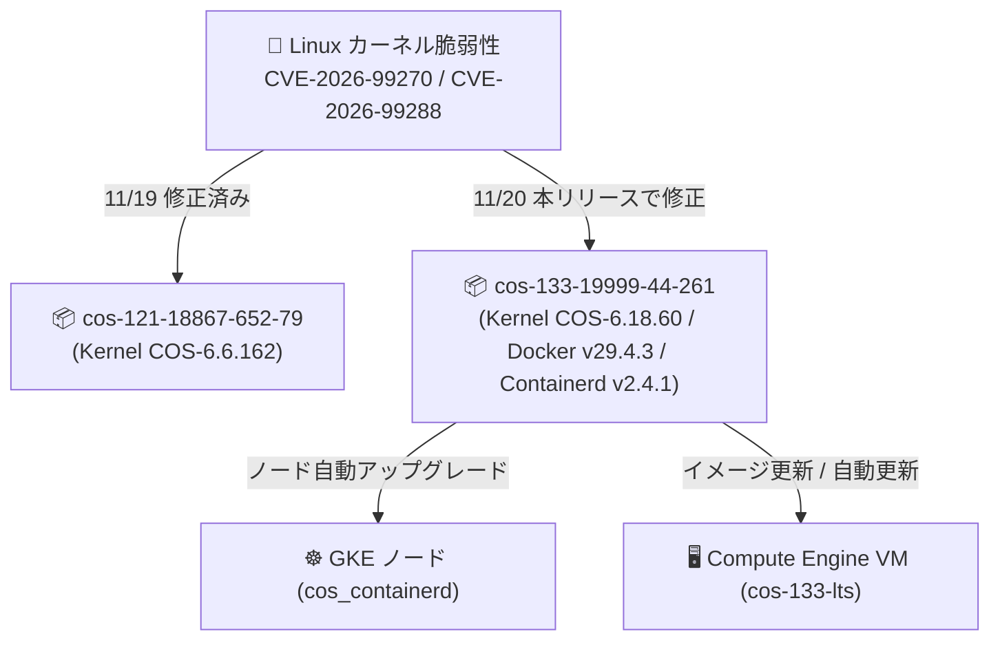

# Container-Optimized OS: cos-133-19999-44-261 リリース (Linux カーネルの CVE 2 件を修正)

**リリース日**: 2026-11-20

**サービス**: Container-Optimized OS

**機能**: cos-133-19999-44-261 リリース (LTS Milestone 133)

**ステータス**: GA (LTS リリース)

📊 [このアップデートのインフォグラフィックを見る](https://takech9203.github.io/google-cloud-news-summary/20261120-container-optimized-os-cos-133-kernel-cve-fixes.html)

## 概要

2026 年 11 月 20 日、Container-Optimized OS (COS) の LTS Milestone 133 系で新しいイメージ `cos-133-19999-44-261` がリリースされました。構成は Kernel COS-6.18.60、Docker v29.4.3、Containerd v2.4.1 で、Linux カーネルの脆弱性 **CVE-2026-99270** と **CVE-2026-99288** の 2 件を修正するセキュリティリリースです。

この 2 件のカーネル CVE は、前日 (11 月 19 日) にリリースされた cos-121 系の `cos-121-18867-652-79` で既に修正されていたものです ([前日のレポート](./2026-11-19-container-optimized-os-cos-121-cos-133-security-updates.md) 参照)。今回のリリースにより、同じカーネル修正が Milestone 133 系にも展開され、両 LTS マイルストーンで修正が揃いました。

Container-Optimized OS は Google Kubernetes Engine (GKE) のノードイメージ (`cos_containerd`) や Compute Engine のコンテナワークロードで使用される、コンテナ実行に最適化されたセキュリティ重視の OS です。GKE Autopilot クラスタは常にこのイメージを使用するため、COS のカーネルセキュリティ修正は GKE 利用者全体に影響する重要なアップデートです。

**アップデート前の課題**

- cos-133 系の直前イメージ (cos-133-19999-44-260) では、Linux カーネルの CVE-2026-99270 / CVE-2026-99288 が未修正のまま残っていた
- 同 2 件は cos-121 系では 11 月 19 日に修正済みであり、Milestone 133 利用者との間で修正状況に差があった

**アップデート後の改善**

- cos-133 系でも Linux カーネルの CVE-2026-99270 / CVE-2026-99288 が修正され、cos-121 系と修正状況が揃った
- GKE ノード (cos_containerd) および Compute Engine 上の COS VM は、本イメージへの更新によりカーネル脆弱性 2 件を解消できる

## アーキテクチャ図



cos-121 で先行して修正されていた 2 件のカーネル CVE が、本リリースで cos-133 系にも展開され、GKE ノードと Compute Engine VM に適用される流れを示しています。

## サービスアップデートの詳細

### 主要機能

1. **cos-133-19999-44-261 (LTS Milestone 133)**
   - Kernel: COS-6.18.60、Docker: v29.4.3、Containerd: v2.4.1
   - Docker / Containerd のバージョンは直前イメージ (cos-133-19999-44-260) から変更なし

2. **Linux カーネルの CVE 修正**
   - CVE-2026-99270 を Linux カーネルで修正
   - CVE-2026-99288 を Linux カーネルで修正
   - いずれも cos-121-18867-652-79 (11 月 19 日) で先行修正されていたカーネル脆弱性で、本リリースにより Milestone 133 にも展開

## 技術仕様

### リリース構成

| 項目 | cos-133-19999-44-261 |
|------|---------------------|
| マイルストーン | 133 (LTS) |
| Kernel | COS-6.18.60 |
| Docker | v29.4.3 |
| Containerd | v2.4.1 |
| イメージファミリー | cos-133-lts / cos-arm64-133-lts |
| リリース日 | 2026-11-20 |

### セキュリティ修正の一覧

| 脆弱性 | 対象コンポーネント | 修正方法 |
|-----|-------------------|---------|
| CVE-2026-99270 | Linux kernel | 修正適用 |
| CVE-2026-99288 | Linux kernel | 修正適用 |

## 設定方法

### 前提条件

1. Container-Optimized OS を GKE ノードイメージまたは Compute Engine VM イメージとして使用していること
2. LTS Milestone 133 (cos-133) 系のイメージを利用していること

### 手順

#### ステップ 1: 現在のイメージバージョンの確認

```bash
# Compute Engine インスタンスの OS バージョン確認 (インスタンス内で実行)
cat /etc/os-release

# GKE ノードプールのノードイメージ確認
gcloud container node-pools describe NODE_POOL_NAME \
  --cluster=CLUSTER_NAME \
  --location=LOCATION \
  --format="value(config.imageType)"
```

#### ステップ 2: 新リリースの適用

```bash
# Compute Engine: 新しい COS イメージの確認
gcloud compute images list --project cos-cloud \
  --filter="family:cos-133-lts"

# Compute Engine: 自動更新を有効化する場合 (Milestone 117 以降はデフォルト無効)
gcloud compute instances add-metadata INSTANCE_NAME \
  --metadata cos-update-strategy=update_enabled
```

COS の自動更新はアクティブ/パッシブのルートパーティション方式で、カーネルを含む OS イメージ全体を更新します。更新はパッシブパーティションにインストールされ、再起動後に有効になります。GKE ノードでは COS の自動更新機能は無効化されており、GKE のノード自動アップグレード機能で更新されます。GKE パッチバージョンと COS ノードイメージの対応は [マッピング JSON](https://www.gstatic.com/gke-image-maps/gke-to-cos.json) で公開されています。

## メリット

### ビジネス面

- **セキュリティリスクの低減**: Linux カーネルの既知脆弱性 2 件が修正され、コンテナ実行基盤のカーネルレイヤーにおける脆弱性リスクが低減される
- **コンプライアンス対応**: 定期的な脆弱性修正の適用により、脆弱性管理ポリシーやセキュリティ監査への対応が容易になる

### 技術面

- **両 LTS マイルストーンでの修正完了**: cos-121 (11/19) に続き cos-133 (11/20) でも同一カーネル CVE が修正され、どちらのマイルストーンを利用していても最新の修正を適用できる
- **変更範囲が限定的**: Docker / Containerd のバージョンは変更されておらず、カーネルのセキュリティ修正に絞ったリリースのため、更新に伴う影響範囲を見積もりやすい

## デメリット・制約事項

### 制限事項

- COS の自動更新は再起動するまで有効にならない (自動更新機能は強制再起動を行わない)
- Milestone 117 以降、COS イメージの自動更新機能はデフォルトで無効のため、スタンドアロン利用時は `cos-update-strategy` メタデータの設定またはイメージの差し替えが必要

### 考慮すべき点

- GKE ノードは GKE のノード自動アップグレードで更新されるため、新リリースが反映されるタイミングは GKE のリリースチャネルに依存する
- カーネルのセキュリティ修正を含むため、カーネル更新に敏感な本番ワークロードでは事前検証を推奨
- CVE-2026-99270 / CVE-2026-99288 の詳細 (深刻度や影響範囲) はリリースノートに記載がないため、必要に応じて NVD などの脆弱性データベースで確認すること

## ユースケース

### ユースケース 1: GKE ノード (cos-133 ベース) のカーネル脆弱性解消

**シナリオ**: セキュリティポリシーで既知 CVE の修正適用期限が定められている組織で、cos_containerd ノードの Linux カーネルに残る CVE-2026-99270 / CVE-2026-99288 を解消したい。

**実装例**:
```bash
# GKE → COS イメージのマッピングを確認し、
# cos-133-19999-44-261 を含む GKE パッチバージョンへアップグレード
gcloud container clusters upgrade CLUSTER_NAME \
  --location=LOCATION \
  --node-pool=NODE_POOL_NAME \
  --cluster-version=GKE_PATCH_VERSION
```

**効果**: ノードのカーネル脆弱性 2 件が解消され、脆弱性スキャンの指摘事項を低減できる。

### ユースケース 2: cos-133-lts を使う Compute Engine VM の定期パッチ適用

**シナリオ**: Compute Engine 上で cos-133-lts イメージファミリーの COS VM を運用しており、カーネルの既知 CVE を速やかに解消したい。

**効果**: イメージを cos-133-19999-44-261 に差し替える (または自動更新を有効化して再起動する) ことで、カーネル脆弱性 2 件が解消される。Docker / Containerd のバージョンは変わらないため、コンテナランタイム互換性の再検証負荷は小さい。

## 料金

Container-Optimized OS 自体のイメージ更新に伴う追加料金はありません。料金は実行する Compute Engine / GKE のリソースに依存します。

- [Compute Engine 料金](https://cloud.google.com/compute/pricing)
- [GKE 料金](https://cloud.google.com/kubernetes-engine/pricing)

## 関連サービス・機能

- **Google Kubernetes Engine (GKE)**: COS は GKE のデフォルトノードイメージ (`cos_containerd`)。Autopilot クラスタは常にこのイメージを使用し、ノード自動アップグレードで新リリースが適用される
- **Compute Engine**: コンテナ実行用 VM イメージとして COS を利用可能。cos-133-lts イメージファミリーで本リリースが提供される
- **Container-Optimized OS 自動更新**: スタンドアロン VM では `cos-update-strategy` メタデータで自動更新を制御できる (Milestone 117 以降はデフォルト無効)

## 参考リンク

- 📊 [インフォグラフィック](https://takech9203.github.io/google-cloud-news-summary/20261120-container-optimized-os-cos-133-kernel-cve-fixes.html)
- [公式リリースノート (Google Cloud)](https://docs.cloud.google.com/release-notes#November_20_2026)
- [COS Milestone 133 リリースノート](https://docs.cloud.google.com/container-optimized-os/docs/release-notes/m133)
- [Container-Optimized OS ドキュメント](https://docs.cloud.google.com/container-optimized-os/docs)
- [COS 自動更新の仕組み](https://docs.cloud.google.com/container-optimized-os/docs/concepts/auto-update)
- [GKE ノードイメージ](https://docs.cloud.google.com/kubernetes-engine/docs/concepts/node-images)
- [前日のレポート: cos-121 / cos-133 セキュリティリリース (2026-11-19)](./2026-11-19-container-optimized-os-cos-121-cos-133-security-updates.md)

## まとめ

本リリースは、cos-121 で先行修正されていた Linux カーネルの CVE-2026-99270 / CVE-2026-99288 を Milestone 133 系にも展開する、カーネル修正に絞ったセキュリティリリースです。cos-133 ベースの GKE ノードや COS VM を運用している場合は、ノード自動アップグレードやイメージ更新を通じて cos-133-19999-44-261 を適用し、カーネル脆弱性を解消することを推奨します。

---

**タグ**: Container-Optimized OS, GKE, Compute Engine, セキュリティ, CVE, LTS, Linux カーネル
