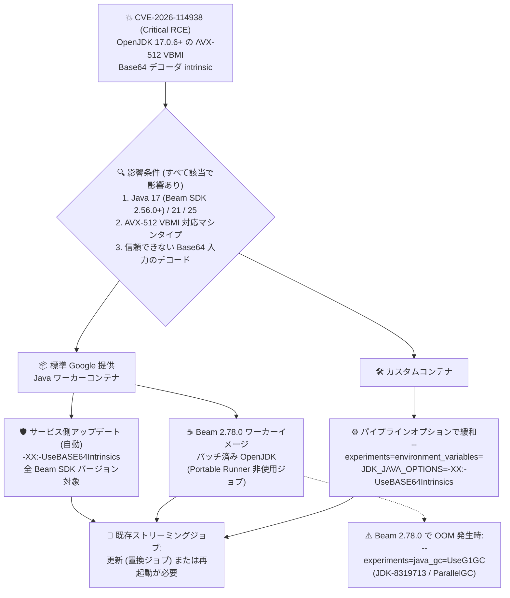

# Dataflow: Java ワーカーセキュリティアップデート (GCP-2026-082 / CVE-2026-114938 対応)

**リリース日**: 2026-11-20

**サービス**: Dataflow

**機能**: サービス側セキュリティアップデート + Apache Beam 2.78.0 ワーカーイメージの OpenJDK パッチ (CVE-2026-114938 対応)

**ステータス**: リリース済み (セキュリティアップデート / Security)

📊 [このアップデートのインフォグラフィックを見る](https://takech9203.github.io/google-cloud-news-summary/20261120-dataflow-java-security-gcp-2026-082.html)

## 概要

2026 年 11 月 20 日、Dataflow は OpenJDK の Critical 脆弱性 **CVE-2026-114938** (セキュリティ速報 **GCP-2026-082**) に対応する 2 段構えのセキュリティアップデートをリリースしました。1 つ目は**サービス側セキュリティアップデート**で、Google 提供の標準 Java 17 / 21 / 25 ワーカーコンテナにおいて、**すべての Apache Beam SDK バージョンを対象に**、脆弱性の原因である HotSpot の Base64 intrinsic を無効化 (`-XX:-UseBASE64Intrinsics`) します。2 つ目は **Apache Beam 2.78.0 ワーカーイメージへのパッチ済み OpenJDK (17.0.21.1+2 / 21.0.13.1+2 / 25.0.5.1+2) の適用**で、Portable Runner を使用しないジョブ (バッチの Non-Portable Runner、ストリーミングの Streaming Java Runner) が対象です。Portable Runner 用と Flex Template ベースイメージのパッチ済み Java 17 / 21 / 25 ワーカーイメージは現在作成中 (in progress) です。

CVE-2026-114938 は、AVX-512 VBMI をサポートする x86-64 プロセッサ上の OpenJDK 17.0.6 以降に存在するリモートコード実行 (RCE) 脆弱性です。HotSpot の AVX-512 VBMI Base64 デコーダ intrinsic における整数アンダーフローにより、不正な形式の Base64 入力 (`Base64.getDecoder()` / `Base64.getUrlDecoder()`) のデコード時にヒープ領域外書き込みが発生し、C2 JIT コンパイラがデコードパスをコンパイルした後、認証不要のリモート攻撃者が JVM プロセス内で任意コードを実行できる可能性があります。Dataflow では Java 17 (Apache Beam SDK 2.56.0 以降)、Java 21、Java 25 のワーカーランタイムが該当します。

重要なのは、**既存のストリーミングジョブはサービス側の JVM オプション更新もパッチ済みワーカーイメージも自動的には取り込まない**点です。保護を適用するには、ストリーミングジョブの更新 (置換ジョブの起動) または再起動が必要です。また、カスタムコンテナを使用するジョブは `environment_variables` experiment によるパイプラインレベルの緩和策を自分で適用する必要があります。

**アップデート前の課題**

- Google 提供の標準 Java ワーカーコンテナ上のジョブも、AVX-512 VBMI 対応マシンタイプ上で未パッチの OpenJDK 17.0.6+ を実行する場合、CVE-2026-114938 の影響を受ける可能性があった
- 恒久対策となるパッチ済み OpenJDK を含むワーカーイメージが提供されていなかった
- GCP-2026-082 の全体ガイダンスでは、Dataflow については「ワーカー JVM に `JDK_JAVA_OPTIONS` 緩和策を適用し、パッチ済みイメージ公開後にジョブを再起動する」という暫定対応のみが案内されていた

**アップデート後の改善**

- サービス側アップデートにより、Google 提供の標準 Java 17 / 21 / 25 ワーカーコンテナでは、すべての Beam SDK バージョンで脆弱な Base64 intrinsic が無効化 (`-XX:-UseBASE64Intrinsics`) されるようになった
- Portable Runner を使用しないジョブ向けに、パッチ済み OpenJDK (17.0.21.1+2 / 21.0.13.1+2 / 25.0.5.1+2) を含む Apache Beam 2.78.0 ワーカーイメージが提供された
- カスタムコンテナやジョブレベルでの明示的な無効化のために、`--experiments="environment_variables=JDK_JAVA_OPTIONS=-XX:-UseBASE64Intrinsics"` という緩和用パイプラインオプションが案内された

## アーキテクチャ図



Dataflow の対応は、標準ワーカーコンテナへのサービス側 intrinsic 無効化と、Beam 2.78.0 イメージへのパッチ済み OpenJDK 適用の 2 系統です。いずれの場合も、既存のストリーミングジョブは更新または再起動しない限り保護が適用されない点が最重要ポイントです。

## サービスアップデートの詳細

### 主要機能

1. **サービス側セキュリティアップデート (全 Beam SDK バージョン対象)**
   - Google 提供の標準 Java 17 / 21 / 25 ワーカーコンテナで、脆弱な HotSpot Base64 intrinsic を無効化 (`-XX:-UseBASE64Intrinsics`)
   - すべての Apache Beam SDK バージョンに適用されるため、SDK をアップグレードできないジョブも新規起動時に保護される

2. **Apache Beam 2.78.0 ワーカーイメージの OpenJDK パッチ**
   - パッチ済み OpenJDK (Java 17: `17.0.21.1+2`、Java 21: `21.0.13.1+2`、Java 25: `25.0.5.1+2`) を適用
   - 対象は Portable Runner を使用しないジョブ (バッチ: Non-Portable Runner、ストリーミング: Streaming Java Runner)
   - Portable Runner 用および Flex Template ベースイメージのパッチ済みワーカーイメージは作成中 (in progress)

3. **カスタムコンテナ / ジョブレベル向けの緩和用パイプラインオプション**
   - `--experiments="environment_variables=JDK_JAVA_OPTIONS=-XX:-UseBASE64Intrinsics"` で Base64 intrinsic をジョブレベルで明示的に無効化
   - Classic Template / Flex Template では `--additional-experiments` (REST API では `additionalExperiments`) で同じ値を指定
   - 緩和の有効化はワーカーログの `Picked up JDK_JAVA_OPTIONS: -XX:-UseBASE64Intrinsics` で確認可能

4. **既存ストリーミングジョブへの適用ガイダンス**
   - 既存のストリーミングジョブはサービス側 JVM オプション更新もパッチ済みワーカーイメージも自動取得しない
   - サービス側アップデートまたは `environment_variables` パイプラインオプションを適用するには、ストリーミングジョブの更新 (置換ジョブの起動) または再起動が必要

## 技術仕様

### CVE-2026-114938 の概要 (Dataflow 観点)

| 項目 | 詳細 |
|------|------|
| CVE ID | CVE-2026-114938 |
| 深刻度 | Critical |
| 脆弱性の種類 | 整数アンダーフローによるヒープ領域外書き込み → リモートコード実行 (RCE) |
| 発生箇所 | OpenJDK HotSpot の AVX-512 VBMI Base64 デコーダ intrinsic (`UseAVX=3` 有効時) |
| トリガー | 不正な形式の標準 / URL-safe Base64 入力のデコード (`Base64.getDecoder()` / `Base64.getUrlDecoder()`) |
| Dataflow で影響を受けるランタイム | Java 17 (Apache Beam SDK 2.56.0 以降)、Java 21、Java 25 (影響を受ける Java SDK ハーネスを使う多言語パイプラインを含む) |
| Dataflow で影響を受けないランタイム | Java 8、Java 11、Java 17 (Apache Beam SDK 2.56.0 より前) |

### 影響を受けるマシンタイプ

パイプラインが影響を受けるのは、以下の **3 条件がすべて** 当てはまる場合のみです。

1. ワーカーが未パッチの OpenJDK 17.0.6 以降を実行している (Java 17 + Beam SDK 2.56.0 以降、Java 21、Java 25)
2. ワーカー VM が AVX-512 VBMI 対応の x86-64 プロセッサで稼働している
3. ワーカーコード (カスタム変換、サードパーティ依存関係、テンプレートなど) が `java.util.Base64.getDecoder()` / `getUrlDecoder()` で信頼できない Base64 / Base64URL 入力をデコードしている

| 分類 | マシンタイプ |
|------|-------------|
| 影響あり (AVX-512 VBMI 対応) | N2 (Ice Lake)、N4、N4D、C3、C3D、C4、C4D、C4N、M3、M4、M4N、A3、A4、G4、H3、H4D、X4、X5、Z3、Z4D、Z4M |
| 影響なし (Dataflow デフォルト) | E2、N1 |
| 影響なし (Arm ベース) | T2A、C4A、N4A |
| 影響なし (AVX-512 VBMI 非対応の x86-64) | N2D、C2、C2D、T2D |

**補足**: Flex Template のランチャー VM はデフォルトで影響のないマシンタイプ (E2 や N1 など) を使用しますが、ランチャーのマシンタイプを上書きしている場合や、デフォルトマシンタイプが利用できず AVX-512 VBMI 対応マシンタイプへフォールバックした場合は影響を受ける可能性があります。

また、Apache Beam Java SDK のサポート対象コンポーネント (`beam-sdks-java-core`、`beam-sdks-java-io-google-cloud-platform`、`beam-sdks-java-io-kafka`) の検査により、**Beam のファーストパーティ変換はパイプライン要素データに対して脆弱なコードパスを使用していない**ことが確認されています。自作の変換、サードパーティ依存関係、テンプレートについては、各自で露出の有無を確認する必要があります。

### パッチ済み OpenJDK バージョン (Apache Beam 2.78.0 ワーカーイメージ)

| Java バージョン | パッチ済み OpenJDK |
|-----------------|---------------------|
| Java 17 | 17.0.21.1+2 |
| Java 21 | 21.0.13.1+2 |
| Java 25 | 25.0.5.1+2 |

### 構成別の対応状況

| 構成 | 対応状況 |
|------|---------|
| 標準 Google 提供 Java ワーカーコンテナ (全 Beam SDK バージョン) | サービス側アップデートで Base64 intrinsic を無効化 (`-XX:-UseBASE64Intrinsics`) |
| Beam 2.78.0 + Portable Runner 非使用 (Non-Portable Runner / Streaming Java Runner) | パッチ済み OpenJDK 適用済みワーカーイメージを提供 |
| Portable Runner 用ワーカーイメージ / Flex Template ベースイメージ | パッチ済みイメージは作成中 (in progress) |
| カスタムコンテナ | `environment_variables` experiment による緩和策の適用が必要 |
| 既存ストリーミングジョブ | 更新 (置換ジョブ) または再起動で適用 |

## 設定方法

### 前提条件

1. 影響条件の確認: Java 17 (Beam SDK 2.56.0+) / 21 / 25 ランタイム、AVX-512 VBMI 対応マシンタイプ、ワーカーコードでの信頼できない Base64 入力のデコード、の 3 条件に該当するジョブを特定していること
2. 対象プロジェクトでの Dataflow ジョブの起動・更新権限があること

### 手順

#### ステップ 1: カスタムコンテナ使用ジョブ (またはジョブレベルで明示的に無効化したい場合) に緩和オプションを設定する

```bash
# 通常のパイプライン起動時
--experiments="environment_variables=JDK_JAVA_OPTIONS=-XX:-UseBASE64Intrinsics"

# Classic Template / Flex Template を gcloud CLI で起動する場合
--additional-experiments="environment_variables=JDK_JAVA_OPTIONS=-XX:-UseBASE64Intrinsics"
```

REST API では `additionalExperiments` に同じ値を指定します。緩和が有効になっていることは、ワーカーログに次のようなエントリが出力されることで確認できます。

```
Picked up JDK_JAVA_OPTIONS: -XX:-UseBASE64Intrinsics
```

#### ステップ 2: 既存のストリーミングジョブを更新または再起動する

```bash
# 置換ジョブの起動 (ジョブの更新) — Java パイプラインの例
--update --jobName=EXISTING_JOB_NAME
```

既存のストリーミングジョブはサービス側 JVM オプション更新やパッチ済みワーカーイメージを自動的に取り込みません。サービス側アップデートや `environment_variables` パイプラインオプションを適用するには、[ストリーミングジョブの更新](https://docs.cloud.google.com/dataflow/docs/guides/updating-a-pipeline) (置換ジョブの起動) またはジョブの再起動を実施します。

#### ステップ 3: (恒久対策) Apache Beam 2.78.0 へアップグレードし、必要に応じて GC を調整する

```bash
# パッチ済み OpenJDK で OOM が発生した場合 (JDK-8319713 / ParallelGC) は G1 GC を使用
--experiments=java_gc=UseG1GC
```

Portable Runner を使用しないジョブは、Apache Beam 2.78.0 へのアップグレードでパッチ済み OpenJDK を含むワーカーイメージを取得できます。アップグレード後に ParallelGC に影響する JDK-8319713 に起因する OOM エラーが発生した場合は、`--experiments=java_gc=UseG1GC` で G1 ガベージコレクタを構成します。

## メリット

### ビジネス面

- **Critical 脆弱性への迅速な保護**: サービス側アップデートが全 Beam SDK バージョンの標準ワーカーコンテナに適用されるため、SDK アップグレードを待たずに新規起動ジョブが保護される
- **影響範囲の明確化による対応工数の削減**: 3 条件 (ランタイム / マシンタイプ / コードパス) による影響判定基準が明示されており、デフォルトの E2 / N1 ワーカーや Java 8 / 11 のジョブは対応不要と切り分けられる

### 技術面

- **intrinsic 無効化とパッチ済み JDK の 2 段構え**: サービス側の `-XX:-UseBASE64Intrinsics` による即時緩和と、Beam 2.78.0 イメージのパッチ済み OpenJDK による恒久対策の両方が提供される
- **ファーストパーティ Beam 変換の安全性確認済み**: `beam-sdks-java-core` などの主要コンポーネントがパイプライン要素データに対して脆弱なコードパスを使わないことが検査で確認されており、調査対象をカスタムコードに絞れる

## デメリット・制約事項

### 制限事項

- パッチ済み OpenJDK を含むワーカーイメージは Apache Beam 2.78.0 のみで、かつ Portable Runner を使用しないジョブ (Non-Portable Runner / Streaming Java Runner) に限定される
- Portable Runner 用ワーカーイメージと Flex Template ベースイメージのパッチ版は作成中 (in progress) であり、現時点では提供されていない
- カスタムコンテナはサービス側アップデートの対象外で、`environment_variables` experiment による緩和策を自分で適用する必要がある

### 考慮すべき点

- **既存のストリーミングジョブは何もしなければ保護されない**。サービス側アップデート / パイプラインオプションの適用には、ジョブの更新 (置換ジョブ) または再起動が必須
- Beam 2.78.0 + パッチ済み OpenJDK へのアップグレード後、JDK-8319713 (ParallelGC への影響) により OOM エラーが発生する場合がある。その際は `--experiments=java_gc=UseG1GC` で G1 GC を構成する
- Flex Template のランチャー VM は、マシンタイプを上書きしている場合やデフォルトマシンタイプが利用できずフォールバックした場合に影響を受ける可能性があるため、構成の確認が必要
- `-XX:-UseBASE64Intrinsics` は Base64 デコードの intrinsic 最適化を無効化する緩和策であり、恒久対策はパッチ済み OpenJDK を含むイメージへの移行である

## ユースケース

### ユースケース 1: カスタムコンテナを使うストリーミングパイプラインの緊急対応

**シナリオ**: C3 マシンタイプ上でカスタムコンテナを使用し、外部システムから受信したメッセージに含まれる Base64 データをカスタム変換でデコードしている長期稼働ストリーミングジョブを運用している。

**実装例**:
```bash
# 緩和オプション付きの置換ジョブを起動してジョブを更新
mvn compile exec:java -Dexec.args="... \
  --update --jobName=EXISTING_JOB_NAME \
  --experiments=environment_variables=JDK_JAVA_OPTIONS=-XX:-UseBASE64Intrinsics"
```

**効果**: 3 条件すべてに該当する高リスク構成に対し、ジョブ更新 1 回で Base64 intrinsic の無効化を適用できる。ワーカーログの `Picked up JDK_JAVA_OPTIONS` エントリで適用を確認できる。

### ユースケース 2: 影響範囲の棚卸しによる対応優先順位付け

**シナリオ**: 多数の Dataflow ジョブを運用する組織が、CVE-2026-114938 への対応要否をジョブごとに判定したい。

**効果**: デフォルトの E2 / N1 ワーカーや Arm ベース VM、Java 8 / 11、Beam SDK 2.56.0 より前の Java 17 のジョブは影響なしと即座に除外でき、AVX-512 VBMI 対応マシンタイプ + Java 17 (Beam 2.56.0+) / 21 / 25 + 信頼できない Base64 入力をデコードするカスタムコードを持つジョブに対応を集中できる。

## 料金

本セキュリティアップデートの適用自体に追加料金は発生しません。ジョブの更新 (置換ジョブの起動) や再起動に伴うリソース使用には、通常の Dataflow 料金が適用されます。

- Dataflow 料金ページ: https://cloud.google.com/dataflow/pricing

## 関連サービス・機能

- **Apache Beam 2.78.0**: パッチ済み OpenJDK (17.0.21.1+2 / 21.0.13.1+2 / 25.0.5.1+2) を含むワーカーイメージが提供される SDK バージョン (Portable Runner 非使用ジョブ向け)
- **Dataflow ストリーミングジョブの更新**: サービス側アップデートの適用に必要な置換ジョブの起動・再起動の手順 ([パイプラインの更新ガイド](https://docs.cloud.google.com/dataflow/docs/guides/updating-a-pipeline))
- **Dataflow Portable Runner / Flex Template**: パッチ済みワーカーイメージ・ベースイメージが作成中の構成。公開され次第、GCP-2026-082 速報が更新される
- **App Engine / Cloud Run / Buildpacks**: 同じ GCP-2026-082 / CVE-2026-114938 への対応として、サーバーレス系サービスではパッチ済み Java ランタイムのロールアウトが同日完了済み (関連レポート: [2026-11-20 サーバーレス Java ランタイムセキュリティアップデート](./2026-11-20-serverless-java-runtime-security-gcp-2026-082.md))
- **Dataproc**: GCP-2026-082 の全体速報では Dataflow と並んで言及されており、パッチ済み Java 17 / 21 / 25 ワーカーイメージの提供が進行中
- **Artifact Analysis / Security Command Center**: 脆弱性フィードの更新に伴い CVE-2026-114938 の通知を受け取れる

## 参考リンク

- 📊 [インフォグラフィック](https://takech9203.github.io/google-cloud-news-summary/20261120-dataflow-java-security-gcp-2026-082.html)
- [公式リリースノート (2026 年 11 月 20 日)](https://docs.cloud.google.com/release-notes#November_20_2026)
- [Dataflow セキュリティ速報 GCP-2026-082](https://docs.cloud.google.com/dataflow/docs/security-bulletins#gcp-2026-082)
- [Google Cloud 全体のセキュリティ速報 GCP-2026-082](https://cloud.google.com/support/bulletins#gcp-2026-082)
- [既存パイプラインの更新 (置換ジョブの起動)](https://docs.cloud.google.com/dataflow/docs/guides/updating-a-pipeline)
- [Dataflow のメモリ不足エラーのトラブルシューティング (Java GC の変更)](https://docs.cloud.google.com/dataflow/docs/guides/troubleshoot-oom)
- [Dataflow Portable Runner](https://docs.cloud.google.com/dataflow/docs/portable-runner)
- [料金ページ](https://cloud.google.com/dataflow/pricing)

## まとめ

Dataflow は CVE-2026-114938 (Critical / RCE) に対し、標準 Java ワーカーコンテナへのサービス側 Base64 intrinsic 無効化 (全 Beam SDK バージョン対象) と、Apache Beam 2.78.0 ワーカーイメージへのパッチ済み OpenJDK 適用 (Portable Runner 非使用ジョブ向け) をリリースしました。最も重要なアクションは、**既存のストリーミングジョブの更新または再起動**と、**カスタムコンテナ使用ジョブへの `environment_variables` 緩和オプションの適用**です。影響判定は「Java 17 (Beam 2.56.0+) / 21 / 25 + AVX-512 VBMI 対応マシンタイプ + 信頼できない Base64 入力のデコード」の 3 条件で行い、該当するジョブから優先的に対応してください。

---

**タグ**: Dataflow, Apache Beam, セキュリティ, CVE-2026-114938, GCP-2026-082, Java, OpenJDK, リモートコード実行, ストリーミング, セキュリティアップデート
