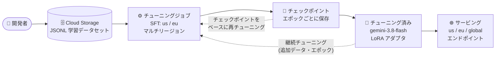

# Gemini Enterprise Agent Platform: Gemini 3.8 Flash の教師ありファインチューニングが GA

**リリース日**: 2026-11-20

**サービス**: Gemini Enterprise Agent Platform

**機能**: Gemini 3.8 Flash (gemini-3.8-flash) の教師ありファインチューニング (Supervised Fine-Tuning)、継続チューニング (Continuous Tuning)、チューニングチェックポイント

**ステータス**: GA (一般提供)

📊 [このアップデートのインフォグラフィックを見る](https://takech9203.github.io/google-cloud-news-summary/20261120-gemini-3-8-flash-supervised-fine-tuning-ga.html)

## 概要

Gemini Enterprise Agent Platform において、Gemini 3.8 Flash (`gemini-3.8-flash`) に対する教師ありファインチューニング (Supervised Fine-Tuning、SFT)、継続チューニング (Continuous Tuning)、チューニングチェックポイント (Tuning Checkpoints) が一般提供 (GA) になりました。

Gemini 3.8 Flash は、長時間にわたるソフトウェアエンジニアリング、自律エージェント、複雑なエンタープライズワークフロー向けに設計された最新の Flash モデルで、100 万トークン超 (1,048,576) のコンテキストウィンドウと最大 65,536 の出力トークンをサポートします。今回の GA により、ラベル付きデータセットを使ってこの最新 Flash モデルをドメイン固有タスクに適応させる本番利用が可能になりました。

チューニングジョブは `us` および `eu` のマルチリージョンエンドポイントで実行でき、チューニング済みモデルの提供 (サービング) は `us`・`eu` マルチリージョンエンドポイントに加えて `global` エンドポイントでも可能です。対象ユーザーは、分類・要約・抽出型質問応答・チャットなど、明確に定義されたタスクでラベル付きデータを保有し、最新 Flash モデルの性能をタスク特化で引き出したい企業・開発者です。

**アップデート前の課題**

- 最新モデルである Gemini 3.8 Flash はチューニングが GA ではなく、ファインチューニングを本番利用する場合は Gemini 3.5 Flash など旧世代のモデルを選択する必要があった
- 最新モデルの汎用性能とチューニングによるタスク特化を両立できなかった

**アップデート後の改善**

- Gemini 3.8 Flash を基盤モデルとして、教師ありファインチューニングを GA (本番品質) で実行できるようになった
- 継続チューニングにより、チューニング済みモデルやチェックポイントを基点に追加のエポックやデータで再チューニングでき、効率的なチューニング実験が可能になった
- チューニングチェックポイントにより、エポックごとの学習進捗を保存して性能を比較し、最適なチェックポイントを選択できるようになった
- チューニング済みモデルを `global` エンドポイントでも提供できるようになり、グローバルな推論構成に組み込めるようになった

## アーキテクチャ図



Cloud Storage 上の JSONL データセットを入力として `us`/`eu` マルチリージョンでチューニングジョブを実行し、エポックごとのチェックポイントから最適なモデルを選択して `us`/`eu`/`global` エンドポイントで提供します。チューニング済みモデルやチェックポイントは継続チューニングの基盤モデルとして再利用できます。

## サービスアップデートの詳細

### 主要機能

1. **教師ありファインチューニング (SFT) の GA**
   - ラベル付きデータセットでモデルの重み (LoRA アダプタ) を調整し、予測とラベルの差を最小化
   - 分類、要約、抽出型質問応答、チャットなどのタスク性能改善に有効
   - テキスト、画像、音声、動画、ドキュメントの各データタイプに対応 (詳細はデータセット準備ドキュメントを参照)

2. **継続チューニング (Continuous Tuning)**
   - チューニング済みモデルまたはチェックポイントをベースモデルとして、追加のエポックや学習データでさらにチューニング (SFT → SFT)
   - 学習不足 (underfitting) の解消、新しいデータによるモデルの最新化、既存チューニング済みモデルのさらなるカスタマイズに活用
   - Google Gen AI SDK でサポート (Agent Platform SDK for Python は非対応)

3. **チューニングチェックポイント (Tuning Checkpoints)**
   - SFT ではエポックごとにチューニングの進捗を保存
   - チェックポイント間の性能を比較し、最も性能の良いチェックポイントを選択可能
   - `Export last checkpoint only` の設定で中間チェックポイントを無効化し、最終チェックポイントのみエクスポートすることも可能

4. **マルチリージョン / グローバルエンドポイント対応**
   - チューニングジョブの実行: `us` および `eu` マルチリージョンエンドポイント
   - チューニング済みモデルの提供: `us`・`eu` マルチリージョンエンドポイントおよび `global` エンドポイント

## 技術仕様

### Gemini 3.8 Flash モデル仕様 (チューニング関連)

| 項目 | 詳細 |
|------|------|
| モデル ID | `gemini-3.8-flash` |
| コンテキストウィンドウ | 1,048,576 トークン |
| 最大出力トークン | 65,536 トークン |
| チューニング | 教師ありファインチューニング対応 |
| Thinking | 対応 (チューニング時は thinking level を `MINIMAL` に設定することを推奨) |
| チューニングジョブ実行エンドポイント | `us`、`eu` マルチリージョン |
| チューニング済みモデルの提供エンドポイント | `us`、`eu` マルチリージョン、`global` |

### Thinking とチューニングの関係

Thinking に対応するモデルでは、Gemini 3 以降のモデルの場合 thinking level を `MINIMAL` に設定することで、チューニング済みタスクの性能向上とコスト削減が期待できます。教師ありファインチューニング中、モデルは学習データから学習し思考プロセスを省略するため、チューニング済みモデルは思考バジェットがほぼゼロでもタスクを効果的に実行できます。多段階推論能力そのものをチューニングしたい場合は、強化学習ファインチューニング (RLFT) の利用が案内されています。

### リージョンとデータの扱い

- 変換後のデータセットやチューニング済みモデルなどのユーザーデータは、チューニングジョブのリージョンに保存される
- チューニング中の計算は、利用可能なアクセラレータ確保のため US または EU 内の他リージョンへ透過的にオフロードされることがある
- `global` リージョンは CMEK (顧客管理の暗号鍵) および Data Residency Zones (DRZ) に非対応。global モデルのチューニング済みアダプタは US リージョンに保存される (Cloud Storage に global バケットロケーションがないため)

## 設定方法

### 前提条件

1. ユースケース (テキスト、画像、音声、動画、ドキュメント、関数呼び出し) に応じた JSONL 形式の教師ありファインチューニング用データセットを準備し、Cloud Storage に配置する
2. Gemini 3 以降のモデルのチューニングジョブ作成は Google Gen AI SDK または REST API を使用する (Google Cloud コンソールからのジョブ作成は Gemini 2.5 以前のモデルのみ対応)

### 手順

#### ステップ 1: リージョンの指定 (Google Gen AI SDK)

```bash
export GOOGLE_CLOUD_PROJECT=PROJECT_ID
export GOOGLE_CLOUD_LOCATION=us   # または eu
export GOOGLE_GENAI_USE_ENTERPRISE=True
```

Google Gen AI SDK では環境変数 `GOOGLE_CLOUD_LOCATION` でチューニングジョブのリージョンを指定します。

#### ステップ 2: チューニングジョブの作成 (REST / Gemini 3 以降)

```bash
# Gemini 3 以降のモデルのエンドポイント形式
POST https://aiplatform.TUNING_JOB_REGION.rep.googleapis.com/v1/projects/PROJECT_ID/locations/TUNING_JOB_REGION/tuningJobs
```

`TUNING_JOB_REGION` にジョブを実行するリージョン (`us` または `eu`) を指定します。Gemini 2.5 以前とはエンドポイントの URL 形式が異なる点に注意してください。

#### ステップ 3: 継続チューニング (チューニング済みモデルの再チューニング)

```python
from google import genai
from google.genai.types import (
    HttpOptions, TuningDataset, CreateTuningJobConfig,
)

client = genai.Client(http_options=HttpOptions(api_version="v1beta1"))

tuning_job = client.tunings.tune(
    base_model=tuned_model_name,  # チューニング済みモデルのリソース名
    training_dataset=TuningDataset(gcs_uri="gs://BUCKET/sft_train_data.jsonl"),
    config=CreateTuningJobConfig(
        tuned_model_display_name="continued tuning job",
        pre_tuned_model_checkpoint_id=checkpoint_id,  # 省略時はデフォルトチェックポイント
    ),
)
```

モデルリソース名は `projects/{project}/locations/{location}/models/{modelId}@{version_id}` 形式で指定します。チェックポイント ID を省略した場合はデフォルトのチェックポイントが使用されます。

## メリット

### ビジネス面

- **最新 Flash モデルのタスク特化**: 最も高性能な Flash モデルをドメイン固有のタスクに適応させ、汎用モデルでは届かない精度を GA 品質で実現できる
- **チューニング資産の継続活用**: 継続チューニングにより、過去のチューニング済みモデルを捨てずに新しいデータで更新でき、学習コストを抑えられる

### 技術面

- **チェックポイントによる最適モデル選択**: エポックごとのチェックポイントを比較して過学習前の最適な時点を選べるため、チューニングの試行錯誤が効率化される
- **グローバル提供**: チューニング済みモデルを `global` エンドポイントで提供でき、リージョンを跨ぐ推論構成に組み込みやすい
- **思考プロセスの省略による推論コスト削減**: チューニング済みモデルは thinking level `MINIMAL` でもタスクを効果的に実行できるため、推論コストを抑えられる

## デメリット・制約事項

### 制限事項

- 教師ありファインチューニングは Covered Service ではなく、SLA の SLO 対象外
- チューニングジョブの実行は `us`・`eu` マルチリージョンエンドポイントのみ (単一リージョン指定は不可)
- `global` リージョンは CMEK・DRZ に非対応。global モデルのチューニング済みアダプタは US リージョンに保存される
- Google Cloud コンソールからのチューニングジョブ作成は Gemini 2.5 以前のモデルのみ対応 (Gemini 3 以降は SDK / REST API を使用)
- 同時実行チューニングジョブ数にはグローバルクォータ (`Global concurrent tuning jobs`) が適用される (デフォルトで最低 1 ジョブ)

### 考慮すべき点

- チューニング済みモデルへの推論リクエストで Controlled Generation (構造化出力の強制) を適用すると、チューニング時と推論時のデータ不整合によりモデル品質が低下する既知の問題がある。SFT 自体が構造化出力の生成をカスタマイズするため、チューニング済みモデルには Controlled Generation を適用しないことが推奨される
- 継続チューニングで CMEK を使用する場合、事前チューニング済みモデルのチューニングジョブと同じ CMEK を使用する必要がある
- 継続チューニングのベースにできるのは、2025 年 7 月 11 日以降にチューニングされた SFT ベースモデルのみ

## ユースケース

### ユースケース 1: ドメイン特化タスクの精度向上

**シナリオ**: 金融・医療など、ベースモデルの学習データと大きく異なる専門用語・文書形式を扱う分類・要約・抽出型質問応答タスクで、プロンプトエンジニアリングだけでは目標精度に届かない。

**効果**: ラベル付きデータセットで Gemini 3.8 Flash をチューニングすることで、ドメイン固有のタスク性能を改善。チューニング済みモデルは思考プロセスを省略して動作するため、推論コストも抑制できる。

### ユースケース 2: チューニング済みモデルの継続的な更新運用

**シナリオ**: 既にチューニング済みのモデルを本番運用しているが、新しいデータが継続的に蓄積されており、モデルを最新状態に保ちたい。

**効果**: 継続チューニングにより、ゼロから再チューニングせずにチューニング済みモデル (またはチェックポイント) へ追加データ・追加エポックを適用でき、モデルの鮮度維持と学習コスト削減を両立できる。

## 料金

教師ありファインチューニングの料金は [Gemini Enterprise Agent Platform の料金ページ (Model tuning)](https://cloud.google.com/model-garden/pricing#model-tuning) に記載されています。

- 学習トークン数は「学習データセットのトークン数 × エポック数」で計算される
- チューニング後も、チューニング済みモデルへの推論 (予測リクエスト) 料金は別途発生する。推論料金は Gemini の各 stable バージョンと同一

## 利用可能リージョン

| 用途 | 利用可能なエンドポイント |
|------|--------------------------|
| チューニングジョブの実行 | `us`、`eu` マルチリージョンエンドポイント |
| チューニング済みモデルの提供 | `us`、`eu` マルチリージョンエンドポイント、`global` エンドポイント |

## 関連サービス・機能

- **Cloud Storage**: JSONL 形式の学習・検証データセットの保存先。チューニング済みアダプタの保存にも使用される
- **Gen AI evaluation service**: チューニングジョブに評価設定 (evaluationConfig) を組み込み、チューニング完了後に自動評価を実行可能 (Preview、Gemini 2.5 系モデル対象)
- **強化学習ファインチューニング (RLFT)**: 多段階推論能力をチューニングしたい場合の選択肢。SFT チェックポイントの上に RLFT を適用する継続チューニング (SFT → RLFT) も可能
- **Model Registry**: チューニング済みモデルのバージョンとチェックポイントの管理・確認に使用

## 参考リンク

- 📊 [インフォグラフィック](https://takech9203.github.io/google-cloud-news-summary/20261120-gemini-3-8-flash-supervised-fine-tuning-ga.html)
- [公式リリースノート](https://docs.cloud.google.com/release-notes#November_20_2026)
- [About supervised fine-tuning for Gemini models](https://docs.cloud.google.com/gemini-enterprise-agent-platform/models/tuning/supervised-tuning)
- [Tune Gemini models with supervised fine-tuning](https://docs.cloud.google.com/gemini-enterprise-agent-platform/models/tuning/supervised-tuning/use)
- [About continuous tuning for Gemini models](https://docs.cloud.google.com/gemini-enterprise-agent-platform/models/tuning/continuous-tuning)
- [Use checkpoints in Gemini tuning](https://docs.cloud.google.com/gemini-enterprise-agent-platform/models/tuning/checkpoints)
- [Gemini 3.8 Flash モデルページ](https://docs.cloud.google.com/gemini-enterprise-agent-platform/models/gemini/3-8-flash)
- [料金ページ (Model tuning)](https://cloud.google.com/model-garden/pricing#model-tuning)

## まとめ

最新の Gemini 3.8 Flash に対する教師ありファインチューニング・継続チューニング・チューニングチェックポイントが GA となり、最新 Flash モデルのタスク特化を本番品質で行えるようになりました。既存のチューニング済みモデルを運用中のチームは、Gemini 3.8 Flash をベースにした再チューニングと、チェックポイント比較による最適モデル選択の導入を検討することを推奨します。Gemini 3 以降はジョブ作成がコンソール非対応 (SDK / REST のみ) で、エンドポイント URL 形式も変更されている点に注意してください。

---

**タグ**: Gemini Enterprise Agent Platform, Gemini 3.8 Flash, Supervised Fine-Tuning, Continuous Tuning, Tuning Checkpoints, GA, 生成 AI, モデルチューニング
