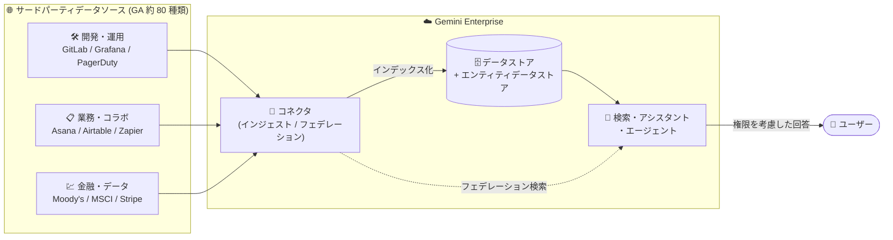

# Gemini Enterprise: サードパーティデータストア約 80 種類が GA

**リリース日**: 2026-11-20

**サービス**: Gemini Enterprise

**機能**: サードパーティデータストア (約 80 種類) の一般提供開始

**ステータス**: GA (一般提供)

📊 [このアップデートのインフォグラフィックを見る](https://takech9203.github.io/google-cloud-news-summary/20261120-gemini-enterprise-third-party-data-stores-ga.html)

## 概要

Gemini Enterprise において、AirOps、Airtable、Asana、GitLab、Grafana、Hugging Face、Linear、Moody's、MSCI、PagerDuty、Sourcegraph、Stripe、Zapier など約 80 種類のサードパーティデータストアが一般提供 (GA) になりました。これにより、組織はこれらの外部アプリケーション・データソースを Gemini Enterprise に接続し、エンタープライズ検索やエージェントのグラウンディング (回答根拠) として本番環境で利用できます。

Gemini Enterprise のコネクタは、サードパーティアプリケーションのデータをデータストアとして取り込み (インジェスト/インデックス化)、またはデータソースを直接参照するフェデレーション方式で接続します。接続するとデータソースごとにデータストアが作成され、エンティティ (例: Jira Cloud の issue、attachment、comment など) ごとにエンティティデータストアが関連付けられます。

今回の GA 対象は、開発者ツール、プロジェクト管理、金融・マーケットデータ、法務、CRM・カスタマーサポート、旅行・ライフスタイルサービスまで幅広い業種をカバーしており、Gemini Enterprise のコネクタエコシステムが大幅に拡充されました。

**アップデート前の課題**

- 多くのサードパーティデータソースは GA 前のステータスであり、本番ワークロードでの採用判断が難しかった
- 社内ナレッジが多数の SaaS アプリケーションに分散し、Gemini Enterprise から横断的に参照できる対象が限られていた
- 業種特化型データ (金融マーケットデータ、法務ドキュメント管理など) を AI アシスタントのグラウンディングに組み込む公式な手段が限られていた

**アップデート後の改善**

- 約 80 種類のサードパーティデータストアが GA となり、本番環境で安心して利用できるようになった
- 開発・運用 (GitLab、Grafana、PagerDuty、Sourcegraph)、金融 (Moody's、MSCI、S&P Global、FactSet)、法務 (iManage、NetDocuments、Relativity) など、業種・職種特化のデータソースを公式コネクタで接続できるようになった
- `discoveryengine.managed.allowedDataSources` 組織ポリシーで利用可能なデータソースを統制しつつ、エコシステム全体を活用できるようになった

## アーキテクチャ図

サードパーティデータソースはコネクタ経由で Gemini Enterprise に接続され、インジェスト (インデックス化) の場合はデータストアに取り込まれ、フェデレーションの場合はクエリ時にデータソースへ直接問い合わせます。ユーザーにはアクセス権限を考慮した検索結果・回答が返されます。

## サービスアップデートの詳細

### 主要機能

1. **約 80 種類のサードパーティデータストアが GA**
   - 今回 GA になったデータストアの一覧 (リリースノートより): AirOps、Airtable、Aiwyn Tax、AllTrails、Apollo GraphOS、Asana、Atlan、Attio、Autodesk Product Help、AWS Marketplace、Blockscout、Calendly、Campfire、Cisco Workspaces、Cohesity、CoinDesk、Courtroom5、Crossbeam、Crypto、D&B Commercial Graph、D&B Finance Analytics、Daloopa、Descript、DirectBooker、Egnyte、Excalidraw、FactSet AI-Ready Data、Fibery、Finnhub、Freshservice、Fullstory、GitLab、Globalping、Google Compute Engine、Google Stitch、Grafana、Granted、Guru、Hex、Hugging Face、iManage platform、Intercom、Kiwi.com、Linear、LumApps、Mercury、Microsoft Learn、Midpage、Moody's、MSCI、NetDocuments、Omni Analytics、Open Targets、PagerDuty、Pendo、pg-aiguide、Pylon、Ramp、Relativity、S&P Global - Deterministic Retrieval、Sanity、ServiceM8、Solve Intelligence、Sourcegraph、Squarespace、Starburst、Streak、Stripe、Supermetrics、SurveyMonkey、Taskrabbit、Tavily、Trivago、Twilio Docs、Vanta、Viator、Webex Meetings、Windsor.ai、Wix、Zapier、Zoho Desk、Zoho Projects

2. **幅広い業種・職種をカバーするカテゴリ構成**

   | カテゴリ (参考分類) | 代表的なデータストア |
   |------|------|
   | 開発者ツール・運用 | GitLab、Sourcegraph、Grafana、PagerDuty、Linear、Apollo GraphOS、Hugging Face、Twilio Docs、Microsoft Learn、Google Compute Engine |
   | プロジェクト管理・コラボレーション | Asana、Airtable、Fibery、Zoho Projects、Calendly、Webex Meetings、Cisco Workspaces、LumApps、Guru |
   | 金融・マーケットデータ | Moody's、MSCI、S&P Global - Deterministic Retrieval、FactSet AI-Ready Data、D&B Commercial Graph、D&B Finance Analytics、Daloopa、Finnhub、CoinDesk、Stripe、Ramp、Mercury |
   | 法務・コンプライアンス | iManage platform、NetDocuments、Relativity、Courtroom5、Midpage、Solve Intelligence、Vanta |
   | CRM・サポート・マーケティング | Attio、Streak、Intercom、Pylon、Zoho Desk、Freshservice、Pendo、Fullstory、SurveyMonkey、Supermetrics、Windsor.ai、Crossbeam、Squarespace、Wix |
   | データ分析・カタログ | Hex、Omni Analytics、Starburst、Atlan、Tavily、Open Targets |
   | 旅行・ライフスタイル | AllTrails、Kiwi.com、Trivago、Viator、DirectBooker、Taskrabbit、ServiceM8 |
   | コンテンツ・自動化・その他 | Egnyte、Cohesity、Zapier、Sanity、Descript、Excalidraw、AWS Marketplace、Google Stitch、Blockscout、Globalping、Granted、Campfire、AirOps、Aiwyn Tax、Autodesk Product Help、pg-aiguide、Crypto |

   ※ カテゴリ分けは理解しやすさのための参考分類です。正式な一覧は公式ドキュメントを参照してください。

3. **データストアとエンティティデータストアの自動作成**
   - サードパーティデータソースを接続すると、Gemini Enterprise がデータストアを作成し、指定したエンティティごとにエンティティデータストアを関連付ける
   - エンティティタイプはデータソース固有 (例: Jira Cloud では issue、attachment、comment、worklog)
   - 非構造化データ (PDF、HTML、DOCX など) は非構造化データストア、構造化データは構造化データストアとして作成される

4. **組織ポリシーによる統制**
   - 各コネクタには `discoveryengine.managed.allowedDataSources` 組織ポリシー用の値が定義されており (例: GitLab は `gitlab`、Grafana は `grafana`)、管理者は組織で許可するデータソースを制御できる

## 技術仕様

### 接続方式: フェデレーションとインジェスト

| 方式 | 内容 | 特徴 |
|------|------|------|
| データフェデレーション | 指定したデータソースから直接情報を取得 | データを Gemini Enterprise のインデックスにコピーしないためストレージ不要。ただしインデックス化されないため検索品質が低くなる場合がある |
| データインジェスト (インデックス化) | データを Gemini Enterprise のインデックスにコピー | 検索品質の向上が期待できる。ただしストレージと同期時間を消費する |

コネクタが両方式をサポートする場合は、要件に応じて接続方式を選択できます。

### セキュリティ関連の仕様

| 項目 | 詳細 |
|------|------|
| アクセス制御 | データストアに対するアクセス制御を設定 (Identity and permissions) |
| CMEK | 顧客管理の暗号鍵を使用する場合、サードパーティコネクタ向けにシングルリージョン鍵の登録が必要 |
| 静的 IP エグレス | データストアからのアウトバウンドトラフィックを固定 IP アドレスから発信するよう構成可能 (対応データストアのみ)。ソースシステム側での許可リスト登録に利用 |
| データ保存リージョン | インジェスト時に global、US、EU などの保存先リージョンを選択 |
| フェデレーション時の注意 | フェデレーテッド検索ではクエリ文字列が有効化されたすべてのサードパーティ検索バックエンドに送信される。サードパーティシステムに渡ったデータはそのシステムの利用規約・プライバシーポリシーに従う |

## 設定方法

### 前提条件

1. Gemini Enterprise のセットアップが完了していること
2. サードパーティアプリケーションの管理者が、接続に必要な認証情報・スコープ・権限を確認し設定していること (必要な権限はデータソースごとに異なる)
3. データストアへのアクセス制御の設計 (Identity and permissions)
4. CMEK を使用する場合は、シングルリージョン鍵の登録

### 手順 (概要)

1. フェデレーションとインジェストのどちらでデータを接続するかを決定する
2. インジェストの場合、データ取り込みに使用するユーザー認証情報でリソースへのアクセスが制限されていないことを確認する
3. データの同期頻度を決定する
4. 必要に応じて静的 IP エグレスを構成し、ソースシステム側で IP を許可リストに登録する
5. 各データソース固有のセットアップ手順 (公式ドキュメントのコネクタ別ページ) に従って接続する

詳細な手順は [Connect a third-party data source](https://docs.cloud.google.com/gemini/enterprise/docs/connectors/connect-third-party-data-source) および各コネクタのドキュメントを参照してください。

## メリット

### ビジネス面

- **本番採用の判断が容易に**: GA ステータスにより、エンタープライズの本番環境でこれらのコネクタを採用しやすくなった
- **業種特化データの活用**: 金融 (Moody's、MSCI、S&P Global)、法務 (iManage、Relativity) など、業種特化のデータを AI アシスタントの回答根拠に組み込める
- **サイロ化したナレッジの統合**: 多数の SaaS に分散した社内情報を Gemini Enterprise から横断的に検索・活用できる

### 技術面

- **権限を考慮した検索**: ソースシステムの ACL を反映した permission-aware なエンタープライズ検索でグラウンディングできる
- **接続方式の柔軟性**: コネクタが対応していれば、検索品質を重視したインジェストとストレージ不要のフェデレーションを選択できる
- **ガバナンス**: 組織ポリシー (`discoveryengine.managed.allowedDataSources`) により、組織として許可するデータソースを統制できる

## デメリット・制約事項

### 制限事項

- すべてのサードパーティデータストアがアクション (操作実行) をサポートしているわけではなく、フェデレーテッド検索のみ・検索のみといった限定機能のデータストアもある
- データソースごとにサポートされるエンティティタイプ・データ形式が異なる
- インジェストはストレージを消費する (ストレージ・インデックス quota はエディションに応じてプールされる)

### 考慮すべき点

- フェデレーテッド検索では、クエリ文字列 (検索リクエストや会話履歴の一部を含む可能性がある) が有効化されたサードパーティ検索バックエンドに送信され、サードパーティシステムがクエリをユーザーの ID と紐付けられる。サードパーティに渡ったデータは Google Cloud ではなく当該システムの利用規約・プライバシーポリシーの適用対象となる
- PII を含むデータでオートコンプリートを使用する場合は PII 漏えい対策の検討が必要
- サードパーティ側の認証情報・スコープの管理 (アプリケーション管理者による設定) が必要

## ユースケース

### ユースケース 1: 開発・運用ナレッジの横断検索

**シナリオ**: 開発チームが GitLab のコード・イシュー、Grafana のダッシュボード、PagerDuty のインシデント情報を個別に検索しており、障害対応時の情報収集に時間がかかっている。

**効果**: GitLab、Grafana、PagerDuty、Sourcegraph などを Gemini Enterprise に接続することで、自然言語の問い合わせで関連情報を横断的に取得でき、インシデント対応やオンボーディングを効率化できる。

### ユースケース 2: 金融リサーチのグラウンディング

**シナリオ**: 金融機関のリサーチチームが Moody's、MSCI、S&P Global、FactSet などの外部マーケットデータを参照しながらレポートを作成している。

**効果**: これらの金融データソースを GA コネクタで接続することで、Gemini Enterprise のアシスタントが信頼できる外部データに基づいて回答を生成でき、リサーチ業務を支援できる。

## 料金

コネクタ自体の個別料金は Release Notes には記載されていません。Gemini Enterprise はエディション (Business / Standard / Plus / Pay-as-you-go / Frontline) ごとのシートベースのサブスクリプションで提供され、ストレージ・データインデックスの quota はエディションに応じてユーザー間でプールされます (例: Standard は 1 ユーザーあたり 30 GiB、Plus は 75 GiB のプール)。詳細は以下を参照してください。

- [Gemini Enterprise editions](https://docs.cloud.google.com/gemini/enterprise/docs/editions)

## 関連サービス・機能

- **ファーストパーティ (Google) データソースコネクタ**: Google Drive、Gmail、Google カレンダーなどの Google データソース接続。サードパーティコネクタと組み合わせて社内情報を統合できる
- **Data Cloud コネクタ**: BigQuery やデータベースなど Google Cloud のデータ基盤に MCP ベースで接続し、リアルタイムのガバナンス付きクエリを実行
- **カスタムコネクタ**: 標準コネクタライブラリにないデータソースを Discovery Engine API 経由で統合
- **組織ポリシー (`discoveryengine.managed.allowedDataSources`)**: 利用を許可するデータソースの統制
- **CMEK / 静的 IP エグレス**: データストアの暗号化とネットワーク統制

## 参考リンク

- 📊 [インフォグラフィック](https://takech9203.github.io/google-cloud-news-summary/20261120-gemini-enterprise-third-party-data-stores-ga.html)
- [公式リリースノート](https://docs.cloud.google.com/release-notes#November_20_2026)
- [Connect a third-party data source](https://docs.cloud.google.com/gemini/enterprise/docs/connectors/connect-third-party-data-source)
- [Introduction to connectors and data stores](https://docs.cloud.google.com/gemini/enterprise/docs/connectors/introduction-to-connectors-and-data-stores)
- [Gemini Enterprise editions](https://docs.cloud.google.com/gemini/enterprise/docs/editions)

## まとめ

約 80 種類のサードパーティデータストアが GA となり、Gemini Enterprise のコネクタエコシステムは開発者ツールから金融・法務・旅行まで幅広い業種をカバーする規模に拡大しました。すでに Preview で検証していた組織は本番展開を検討でき、これから導入する組織は組織ポリシーによる統制とフェデレーション/インジェストの接続方式を設計した上で、自社の主要 SaaS からの接続を進めることを推奨します。

---

**タグ**: Gemini Enterprise, コネクタ, データストア, サードパーティ連携, GA, エンタープライズ検索, グラウンディング
