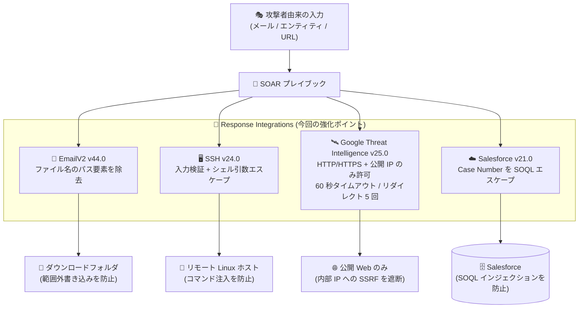

# Google SecOps Marketplace: 4 統合のセキュリティ強化アップデート (EmailV2 / SSH / Google Threat Intelligence / Salesforce)

**リリース日**: 2026-11-20

**サービス**: Google SecOps Marketplace (Response Integrations)

**機能**: EmailV2 v44.0、SSH v24.0、Google Threat Intelligence v25.0、Salesforce v21.0 のセキュリティ強化

**ステータス**: GA (Generally Available)

📊 [このアップデートのインフォグラフィックを見る](https://takech9203.github.io/google-cloud-news-summary/20261120-google-secops-marketplace-integration-updates.html)

## 概要

2026 年 11 月 20 日、Google SecOps Marketplace (Response Integrations) の 4 つの統合に対して、**セキュリティ強化 (hardening) を主眼としたバージョンアップ**がリリースされました。今回の更新は新機能の追加ではなく、SOAR プレイブックが外部データ (メール添付ファイル、アクションパラメータ、外部 URL、ケース番号) を扱う際の攻撃経路を塞ぐ防御的な修正が中心です。

対象は、EmailV2 v44.0 (添付ファイル保存時のパストラバーサル対策)、SSH v24.0 (シェル引数の入力検証・エスケープ強化)、Google Threat Intelligence v25.0 (外部 URL ダウンロードの SSRF 対策)、Salesforce v21.0 (SOQL インジェクション対策) の 4 統合です。SOAR の統合はアラートに含まれる攻撃者由来のデータ (メール、URL、エンティティ値) をそのまま処理することが多く、これらの入力経由の攻撃 (パストラバーサル、コマンドインジェクション、SSRF、SOQL インジェクション) に対する堅牢性はプラットフォーム全体のセキュリティに直結します。該当統合を利用中の環境では、Content Hub からの早期アップデートを推奨します。

**アップデート前の課題**

- EmailV2 の添付ファイル保存処理では、添付ファイル名に含まれるディレクトリパス要素がそのまま書き込み先パスに反映され得る構造であり、細工されたファイル名 (例: `../` を含む) による保存先ディレクトリ外への書き込み (パストラバーサル) のリスクがあった。また、1 つの添付ファイルの保存失敗がアクション実行全体の停止につながることがあった
- SSH 統合のアクションでは、パラメータ値 (IP アドレス、ユーザー名、プロセス名など) がリモートホスト上のシェルコマンドに渡される際の入力検証とエスケープが不十分で、細工された値によるコマンド注入のリスクがあった
- Google Threat Intelligence の Submit File アクションの External URLs パラメータは、URL のスキームや解決先 IP の検証が緩く、内部ネットワークやメタデータエンドポイントへのアクセスを誘発する SSRF のリスクがあった。また、ダウンロードのタイムアウトやリダイレクト回数の上限が明示されていなかった
- Salesforce 統合では、Case Number パラメータが SOQL クエリに組み込まれる際のエスケープが行われておらず、細工された値による SOQL インジェクションのリスクがあった

**アップデート後の改善**

- EmailV2 v44.0 では、添付ファイル名からディレクトリパス要素を除去 (strip) してからダウンロードフォルダに書き込むようになり、パストラバーサルが防止された。保存に失敗した添付ファイルはログに記録してスキップし、アクションの実行が継続されるようになった
- SSH v24.0 では、アクションパラメータの入力検証とシェル引数のエスケープが強化され、リモートホストで実行されるコマンドへの不正な値の混入が防止された
- Google Threat Intelligence v25.0 では、External URLs パラメータの URL が HTTP/HTTPS かつパブリックにルーティング可能な IP アドレスに解決されることが必須となり (SSRF 対策)、ダウンロードに 60 秒のタイムアウトと最大 5 回のリダイレクト制限が適用され、ダウンロード処理が統合の認証情報から分離された
- Salesforce v21.0 では、Case Number パラメータが SOQL クエリ組み立て前にエスケープされるようになり、SOQL インジェクションが防止された

## アーキテクチャ図

SOAR プレイブックは攻撃者由来のデータ (メール添付、エンティティ値、外部 URL) を各統合に渡して処理します。今回の 4 統合の更新により、それぞれの出口 (ファイルシステム、リモートシェル、外部ダウンロード、SOQL クエリ) で入力のサニタイズ・検証が強化されました。

## サービスアップデートの詳細

### 統合ごとの変更内容

| 統合 | バージョン | セキュリティ強化の内容 | 影響するアクション |
|------|-----------|----------------------|-------------------|
| EmailV2 | 44.0 | 添付ファイル名からディレクトリパス要素を除去してから保存 (パストラバーサル対策)。保存に失敗した添付ファイルはログに記録してスキップし、実行を継続するようエラーハンドリングを改善 | Download Email Attachments、Save Email Attachments To Case、Wait for Email from User |
| SSH | 24.0 | アクションパラメータの入力検証とシェル引数エスケープを改善 | Block IP Address in iptables、List iptables Rules、Logoff User、Shutdown Machine、Terminate Process |
| Google Threat Intelligence | 25.0 | External URLs パラメータのダウンロード検証を強化: HTTP/HTTPS かつパブリックにルーティング可能な IP に解決される URL のみ許可 (SSRF 対策)、60 秒のダウンロードタイムアウトと最大 5 回のリダイレクト制限を適用、ダウンロード処理を統合の認証情報から分離 | Submit File |
| Salesforce | 21.0 | Case Number パラメータを SOQL クエリ発行前にエスケープ (SOQL インジェクション対策) | Add Comment、Close Case、Get Case、Update Case |

### 対策されている攻撃手法

| 攻撃手法 | 対象統合 | 攻撃シナリオの例 |
|---------|---------|----------------|
| パストラバーサル | EmailV2 | `../../` などのパス要素を含むファイル名の添付ファイルにより、指定したダウンロードフォルダの外に書き込ませる |
| コマンド / 引数インジェクション | SSH | エンティティ値やパラメータにシェルメタ文字を混入させ、リモートホストで意図しないコマンドを実行させる |
| SSRF (Server-Side Request Forgery) | Google Threat Intelligence | 内部 IP やメタデータエンドポイントに解決される URL を External URLs に指定し、内部リソースへアクセスさせる |
| SOQL インジェクション | Salesforce | Case Number に細工した文字列を渡し、Salesforce への SOQL クエリを改変する |

## 技術仕様

### 影響を受けるアクションの役割 (公式ドキュメントより)

- **EmailV2 - Download Email Attachments**: 指定したメールの添付ファイルを Google SecOps サーバー上の指定パス (Download Path) に保存する
- **EmailV2 - Save Email Attachments To Case**: メールの添付ファイルを現在のケースの Case Wall に保存する
- **EmailV2 - Wait for Email from User**: Send Email への返信を待機し、Fetch Response Attachments 有効時は返信の添付ファイルも取得する
- **SSH - Block IP Address in iptables / Shutdown Machine / Terminate Process など**: リモートサーバーに SSH 接続し、IP アドレスのブロック、マシンのシャットダウン、プロセスの終了などを実行する。Remote Server、Block IP Address、Process などのパラメータがコマンドに渡される
- **Google Threat Intelligence - Submit File**: ファイルを解析のために送信する。External URLs パラメータにはファイル取得元のパブリック URL をカンマ区切りで指定できる
- **Salesforce - Add Comment / Close Case / Get Case / Update Case**: Case Number パラメータで対象ケースを指定し、コメント追加・クローズ・取得・更新を行う

### Google Threat Intelligence v25.0 の External URLs 検証仕様

| 項目 | 内容 |
|------|------|
| 許可スキーム | HTTP / HTTPS のみ |
| 解決先 IP | パブリックにルーティング可能な IP アドレスのみ (プライベート IP などへの解決は拒否) |
| ダウンロードタイムアウト | 60 秒 |
| リダイレクト | 最大 5 回 |
| 認証情報 | ダウンロード処理は統合の認証情報から分離 (外部サイトへ認証情報が渡らない) |

## メリット

### ビジネス面

- **SOAR プラットフォームの攻撃対象領域の縮小**: フィッシング調査など攻撃者由来のデータを日常的に処理するプレイブックにおいて、統合経由でのサーバー侵害リスクが低減する
- **運用の継続性向上**: EmailV2 で一部の添付ファイル保存に失敗してもアクションが停止せずログ記録のうえ継続されるため、プレイブックの失敗による対応遅延が減る

### 技術面

- **多層防御の強化**: ファイル書き込み (パス除去)、シェル実行 (エスケープ)、外部通信 (URL/IP 検証・タイムアウト)、クエリ発行 (エスケープ) と、統合の出口ごとに入力サニタイズが実装された
- **SSRF 対策の明確化**: Submit File の外部 URL ダウンロードが公開 Web に限定され、内部ネットワークやクラウドメタデータへの到達が遮断される。認証情報の分離により資格情報の漏えい経路も塞がれる
- **挙動が仕様として明示**: タイムアウト 60 秒・リダイレクト 5 回などの制限が明示され、プレイブック設計時に考慮できる

## デメリット・制約事項

### 考慮すべき点

- Google Threat Intelligence v25.0 では、**内部ネットワーク上の URL や HTTP/HTTPS 以外の URL を External URLs に指定する運用は動作しなくなる**。該当する使い方をしているプレイブックは、File Paths パラメータ (サーバー上のファイルパス指定) などへの切り替えが必要
- 大きなファイルや応答の遅いサイトからのダウンロードは 60 秒のタイムアウトに達して失敗する可能性がある
- EmailV2 ではファイル名のパス要素が除去されるため、添付ファイル名のディレクトリ構造に依存した後続処理がある場合は見直しが必要
- 統合のアップデートで問題が発生した場合は、Content Hub のバージョンロールバック機能で旧バージョンへ復帰できる

## ユースケース

### ユースケース 1: フィッシングメール調査プレイブックの安全性向上

**シナリオ**: EmailV2 の Download Email Attachments / Save Email Attachments To Case を使い、報告された不審メールの添付ファイルを自動で取得・解析している。攻撃者はファイル名に `../` を含む添付ファイルを送り付け、SOAR サーバー上の意図しない場所への書き込みを狙う可能性がある。

**効果**: v44.0 では添付ファイル名のパス要素が除去されるため、保存先は指定したダウンロードフォルダ内に限定される。また、保存に失敗した添付ファイルがあってもスキップして処理が続くため、大量添付メールの調査が途中で止まらない。

### ユースケース 2: Submit File の外部 URL 取得を安全に利用

**シナリオ**: 脅威インテリジェンス調査で、外部サイトにホストされている検体ファイルの URL を Google Threat Intelligence の Submit File (External URLs) に渡して解析している。細工された URL が内部 IP に解決されると SSRF の踏み台になるリスクがあった。

**効果**: v25.0 では HTTP/HTTPS かつ公開 IP に解決される URL のみダウンロードされるため、内部ネットワークへの到達が遮断される。タイムアウトとリダイレクト上限により、ダウンロードの長時間ハングやリダイレクトチェーンの悪用も防げる。

### ユースケース 3: インシデント封じ込めアクション (SSH) の堅牢化

**シナリオ**: プレイブックから SSH 統合の Block IP Address in iptables や Terminate Process を実行し、アラートのエンティティ値 (IP アドレス、プロセス名) をそのままパラメータに渡して封じ込めを自動化している。

**効果**: v24.0 の入力検証とシェル引数エスケープにより、エンティティ値にシェルメタ文字が含まれていてもリモートホストで意図しないコマンドが実行されるリスクが低減する。

## 関連サービス・機能

- **Google SecOps SOAR**: 本アップデートの対象である Response Integrations は、SOAR のプレイブックアクション・コネクタの基盤コンポーネント
- **Content Hub**: 統合のインストール・更新・バージョンロールバックを行う入口。今回の 4 統合の新バージョンも Content Hub から適用する
- **Google Threat Intelligence**: Submit File アクションの連携先となる脅威インテリジェンスサービス

## 参考リンク

- 📊 [インフォグラフィック](https://takech9203.github.io/google-cloud-news-summary/20261120-google-secops-marketplace-integration-updates.html)
- [公式リリースノート (Google Cloud Release Notes)](https://docs.cloud.google.com/release-notes#November_20_2026)
- [Google SecOps Marketplace Release Notes](https://docs.cloud.google.com/chronicle/docs/soar/marketplace-integrations/release-notes)
- [EmailV2 統合ドキュメント](https://docs.cloud.google.com/chronicle/docs/soar/marketplace-integrations/email-v2)
- [SSH 統合ドキュメント](https://docs.cloud.google.com/chronicle/docs/soar/marketplace-integrations/ssh)
- [Google Threat Intelligence 統合ドキュメント](https://docs.cloud.google.com/chronicle/docs/soar/marketplace-integrations/google-threat-intelligence)
- [Salesforce 統合ドキュメント](https://docs.cloud.google.com/chronicle/docs/soar/marketplace-integrations/salesforce)

## まとめ

今回のアップデートは、SOAR 統合が攻撃者由来のデータを処理する際の代表的な攻撃経路 (パストラバーサル、コマンドインジェクション、SSRF、SOQL インジェクション) を塞ぐセキュリティ強化パッケージです。特にフィッシング調査や封じ込め自動化で EmailV2・SSH・Google Threat Intelligence・Salesforce 統合を利用している環境では、Content Hub から新バージョンへの更新を早期に実施することを推奨します。あわせて、内部 URL を External URLs に渡しているプレイブックなど、強化された検証により動作が変わるケースがないかの確認も行ってください。

---

**タグ**: Google SecOps, SOAR, Marketplace, Response Integrations, EmailV2, SSH, Google Threat Intelligence, Salesforce, セキュリティ, SSRF, パストラバーサル, SOQL インジェクション
