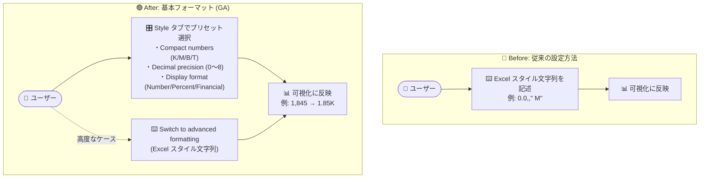

# Looker: コンパクト数値表示と基本値フォーマットが GA

**リリース日**: 2026-11-20

**サービス**: Looker

**機能**: デフォルト Explore インターフェースにおけるコンパクト数値表示と基本値フォーマット

**ステータス**: GA (一般提供)

📊 [このアップデートのインフォグラフィックを見る](https://takech9203.github.io/google-cloud-news-summary/20261120-looker-compact-numbers-value-formatting-ga.html)

## 概要

Looker 26.20 以降を使用するインスタンスのデフォルト Explore インターフェースで、コンパクト数値表示 (Compact numbers) と基本値フォーマット (basic value formatting) が一般提供 (GA) になりました。Looker (Google Cloud core) と Looker (original) の両方が対象です。

これまで Explore の可視化で数値の表示形式 (大きな値の省略表記、小数点以下の桁数、パーセントや通貨などの表示形式) を調整するには、Excel スタイルのフォーマット文字列 (例: `0.0,," M"`) を記述する必要がありました。今回の GA により、単一値 (single value)、縦棒 (column)、横棒 (bar)、折れ線 (line)、散布図 (scatterplot)、面 (area)、ウォーターフォール (waterfall)、テーブル (table) の各チャートで、フォーマット文字列を書かずに GUI のプリセットから値の表示形式を設定できるようになりました。

ビジネスユーザーやアナリストなど、Excel スタイルのフォーマット構文に馴染みのないユーザーでも、ダッシュボードやレポートで見やすい数値表示を簡単に実現できるようになる、アクセシビリティの高いアップデートです。

**アップデート前の課題**

- 可視化の値の表示形式を変更するには、Excel スタイルのフォーマット文字列 (例: `#,##0.00`、`0.000,," M"`) を正しく記述する必要があった
- 大きな数値を「1.85K」「2.3M」のように省略表記するにも、専用のフォーマット文字列の知識が必要だった
- フォーマット構文を知らないビジネスユーザーは、LookML 開発者に `value_format` の定義を依頼するか、デフォルト表示のまま利用する必要があった

**アップデート後の改善**

- **Compact numbers** オプションを有効にするだけで、1,000 以上の数値を K (千) / M (百万) / B (十億) / T (兆) の標準的な接尾辞で省略表記できるようになった
- **Decimal precision** で小数点以下の表示桁数 (Default、0、1〜8) を選択できるようになった
- **Display format** で Default / Number (桁区切り) / Percent (%) / Financial (通貨記号) の表示プリセットを選択できるようになった
- フォーマット文字列が必要な高度なケースでは、「Switch to advanced formatting」で従来の Excel スタイル文字列にも切り替え可能

## アーキテクチャ図



従来は Excel スタイルのフォーマット文字列の記述が必須でしたが、GA 後はデフォルト Explore インターフェースの Style タブから GUI プリセットで値フォーマットを設定でき、必要に応じて高度なフォーマット文字列にも切り替えられます。

## サービスアップデートの詳細

### 主要機能

1. **Compact numbers (コンパクト数値表示)**
   - 1,000 以上の数値を標準的なメトリック接尾辞で省略表記: K (千)、M (百万)、B (十億)、T (兆)
   - デフォルトでは無効 (オプトイン)
   - 有効時、Decimal precision が Default の場合は小数点以下 2 桁で表示 (例: 1,845 → 1.85K)、0 を選択すると整数に丸め (例: 2K)

2. **Decimal precision (小数精度)**
   - 表示する小数点以下の桁数を Default、0、または 1〜8 から選択
   - フォーマット文字列を書かずに桁数だけを調整可能

3. **Display format (表示形式プリセット)**
   - **Default**: 基盤となるデータソースのデフォルトフォーマットで表示
   - **Number**: 桁区切り付きの標準的な数値として表示
   - **Percent**: パーセント記号 (%) 付きで表示
   - **Financial**: ローカライズされた通貨記号 (例: $) 付きで表示

4. **高度なフォーマットへの切り替え**
   - 「Switch to advanced formatting」で従来どおり Excel スタイルのカスタムフォーマット文字列 (Custom Format Rule) を入力可能
   - 「Switch to basic formatting」で基本コントロールに戻れる (基本フォーマットの選択はカスタムフォーマットルールを上書きする)

## 技術仕様

### 対応環境と対象チャート

| 項目 | 詳細 |
|------|------|
| 対象エディション | Looker (Google Cloud core) および Looker (original) |
| 必要バージョン | Looker 26.20 以降 |
| 対象インターフェース | デフォルト Explore インターフェース (新しい Explore エクスペリエンス) |
| 対象チャート | 単一値、縦棒、横棒、折れ線、散布図、面、ウォーターフォール、テーブル |
| 設定場所 | Configure パネルの Style タブ (テーブルチャートは Series セクション内の Format) |
| Compact numbers の接尾辞 | K (千)、M (百万)、B (十億)、T (兆) |
| Decimal precision | Default、0、1〜8 |
| Display format | Default、Number、Percent、Financial |

### チャートタイプ別の設定箇所

| チャートタイプ | 設定箇所 |
|----------------|----------|
| 単一値チャート | Style セクションを展開 |
| 縦棒・横棒・折れ線・散布図・面・ウォーターフォール | Values セクションを展開し、Value Labels を有効化 |
| テーブルチャート | Series セクションを展開し、Customizations でフォーマット対象の列を展開 |

## 設定方法

### 前提条件

1. インスタンスが Looker 26.20 以降を使用していること
2. デフォルト Explore インターフェース (新しい Explore エクスペリエンス) を使用していること

### 手順

#### ステップ 1: Style タブを開く

Explore で可視化を表示し、Configure パネルの **Style** タブを開きます。チャートタイプに応じて該当セクション (Style / Values / Series) を展開します。縦棒・横棒・折れ線・散布図・面・ウォーターフォールの場合は **Value Labels** を有効にします。

#### ステップ 2: 基本フォーマットを設定する

**Value format** セクション (テーブルチャートの場合は **Format** セクション) で、以下のいずれかを設定します。

- **Compact numbers**: 大きな値を K/M/B/T で省略表記
- **Decimal precision**: 小数点以下の桁数を選択
- **Display format**: Default / Number / Percent / Financial から選択

#### ステップ 3 (任意): 高度なフォーマットに切り替える

Excel スタイルのフォーマット文字列が必要な場合は、**Switch to advanced formatting** をクリックし、**Custom Format Rule** フィールドにフォーマット文字列を入力します。基本コントロールに戻すには **Switch to basic formatting** をクリックします。

## メリット

### ビジネス面

- **セルフサービス分析の裾野拡大**: フォーマット構文を知らないビジネスユーザーでも、見やすい数値表示を自分で設定できる
- **レポート品質の向上**: 大きな数値のコンパクト表記により、ダッシュボードや単一値チャートの可読性が向上する

### 技術面

- **LookML 開発者への依頼削減**: 表示形式の微調整のために `value_format` の変更を開発者に依頼する必要が減る
- **後方互換性の確保**: 高度なケースでは従来の Excel スタイルフォーマット文字列へいつでも切り替え可能
- **設定の簡素化**: GUI プリセットにより設定ミス (フォーマット文字列の構文エラー) を防止できる

## デメリット・制約事項

### 制限事項

- Looker 26.20 以降のデフォルト Explore インターフェースでのみ利用可能 (クラシック Explore では従来どおり Value Format フィールドにフォーマット文字列を入力する)
- カスタムフォーマットは `type: number` のディメンションまたはメジャーに対してのみサポートされる
- 基本フォーマットのオプションを選択すると、カスタムフォーマットルール (高度なフォーマット) の設定は上書きされる

### 考慮すべき点

- LookML の `value_format` / `value_format_name` や、インスタンス・ユーザー単位の Number format 設定 (ロケール別の桁区切り) と併用する場合は、適用の重なり方を確認する必要がある
- Compact numbers はデフォルトで無効のため、利用するにはチャートごとに有効化が必要

## ユースケース

### ユースケース 1: 経営ダッシュボードの KPI 表示

**シナリオ**: 売上高やユーザー数など桁数の大きい KPI を単一値チャートで表示する際、「1,845,000,000」のような生の数値では瞬時に規模を把握しにくい。

**実装例**:
```
Explore → Configure パネル → Style タブ → Style セクション
- Compact numbers: 有効
- Decimal precision: 1
- Display format: Financial
```

**効果**: 「$1.8B」のような簡潔な表示になり、経営層が一目で規模を把握できる。フォーマット文字列の知識は不要。

### ユースケース 2: アナリストによる割合指標のアドホック分析

**シナリオ**: コンバージョン率や成長率などの割合指標を折れ線チャートで可視化する際、これまでは `0.00%` のようなフォーマット文字列を都度入力していた。

**効果**: Display format で Percent を選択し、Decimal precision で桁数を選ぶだけで統一的なパーセント表示が可能になり、アドホック分析のスピードが向上する。

## 料金

本アップデートは Explore インターフェースの表示機能の GA であり、リリースノートに料金に関する記載はありません。Looker の料金体系は以下の公式ページを参照してください。

- [Looker 料金ページ](https://cloud.google.com/looker/pricing)

## 関連サービス・機能

- **LookML `value_format` / `value_format_name` パラメータ**: モデル側で定義する従来の値フォーマット方法。基本フォーマットはこれを補完する UI レイヤーの機能
- **テーブル計算・カスタムフィールド**: 作成・編集時に Format ドロップダウンでカスタムフォーマットを指定可能
- **Number format 設定 (ローカライズ)**: インスタンス・ユーザー単位で桁区切り記号 (1,234.56 / 1.234,56 / 1 234,56) を設定する機能で、他のフォーマット設定の上に適用される
- **Looker Studio**: 同じく Google Cloud の BI ツールで、コンパクト数値などの表示オプションを提供しており、ツール間で一貫した数値表現を実現しやすくなる

## 参考リンク

- 📊 [インフォグラフィック](https://takech9203.github.io/google-cloud-news-summary/20261120-looker-compact-numbers-value-formatting-ga.html)
- [公式リリースノート (Google Cloud)](https://docs.cloud.google.com/release-notes#November_20_2026)
- [Looker リリースノート](https://docs.cloud.google.com/looker/docs/release-notes)
- [ドキュメント: デフォルト Explore インターフェースでのカスタムフォーマット](https://docs.cloud.google.com/looker/docs/custom-formatting#using-custom-formatting-in-the-default-explore-interface)
- [ドキュメント: value_format パラメータ](https://docs.cloud.google.com/looker/docs/reference/param-field-value-format)
- [料金ページ](https://cloud.google.com/looker/pricing)

## まとめ

Looker のデフォルト Explore インターフェースで、Excel スタイルのフォーマット文字列を書かずにコンパクト数値表示や小数精度・表示形式を GUI で設定できるようになりました。ビジネスユーザーのセルフサービス分析を後押しする改善であり、Looker 26.20 以降のインスタンスを利用している場合は、ダッシュボードや Explore の数値表示設定をこの基本フォーマットに置き換えることを検討してください。

---

**タグ**: #Looker #BI #DataVisualization #Explore #GA #ValueFormatting
