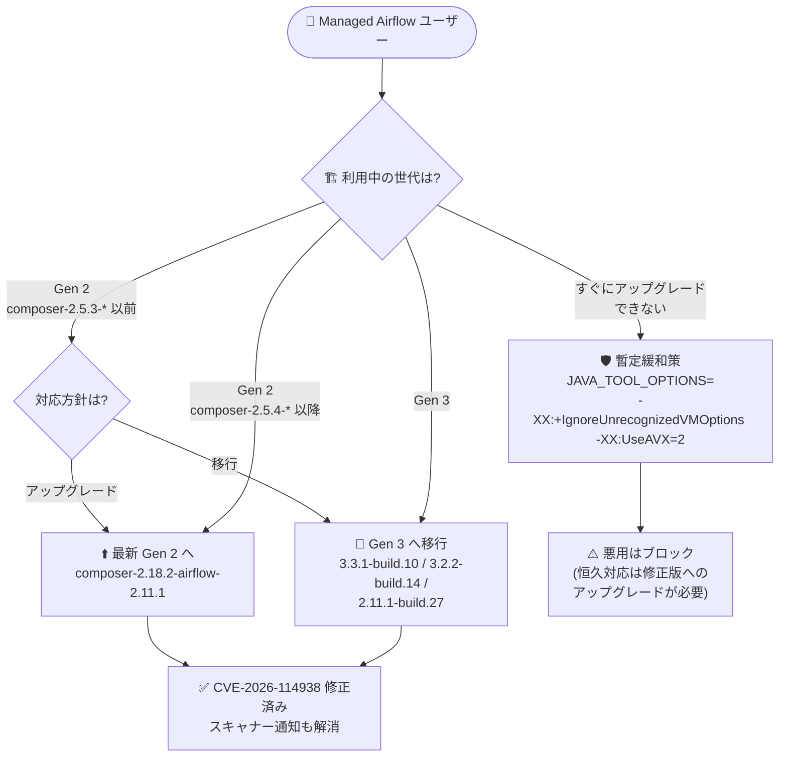

# Managed Service for Apache Airflow: CVE-2026-114938 修正版リリースと新バージョン提供

**リリース日**: 2026-11-20

**サービス**: Managed Service for Apache Airflow (旧 Cloud Composer)

**機能**: CVE-2026-114938 に対応した修正版バージョンのリリース、新ビルドの提供、旧バージョンのサポート終了

**ステータス**: Security (更新: 2026-11-20) / Change / Deprecated

📊 [このアップデートのインフォグラフィックを見る](https://takech9203.github.io/google-cloud-news-summary/20261120-managed-airflow-cve-2026-114938-fixed-versions.html)

## 概要

Managed Service for Apache Airflow (旧 Cloud Composer) は、脆弱性 **CVE-2026-114938 に対応した新しい Managed Airflow バージョンをリリース**しました。これは [11 月 19 日に発表された修正準備と暫定緩和策のアナウンス](./2026-11-19-managed-airflow-cve-2026-114938-mitigation.md)の続報で、「修正は今後のバージョンで公開される」とされていたものが実際に利用可能になったアップデートです。

Gen 2 環境で「JVM が CVE-2026-114938 に対して脆弱である」というスキャナー通知を解消したいユーザーは、最新の Gen 2 バージョン **composer-2.18.2-airflow-2.11.1** へのアップグレードが要請されています。また、初期の Gen 2 バージョン (**composer-2.5.3-\* 以前**) を使用しているユーザーは、最新の Gen 2 バージョンへのアップグレード、または Gen 3 バージョン (**3.3.1-build.10、3.2.2-build.14、2.11.1-build.27**) への移行が要請されています。

同日には、Gen 3 の新しい Airflow ビルド (composer-3-airflow-3.3.1-build.10、3.2.2-build.14、2.11.1-build.27 (デフォルト)) と Gen 2 の新イメージ (composer-2.18.2-airflow-2.11.1 (デフォルト)) の提供開始、および **composer-3-airflow-3.1.0-build.2 のサポート終了**も発表されています。

**アップデート前の課題**

- 11 月 19 日時点では CVE-2026-114938 の修正版は未公開で、環境変数 `JAVA_TOOL_OPTIONS=-XX:+IgnoreUnrecognizedVMOptions -XX:UseAVX=2` による暫定緩和策のみが利用可能だった
- 脆弱性スキャナーが Managed Airflow Gen 2 環境内の JVM を CVE-2026-114938 に対して脆弱と検知し、通知が発生し続けていた
- 緩和用の環境変数は各環境へ手動で設定する必要があった

**アップデート後の改善**

- CVE-2026-114938 に対応した修正版バージョンがリリースされ、アップグレードによる恒久的な対応が可能になった (Gen 2: composer-2.18.2-airflow-2.11.1、Gen 3: 3.3.1-build.10 / 3.2.2-build.14 / 2.11.1-build.27)
- 最新 Gen 2 バージョンへのアップグレードにより、脆弱な JVM に関するスキャナー通知を解消できるようになった
- Gen 3 全環境と Gen 2 (composer-2.5.4-\* 以降) では、アップグレードや環境変数の変更、PyPI パッケージの変更、Airflow 構成オーバーライドの変更、スナップショットの読み込み、タスクログ保存設定の変更といった特定のオペレーションを実行すると、緩和用の環境変数が (未設定の場合) 自動的に設定されるようになった

## アーキテクチャ図



利用中の世代とバージョンに応じて、修正版へのアップグレード / Gen 3 への移行 / 暫定緩和策 (環境変数設定) のいずれかを選択する判断フローです。恒久対応は修正版バージョンへのアップグレードです。

## サービスアップデートの詳細

### 主要なポイント

1. **CVE-2026-114938 修正版バージョンのリリース (Security)**
   - CVE-2026-114938 に対応した新しい Managed Airflow バージョンがリリースされた
   - Gen 2 環境で脆弱な JVM に関するスキャナー通知を解消したい場合は、最新 Gen 2 バージョン composer-2.18.2-airflow-2.11.1 へのアップグレードが要請されている
   - 初期の Gen 2 バージョン (composer-2.5.3-\* 以前) のユーザーは、最新 Gen 2 へのアップグレード、または Gen 3 (3.3.1-build.10、3.2.2-build.14、2.11.1-build.27) への移行が要請されている

2. **アップグレード不要の暫定緩和策 (継続)**
   - アップグレードせずに悪用をブロックする暫定緩和策として、環境変数 `JAVA_TOOL_OPTIONS` に値 `-XX:+IgnoreUnrecognizedVMOptions -XX:UseAVX=2` を設定する方法が引き続き案内されている
   - `JAVA_TOOL_OPTIONS` が既に設定されている場合は、既存の値に `-XX` フラグを追記する

3. **特定オペレーションによる環境変数の自動設定**
   - Gen 3 のすべての環境と Gen 2 の composer-2.5.4-\* 以降の環境では、以下のオペレーションを実行すると、緩和用の環境変数が未設定の場合に自動的に設定される
     - 環境をサポートされている他のバージョンへアップグレードする (最新バージョン推奨)
     - Gen 2: 環境のバケットへのタスクログ保存の有効化 / 無効化
     - Gen 3: 環境変数の追加・削除・更新
     - カスタム PyPI パッケージの追加・削除、または制約 (constraints) の変更
     - Airflow 構成オプションのオーバーライドの追加・削除・変更
     - 環境スナップショットの読み込み

4. **新バージョンの提供 (Change)**
   - Gen 3 の新 Airflow ビルド: composer-3-airflow-3.3.1-build.10、composer-3-airflow-3.2.2-build.14、composer-3-airflow-2.11.1-build.27 (デフォルト)
   - Gen 2 の新イメージ: composer-2.18.2-airflow-2.11.1 (デフォルト)

5. **サポート終了 (Deprecated)**
   - composer-3-airflow-3.1.0-build.2 がサポート終了期間に達した

## 技術仕様

### 対象バージョンと推奨アクション

| 現在の環境 | 推奨アクション |
|------|------|
| Gen 2 (composer-2.5.3-\* 以前) | 最新 Gen 2 (composer-2.18.2-airflow-2.11.1) へアップグレード、または Gen 3 (3.3.1-build.10 / 3.2.2-build.14 / 2.11.1-build.27) へ移行 |
| Gen 2 (composer-2.5.4-\* 以降) | 最新 Gen 2 (composer-2.18.2-airflow-2.11.1) へアップグレード (スキャナー通知の解消) |
| Gen 3 | 新ビルド (composer-3-airflow-3.3.1-build.10 / 3.2.2-build.14 / 2.11.1-build.27) へアップグレード |
| すぐにアップグレードできない環境 | 暫定緩和策として環境変数 `JAVA_TOOL_OPTIONS=-XX:+IgnoreUnrecognizedVMOptions -XX:UseAVX=2` を設定 |

### 今回提供された新バージョン

| 世代 | バージョン / ビルド | 備考 |
|------|------|------|
| Gen 3 | composer-3-airflow-3.3.1-build.10 | 新 Airflow ビルド |
| Gen 3 | composer-3-airflow-3.2.2-build.14 | 新 Airflow ビルド |
| Gen 3 | composer-3-airflow-2.11.1-build.27 | 新 Airflow ビルド (デフォルト) |
| Gen 2 | composer-2.18.2-airflow-2.11.1 | 新イメージ (デフォルト) |

### 緩和用環境変数が自動設定されるオペレーション (Gen 3 全環境、Gen 2 は composer-2.5.4-\* 以降)

| オペレーション | 対象 |
|------|------|
| サポートされている他バージョンへのアップグレード | Gen 2 / Gen 3 |
| タスクログの環境バケットへの保存の有効化 / 無効化 | Gen 2 |
| 環境変数の追加・削除・更新 | Gen 3 |
| カスタム PyPI パッケージの追加・削除、制約の変更 | Gen 2 / Gen 3 |
| Airflow 構成オプションのオーバーライドの追加・削除・変更 | Gen 2 / Gen 3 |
| 環境スナップショットの読み込み | Gen 2 / Gen 3 |

## 設定方法

### 前提条件

1. Managed Airflow (Cloud Composer) 環境を運用していること
2. 環境を更新できる IAM 権限を持っていること
3. アップグレード前に、実行中の DAG を一時停止し、進行中のタスクの完了を待つこと (公式ドキュメントの推奨)

### 手順

#### ステップ 1: アップグレード可能なバージョンを確認する

```bash
gcloud composer environments list-upgrades ENVIRONMENT_NAME \
  --location LOCATION
```

環境がアップグレード可能な Managed Airflow バージョンの一覧を表示します。リリースは数日かけて各リージョンへ段階的にロールアウトされるため、最新バージョンがまだ利用できない場合があります。

#### ステップ 2: 修正版バージョンへアップグレードする (Gen 2 の例)

```bash
gcloud composer environments update ENVIRONMENT_NAME \
  --location LOCATION \
  --image-version composer-2.18.2-airflow-2.11.1
```

`ENVIRONMENT_NAME` は環境名、`LOCATION` は環境のリージョンに置き換えます。Google Cloud コンソールの場合は、環境の詳細ページの「環境の構成」タブで「Image version」の「アップグレード」から実行できます。

#### ステップ 3: Gen 2 から Gen 3 へ移行する場合 (composer-2.5.3-\* 以前のユーザー向け選択肢)

Gen 2 から Gen 3 へのインプレースアップグレードはできないため、サイドバイサイド移行を行います。

```bash
# 1. Gen 2 環境のスナップショットを保存
gcloud composer environments snapshots save COMPOSER_2_ENV \
  --location COMPOSER_2_LOCATION

# 2. Gen 3 環境を作成後、スナップショットを読み込み
gcloud composer environments snapshots load COMPOSER_3_ENV \
  --location COMPOSER_3_LOCATION \
  --snapshot-path "SNAPSHOT_PATH"
```

移行手順の詳細は[公式の移行ガイド](https://docs.cloud.google.com/composer/docs/composer-2/migrate-composer-3)を参照してください。

#### ステップ 4: すぐにアップグレードできない場合の暫定緩和策

```bash
gcloud composer environments update ENVIRONMENT_NAME \
  --location LOCATION \
  --update-env-variables="JAVA_TOOL_OPTIONS=-XX:+IgnoreUnrecognizedVMOptions -XX:UseAVX=2"
```

`JAVA_TOOL_OPTIONS` が既に設定されている場合は、既存の値に `-XX` フラグを追記します。

## メリット

### ビジネス面

- **Critical 脆弱性への恒久対応が可能に**: 暫定緩和策 (環境変数) に依存せず、修正版バージョンへのアップグレードで CVE-2026-114938 に恒久的に対処できる
- **スキャナー通知の解消**: 最新 Gen 2 バージョンへのアップグレードにより、脆弱性スキャナーによる JVM 脆弱性の検知通知を解消でき、セキュリティ運用のノイズを削減できる

### 技術面

- **自動フォールバックの仕組み**: Gen 3 と Gen 2 (composer-2.5.4-\* 以降) では、アップグレードや構成変更などの一般的なオペレーションの実行時に緩和用環境変数が自動設定されるため、設定漏れのリスクが低減される
- **複数の対応パスの提供**: 最新 Gen 2 へのアップグレード、Gen 3 への移行、暫定緩和策の 3 つの選択肢があり、環境の状況に応じて対応を選べる

## デメリット・制約事項

### 制限事項

- Gen 2 から Gen 3 へのインプレースアップグレードはできず、サイドバイサイド移行 (スナップショット利用など) が必要
- Managed Airflow バージョンのダウングレードはできない
- リリースは各リージョンへ数日かけて段階的にロールアウトされるため、リージョンによっては最新バージョンがまだ選択できない場合がある
- composer-3-airflow-3.1.0-build.2 はサポート終了となったため、該当ビルドを使用中の環境は後継バージョンへの移行計画が必要

### 考慮すべき点

- アップグレードの前に DAG を一時停止し、進行中のタスクの完了を待つことが推奨されている (公式ドキュメント)
- 環境変数の自動設定は Gen 2 の composer-2.5.3-\* 以前には適用されないため、該当環境ではアップグレード / 移行、または手動での環境変数設定が必要
- 暫定緩和策 (環境変数) はあくまで悪用のブロックであり、脆弱な JVM 自体はスキャナーに検知され続けるため、通知解消には修正版へのアップグレードが必要

## ユースケース

### ユースケース 1: スキャナー通知を解消したい Gen 2 環境の一斉アップグレード

**シナリオ**: Security Command Center や脆弱性スキャナーが Gen 2 環境の JVM を CVE-2026-114938 に対して脆弱と検知し続けており、通知を解消したい。

**実装例**:
```bash
# 対象環境の確認
gcloud composer environments list --locations=us-central1

# 最新 Gen 2 バージョンへアップグレード
gcloud composer environments update example-environment \
  --location us-central1 \
  --image-version composer-2.18.2-airflow-2.11.1
```

**効果**: 修正版 JVM を含む最新イメージに切り替わり、CVE-2026-114938 への恒久対応とスキャナー通知の解消が同時に実現できる。

### ユースケース 2: 旧 Gen 2 (composer-2.5.3-\* 以前) 環境の Gen 3 への移行

**シナリオ**: 長期間アップグレードしていない初期の Gen 2 環境 (composer-2.5.3-\* 以前) を運用しており、これを機にアーキテクチャが刷新された Gen 3 へ移行したい。

**効果**: スナップショットを使ったサイドバイサイド移行により、修正済みの Gen 3 バージョン (3.3.1-build.10 / 3.2.2-build.14 / 2.11.1-build.27) へ移行でき、脆弱性対応と環境のモダナイズを同時に達成できる。なお、Gen 3 ではスナップショットの読み込み自体が緩和用環境変数の自動設定のトリガーにもなる。

## 利用可能リージョン

Managed Airflow のリリースは、サポートされる全リージョンへ数日かけて段階的にロールアウトされます。リージョンで利用可能なバージョンは `gcloud composer environments list-upgrades` または [imageVersions.list API](https://docs.cloud.google.com/composer/docs/reference/rest/v1/projects.locations.imageVersions/list) で確認してください。

## 関連サービス・機能

- **Google Cloud セキュリティ速報 (Security Bulletins)**: CVE-2026-114938 (OpenJDK HotSpot の AVX-512 VBMI Base64 デコーダーにおける脆弱性、深刻度 Critical) の詳細と Google Cloud 各サービスでの対応状況が公開されている
- **Security Command Center / 脆弱性スキャナー**: 脆弱な JVM の検知通知の発生元。最新 Gen 2 バージョンへのアップグレードで通知を解消できる
- **環境スナップショット**: Gen 2 から Gen 3 へのサイドバイサイド移行に使用。スナップショットの読み込みは緩和用環境変数の自動設定トリガーでもある

## 参考リンク

- 📊 [インフォグラフィック](https://takech9203.github.io/google-cloud-news-summary/20261120-managed-airflow-cve-2026-114938-fixed-versions.html)
- [公式リリースノート](https://docs.cloud.google.com/release-notes#November_20_2026)
- [前日のレポート: CVE-2026-114938 への対応 (修正準備と暫定緩和策)](./2026-11-19-managed-airflow-cve-2026-114938-mitigation.md)
- [Managed Airflow バージョン一覧](https://docs.cloud.google.com/composer/docs/composer-versions)
- [環境のアップグレード手順](https://docs.cloud.google.com/composer/docs/composer-2/upgrade-environments)
- [Gen 2 から Gen 3 への移行ガイド](https://docs.cloud.google.com/composer/docs/composer-2/migrate-composer-3)
- [Google Cloud セキュリティ速報](https://docs.cloud.google.com/support/bulletins)

## まとめ

前日 (11 月 19 日) に予告されていた CVE-2026-114938 の修正版が実際にリリースされ、Gen 2 は composer-2.18.2-airflow-2.11.1、Gen 3 は 3.3.1-build.10 / 3.2.2-build.14 / 2.11.1-build.27 で恒久対応が可能になりました。暫定緩和策 (環境変数設定) を適用済みの環境も、スキャナー通知の解消と恒久対応のために修正版へのアップグレードを計画してください。特に composer-2.5.3-\* 以前の旧 Gen 2 環境は環境変数の自動設定の対象外でもあるため、最新 Gen 2 へのアップグレードまたは Gen 3 への移行を優先的に進めることを推奨します。

---

**タグ**: Managed Service for Apache Airflow, Cloud Composer, セキュリティ, CVE-2026-114938, OpenJDK, バージョンアップグレード, サポート終了
