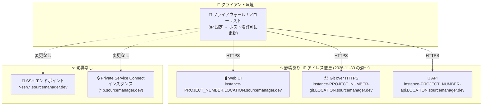

# Secure Source Manager: パブリックエンドポイントの IP アドレス変更 (事前アナウンス)

**リリース日**: 2026-11-20

**サービス**: Secure Source Manager

**機能**: パブリックエンドポイント (*.sourcemanager.dev) の背後にある IP アドレスの変更

**ステータス**: Announcement (事前告知)

📊 [このアップデートのインフォグラフィックを見る](https://takech9203.github.io/google-cloud-news-summary/20261120-secure-source-manager-public-endpoint-ip-change.html)

## 概要

Google Cloud は、2026 年 11 月 30 日の週から、内部インフラストラクチャの改善の一環として、Secure Source Manager の一部のパブリックホスト名 (`*.sourcemanager.dev`) の背後にある IP アドレスを変更することを発表しました。対象となるのは、Web UI、Git over HTTPS、および API のパブリックエンドポイントです。

一方、SSH エンドポイント (`*-ssh.*.sourcemanager.dev`) と Private Service Connect インスタンスは、今回の変更の影響を受けません。

ファイアウォールルールやアローリストをインスタンスの IP アドレスに固定 (ピン留め) しているユーザーは、IP アドレスではなくインスタンスのホスト名 (`*.sourcemanager.dev`) を許可するように更新する必要があります。IP アドレスベースの制御を使用していない場合、特別な対応は不要です。

**アップデート前の状況**

- 一部のユーザーは、ファイアウォールルールやアローリストを Secure Source Manager インスタンスの IP アドレスに固定して運用していた
- IP アドレスは Google 側のインフラ構成に依存するため、IP 固定の運用はインフラ変更時に接続断のリスクを抱えていた

**アナウンスによる対応事項**

- 2026 年 11 月 30 日の週以降、パブリックエンドポイント (Web UI / Git over HTTPS / API) の IP アドレスが変更される
- IP アドレスに固定したファイアウォールルールやアローリストは、ホスト名 (`*.sourcemanager.dev`) ベースの許可に更新することが推奨される
- SSH エンドポイントと Private Service Connect インスタンスは影響を受けないため、これらのみを利用している場合は対応不要

## アーキテクチャ図



パブリックな Web UI / Git over HTTPS / API エンドポイントの IP アドレスのみが変更対象であり、SSH エンドポイントと Private Service Connect 経由のアクセスは影響を受けません。

## サービスアップデートの詳細

### 変更内容

1. **パブリックエンドポイントの IP アドレス変更**
   - 2026 年 11 月 30 日の週から、内部インフラストラクチャ改善の一環として実施
   - 対象: 一部のパブリック Secure Source Manager ホスト名 (`*.sourcemanager.dev`) の背後にある IP アドレス
   - 対象エンドポイント: Web UI、Git over HTTPS、API

2. **影響を受けないエンドポイント**
   - SSH エンドポイント (`*-ssh.*.sourcemanager.dev`)
   - Private Service Connect インスタンス (パブリックインターネットにエンドポイントを公開せず、ユーザーのプライベートネットワーク内の IP アドレスを使用)

3. **推奨される対応**
   - ファイアウォールルールやアローリストをインスタンスの IP アドレスに固定している場合、インスタンスのホスト名 (`*.sourcemanager.dev`) を許可する形に更新する

## 技術仕様

### 影響範囲の整理

| エンドポイント | ホスト名の例 | 影響 |
|------|------|------|
| Web UI (HTML) | `INSTANCE_ID-PROJECT_NUMBER.LOCATION.sourcemanager.dev` | ⚠️ IP アドレス変更 |
| Git over HTTPS | `INSTANCE_ID-PROJECT_NUMBER-git.LOCATION.sourcemanager.dev` | ⚠️ IP アドレス変更 |
| API (データプレーン) | `INSTANCE_ID-PROJECT_NUMBER-api.LOCATION.sourcemanager.dev` | ⚠️ IP アドレス変更 |
| SSH | `*-ssh.*.sourcemanager.dev` | ✅ 影響なし |
| Private Service Connect インスタンス | `*.LOCATION.p.sourcemanager.dev` (プライベート IP) | ✅ 影響なし |

ホスト名の形式は Secure Source Manager インスタンスの `hostConfig` フィールド (`html` / `gitHttp` / `api` / `gitSsh`) で確認できます。

### 対応の要否

| 現在の運用 | 対応 |
|------|------|
| ファイアウォール / アローリストで IP アドレスを固定 | ホスト名 (`*.sourcemanager.dev`) ベースの許可に更新 (2026-11-30 の週より前に実施) |
| ホスト名ベースで許可済み | 対応不要 |
| SSH のみ利用 | 対応不要 |
| Private Service Connect インスタンスのみ利用 | 対応不要 |

## 設定方法

### 対応手順

#### ステップ 1: 自インスタンスのホスト名を確認

```bash
gcloud source-manager instances describe INSTANCE_ID \
  --region=LOCATION
```

出力の `hostConfig` フィールドに、Web UI (`html`)、API (`api`)、Git over HTTPS (`gitHttp`)、SSH (`gitSsh`) の各ホスト名が表示されます。

#### ステップ 2: ファイアウォールルール / アローリストの確認と更新

自社のファイアウォールやプロキシ、Egress 制御のアローリストに、Secure Source Manager インスタンスの IP アドレスが直接記載されていないかを確認します。IP アドレスで固定している場合は、インスタンスのホスト名 (`*.sourcemanager.dev`) を許可する設定に変更します。

詳細は、リリースノートで案内されている「Public endpoint IP addresses」のドキュメントを参照してください。

## 考慮すべき点

- IP アドレス固定のまま 2026 年 11 月 30 日の週を迎えると、Web UI、Git over HTTPS、API への接続がファイアウォールでブロックされ、開発ワークフロー (clone / push / pull、CI/CD 連携、API 操作) が停止するおそれがある
- 変更は「2026 年 11 月 30 日の週」から開始されるため、切り替え完了の正確な日時に依存した運用は避け、事前にホスト名ベースの許可へ移行しておくことが望ましい
- オンプレミスや社内ネットワークの Egress 制御 (プロキシの許可リストなど) も確認対象に含める

## ユースケース

### ユースケース 1: 社内ネットワークから Egress 制御付きで Git over HTTPS を利用

**シナリオ**: 社内ファイアウォールで外向き通信を制限しており、Secure Source Manager インスタンスの IP アドレスを個別に許可して `git clone` / `git push` を行っている。

**対応**: IP アドレスの許可エントリを削除し、ホスト名 (FQDN) ベースのルールで `*.sourcemanager.dev` (または自インスタンスの各ホスト名) を許可する。

**効果**: 2026 年 11 月 30 日の週以降の IP アドレス変更後も、設定変更なしで接続を継続できる。

### ユースケース 2: プライベート接続への移行検討

**シナリオ**: パブリックエンドポイントの IP 変更を機に、パブリックインターネット経由のアクセス自体を見直したい。

**対応**: Private Service Connect インスタンスを利用すると、エンドポイントはユーザーのプライベートネットワーク内の IP アドレスに割り当てられ、今回のようなパブリック側のインフラ変更の影響を受けない。

**効果**: ネットワーク境界の管理をユーザー側の VPC に閉じられ、パブリックエンドポイントの変更から切り離せる。

## 利用可能リージョン

Secure Source Manager は us-central1、us-east1、northamerica-northeast1、asia-east1、asia-northeast1 (東京)、asia-northeast3、australia-southeast1、europe-west2、europe-west4、me-west1、me-central2 で利用可能です。最新のリージョン情報は[ロケーションのドキュメント](https://docs.cloud.google.com/secure-source-manager/docs/locations)を参照してください。

## 関連サービス・機能

- **Private Service Connect**: Secure Source Manager をプライベートネットワーク経由で利用する構成。今回の IP アドレス変更の影響を受けない
- **Cloud Build / Jenkins / Webhook 連携**: パブリックエンドポイント経由で CI/CD ツールと連携している場合、ファイアウォール設定の確認対象となる
- **Cloud DNS**: Private Service Connect インスタンス利用時のプライベート DNS レコード管理に使用

## 参考リンク

- 📊 [インフォグラフィック](https://takech9203.github.io/google-cloud-news-summary/20261120-secure-source-manager-public-endpoint-ip-change.html)
- [公式リリースノート](https://docs.cloud.google.com/release-notes#November_20_2026)
- [Secure Source Manager ドキュメント](https://docs.cloud.google.com/secure-source-manager/docs)
- [Private Service Connect インスタンスの作成](https://docs.cloud.google.com/secure-source-manager/docs/create-private-service-connect-instance)
- [Secure Source Manager のロケーション](https://docs.cloud.google.com/secure-source-manager/docs/locations)

## まとめ

2026 年 11 月 30 日の週から、Secure Source Manager のパブリックエンドポイント (Web UI / Git over HTTPS / API) の IP アドレスが変更されます。ファイアウォールやアローリストで IP アドレスを固定している場合は、接続断を防ぐため、それまでにホスト名 (`*.sourcemanager.dev`) ベースの許可へ更新してください。SSH エンドポイントと Private Service Connect インスタンスのみを利用している場合、対応は不要です。

---

**タグ**: #SecureSourceManager #ネットワーク #ファイアウォール #IPアドレス #DevOps #Git
