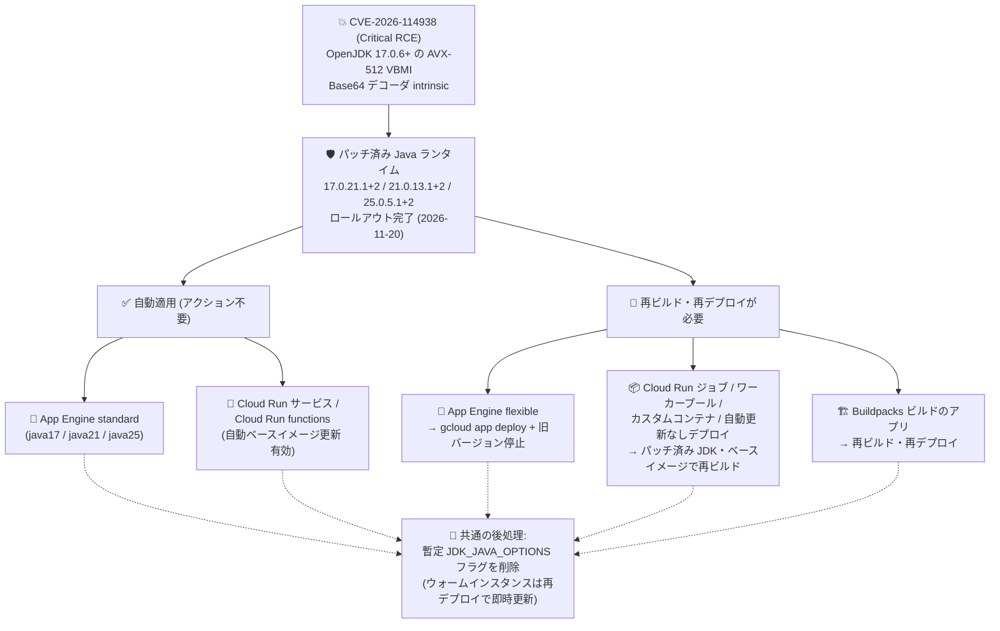

# App Engine / Cloud Run / Buildpacks: Java ランタイムセキュリティアップデート (GCP-2026-082 / CVE-2026-114938 対応)

**リリース日**: 2026-11-20

**サービス**: App Engine flexible environment (Java), App Engine standard environment (Java), Buildpacks, Cloud Run, Cloud Run functions

**機能**: Java ランタイムセキュリティアップデート (Java 17: 17.0.21.1+2 / Java 21: 21.0.13.1+2 / Java 25: 25.0.5.1+2)

**ステータス**: リリース済み (セキュリティアップデート / Security)

📊 [このアップデートのインフォグラフィックを見る](https://takech9203.github.io/google-cloud-news-summary/20261120-serverless-java-runtime-security-gcp-2026-082.html)

## 概要

2026 年 11 月 20 日、Google Cloud はサーバーレス系サービス (App Engine flexible environment、App Engine standard environment、Cloud Run、Cloud Run functions、Cloud Functions (1st gen)) および Google Cloud Buildpacks 向けに、重要な Java ランタイムセキュリティアップデートをリリースしました。パッチ適用済みの Java ランタイムバージョンは **Java 17: `17.0.21.1+2`、Java 21: `21.0.13.1+2`、Java 25: `25.0.5.1+2`** で、各サービスへのランタイムベースイメージと Buildpacks パッケージのロールアウトが完了しています。これはセキュリティ速報 **GCP-2026-082** (同日更新) に記載された OpenJDK の脆弱性 **CVE-2026-114938** への対応です。

CVE-2026-114938 は、OpenJDK 17.0.6 以降 (17.0.6+、21.x、25.x、27.x。Eclipse Temurin などの各ディストリビューションを含む) に存在する深刻度 **Critical** のリモートコード実行 (RCE) 脆弱性です。AVX-512 VBMI をサポートする x86-64 プロセッサ上で、HotSpot の AVX-512 VBMI Base64 デコーダ組み込み関数 (intrinsic) における整数アンダーフローにより、不正な形式の Base64 入力 (`Base64.getDecoder()` / `Base64.getUrlDecoder()`) のデコード時にヒープ領域外書き込みが発生し、認証不要のリモート攻撃者による JVM プロセス内での任意コード実行につながる可能性があります。OpenJDK 8、11、17.0.0〜17.0.5 は影響を受けません。

重要なのは、**サービスごと・デプロイ形態ごとに必要なアクションが異なる**点です。自動ベースイメージ更新が有効なワークロード (App Engine standard、自動更新有効の Cloud Run サービス / Cloud Run functions / Cloud Functions 1st gen) はパッチが自動適用されますが、App Engine flexible、Cloud Run のジョブ / ワーカープール / カスタムコンテナ / 自動更新なしのデプロイ、Buildpacks でビルドしたアプリケーションは、**再ビルド・再デプロイが必要**です。

**アップデート前の課題**

- Java 17 以降のランタイムを使用するサーバーレスワークロードは CVE-2026-114938 の影響を受ける可能性があり、パッチ済みランタイムが提供されるまでは暫定緩和策として環境変数 `JDK_JAVA_OPTIONS="-XX:+IgnoreUnrecognizedVMOptions -XX:UseAVX=2"` の設定 (AVX-512 の無効化) が必要だった
- 暫定緩和フラグは AVX-512 命令を無効化するものであり、恒久対策としてパッチ済み JDK への更新が待たれていた
- マネージドランタイムの利用者は、自身でベースイメージの JVM にパッチを適用できなかった

**アップデート後の改善**

- パッチ済み Java ランタイム (17.0.21.1+2 / 21.0.13.1+2 / 25.0.5.1+2) のベースイメージと Buildpacks パッケージのロールアウトが全対象サービスで完了した
- 自動ベースイメージ更新が有効なワークロードは、アクション不要でパッチ済みランタイムを受け取れるようになった
- 再ビルド・再デプロイが必要なワークロードも、Buildpacks / マネージドランタイムの再デプロイだけで恒久対策が完了し、暫定的な `JDK_JAVA_OPTIONS` 緩和フラグを削除できるようになった

## アーキテクチャ図



パッチ済みランタイムの適用経路は 2 系統に分かれます。自動ベースイメージ更新が有効なワークロードはアクション不要で保護され、それ以外は再ビルド・再デプロイが必要です。いずれの場合も、パッチ済みランタイムで稼働後に暫定緩和フラグを削除します。

## サービスアップデートの詳細

### 主要機能

1. **パッチ済み Java ランタイムベースイメージのロールアウト完了**
   - Java 17 (`17.0.21.1+2`)、Java 21 (`21.0.13.1+2`)、Java 25 (`25.0.5.1+2`) のランタイムベースイメージと Buildpacks パッケージが、Cloud Run、Cloud Run functions、Cloud Functions (1st gen)、App Engine、Google Cloud Buildpacks 全体でロールアウト完了
   - CVE-2026-114938 (Critical / RCE) の恒久対策

2. **自動ベースイメージ更新によるゼロタッチ適用**
   - App Engine standard (java17 / java21 / java25)、自動ベースイメージ更新が有効な Cloud Run サービス (第 1・第 2 世代実行環境)、Cloud Run functions、自動更新が有効な Cloud Functions (1st gen) は、パッチ済みランタイムを自動的に受領
   - ウォームインスタンスを即時更新したい場合は再デプロイを実施
   - App Engine standard と Cloud Run 第 2 世代実行環境 (自動ベースイメージ更新利用時) では、ウォームインスタンスがパッチ済み JVM に入れ替わるまでの間、**暫定的な AVX-512 VBMI セーフガードが 2026 年 11 月 30 日まで有効**に維持される

3. **再ビルド・再デプロイが必要なワークロードへの明確なガイダンス**
   - App Engine flexible (マネージド Java ランタイム)、Cloud Run ジョブ / ワーカープール、自動ベースイメージ更新なしのソースデプロイは、再ビルド・再デプロイでパッチ済みランタイムを取得 (App Engine flexible では `gcloud app deploy` を実行し、旧バージョンを停止)
   - カスタムコンテナは、パッチ済みの上流 JDK またはベースイメージでコンテナイメージを再ビルド・再デプロイするまで `JDK_JAVA_OPTIONS` 緩和策を継続

4. **暫定緩和フラグの削除**
   - パッチ済みランタイムでの稼働後、`app.yaml` / `appengine-web.xml` や環境変数に追加した暫定的な `JDK_JAVA_OPTIONS="-XX:+IgnoreUnrecognizedVMOptions -XX:UseAVX=2"` フラグを削除して再デプロイ

## 技術仕様

### CVE-2026-114938 の概要

| 項目 | 詳細 |
|------|------|
| CVE ID | CVE-2026-114938 |
| 深刻度 | Critical |
| 脆弱性の種類 | 整数アンダーフローによるヒープ領域外書き込み → リモートコード実行 (RCE) |
| 発生箇所 | OpenJDK HotSpot の AVX-512 VBMI Base64 デコーダ intrinsic |
| トリガー | 不正な形式の標準 / URL-safe Base64 入力のデコード (`Base64.getDecoder()` / `Base64.getUrlDecoder()`) |
| 影響を受ける JDK | OpenJDK 17.0.6 以降 (17.0.6+、21.x、25.x、27.x。Temurin など各ディストリビューション含む) |
| 影響を受けない JDK | OpenJDK 8、11、17.0.0〜17.0.5 |
| 影響を受ける CPU | AVX-512 VBMI をサポートする x86-64 プロセッサ |
| 暫定緩和策 | `JDK_JAVA_OPTIONS="-XX:+IgnoreUnrecognizedVMOptions -XX:UseAVX=2"` を設定して再起動 / 再デプロイ |

### パッチ済み Java ランタイムバージョン

| Java バージョン | パッチ済みランタイム |
|-----------------|---------------------|
| Java 17 | 17.0.21.1+2 |
| Java 21 | 21.0.13.1+2 |
| Java 25 | 25.0.5.1+2 |

### サービス別の必要アクション

| サービス / デプロイ形態 | パッチ適用 | 必要なアクション |
|------------------------|-----------|------------------|
| App Engine standard (java17 / java21 / java25) | 自動 | なし (ウォームインスタンスの即時更新には再デプロイ)。`app.yaml` / `appengine-web.xml` の暫定 `JDK_JAVA_OPTIONS` フラグを削除して再デプロイ |
| App Engine flexible (マネージド Java ランタイム) | 手動 | `gcloud app deploy` で再ビルド・再デプロイし、旧バージョンを停止。その後、暫定フラグを削除 |
| Cloud Run サービス (自動ベースイメージ更新 有効) | 自動 | なし (ウォームインスタンスの即時更新には再デプロイ)。第 1・第 2 世代実行環境とも対象 |
| Cloud Run ジョブ / ワーカープール / 自動更新なしデプロイ | 手動 | パッチ済み JDK またはベースイメージで再ビルド・再デプロイ |
| Cloud Run カスタムコンテナ | 手動 | 再ビルド・再デプロイまで `JDK_JAVA_OPTIONS` 緩和策を継続し、完了後にフラグを削除 |
| Cloud Run functions / Cloud Functions (1st gen) (自動更新 有効) | 自動 | なし (ウォームインスタンスの即時更新には再デプロイ) |
| Cloud Run functions (自動更新 なし) | 手動 | 関数を再デプロイしてパッチ済みランタイムを取得 |
| Buildpacks でビルドしたアプリケーション | 手動 | 再ビルド・再デプロイ。`GOOGLE_RUNTIME_VERSION` は未設定のままか、`17` / `21` / `25` や `17.0` などメジャー / マイナーバージョンに固定 (4 要素のパッチ文字列への固定は避ける) |

## 設定方法

### 前提条件

1. Java 17 以降のランタイムを使用するワークロードを特定していること (OpenJDK 8、11、17.0.0〜17.0.5 は影響なし)
2. 対象プロジェクトでのデプロイ権限 (App Engine デプロイ、Cloud Run デプロイなど) があること

### 手順

#### ステップ 1: 自動更新対象のワークロードを確認し、ウォームインスタンスを更新する

```bash
# App Engine standard: 再デプロイでウォームインスタンスを即時更新
gcloud app deploy

# Cloud Run: 再デプロイ (リビジョン更新) でウォームインスタンスを即時更新
gcloud run deploy SERVICE --image APP_IMAGE --base-image java21
```

自動ベースイメージ更新が有効なワークロードはアクション不要ですが、再デプロイすることでウォームインスタンスを即座にパッチ済みランタイムへ入れ替えられます。Cloud Run では、サービスログの `run.googleapis.com/base_image_versions` ラベルで使用中のベースイメージバージョンを確認できます。

#### ステップ 2: 手動対応が必要なワークロードを再ビルド・再デプロイする

```bash
# App Engine flexible: 再ビルド・再デプロイし、旧バージョンを停止
gcloud app deploy
gcloud app versions stop OLD_VERSION

# Cloud Run ジョブ / ワーカープール / カスタムコンテナ:
# パッチ済み JDK / ベースイメージでイメージを再ビルドして再デプロイ
gcloud builds submit --tag REGION-docker.pkg.dev/PROJECT/REPO/IMAGE
gcloud run jobs update JOB --image REGION-docker.pkg.dev/PROJECT/REPO/IMAGE
```

Buildpacks を使用する場合、`GOOGLE_RUNTIME_VERSION` を未設定にするか `21` / `21.0` のようなメジャー / マイナーバージョン指定にしておくことで、再ビルド時に最新のパッチ済みランタイムが自動選択されます。

#### ステップ 3: 暫定緩和フラグを削除する

```bash
# Cloud Run: 環境変数から暫定フラグを削除
gcloud run services update SERVICE --remove-env-vars JDK_JAVA_OPTIONS
```

パッチ済みランタイムで稼働していることを確認したら、`app.yaml` / `appengine-web.xml` / 環境変数に追加した暫定的な `JDK_JAVA_OPTIONS="-XX:+IgnoreUnrecognizedVMOptions -XX:UseAVX=2"` を削除して再デプロイします。このフラグは AVX-512 を無効化するため、残したままにするとパッチ適用後も AVX-512 による最適化が利用されません。

## メリット

### ビジネス面

- **Critical 脆弱性への恒久対策**: 認証不要の RCE という深刻なリスクに対し、暫定緩和 (AVX-512 無効化) ではなくパッチ済み JDK による恒久対策が完了する
- **運用負荷の最小化**: 自動ベースイメージ更新を有効にしているワークロードは、再ビルドなしで保護される

### 技術面

- **自動ベースイメージ更新の価値の実証**: Cloud Run / Cloud Run functions の自動ベースイメージ更新や App Engine standard のマネージドランタイムを使うことで、OS / ランタイムレベルのセキュリティパッチをゼロタッチで受けられる
- **移行期間のセーフガード**: App Engine standard と Cloud Run 第 2 世代 (自動更新利用時) では、ウォームインスタンスの入れ替わり期間中も暫定 AVX-512 VBMI セーフガードが 2026 年 11 月 30 日まで維持され、保護の空白が生じない

## デメリット・制約事項

### 制限事項

- 自動ベースイメージ更新は Google Cloud Buildpacks ベースイメージのみ対応で、独自ベースイメージでは利用できない。カスタムコンテナは自身でパッチ済み JDK / ベースイメージへの再ビルドが必要
- 自動ベースイメージ更新では、Java のようなコンパイル言語のアプリケーションは再コンパイルされない。言語レベルの修正を完全に取り込むには再ビルドが必要な場合がある

### 考慮すべき点

- 自動適用の対象でも、ウォームインスタンスが残っている間は旧ランタイムで稼働し続けるため、即時の保護が必要な場合は再デプロイを実施する
- App Engine standard / Cloud Run 第 2 世代の暫定 AVX-512 VBMI セーフガードは 2026 年 11 月 30 日までで終了するため、それまでにウォームインスタンスの入れ替え (再デプロイ) を完了させることが望ましい
- Buildpacks で `GOOGLE_RUNTIME_VERSION` を 4 要素のパッチバージョン文字列に固定していると、再ビルドしてもパッチ済みランタイムを取得できない。メジャー / マイナーバージョン指定に変更する必要がある
- 暫定 `JDK_JAVA_OPTIONS` フラグの削除漏れは、AVX-512 最適化が無効のままとなるパフォーマンス面の機会損失につながる
- GKE、Compute Engine、Distroless イメージなど自己管理の Java 17+ ワークロードは本アップデートの対象外であり、GCP-2026-082 のガイダンスに従って個別に対応する必要がある

## ユースケース

### ユースケース 1: Cloud Run で Java サービスとジョブを混在運用している場合の棚卸し

**シナリオ**: 自動ベースイメージ更新を有効にした Cloud Run サービスと、カスタムコンテナベースの Cloud Run ジョブ / ワーカープールを運用している組織が、CVE-2026-114938 への対応状況を確認したい。

**実装例**:
```bash
# サービスの自動ベースイメージ更新設定を確認
gcloud run services describe SERVICE --format="yaml(spec.template.metadata.annotations)"

# ジョブ / ワーカープールはパッチ済みベースイメージで再ビルド後に更新
gcloud run jobs update JOB --image REGION-docker.pkg.dev/PROJECT/REPO/IMAGE:patched
```

**効果**: 自動更新有効のサービスは確認のみで完了し、再ビルドが必要なジョブ / ワーカープール / カスタムコンテナに対応作業を集中できる。

### ユースケース 2: App Engine で standard と flexible を併用している場合の対応

**シナリオ**: App Engine standard (java21) と App Engine flexible (Java) の両方でアプリケーションを運用しており、それぞれに必要な対応を実施したい。

**効果**: standard はアクション不要 (即時更新したい場合のみ再デプロイ) である一方、flexible は `gcloud app deploy` での再デプロイと旧バージョンの停止が必須と切り分けられる。両環境とも、対応完了後に `app.yaml` / `appengine-web.xml` の暫定 `JDK_JAVA_OPTIONS` フラグを削除する。

## 料金

セキュリティアップデートの適用自体に追加料金は発生しません。再ビルドに Cloud Build を使用する場合は通常の Cloud Build 料金が適用されます。

- Cloud Run 料金ページ: https://cloud.google.com/run/pricing
- App Engine 料金ページ: https://cloud.google.com/appengine/pricing

## 関連サービス・機能

- **Cloud Run 自動ベースイメージ更新**: Google Cloud Buildpacks ベースイメージの OS / ランタイム層を Google が自動更新する機能。今回のようなランタイム脆弱性対応をゼロタッチ化できる
- **Google Cloud Buildpacks**: サーバーレスアプリケーションのビルドとランタイムベースイメージの提供基盤。今回のパッチ済みランタイムも Buildpacks 経由で配布される
- **Apigee X (1-18-0-apigee-10)**: 同じ GCP-2026-082 / CVE-2026-114938 への対応として、2026-11-17 に Apigee ランタイムへの優先ロールアウトが実施済み (関連レポート: [2026-11-17 Apigee X セキュリティアップデート](./2026-11-17-apigee-x-security-gcp-2026-082.md))
- **Cloud Composer (Managed Service for Apache Airflow)**: GCP-2026-082 の 2026-11-20 更新で「What should I do?」セクションに追加された。同 CVE に関する緩和は関連レポート ([2026-11-19 Managed Airflow CVE-2026-114938 緩和](./2026-11-19-managed-airflow-cve-2026-114938-mitigation.md)) を参照
- **GKE**: COS ノードイメージ自体は Java を含まないため影響なし。ただしコンテナ内で OpenJDK 17.0.6+ を実行する場合は `JDK_JAVA_OPTIONS` 緩和とイメージ再ビルドが必要

## 参考リンク

- 📊 [インフォグラフィック](https://takech9203.github.io/google-cloud-news-summary/20261120-serverless-java-runtime-security-gcp-2026-082.html)
- [公式リリースノート (2026 年 11 月 20 日)](https://docs.cloud.google.com/release-notes#November_20_2026)
- [セキュリティ速報 GCP-2026-082](https://cloud.google.com/support/bulletins#gcp-2026-082)
- [Cloud Run 自動ベースイメージ更新の構成](https://docs.cloud.google.com/run/docs/configuring/services/automatic-base-image-updates)
- [App Engine flexible environment (Java) リリースノート](https://docs.cloud.google.com/appengine/docs/flexible/java/release-notes)
- [Google Cloud Buildpacks 概要](https://docs.cloud.google.com/docs/buildpacks/overview)

## まとめ

CVE-2026-114938 (Critical / RCE) に対するパッチ済み Java ランタイム (17.0.21.1+2 / 21.0.13.1+2 / 25.0.5.1+2) のロールアウトが、App Engine、Cloud Run、Cloud Run functions、Buildpacks 全体で完了しました。自動ベースイメージ更新が有効なワークロードはアクション不要ですが、App Engine flexible、Cloud Run のジョブ / ワーカープール / カスタムコンテナ、Buildpacks ビルドのアプリケーションは速やかに再ビルド・再デプロイを実施してください。いずれの環境でも、パッチ済みランタイムでの稼働確認後に暫定的な `JDK_JAVA_OPTIONS` 緩和フラグを削除することを忘れないようにしましょう。

---

**タグ**: App Engine, Cloud Run, Cloud Run functions, Buildpacks, セキュリティ, CVE-2026-114938, GCP-2026-082, Java, OpenJDK, リモートコード実行, セキュリティアップデート
