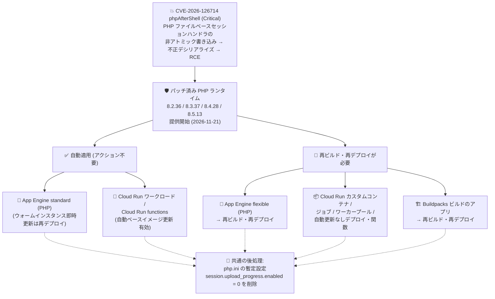

# App Engine / Cloud Run / Buildpacks: PHP ランタイムセキュリティアップデート (GCP-2026-090 / CVE-2026-126714 対応)

**リリース日**: 2026-11-21

**サービス**: App Engine flexible environment (PHP), App Engine standard environment (PHP), Buildpacks, Cloud Run, Cloud Run functions

**機能**: PHP ランタイムセキュリティアップデート (PHP 8.2: 8.2.36 / PHP 8.3: 8.3.37 / PHP 8.4: 8.4.28 / PHP 8.5: 8.5.13)

**ステータス**: リリース済み (セキュリティアップデート / Security)

📊 [このアップデートのインフォグラフィックを見る](https://takech9203.github.io/google-cloud-news-summary/20261121-serverless-php-runtime-security-gcp-2026-090.html)

## 概要

2026 年 11 月 21 日、Google Cloud はサーバーレス系サービス (App Engine flexible environment、App Engine standard environment、Cloud Run、Cloud Run functions) および Google Cloud Buildpacks 向けに、重要な PHP ランタイムセキュリティアップデートをリリースしました。パッチ適用済みの PHP バージョンは **PHP 8.2: `8.2.36`、PHP 8.3: `8.3.37`、PHP 8.4: `8.4.28`、PHP 8.5: `8.5.13`** です。これはセキュリティ速報 **GCP-2026-090** (2026-11-20 公開) に記載された PHP の脆弱性 **CVE-2026-126714** (通称 phpAfterShell) への対応です。

CVE-2026-126714 は、PHP のデフォルトのファイルベースセッションハンドラ (`session.save_handler = files`) に存在する深刻度 **Critical** の脆弱性です。PHP がセッションデータを書き込む処理 (例: 未認証でも動作するファイルアップロード進捗トラッキング) はアトミックではないため、メモリ上限やリクエストタイムアウトなどで PHP ワーカーが書き込み途中に突然停止すると、部分的に上書きされた不正な形式のセッションファイルがディスク上に残ります。その後のリクエストで `session_start()` が呼ばれるとこのファイルがデシリアライズされ、細工された入力により、認証不要のリモート攻撃者が任意コードを実行できる可能性があります。影響を受けるのは PHP 8.2 < 8.2.36、8.3 < 8.3.37、8.4 < 8.4.28、8.5 < 8.5.13 で、サポート終了 (EOL) の PHP 8.1 以前には修正が提供されません。

前日 (2026-11-20) に発生した Java ランタイムの GCP-2026-082 対応と同様、**サービスごと・デプロイ形態ごとに必要なアクションが異なる**点が重要です。App Engine standard と、自動ベースイメージ更新が有効な Cloud Run ワークロード / Cloud Run functions はパッチが自動適用されますが、App Engine flexible、Buildpacks でビルドしたアプリケーション、Cloud Run のカスタムコンテナ / ジョブ / ワーカープール / 自動更新なしのデプロイは、**ただちに再ビルド・再デプロイが必要**です。

**アップデート前の課題**

- PHP 8.2〜8.5 ランタイムを使用するサーバーレスワークロードは CVE-2026-126714 の影響を受ける可能性があり、パッチ済みランタイムが提供されるまでは暫定緩和策として `php.ini` に `session.upload_progress.enabled = 0` を設定し、phpAfterShell の主要な攻撃経路 (セッションアップロード進捗トラッキング) を無効化する必要があった
- 暫定緩和策は主要な攻撃経路を塞ぐものであり、恒久対策としてパッチ済み PHP への更新が待たれていた
- マネージドランタイムの利用者は、自身でベースイメージの PHP にパッチを適用できず、Google によるパッチ済みランタイムイメージの公開を待つ必要があった

**アップデート後の改善**

- パッチ済み PHP ランタイム (8.2.36 / 8.3.37 / 8.4.28 / 8.5.13) が App Engine (standard / flexible)、Cloud Run、Cloud Run functions、Buildpacks 全体で提供開始された
- App Engine standard と、自動ベースイメージ更新が有効な Cloud Run ワークロード / Cloud Run functions は、アクション不要でパッチ済みランタイムを受け取れるようになった
- 再ビルド・再デプロイが必要なワークロードも、再デプロイだけで恒久対策が完了し、暫定的な `session.upload_progress.enabled = 0` 設定を `php.ini` から削除できるようになった

## アーキテクチャ図



パッチ済み PHP ランタイムの適用経路は 2 系統に分かれます。自動ベースイメージ更新が有効なワークロードと App Engine standard はアクション不要で保護され、それ以外は再ビルド・再デプロイが必要です。いずれの場合も、パッチ済みランタイムで稼働後に `php.ini` の暫定緩和設定を削除します。

## サービスアップデートの詳細

### 主要機能

1. **パッチ済み PHP ランタイムの提供開始**
   - PHP 8.2 (`8.2.36`)、PHP 8.3 (`8.3.37`)、PHP 8.4 (`8.4.28`)、PHP 8.5 (`8.5.13`) のランタイムが App Engine flexible / standard、Buildpacks、Cloud Run、Cloud Run functions 向けに提供開始
   - CVE-2026-126714 (Critical / ファイルベースセッションハンドラ経由の RCE) の恒久対策

2. **自動ベースイメージ更新によるゼロタッチ適用**
   - App Engine standard (PHP) のアプリケーションは、アクション不要でパッチ済みランタイムを自動的に受領
   - 自動ベースイメージ更新が有効な Cloud Run ワークロードと Cloud Run functions も、パッチ済みランタイムを自動的に受領
   - ウォームインスタンスを即時更新したい場合は再デプロイを実施

3. **再ビルド・再デプロイが必要なワークロードへの明確なガイダンス**
   - App Engine flexible (PHP) と Buildpacks でビルドしたアプリケーションは、**ただちに**再ビルド・再デプロイしてパッチ済み PHP ランタイムを取得
   - Cloud Run のカスタムコンテナ、ジョブ / ワーカープール、自動ベースイメージ更新なしのデプロイは、パッチ済み PHP バージョンまたはベースイメージで再ビルド・再デプロイ
   - 自動ベースイメージ更新なしの Cloud Run functions は、関数を再デプロイしてパッチ済みランタイムを取得

4. **暫定緩和設定の削除**
   - パッチ済みランタイムでの稼働後、`php.ini` に追加した暫定的な `session.upload_progress.enabled = 0` 設定を削除 (App Engine standard では削除後に再デプロイ)

## 技術仕様

### CVE-2026-126714 (phpAfterShell) の概要

| 項目 | 詳細 |
|------|------|
| CVE ID | CVE-2026-126714 (通称 phpAfterShell) |
| セキュリティ速報 | GCP-2026-090 (2026-11-20 公開) |
| 深刻度 | Critical |
| 脆弱性の種類 | セッションファイルの非アトミック書き込みに起因する不正データのデシリアライズ → リモートコード実行 (RCE) |
| 発生箇所 | PHP のデフォルトのファイルベースセッションハンドラ (`session.save_handler = files`) |
| トリガー | セッションデータ書き込み中 (例: 未認証のファイルアップロード進捗トラッキング) に PHP ワーカーが突然停止 (メモリ上限・リクエストタイムアウトなど) → 不正な形式のセッションファイルが残存 → 後続リクエストの `session_start()` でデシリアライズ |
| 影響を受ける PHP | PHP 8.2 < 8.2.36、PHP 8.3 < 8.3.37、PHP 8.4 < 8.4.28、PHP 8.5 < 8.5.13 |
| 修正が提供されない PHP | PHP 8.1 以前 (PHP 7.2 含む。EOL のため修正なし) |
| 影響を受ける Google Cloud 製品 | App Engine standard (第 2 世代 PHP ランタイム)、App Engine flexible、Cloud Run、Cloud Run functions |
| 暫定緩和策 | `php.ini` に `session.upload_progress.enabled = 0` を設定 (主要な攻撃経路を無効化)。可能であればセッションストレージを Redis / Memcache / データベースなどの外部ストアに切り替え |

### パッチ済み PHP ランタイムバージョン

| PHP バージョン | パッチ済みバージョン |
|----------------|---------------------|
| PHP 8.2 | 8.2.36 |
| PHP 8.3 | 8.3.37 |
| PHP 8.4 | 8.4.28 |
| PHP 8.5 | 8.5.13 |

### サービス別の必要アクション

| サービス / デプロイ形態 | パッチ適用 | 必要なアクション |
|------------------------|-----------|------------------|
| App Engine standard (PHP) | 自動 | なし (ウォームインスタンスの即時更新には再デプロイ)。`php.ini` に暫定緩和設定を追加していた場合は削除して再デプロイ |
| App Engine flexible (PHP) | 手動 | ただちに再ビルド・再デプロイしてパッチ済みランタイムを取得。その後、`php.ini` の暫定緩和設定を削除 |
| Cloud Run ワークロード (自動ベースイメージ更新 有効) | 自動 | なし (ウォームインスタンスの即時更新には再デプロイ) |
| Cloud Run カスタムコンテナ / ジョブ / ワーカープール / 自動更新なしデプロイ | 手動 | パッチ済み PHP バージョンまたはベースイメージで再ビルド・再デプロイし、暫定緩和設定を削除 |
| Cloud Run functions (自動ベースイメージ更新 有効) | 自動 | なし (ウォームインスタンスの即時更新には再デプロイ) |
| Cloud Run functions (自動更新 なし) | 手動 | 関数を再デプロイしてパッチ済みランタイムを取得し、暫定緩和設定を削除 |
| Buildpacks でビルドしたアプリケーション | 手動 | ただちに再ビルド・再デプロイ。その後、`php.ini` の暫定緩和設定を削除 |
| EOL の PHP 8.1 以前 (7.2〜8.1) を使用するワークロード | 修正なし | サポート対象の PHP ランタイム (8.2 以降) へアップグレード、または `php.ini` 緩和策 / 非ファイルセッションストアへの切り替えを継続 |

## 設定方法

### 前提条件

1. PHP 8.2〜8.5 ランタイムを使用するワークロードを特定していること (PHP 8.1 以前は EOL のため修正が提供されず、ランタイムのアップグレードが必要)
2. 対象プロジェクトでのデプロイ権限 (App Engine デプロイ、Cloud Run デプロイなど) があること

### 手順

#### ステップ 1: 自動更新対象のワークロードを確認し、ウォームインスタンスを更新する

```bash
# App Engine standard: 再デプロイでウォームインスタンスを即時更新
gcloud app deploy

# Cloud Run (自動ベースイメージ更新 有効): 再デプロイでウォームインスタンスを即時更新
gcloud run deploy SERVICE --source . --base-image php85
```

App Engine standard と自動ベースイメージ更新が有効な Cloud Run ワークロード / Cloud Run functions はアクション不要ですが、再デプロイすることでウォームインスタンスを即座にパッチ済みランタイムへ入れ替えられます。Cloud Run では、サービスログの `run.googleapis.com/base_image_versions` ラベルで使用中のベースイメージバージョンを確認できます。

#### ステップ 2: 手動対応が必要なワークロードを再ビルド・再デプロイする

```bash
# App Engine flexible / Buildpacks ビルドのアプリ: 再ビルド・再デプロイ
gcloud app deploy

# Cloud Run カスタムコンテナ / ジョブ / ワーカープール:
# パッチ済み PHP / ベースイメージでイメージを再ビルドして再デプロイ
gcloud builds submit --tag REGION-docker.pkg.dev/PROJECT/REPO/IMAGE
gcloud run jobs update JOB --image REGION-docker.pkg.dev/PROJECT/REPO/IMAGE

# Cloud Run functions (自動更新なし): 関数を再デプロイ
gcloud run deploy FUNCTION --source . --function FUNCTION_ENTRYPOINT --base-image php85
```

App Engine flexible と Buildpacks ビルドのアプリケーションは「ただちに (Take immediate action)」の対応が求められています。カスタムコンテナは、上流のパッチ済み PHP (8.2.36 / 8.3.37 / 8.4.28 / 8.5.13) またはパッチ済みベースイメージでコンテナイメージを再ビルドしてください。

#### ステップ 3: 暫定緩和設定を削除する

```ini
; php.ini から以下の暫定緩和設定を削除する
; session.upload_progress.enabled = 0
```

パッチ済みランタイムで稼働していることを確認したら、`php.ini` に追加した暫定的な `session.upload_progress.enabled = 0` 設定を削除します。App Engine standard では削除後に再デプロイが必要です。この設定を残すと、パッチ適用後もセッションアップロード進捗トラッキング機能が無効のままになります。

## メリット

### ビジネス面

- **Critical 脆弱性への恒久対策**: 認証不要の RCE という深刻なリスクに対し、暫定緩和 (アップロード進捗トラッキングの無効化) ではなくパッチ済み PHP による恒久対策が完了する
- **運用負荷の最小化**: App Engine standard や自動ベースイメージ更新を有効にしている Cloud Run ワークロードは、再ビルドなしで保護される

### 技術面

- **自動ベースイメージ更新の価値の実証**: Cloud Run / Cloud Run functions の自動ベースイメージ更新や App Engine standard のマネージドランタイムを使うことで、ランタイムレベルのセキュリティパッチをゼロタッチで受けられる。PHP はインタープリタ型言語のため、Java / Go のような再コンパイルの考慮も不要で、ベースイメージ更新だけで言語ランタイムのパッチが完結する
- **多層防御の推奨事項が明確化**: セキュリティ速報では、ファイルベースのセッションハンドラから Redis / Memcache / データベースなどの外部セッションストアへの切り替えが推奨されており、同種の脆弱性への構造的な耐性を高められる

## デメリット・制約事項

### 制限事項

- PHP 8.1 以前 (7.2〜8.1) は EOL のため上流パッチが提供されない。該当ワークロードはサポート対象の PHP 8.2 以降へのアップグレード、または `php.ini` 緩和策 / 非ファイルセッションストアの継続利用が必要
- 自動ベースイメージ更新は Google Cloud Buildpacks ベースイメージのみ対応で、独自ベースイメージでは利用できない。カスタムコンテナは自身でパッチ済み PHP / ベースイメージへの再ビルドが必要

### 考慮すべき点

- 自動適用の対象でも、ウォームインスタンスが残っている間は旧ランタイムで稼働し続けるため、即時の保護が必要な場合は再デプロイを実施する
- 暫定 `session.upload_progress.enabled = 0` 設定の削除漏れは、アップロード進捗トラッキング機能が使えないままになる機能面の機会損失につながる (削除は、パッチ済みランタイムでの稼働確認後に行う)
- Cloud Run functions の PHP 8.2 ランタイム (php82) は 2026-12-31 に非推奨化が予定されており、今回の対応を機に PHP 8.3 以降への移行を検討する価値がある
- GKE、Compute Engine 上の自己管理 PHP ワークロードは本リリースノートの対象外であり、GCP-2026-090 のガイダンス (上流のパッチ済み PHP への更新、セッション緩和策) に従って個別に対応する必要がある

## ユースケース

### ユースケース 1: Cloud Run で PHP サービスとジョブを混在運用している場合の棚卸し

**シナリオ**: 自動ベースイメージ更新を有効にした Cloud Run サービスと、カスタムコンテナベースの Cloud Run ジョブを運用している組織が、CVE-2026-126714 への対応状況を確認したい。

**実装例**:
```bash
# サービスの自動ベースイメージ更新設定 (base-images アノテーション) を確認
gcloud run services describe SERVICE --format="yaml(spec.template.metadata.annotations)"

# ジョブはパッチ済み PHP ベースイメージで再ビルド後に更新
gcloud run jobs update JOB --image REGION-docker.pkg.dev/PROJECT/REPO/IMAGE:patched
```

**効果**: 自動更新有効のサービスは確認のみで完了し、再ビルドが必要なジョブ / カスタムコンテナに対応作業を集中できる。

### ユースケース 2: セッションストレージの外部化による構造的な耐性強化

**シナリオ**: App Engine standard (PHP) でファイルベースのセッションを使用しているアプリケーションが、今回の脆弱性対応を機にセッションストレージを外部ストアへ移行し、同種の脆弱性への耐性を高めたい。

**実装例**:
```php
// Firestore セッションハンドラへの切り替え例
$firestore = new Google\Cloud\Firestore\FirestoreClient();
$handler = $firestore->sessionHandler(['gcLimit' => 500]);
session_set_save_handler($handler, true);
session_start();
```

**効果**: セキュリティ速報が推奨するとおり、ローカルファイルシステムのセッションハンドラ (`session.save_handler = files`) への依存をなくすことで、ファイルベースセッション起因の攻撃経路そのものを排除できる。複数インスタンス間でのセッション共有も実現できる。

## 料金

セキュリティアップデートの適用自体に追加料金は発生しません。再ビルドに Cloud Build を使用する場合は通常の Cloud Build 料金が適用されます。

- Cloud Run 料金ページ: https://cloud.google.com/run/pricing
- App Engine 料金ページ: https://cloud.google.com/appengine/pricing

## 関連サービス・機能

- **Cloud Run 自動ベースイメージ更新**: Google Cloud Buildpacks ベースイメージの OS / ランタイム層を Google が自動更新する機能。今回のようなランタイム脆弱性対応をゼロタッチ化できる
- **Google Cloud Buildpacks**: サーバーレスアプリケーションのビルドとランタイムベースイメージの提供基盤。今回のパッチ済み PHP ランタイムも Buildpacks 経由で配布される
- **Memorystore for Redis / Firestore**: PHP セッションの外部ストレージとして利用可能。セキュリティ速報が推奨するファイルベースセッションからの脱却に活用できる
- **App Engine / Cloud Run / Cloud Run functions のランタイムサポートスケジュール**: PHP ランタイムの非推奨化・廃止予定日を確認し、EOL バージョン (8.1 以前) からの計画的な移行に利用する
- **GCP-2026-082 (Java ランタイム)**: 前日 2026-11-20 に同じサーバーレス製品群で実施された Java ランタイムのセキュリティアップデート (関連レポート: [2026-11-20 サーバーレス Java ランタイムセキュリティ](./2026-11-20-serverless-java-runtime-security-gcp-2026-082.md))

## 参考リンク

- 📊 [インフォグラフィック](https://takech9203.github.io/google-cloud-news-summary/20261121-serverless-php-runtime-security-gcp-2026-090.html)
- [公式リリースノート (2026 年 11 月 21 日)](https://docs.cloud.google.com/release-notes#November_21_2026)
- [セキュリティ速報 GCP-2026-090](https://docs.cloud.google.com/support/bulletins#gcp-2026-090)
- [App Engine flexible environment ランタイムサポートスケジュール (PHP)](https://docs.cloud.google.com/appengine/docs/flexible/lifecycle/support-schedule#php)
- [App Engine standard environment ランタイムサポートスケジュール (PHP)](https://docs.cloud.google.com/appengine/docs/standard/lifecycle/support-schedule#php)
- [Buildpacks ランタイムサポート (PHP)](https://docs.cloud.google.com/docs/buildpacks/runtime-support#php)
- [Cloud Run ランタイムサポート (PHP)](https://docs.cloud.google.com/run/docs/runtime-support#php)
- [Cloud Run functions ランタイムサポート (PHP)](https://docs.cloud.google.com/functions/docs/runtime-support#php)
- [Cloud Run 自動ベースイメージ更新の構成](https://docs.cloud.google.com/run/docs/configuring/services/automatic-base-image-updates)

## まとめ

CVE-2026-126714 (phpAfterShell / Critical) に対するパッチ済み PHP ランタイム (8.2.36 / 8.3.37 / 8.4.28 / 8.5.13) の提供が、App Engine、Cloud Run、Cloud Run functions、Buildpacks で開始されました。App Engine standard と自動ベースイメージ更新が有効なワークロードはアクション不要ですが、App Engine flexible、Buildpacks ビルドのアプリケーション、Cloud Run のカスタムコンテナ / ジョブ / ワーカープールはただちに再ビルド・再デプロイを実施してください。パッチ済みランタイムでの稼働確認後は `php.ini` の暫定的な `session.upload_progress.enabled = 0` 設定を削除し、あわせて EOL の PHP 8.1 以前を使うワークロードの 8.2 以降への移行と、セッションストレージの外部化 (Redis / Firestore など) も検討しましょう。

---

**タグ**: App Engine, Cloud Run, Cloud Run functions, Buildpacks, セキュリティ, CVE-2026-126714, GCP-2026-090, PHP, phpAfterShell, リモートコード実行, セキュリティアップデート
