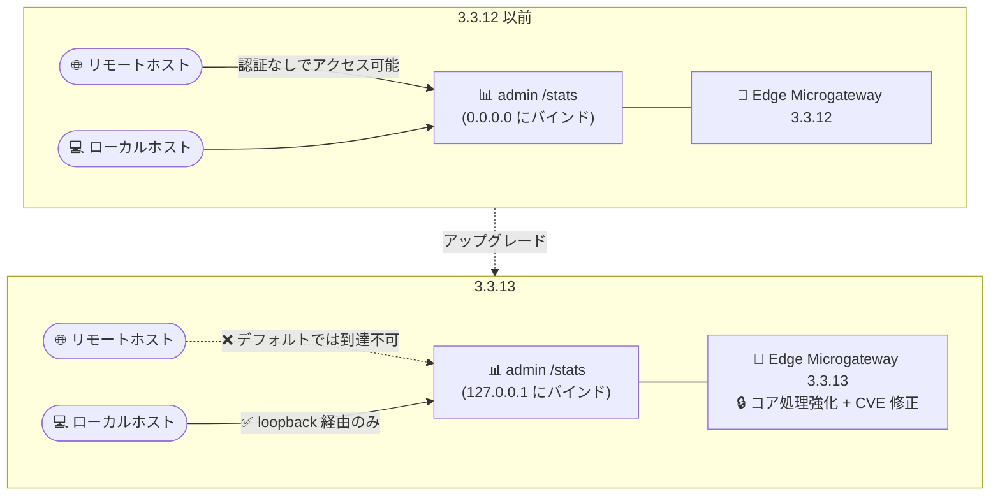

# Apigee Edge for Public Cloud: Edge Microgateway 3.3.13 リリース

**リリース日**: 2026-11-23

**サービス**: Apigee Edge for Public Cloud

**機能**: Edge Microgateway 3.3.13 (admin /stats エンドポイントのバインド変更 + セキュリティ強化 + configure 不具合修正)

**ステータス**: リリース済み (破壊的変更を含む)

📊 [このアップデートのインフォグラフィックを見る](https://takech9203.github.io/google-cloud-news-summary/20261123-apigee-edge-microgateway-3-3-13.html)

## 概要

2026 年 11 月 23 日、Apigee は Edge Microgateway 3.3.13 をリリースしました。Edge Microgateway は Apigee Edge と連携して動作する軽量な API ゲートウェイで、バックエンドサービスの近くに配置して OAuth 認証やクォータなどの API 管理機能を提供します。今回のリリースは、前回 3.3.12 (2026 年 11 月 4 日) に続くセキュリティ中心のメンテナンスリリースです。

最も重要な変更は**破壊的変更 (Breaking Change)** である admin `/stats` エンドポイントのデフォルトバインドアドレスの変更です。3.3.13 以降、`/stats` エンドポイントはすべてのネットワークインターフェース (`0.0.0.0`) ではなく、ループバックアドレス (`127.0.0.1`) にデフォルトでバインドされます。これは認証なしのリモートアクセスを防止するためのセキュリティ強化です。リモートから `/stats` を監視ツール等で参照していた環境では、アップグレード後に到達不能になるため対応が必要です。

このほか、設定 TLS オプション処理やリクエストパス正規化などのコア処理のセキュリティ強化、npm 依存関係・Docker ベースイメージの CVE 対応、初回 `edgemicro configure` 失敗の不具合修正が含まれます。コンポーネントバージョンは microgateway 3.3.13、plugins 3.3.9、edgeauth 3.2.2 です。

**アップデート前の課題**

- admin `/stats` エンドポイントがデフォルトで `0.0.0.0` (全ネットワークインターフェース) にバインドされており、認証なしでリモートから統計情報にアクセスされるリスクがあった
- 設定の TLS オプション処理、ローカルプロキシのシリアライゼーション、環境タグのエスケープに強化の余地があった (570053366)
- URL マッチング・ターゲットルーティングのパス正規化、hop-by-hop ヘッダーの扱い、リクエストパターンキャッシュ、メトリクスヘッダー処理に強化の余地があった (587833624)
- `tmp` および `rimraf` パッケージの API 更新に起因して、初回の `edgemicro configure` / `edgemicro private configure` が edgemicro-auth のデプロイ中に失敗していた (587349448)
- npm 依存関係 (CVE-2026-118764 / CVE-2026-118773) と Docker イメージの Debian OS パッケージ (CVE-2026-27171 / CVE-2026-85091) に既知の脆弱性が残っていた

**アップデート後の改善**

- `/stats` エンドポイントがデフォルトでループバック (`127.0.0.1`) のみにバインドされ、認証なしリモートアクセスが防止された
- 設定 TLS オプション処理・ローカルプロキシシリアライゼーション・環境タグエスケープが強化された
- パス正規化、hop-by-hop ヘッダーフィルタリング、リクエストパターンキャッシュの境界設定、メトリクスヘッダー処理などコアリクエスト処理が強化された
- 初回 `edgemicro configure` / `edgemicro private configure` が正常に完了するようになった
- npm 依存更新と Docker ベースイメージの `node:24.22.3-trixie-slim` への更新により、計 4 件の CVE が修正された

## アーキテクチャ図



破壊的変更である admin `/stats` エンドポイントのバインドアドレス変更 (Before/After) を示しています。3.3.13 ではデフォルトでループバックのみにバインドされ、リモートホストからの認証なしアクセスが防止されます。

## サービスアップデートの詳細

### 主要機能

1. **【破壊的変更】admin /stats エンドポイントのデフォルトバインドアドレス変更**
   - 3.3.13 以降、admin `/stats` エンドポイントはデフォルトで全ネットワークインターフェース (`0.0.0.0`) ではなくループバック (`127.0.0.1`) にバインドされる
   - 目的は認証なしのリモートアクセスの防止
   - リモートの監視システムなどから `/stats` を直接参照していた場合、アップグレード後は到達できなくなるため、ローカル経由での取得への変更などの対応が必要

2. **コア処理のセキュリティ強化**
   - 設定の TLS オプション処理、ローカルプロキシのシリアライゼーション、環境タグのエスケープを強化 (Issue 570053366)
   - URL マッチングとターゲットルーティングにおけるリクエストパスの正規化 (canonicalization) を強化 (Issue 587833624)
   - hop-by-hop ヘッダーのフィルタリング、リクエストパターンキャッシュの境界設定 (bounded caching)、メトリクスヘッダー処理を強化 (Issue 587833624)

3. **脆弱性 (CVE) の修正**
   - `edgemicro` パッケージ: npm 依存関係の更新により CVE-2026-118764、CVE-2026-118773 を修正
   - Docker イメージ: ベースイメージを `node:24.22.3-trixie-slim` に更新し、Debian OS パッケージの CVE-2026-27171、CVE-2026-85091 を修正

4. **初回 configure 失敗の不具合修正**
   - `tmp` および `rimraf` パッケージの API 更新に起因し、初回の `edgemicro configure` および `edgemicro private configure` が edgemicro-auth のデプロイ中に失敗する問題を修正 (Issue 587349448)

## 技術仕様

### コンポーネントバージョン

| コンポーネント | バージョン |
|------|------|
| microgateway | 3.3.13 |
| plugins | 3.3.9 |
| edgeauth | 3.2.2 |

### 修正された脆弱性

| 対象 | CVE | 内容 |
|------|------|------|
| edgemicro パッケージ | CVE-2026-118764、CVE-2026-118773 | npm 依存関係の更新 |
| Docker イメージ | CVE-2026-27171、CVE-2026-85091 | ベースイメージを `node:24.22.3-trixie-slim` に更新、Debian OS パッケージを修正 |

### 修正・強化内容 (Issue ID 別)

| Issue ID | 種別 | 内容 |
|------|------|------|
| 587349448 | Bug | 初回 `edgemicro configure` / `edgemicro private configure` が edgemicro-auth デプロイで失敗する問題を修正 |
| 570053366 | Security | 設定 TLS オプション処理、ローカルプロキシシリアライゼーション、環境タグエスケープの強化 |
| 587833624 | Security | パス正規化、hop-by-hop ヘッダーフィルタリング、リクエストパターンキャッシュ境界、メトリクスヘッダー処理の強化 |

## 設定方法

### 前提条件

1. Edge Microgateway 3.3.12 と同様、サポート対象の Node.js バージョン (22、24、26) で運用していること (npm インストールの場合)
2. リモートから admin `/stats` エンドポイントを参照している場合は、アップグレード前に影響範囲を確認しておくこと

### 手順

#### ステップ 1: npm インストールのアップグレード

```bash
npm install -g edgemicro@3.3.13
```

npm アップグレードの詳細手順は公式の「Upgrading Edge Microgateway」ドキュメントを参照してください。

#### ステップ 2: Docker デプロイメントのアップグレード

```bash
# 3.3.13 の Docker イメージを取得
docker pull gcr.io/apigee-microgateway/edgemicro:3.3.13
```

3.3.13 の Docker イメージは `node:24.22.3-trixie-slim` ベースでビルドされており、Debian OS パッケージの CVE 修正を含みます。

#### ステップ 3: /stats エンドポイントの参照経路の確認

アップグレード後、`/stats` エンドポイントはデフォルトでループバックのみにバインドされます。リモートの監視システムから直接参照していた場合は、Edge Microgateway と同一ホスト (ローカル) 経由で統計情報を取得する構成に見直してください。

## メリット

### ビジネス面

- **セキュリティリスクの低減**: 認証なしでリモートから統計情報へアクセスされる経路がデフォルトで閉じられ、情報漏えいリスクとコンプライアンス指摘事項を削減できる
- **CVE 対応の一括適用**: npm 依存関係と Docker イメージの計 4 件の CVE 修正が 1 回のアップグレードで適用できる

### 技術面

- **セキュアバイデフォルトの運用**: `/stats` のループバックバインドにより、追加設定なしで安全側の構成が標準になる
- **コアリクエスト処理の堅牢化**: パス正規化や hop-by-hop ヘッダーフィルタリングの強化により、URL マッチング・ルーティングに関わる攻撃経路が狭まる
- **初期構築の信頼性向上**: 初回 `edgemicro configure` の失敗が解消され、新規環境のセットアップが確実に完了する

## デメリット・制約事項

### 制限事項

- 3.3.13 以降、admin `/stats` エンドポイントはデフォルトではリモートホストから到達できない (ループバックのみ)

### 考慮すべき点

- リモート監視ツールや外形監視で `/stats` を直接参照している環境では、アップグレード後に統計取得が失敗する。アップグレード前に参照経路を棚卸しし、ローカル経由での取得に変更するなどの対応を計画する
- 3.3.12 で導入された破壊的変更 (Node.js 20 サポート終了、Docker イメージからの npm / npx 削除) を未適用のまま 3.3.13 に一気にアップグレードする場合は、それらの影響もあわせて確認する

## ユースケース

### ユースケース 1: セキュリティパッチの定期適用

**シナリオ**: npm インストールした Edge Microgateway 3.3.12 を運用しており、セキュリティチームから依存パッケージの CVE (CVE-2026-118764 / CVE-2026-118773) への対応を求められている。

**実装例**:
```bash
npm install -g edgemicro@3.3.13
```

**効果**: npm 依存関係の CVE 修正とコアリクエスト処理の強化が適用され、セキュリティ態勢を維持できる。

### ユースケース 2: /stats をリモート監視している環境の移行

**シナリオ**: Kubernetes 上で Edge Microgateway の Docker イメージを運用しており、別 Pod の監視エージェントが `/stats` エンドポイントをリモートから参照してメトリクスを収集している。

**効果**: 3.3.13 では `/stats` がループバックのみにバインドされるため、サイドカーコンテナなど同一ネットワーク名前空間内からの収集に変更することで、認証なしリモートアクセスを塞ぎつつメトリクス収集を継続できる。

## 関連サービス・機能

- **Apigee Edge for Public Cloud**: Edge Microgateway の管理プレーン。API プロキシ、API プロダクト、アナリティクスの管理を担う
- **Artifact Registry / Container Registry (gcr.io)**: 公式 Docker イメージ `gcr.io/apigee-microgateway/edgemicro` の配布元
- **Apigee X / hybrid**: Google Cloud の最新世代 API 管理プラットフォーム。長期的には Apigee Edge からの移行先の選択肢となる

## 参考リンク

- 📊 [インフォグラフィック](https://takech9203.github.io/google-cloud-news-summary/20261123-apigee-edge-microgateway-3-3-13.html)
- [公式リリースノート](https://docs.cloud.google.com/release-notes#November_23_2026)
- [Edge Microgateway リリースノート](https://docs.apigee.com/release/notes/edge-microgateway-release-notes-0)
- [Upgrading Edge Microgateway](https://docs.apigee.com/api-platform/microgateway/3.3.x/operation-and-configuration-reference-edge-microgateway#upgradingedgemicrogateway)
- [Supported software and supported versions](https://docs.apigee.com/release/supported-software#apigeeedgemicrogateway)

## まとめ

Edge Microgateway 3.3.13 は、admin `/stats` エンドポイントのループバックバインドへの変更という破壊的変更を含むセキュリティ強化リリースです。コアリクエスト処理の強化、4 件の CVE 修正、初回 configure 失敗の修正が含まれるため、すべての利用者にアップグレードが推奨されます。適用前に `/stats` をリモートから参照する運用の有無を確認し、必要に応じてローカル経由のメトリクス収集へ構成を見直してから `edgemicro@3.3.13` または Docker イメージ 3.3.13 へ移行してください。

---

**タグ**: #Apigee #EdgeMicrogateway #セキュリティ #CVE #破壊的変更 #APIゲートウェイ #Docker
