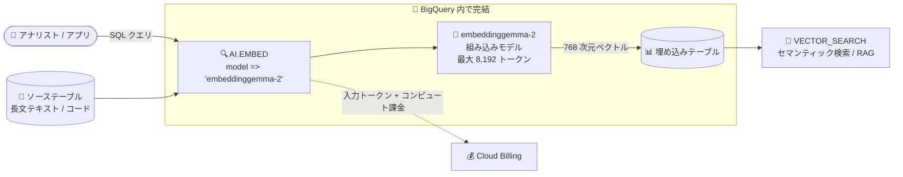

# BigQuery: 組み込み埋め込みモデル embeddinggemma-2 が AI.EMBED で利用可能に (Preview)

**リリース日**: 2026-11-23

**サービス**: BigQuery (BigQuery ML)

**機能**: AI.EMBED 関数向け組み込みモデル embeddinggemma-2

**ステータス**: Preview

📊 [このアップデートのインフォグラフィックを見る](https://takech9203.github.io/google-cloud-news-summary/20261123-bigquery-embeddinggemma-2-preview.html)

## 概要

BigQuery ML の `AI.EMBED` 関数で、新しい組み込み埋め込みモデル `embeddinggemma-2` が Preview として利用可能になりました。`model => 'embeddinggemma-2'` と指定するだけで、Vertex AI エンドポイントや Cloud リソース接続のセットアップなしに、BigQuery 内で直接テキスト埋め込みを生成できます。

embeddinggemma-2 は 8,192 トークンのコンテキストウィンドウをサポートし、長文テキストやコード文字列の埋め込みに最適化されています。既存の組み込みモデル `embeddinggemma-300m` (最大 2,048 トークン、短い文字列向け) と比較して 4 倍のシーケンス長を扱えるため、記事全文やソースコードのようなコンテンツを分割せずにそのまま埋め込みベクトル化し、セマンティック検索や RAG のための大規模なバッチ埋め込み生成を BigQuery のスケールで実行できます。多言語タスクとコーディングタスクに特化しており、出力次元は 768 です。

課金は Vertex AI (Agent Platform) 側では発生せず、クエリを実行したプロジェクトに対して「モデル入力トークン」と「BigQuery コンピュート (スロットまたはスキャンバイト)」の 2 要素で請求される新しい課金モデルが採用されています。

**アップデート前の課題**

- 組み込みモデルは `embeddinggemma-300m` のみで、最大シーケンス長が 2,048 トークン (推奨は 128 トークン以下の短い文字列) に限られ、長文テキストやコードの埋め込みには不向きだった
- 長いコンテキスト (8,192 トークン) を扱うには `gemini-embedding-2` などの Vertex AI エンドポイントを指定する必要があり、Vertex AI 課金や接続・権限 (Vertex AI User ロール) のセットアップが発生するケースがあった
- 長文を組み込みモデルで処理する場合、チャンク分割などの前処理をユーザー側で設計する必要があった

**アップデート後の改善**

- `model => 'embeddinggemma-2'` の指定だけで、8,192 トークンまでの長文テキスト・コードを BigQuery 内で直接埋め込みベクトル化できるようになった
- Cloud リソース接続や Vertex AI ロールが不要になり、`bigquery.jobs.create` と `bigquery.tables.getData` 権限のみで実行可能 (Vertex AI 側のセットアップ・課金なし)
- NULL 値、空文字列、8,192 トークンを超えて切り捨てられたトークンは課金対象外となり、コスト効率よく大規模バッチ埋め込みを実行できる

## アーキテクチャ図



埋め込み生成が Vertex AI エンドポイントを経由せず BigQuery 内で完結するデータフローです。生成した 768 次元ベクトルは `VECTOR_SEARCH` と組み合わせてセマンティック検索や RAG に活用できます。

## サービスアップデートの詳細

### 主要機能

1. **8,192 トークンの長いコンテキストウィンドウ**
   - embeddinggemma-300m の 2,048 トークン (推奨 128 トークン以下) に対し、4 倍のシーケンス長をサポート
   - 記事全文、ドキュメント、ソースコードなどを分割せずに埋め込み可能
   - 長文テキストとコード文字列の埋め込みに最適化され、多言語・コーディングタスクに特化

2. **セットアップ不要の組み込みモデル**
   - Vertex AI エンドポイント、Cloud リソース接続、`roles/aiplatform.user` が一切不要
   - `bigquery.jobs.create` (クエリ実行プロジェクト) と `bigquery.tables.getData` (ソーステーブル) の権限のみで利用可能
   - `SELECT AI.EMBED('text', model => 'embeddinggemma-2')` の 1 行で実行できる

3. **トークンベースの新しい課金モデル**
   - モデル入力トークン + BigQuery コンピュート (スロットまたはスキャンバイト) の 2 要素課金
   - 出力埋め込み、NULL 値、空文字列、8,192 トークン超過分の切り捨てトークンは課金対象外
   - 課金済み入力トークンは Cloud Billing レポートで確認可能

## 技術仕様

### 組み込みモデルの比較 (embeddinggemma-2 vs embeddinggemma-300m)

| 項目 | embeddinggemma-2 (新・Preview) | embeddinggemma-300m (既存) |
|------|-------------------------------|---------------------------|
| 最大シーケンス長 | 8,192 トークン | 2,048 トークン |
| 出力次元 | 768 | 768 |
| 得意分野 | 長文テキスト・コードの埋め込み、多言語・コーディングタスク | 短い文字列 (128 トークン以下) の埋め込み、多言語タスク |
| 埋め込み処理の場所 | BigQuery 内 | BigQuery 内 |
| 課金 | モデル入力トークン + BigQuery コンピュート | BigQuery コンピュートのみ |
| Vertex AI セットアップ | 不要 | 不要 |
| Assured Workloads | 利用不可 | 利用可 |

### Vertex AI エンドポイントモデルとの位置づけ

| モデル指定 | 最大シーケンス長 | 出力次元 | 課金 |
|-----------|----------------|---------|------|
| `model => 'embeddinggemma-2'` | 8,192 トークン | 768 | BigQuery 側のみ (入力トークン + コンピュート) |
| `endpoint => 'gemini-embedding-2'` | 8,192 トークン | 最大 3,072 (マルチモーダル対応) | Vertex AI 課金 |
| `endpoint => 'gemini-embedding-001'` | 2,048 トークン | 最大 3,072 | Vertex AI 課金 |
| `endpoint => 'text-embedding-005'` | 2,048 トークン | 最大 768 | Vertex AI 課金 |

### パラメータに関する注意

- `task_type` パラメータは embeddinggemma-2 では非対応 (NULL または省略が必須)
- 入力はテキスト (STRING 列、文字列リテラル、文字列を返す式) に対応

### データ所在地 (embeddinggemma-2 指定時)

| クエリ実行ロケーション | データ処理場所 |
|----------------------|---------------|
| us マルチリージョン / 米国内シングルリージョン | 米国内で処理 |
| eu マルチリージョン / EU 内シングルリージョン (europe-west2、europe-west6 を除く) | EU 内で処理 |
| その他 (europe-west2、europe-west6 含む) | データ所在地のコミットメントなし (リージョン外で処理される可能性あり) |

## 設定方法

### 前提条件

1. クエリを実行するプロジェクトに対する `bigquery.jobs.create` 権限
2. ソーステーブルに対する `bigquery.tables.getData` 権限

(Cloud リソース接続や Vertex AI ロールは不要)

### 手順

#### ステップ 1: 単一テキストの埋め込み生成

```sql
SELECT AI.EMBED(
  'A piece of text to embed',
  model => 'embeddinggemma-2') AS embedding;
```

`embedding.result` 列に 768 次元の配列が返されます。`embedding.status` が空文字列であれば成功です。

#### ステップ 2: テーブル全体の埋め込みを生成して保存

```sql
CREATE OR REPLACE TABLE mydataset.docs_embeddings AS
SELECT
  title,
  body,
  AI.EMBED(body, model => 'embeddinggemma-2').result AS embedding
FROM mydataset.long_documents;
```

複数のクエリで同じ埋め込みを再利用する場合は、結果をテーブルに保存することが推奨されています。

#### ステップ 3: VECTOR_SEARCH でセマンティック検索

```sql
SELECT base.title, base.body
FROM VECTOR_SEARCH(
  TABLE mydataset.docs_embeddings,
  'embedding',
  (SELECT AI.EMBED('検索したいトピック', model => 'embeddinggemma-2').result),
  top_k => 5);
```

## メリット

### ビジネス面

- **セットアップコストの削減**: Vertex AI の接続・権限設定が不要なため、データアナリストが SQL だけで埋め込み生成を開始でき、導入までのリードタイムが短縮される
- **コストの透明性**: 課金済み入力トークンが Cloud Billing レポートで確認でき、NULL・空文字列・超過分が課金されないため無駄なコストが発生しにくい

### 技術面

- **長文対応**: 8,192 トークンのコンテキストウィンドウにより、チャンク分割なしで記事全文やコードファイルを埋め込み可能
- **BigQuery 内で完結**: データを外部に移動せず、BigQuery のスケールで大規模バッチ埋め込みを直接実行できる
- **VECTOR_SEARCH との統合**: 生成した埋め込みをそのままベクトル検索や RAG パイプラインに組み込める

## デメリット・制約事項

### 制限事項

- Preview 段階のため、SLA の対象外であり仕様が変更される可能性がある
- 生成される埋め込みは実行ごとにわずかに変動する可能性がある (コサイン距離で最大 1e-4)。ベクトル比較は浮動小数点の完全一致ではなく距離しきい値で行う必要がある
- Assured Workloads プロジェクトでは利用不可 (代わりに `embeddinggemma-300m` を使用する)
- `task_type` パラメータは使用不可 (NULL または省略が必須)
- マルチモーダル入力 (画像など) は非対応。マルチモーダル埋め込みには `gemini-embedding-2` エンドポイントを使用する

### 考慮すべき点

- embeddinggemma-300m と異なり、BigQuery コンピュートに加えてモデル入力トークン課金が発生するため、短い文字列 (128 トークン以下) 中心のワークロードでは embeddinggemma-300m の方がコスト効率が良い場合がある
- europe-west2 / europe-west6 を含む一部ロケーションではデータ所在地のコミットメントがないため、コンプライアンス要件がある場合はクエリ実行リージョンを確認する必要がある
- 異なる埋め込みモデル同士は数学的に互換性がないため、既存の embeddinggemma-300m や text-embedding-005 で生成済みのベクトルと混在させて検索することはできない

## ユースケース

### ユースケース 1: 長文ドキュメントのセマンティック検索基盤

**シナリオ**: 社内ナレッジベースやサポート記事 (数千〜数万件、各数千トークン) を BigQuery に蓄積しており、チャンク分割なしで記事単位のセマンティック検索を構築したい。

**実装例**:
```sql
CREATE OR REPLACE TABLE kb.article_embeddings AS
SELECT
  article_id,
  title,
  AI.EMBED(full_text, model => 'embeddinggemma-2').result AS embedding
FROM kb.articles;
```

**効果**: 8,192 トークンまでの記事を分割せずにそのまま埋め込み化でき、チャンク管理のパイプラインが不要になる。Vertex AI のセットアップなしで即日構築できる。

### ユースケース 2: ソースコードの類似検索・重複検出

**シナリオ**: データウェアハウスに蓄積した SQL スクリプトやソースコードスニペットに対して、類似コードの検索や重複検出を行いたい。

**効果**: embeddinggemma-2 はコーディングタスクに特化しているため、コード文字列の意味的な類似性を捉えた埋め込みを生成でき、VECTOR_SEARCH と組み合わせて類似コード検索を SQL のみで実現できる。

## 料金

embeddinggemma-2 は Vertex AI (Agent Platform) 課金が発生せず、クエリを実行したプロジェクトに対して以下の 2 要素で課金されます。

| 課金要素 | 内容 |
|---------|------|
| モデル入力トークン | embeddinggemma-2 が処理した入力トークン。出力埋め込みは課金対象外。NULL 値、空文字列、8,192 トークンを超えて切り捨てられたトークンも課金対象外 |
| BigQuery コンピュート | クエリの残りの部分に対するスロット使用量またはスキャンバイト (オンデマンド / Editions の料金モデルに従う) |

参考: 既存の embeddinggemma-300m は BigQuery コンピュート (スロットまたはスキャンバイト) のみで課金されます。

入力トークンの具体的な単価は [BigQuery 料金ページの EmbeddingGemma 2 セクション](https://cloud.google.com/bigquery/pricing#embeddinggemma-2-on-bigquery) を参照してください。課金済み入力トークンは Cloud Billing レポートで確認できます。

## 利用可能リージョン

us / eu マルチリージョンおよび各シングルリージョンで実行できますが、データ所在地のコミットメントはロケーションにより異なります (技術仕様の「データ所在地」の表を参照)。us・米国内リージョンでは米国内、eu・EU 内リージョン (europe-west2 / europe-west6 を除く) では EU 内でデータが処理されます。

## 関連サービス・機能

- **VECTOR_SEARCH 関数 / ベクトルインデックス**: 生成した埋め込みに対するセマンティック検索。AI.EMBED の出力をそのまま検索クエリに利用可能
- **embeddinggemma-300m**: 既存の組み込み埋め込みモデル。短い文字列向けで、Assured Workloads プロジェクトではこちらを使用
- **gemini-embedding-2 (Vertex AI エンドポイント)**: テキスト・画像・音声・動画・PDF を統合空間に埋め込むマルチモーダルモデル。最大 3,072 次元・8,192 トークン対応で、マルチモーダル要件がある場合の選択肢
- **Cloud Billing レポート**: embeddinggemma-2 の課金済み入力トークンの確認
- **AI.GENERATE / AI.CLASSIFY などの生成 AI 関数**: BigQuery 内で LLM 推論を行う関数群。なお、生成 AI 関数向けのトークンクォータ (日次) は AI.EMBED には適用されない

## 参考リンク

- 📊 [インフォグラフィック](https://takech9203.github.io/google-cloud-news-summary/20261123-bigquery-embeddinggemma-2-preview.html)
- [公式リリースノート](https://docs.cloud.google.com/release-notes#November_23_2026)
- [AI.EMBED 関数リファレンス](https://docs.cloud.google.com/bigquery/docs/reference/standard-sql/bigqueryml-syntax-ai-embed)
- [モデルの選択ガイド](https://docs.cloud.google.com/bigquery/docs/reference/standard-sql/bigqueryml-syntax-ai-embed#choose_a_model)
- [課金と権限](https://docs.cloud.google.com/bigquery/docs/reference/standard-sql/bigqueryml-syntax-ai-embed#billing_and_permissions)
- [BigQuery 料金ページ](https://cloud.google.com/bigquery/pricing#compute-pricing-models)

## まとめ

embeddinggemma-2 の登場により、Vertex AI のセットアップなしに 8,192 トークンまでの長文テキスト・コードの埋め込みを BigQuery 内で大規模に生成できるようになりました。長文ドキュメントのセマンティック検索や RAG 基盤を SQL だけで構築したいチームは、Preview 段階から検証を始める価値があります。短い文字列中心のワークロードでは、コンピュート課金のみの embeddinggemma-300m との使い分けを検討してください。

---

**タグ**: BigQuery, BigQuery ML, AI.EMBED, embeddinggemma-2, Embeddings, Vector Search, Preview, Generative AI
