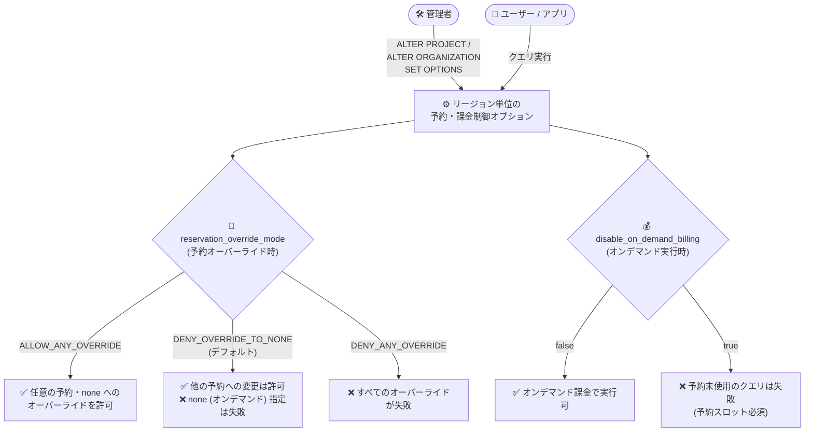

# BigQuery: 予約・課金制御オプション reservation_override_mode / disable_on_demand_billing が GA

**リリース日**: 2026-11-23

**サービス**: BigQuery

**機能**: 予約・課金制御オプション (reservation_override_mode / disable_on_demand_billing)

**ステータス**: GA (一般提供)

📊 [このアップデートのインフォグラフィックを見る](https://takech9203.github.io/google-cloud-news-summary/20261123-bigquery-reservation-billing-controls-ga.html)

## 概要

BigQuery の予約・課金制御オプションである `reservation_override_mode` と `disable_on_demand_billing` が一般提供 (GA) になりました。これらはリージョン単位のオプションで、`ALTER PROJECT SET OPTIONS` および `ALTER ORGANIZATION SET OPTIONS` ステートメントを使って設定し、クエリが割り当て済みの予約 (Reservation) をオーバーライドしてオンデマンド課金に切り替えられるかどうか、またはクエリに予約スロットの使用を必須にするかどうかを制御できます。

BigQuery では、プロジェクト・フォルダ・組織に割り当てられたデフォルトの予約を、クエリ実行時に別の予約や `none` (オンデマンド課金) に柔軟にオーバーライドできます。これは便利な一方で、組織としてコストの予測可能性を担保したい場合には統制が必要になります。今回 GA となった 2 つのオプションにより、管理者はプロジェクトまたは組織レベルで「柔軟な予約利用を許可する」「予約スロットの使用を必須にする」といったポリシーをリージョンごとに適用できるようになりました。

FinOps やコスト管理を担う管理者、マルチプロジェクト環境で BigQuery の課金形態を統制したい組織管理者にとって重要なアップデートです。

**アップデート前の課題**

- これらの予約・課金制御オプションはプレビュー段階であり、本番環境の統制ポリシーとして採用するには GA を待つ必要があった
- クエリ実行時に割り当て済み予約をオーバーライドして `none` (オンデマンド課金) を指定でき、意図しないオンデマンド課金が発生するリスクを組織的に抑止する仕組みが限られていた
- 予約未割り当てのプロジェクトはデフォルトでオンデマンド課金となるため、「すべてのクエリを予約スロットで実行させる」という統制を強制する手段が必要だった

**アップデート後の改善**

- `reservation_override_mode` と `disable_on_demand_billing` が GA となり、本番環境の統制ポリシーとして正式に利用可能になった
- `reservation_override_mode` により、予約のオーバーライドを「すべて許可」「オンデマンド (`none`) への変更のみ拒否」「すべて拒否」の 3 段階で制御できるようになった
- `disable_on_demand_billing` を `true` に設定すると、リージョン内のすべてのクエリに割り当て済み予約の使用を必須化でき、予約を使わないクエリは失敗するようになった

## アーキテクチャ図



管理者が DDL ステートメントでリージョン単位のポリシーを設定し、クエリ実行時の予約オーバーライドとオンデマンド課金の可否が制御される流れを示しています。

## サービスアップデートの詳細

### 主要機能

1. **reservation_override_mode (STRING)**
   - リージョン内でクエリの予約をどのようにオーバーライドできるかを指定する
   - `'ALLOW_ANY_OVERRIDE'`: オンデマンド課金の強制 (`'none'`) を含む、すべての予約オーバーライドを許可
   - `'DENY_OVERRIDE_TO_NONE'` (デフォルト): 他の既存の予約へのオーバーライドは許可するが、明示的なオンデマンド指定 (`'none'`) は失敗する
   - `'DENY_ANY_OVERRIDE'`: 割り当て済み予約に対するあらゆるオーバーライドの試行が失敗する

2. **disable_on_demand_billing (BOOL)**
   - リージョン内でオンデマンド課金を無効化するかどうかを指定する
   - `true` に設定すると、すべてのクエリは割り当て済みの予約を使用する必要があり、使用しない場合はクエリが失敗する

3. **プロジェクト / 組織レベルでのリージョン単位設定**
   - どちらのオプションも `region-REGION.` プレフィックス付きのリージョン単位オプションとして設定する
   - `ALTER PROJECT SET OPTIONS` (プロジェクトレベル) と `ALTER ORGANIZATION SET OPTIONS` (組織レベル) の両方で利用可能

## 技術仕様

### オプション一覧

| 項目 | 詳細 |
|------|------|
| `reservation_override_mode` | STRING 型。`'ALLOW_ANY_OVERRIDE'` / `'DENY_OVERRIDE_TO_NONE'` (デフォルト) / `'DENY_ANY_OVERRIDE'` |
| `disable_on_demand_billing` | BOOL 型。`true` の場合、すべてのクエリに割り当て済み予約の使用が必須となり、使用しないクエリは失敗する |
| 適用スコープ | プロジェクトまたは組織 (リージョン単位、`region-REGION.` プレフィックスが必要) |
| 設定方法 | `ALTER PROJECT SET OPTIONS` / `ALTER ORGANIZATION SET OPTIONS` DDL ステートメント |
| 値のクリア | オプションに `NULL` を設定するとその値がクリアされる |

### 必要な権限

| 権限 | リソース |
|------|----------|
| `bigquery.config.update` | 変更対象のプロジェクトまたは組織 |

## 設定方法

### 前提条件

1. 変更対象のプロジェクトまたは組織に対する `bigquery.config.update` IAM 権限を持っていること
2. 対象リージョン (例: `us`、`europe-west6`) を確認しておくこと (1 つのステートメントで指定できるリージョンは 1 つ)

### 手順

#### ステップ 1: プロジェクトレベルで予約オーバーライドを制御する

```sql
ALTER PROJECT PROJECT_ID
SET OPTIONS (
  `region-us.reservation_override_mode` = 'ALLOW_ANY_OVERRIDE'
);
```

`PROJECT_ID` のプロジェクトについて、us リージョンでオンデマンド (`'none'`) を含む任意の予約オーバーライドを許可します。オーバーライドを完全に禁止する場合は `'DENY_ANY_OVERRIDE'` を指定します。

#### ステップ 2: 組織レベルでオンデマンド課金を無効化する

```sql
ALTER ORGANIZATION
SET OPTIONS (
  `region-us.disable_on_demand_billing` = true
);
```

組織内の us リージョンで実行されるすべてのクエリに割り当て済み予約の使用を必須化します。予約を使用しないクエリは失敗します。

#### ステップ 3: 設定を解除する

```sql
ALTER PROJECT PROJECT_ID
SET OPTIONS (
  `region-us.reservation_override_mode` = NULL,
  `region-us.disable_on_demand_billing` = NULL
);
```

オプションに `NULL` を設定すると、そのプロジェクトの値がクリアされます。

## メリット

### ビジネス面

- **コストの予測可能性**: 予約スロットの使用を必須化することで、意図しないオンデマンド課金 (スキャン量ベースの従量課金) の発生を防ぎ、コストを予約 (キャパシティベース) に集約できる
- **ガバナンスの強化**: プロジェクト・組織レベルで課金形態のポリシーを一元的に適用でき、個々のユーザーの実行時指定に依存しない統制が可能になる

### 技術面

- **SQL (DDL) だけで設定可能**: `ALTER PROJECT` / `ALTER ORGANIZATION` の DDL ステートメントで設定でき、追加のインフラやツールが不要
- **リージョン単位の柔軟な制御**: リージョンごとに異なるポリシーを適用できるため、リージョンによって予約運用とオンデマンド運用を使い分けられる
- **段階的な制御レベル**: `reservation_override_mode` の 3 つの値により、完全許可から完全拒否まで要件に応じた強度を選択できる

## デメリット・制約事項

### 制限事項

- リージョン単位の設定であり、`region-REGION.` プレフィックスの指定が必要。1 つのステートメントで指定できるリージョンは 1 つ
- 設定には変更対象のプロジェクトまたは組織に対する `bigquery.config.update` 権限が必要

### 考慮すべき点

- `disable_on_demand_billing = true` を設定すると、予約が割り当てられていないクエリは失敗するため、事前に対象リージョンのすべてのワークロードに予約割り当てがあることを確認する必要がある
- `reservation_override_mode` のデフォルトは `'DENY_OVERRIDE_TO_NONE'` であり、明示的なオンデマンドへのオーバーライド (`'none'`) は既定で失敗する。実行時オーバーライドに依存している既存ワークフローへの影響を確認すること

## ユースケース

### ユースケース 1: 本番環境でのオンデマンド課金の全面禁止

**シナリオ**: 組織として BigQuery のコストを予約 (キャパシティベース課金) に一本化しており、スキャン量に応じて変動するオンデマンド課金の発生を防ぎたい。

**実装例**:
```sql
ALTER ORGANIZATION
SET OPTIONS (
  `region-us.disable_on_demand_billing` = true,
  `region-us.reservation_override_mode` = 'DENY_ANY_OVERRIDE'
);
```

**効果**: us リージョンでは予約を使用しないクエリが失敗し、割り当て済み予約のオーバーライドもできなくなるため、すべてのクエリコストが予約スロットに統制される。

### ユースケース 2: 開発プロジェクトでの柔軟な予約オーバーライドの許可

**シナリオ**: 開発用プロジェクトでは、検証のためにクエリ実行時に別の予約やオンデマンド課金へ柔軟に切り替えたい。

**実装例**:
```sql
ALTER PROJECT dev-project
SET OPTIONS (
  `region-us.reservation_override_mode` = 'ALLOW_ANY_OVERRIDE'
);
```

**効果**: 開発プロジェクトに限り、オンデマンド (`'none'`) を含む任意の予約オーバーライドが許可され、検証作業の自由度を確保できる。

## 料金

BigQuery の構成サービス (configuration service) の利用自体に追加料金はかかりません。クエリの課金は、予約 (キャパシティベース課金) またはオンデマンド課金の通常の BigQuery 料金体系に従います。

詳細は [BigQuery の料金ページ](https://cloud.google.com/bigquery/pricing) を参照してください。

## 関連サービス・機能

- **BigQuery Reservations (予約とワークロード管理)**: 本オプションの制御対象。予約の割り当て (プロジェクト / フォルダ / 組織) と、実行時の柔軟な予約指定 (オーバーライド) の仕組みを提供する
- **ALTER PROJECT / ALTER ORGANIZATION SET OPTIONS (DDL)**: 本オプションを含む、タイムゾーン・クエリタイムアウト・KMS キーなどのリージョン単位デフォルト設定を構成する DDL ステートメント
- **IAM (Identity and Access Management)**: 設定変更には `bigquery.config.update` 権限が必要

## 参考リンク

- 📊 [インフォグラフィック](https://takech9203.github.io/google-cloud-news-summary/20261123-bigquery-reservation-billing-controls-ga.html)
- [公式リリースノート (2026-11-23)](https://docs.cloud.google.com/release-notes#November_23_2026)
- [ドキュメント: デフォルト構成の設定 (予約・課金制御)](https://docs.cloud.google.com/bigquery/docs/default-configuration#reservation-controls)
- [ドキュメント: ALTER PROJECT SET OPTIONS オプション一覧](https://docs.cloud.google.com/bigquery/docs/reference/standard-sql/data-definition-language#project_set_options_list)
- [ドキュメント: 予約を使用したワークロード管理](https://docs.cloud.google.com/bigquery/docs/reservations-workload-management)
- [料金ページ](https://cloud.google.com/bigquery/pricing)

## まとめ

BigQuery のコストガバナンスを DDL ベースのリージョン単位ポリシーとして強制できる `reservation_override_mode` と `disable_on_demand_billing` が GA となり、本番環境での採用が可能になりました。予約中心のコスト運用を行っている組織は、意図しないオンデマンド課金を防ぐためにこれらのオプションの適用を検討することを推奨します。導入前には、対象リージョンの全ワークロードへの予約割り当て状況と、実行時オーバーライドに依存する既存処理への影響を必ず確認してください。

---

**タグ**: BigQuery, Reservations, FinOps, コスト管理, DDL, GA
