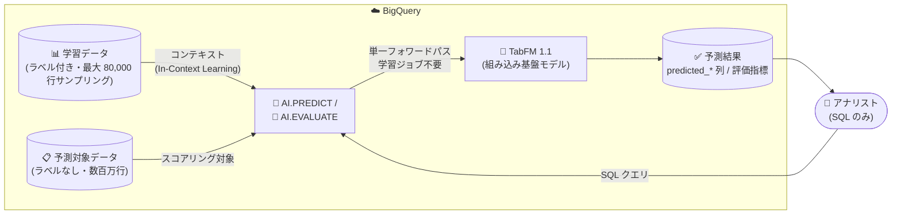

# BigQuery: TabFM 1.1 が AI.PREDICT / AI.EVALUATE のデフォルトモデルに (Preview)

**リリース日**: 2026-11-23

**サービス**: BigQuery (BigQuery ML)

**機能**: TabFM モデル バージョン 1.1

**ステータス**: Preview

📊 [このアップデートのインフォグラフィックを見る](https://takech9203.github.io/google-cloud-news-summary/20261123-bigquery-tabfm-1-1-preview.html)

## 概要

BigQuery ML の表形式データ向け基盤モデル (Tabular Foundation Model) である **TabFM のバージョン 1.1** が利用可能になり、`AI.PREDICT` 関数と `AI.EVALUATE` 関数で使用される**デフォルトモデル**になりました。本機能は Preview として提供されます。

TabFM は Google Research のオープンソース TabFM モデルの BigQuery 組み込み実装で、構造的因果モデルで生成された数億の合成データセットで事前学習された基盤モデルです。モデルの学習 (`CREATE MODEL`)、ハイパーパラメータ調整、特徴量エンジニアリングを一切行わずに、In-Context Learning によるゼロショットの回帰・分類を SQL だけで実行できます。予測精度は XGBoost やランダムフォレストといった従来の教師ありツリーベースアルゴリズムに匹敵するとされています。

バージョン 1.1 では精度の向上に加えて、入力上限の大幅な拡大 (サンプリング学習行 10,000 行 → 80,000 行、特徴量カラム 50 → 128) と大幅なレイテンシ改善 (最大 50 分の 1) が実現されました。インタラクティブなクエリでは約 1 秒で予測が返り、1 つの BigQuery ジョブで数百万行のスコアリングが可能になります。データアナリストやデータエンジニアが、ML 基盤を構築せずに本番規模の予測ワークロードを BigQuery 内で完結できるようになる点が大きな価値です。

**アップデート前の課題**

TabFM 1.0 では、以下の制約により適用できるワークロードが限られていました。

- サンプリング学習行 (コンテキストとして与える学習データ) の上限が 10,000 行で、大規模データセットの情報を十分に活用できなかった
- 特徴量カラムの上限が 50 で、特徴量の多いワイドテーブルにはそのまま適用できなかった
- 推論レイテンシが大きく、インタラクティブな分析や大規模バッチスコアリングには向かなかった

**アップデート後の改善**

- サンプリング学習行の上限が **80,000 行 (8 倍)** に拡大し、より多くのコンテキストで精度の高い予測が可能になった
- 特徴量カラムの上限が **128 (約 2.6 倍)** に拡大し、ワイドテーブルへの適用範囲が広がった
- レイテンシが**最大 50 分の 1** に改善され、インタラクティブクエリで約 1 秒の予測、1 ジョブで数百万行のスコアリングが可能になった
- `AI.PREDICT` / `AI.EVALUATE` のデフォルトモデルが 1.1 になったため、既存クエリは変更なしで新バージョンの恩恵を受けられる

## アーキテクチャ図



学習データ (コンテキスト) と予測対象データを SQL の `AI.PREDICT` に渡すだけで、組み込みの TabFM 1.1 モデルが単一フォワードパスで回帰・分類を実行します。`CREATE MODEL` によるモデル学習ステップは不要です。

## サービスアップデートの詳細

### 主要機能

1. **TabFM 1.1 がデフォルトモデルに**
   - `AI.PREDICT` と `AI.EVALUATE` の両関数で、TabFM 1.1 がデフォルトで使用される
   - 既存のクエリは書き換え不要で、精度向上・レイテンシ改善・スケール拡大の恩恵を自動的に受けられる

2. **入力上限の大幅拡大**
   - サンプリング学習行: 最大 80,000 行 (従来 10,000 行)
   - 特徴量カラム: 最大 128 (従来 50)。128 を超える特徴量が必要な場合は bqml-feedback@google.com への連絡が案内されている
   - 分類タスクは最大 10 クラスまで対応

3. **大幅なレイテンシ改善と高スループット**
   - レイテンシは最大 50 分の 1 に改善
   - インタラクティブクエリでは約 1 秒で予測を返却
   - 1 つの BigQuery ジョブで数百万行のスコアリングが可能

4. **設定可能なアンサンブル (`n_ensembles`)**
   - In-Context アンサンブルのメンバー数を 1〜32 で指定可能 (デフォルト: 4)
   - 値を増やすと精度と安定性が向上する一方、トークン消費が線形に増加
   - 1 または 2 に設定するとレイテンシとコストを削減できる

## 技術仕様

### TabFM 1.0 → 1.1 比較

| 項目 | TabFM 1.0 (従来) | TabFM 1.1 (今回) |
|------|------------------|------------------|
| サンプリング学習行の上限 | 10,000 行 | **80,000 行 (8 倍)** |
| 特徴量カラムの上限 | 50 | **128 (約 2.6 倍)** |
| レイテンシ | — | **最大 50 分の 1 に改善**、インタラクティブクエリで約 1 秒 |
| スコアリング規模 | — | 1 つの BigQuery ジョブで数百万行 |
| デフォルトモデル | — | AI.PREDICT / AI.EVALUATE のデフォルト |

### TabFM 1.1 の能力 (公式ドキュメントより)

| 項目 | 詳細 |
|------|------|
| 対応タスク | 回帰、分類 (最大 10 クラス) |
| 最大特徴量カラム数 | 128 |
| 最大サンプリング学習行数 | 80,000 行 |
| アンサンブル設定 | 対応 (デフォルト 4、有効範囲 1〜32) |
| 対応データ型 (特徴量・ラベル) | `STRING`, `BOOL`, `INT64`, `FLOAT64`, `NUMERIC`, `BIGNUMERIC` |
| タスク判定 | ラベル列が `STRING`/`BOOL` → 分類、数値型 → 回帰 (自動判定) |

### AI.PREDICT の構文

```sql
AI.PREDICT(
  { TABLE training_table | (training_query) },
  { TABLE prediction_table | (prediction_query) }
  [, label_col => 'LABEL_COL']      -- デフォルト: 'label'
  [, n_ensembles => NUM_ENSEMBLES]  -- 1〜32、デフォルト: 4
)
```

**出力列:**
- 回帰: `predicted_<label列名>` (学習データのラベル列と同じ型)
- 分類: `predicted_<label列名>` に加え、`predicted_<label列名>_probs` (`ARRAY<STRUCT<label STRING, prob FLOAT64>>`) で各クラスの確率を返す

### AI.EVALUATE の出力 (TabFM)

| タスク | 評価指標 |
|--------|---------|
| 回帰 | `mean_absolute_error`, `mean_squared_error`, `mean_squared_log_error`, `median_absolute_error`, `r2_score`, `explained_variance` |
| 分類 | `precision`, `recall`, `accuracy`, `f1_score` (マクロ平均) |

## 設定方法

### 前提条件

1. BigQuery が有効な Google Cloud プロジェクト (課金未設定の場合は BigQuery サンドボックスの無料枠で実行可能)
2. 学習データに `label` 列、または `label_col` で指定するラベル列が存在すること
3. 学習データの全特徴量カラムが、予測対象データに同じデータ型で存在すること (列の順序は不問)

### 手順

#### ステップ 1: ゼロショット分類を実行する

```sql
WITH prepared_data AS (
  SELECT *, RAND() <= 0.8 AS training
  FROM `bigquery-public-data.ml_datasets.penguins`
  WHERE sex IS NOT NULL AND sex != '.'
)
SELECT * FROM AI.PREDICT(
  -- 学習データ (コンテキスト)
  (SELECT * EXCEPT(training) FROM prepared_data WHERE training),
  -- 予測対象データ
  (SELECT * EXCEPT(training) FROM prepared_data WHERE NOT training),
  label_col => 'sex'
);
```

`CREATE MODEL` によるモデル作成なしで、`predicted_sex` (予測クラス) と `predicted_sex_probs` (クラスごとの確率) が返ります。

#### ステップ 2: 予測精度を評価する

```sql
WITH prepared_data AS (
  SELECT *, RAND() <= 0.8 AS training
  FROM `bigquery-public-data.ml_datasets.penguins`
  WHERE body_mass_g > 0
)
SELECT * FROM AI.EVALUATE(
  (SELECT * EXCEPT(training) FROM prepared_data WHERE training),
  (SELECT * EXCEPT(training) FROM prepared_data WHERE NOT training),
  label_col => 'body_mass_g',
  n_ensembles => 4
);
```

回帰タスクでは R² スコアや MAE などの指標が返り、ホールドアウトデータに対する精度をそのまま SQL で検証できます。

## メリット

### ビジネス面

- **ML 導入の初期コスト削減**: モデルの学習・チューニング・デプロイのパイプラインが不要になり、SQL が書ける人材だけで予測分析を開始できる
- **本番規模への即時スケール**: 1 ジョブで数百万行をスコアリングできるため、PoC から本番バッチまで同じクエリで対応できる
- **意思決定の高速化**: 約 1 秒のインタラクティブ予測により、アドホック分析やダッシュボードへの組み込みが現実的になる

### 技術面

- **移行作業ゼロ**: 1.1 はデフォルトモデルのため、既存の `AI.PREDICT` / `AI.EVALUATE` クエリは変更なしで性能向上の恩恵を受けられる
- **適用範囲の拡大**: 80,000 行のコンテキストと 128 特徴量により、従来は boosted tree などの学習型モデルが必要だったワイドテーブルにもゼロショットで対応可能
- **精度とコストの調整が容易**: `n_ensembles` パラメータ 1 つでレイテンシ・コストと精度のトレードオフを制御できる
- **商用利用可**: BigQuery 経由の TabFM 利用は Google Cloud 利用規約に従い商用利用が可能 (GitHub / Hugging Face の公開ウェイトに付く非商用ライセンスはセルフホスト時のみ適用)

## デメリット・制約事項

### 制限事項

- Preview 段階の機能であり、Pre-GA Offerings Terms が適用される (サポートが限定的な場合がある)
- 分類は最大 10 クラスまで
- サンプリング学習行は最大 80,000 行、特徴量カラムは最大 128 (超過する場合は bqml-feedback@google.com へ要相談)
- 特徴量・ラベルのデータ型は `STRING`, `BOOL`, `INT64`, `FLOAT64`, `NUMERIC`, `BIGNUMERIC` に限定
- Assured Workloads プロジェクトでは TabFM との組み合わせを使用できない

### 考慮すべき点

- データ処理のリージョン: US / EU のマルチリージョンおよび単一リージョンはそれぞれの域内で処理されるが、`europe-west2` (ロンドン)、`europe-west6` (スイス) を含むその他のロケーションにはデータレジデンシーのコミットメントがなく、クエリリージョン外で処理される可能性がある
- `n_ensembles` を増やすとトークン消費が線形に増加するため、大規模スコアリングではコストとのバランスを検討する
- より細かいモデルチューニングが必要な場合は、従来どおり boosted tree / random forest モデルを `CREATE MODEL` で学習し `ML.PREDICT` を使う選択肢が推奨されている

## ユースケース

### ユースケース 1: 学習パイプラインなしの大規模リードスコアリング

**シナリオ**: マーケティングチームが、過去の商談データ (成約/失注ラベル付き) をコンテキストに、数百万件の新規リードの成約確率を毎日スコアリングしたい。ML エンジニアはおらず、モデル学習パイプラインの運用は避けたい。

**実装例**:
```sql
SELECT lead_id, predicted_converted, predicted_converted_probs
FROM AI.PREDICT(
  (SELECT * FROM `crm.historical_deals`),   -- ラベル付き過去データ (最大 80,000 行サンプリング)
  (SELECT * FROM `crm.new_leads`),          -- 数百万件の新規リード
  label_col => 'converted'
);
```

**効果**: モデルの学習・デプロイなしで、1 つの BigQuery ジョブとして日次バッチスコアリングを実行できる。TabFM 1.1 の特徴量 128 カラム対応により、リッチな顧客属性をそのまま入力できる。

### ユースケース 2: ダッシュボードからのインタラクティブな数値予測

**シナリオ**: 需要予測ダッシュボードで、ユーザーが条件 (店舗、商品カテゴリなど) を変えるたびに、過去実績をコンテキストとした売上予測を即座に表示したい。

**効果**: TabFM 1.1 のレイテンシ改善 (インタラクティブクエリで約 1 秒) により、BI ツールからのオンデマンド予測クエリが実用的なレスポンスで動作する。回帰タスクはラベル列を数値型にするだけで自動的に有効になる。

## 料金

TabFM は、標準の BigQuery コンピューティング料金に加えて**トークンベースの料金**が適用されます。課金は以下の 2 つの要素で構成されます。

- **TabFM トークン**: クエリ内で TabFM モデルが消費したトークン (レートは BigQuery ML pricing ページを参照)
- **BigQuery コンピューティング**: Enterprise / Enterprise Plus エディションではスロット、オンデマンド料金では処理バイト数で課金

`n_ensembles` を増やすとトークン消費が線形に増えるため、精度要件に応じて 1〜2 に下げることでコストを削減できます。詳細は [BigQuery ML の料金ページ](https://cloud.google.com/bigquery/pricing#bigquery-ml-pricing) を参照してください。

## 利用可能リージョン

`AI.PREDICT` / `AI.EVALUATE` と TabFM モデルは、BigQuery ML の非リモートモデルがサポートされる[すべてのロケーション](https://docs.cloud.google.com/bigquery/docs/locations#locations-for-non-remote-models)で利用できます。データレジデンシーの扱いはクエリロケーションに依存します (「考慮すべき点」参照)。

## 関連サービス・機能

- **AI.PREDICT / AI.EVALUATE 関数**: TabFM を呼び出す BigQuery ML のマネージド AI 関数。学習ステップなしで回帰・分類と評価を実行
- **TimesFM (AI.FORECAST / AI.DETECT_ANOMALIES)**: 時系列データ向けの基盤モデル。表形式データの TabFM と対になる、学習不要のゼロショット予測ファミリー
- **Boosted Tree / Random Forest (CREATE MODEL + ML.PREDICT)**: TabFM より細かいチューニングが必要な場合の学習型モデルの選択肢
- **BigQuery サンドボックス**: 課金設定なしで TabFM クイックスタートを無料枠で試用可能

## 参考リンク

- 📊 [インフォグラフィック](https://takech9203.github.io/google-cloud-news-summary/20261123-bigquery-tabfm-1-1-preview.html)
- [公式リリースノート](https://docs.cloud.google.com/release-notes#November_23_2026)
- [Google Cloud Blog: TabFM adds predictive ML to BigQuery](https://cloud.google.com/blog/products/data-analytics/tabfm-adds-predictive-ml-to-bigquery)
- [ドキュメント: The TabFM model](https://docs.cloud.google.com/bigquery/docs/tabfm-model)
- [ドキュメント: AI.PREDICT 関数](https://docs.cloud.google.com/bigquery/docs/reference/standard-sql/bigqueryml-syntax-ai-predict)
- [ドキュメント: AI.EVALUATE 関数](https://docs.cloud.google.com/bigquery/docs/reference/standard-sql/bigqueryml-syntax-ai-evaluate)
- [Google Research: TabFM (GitHub)](https://github.com/google-research/tabfm)
- [料金ページ](https://cloud.google.com/bigquery/pricing#bigquery-ml-pricing)

## まとめ

TabFM 1.1 は、ゼロショット表形式予測を「試せる機能」から「本番で使える機能」へ引き上げるアップデートです。入力上限の 8 倍拡大と最大 50 分の 1 のレイテンシ改善により、学習パイプラインなしでインタラクティブ予測から数百万行のバッチスコアリングまでカバーできます。既存の `AI.PREDICT` / `AI.EVALUATE` ユーザーはクエリ変更なしで恩恵を受けられるため、まずはサンドボックスやクイックスタートで自社データへの適用精度を `AI.EVALUATE` で検証することを推奨します。

---

**タグ**: BigQuery, BigQuery ML, TabFM, AI.PREDICT, AI.EVALUATE, 基盤モデル, ゼロショット学習, 機械学習, Preview
