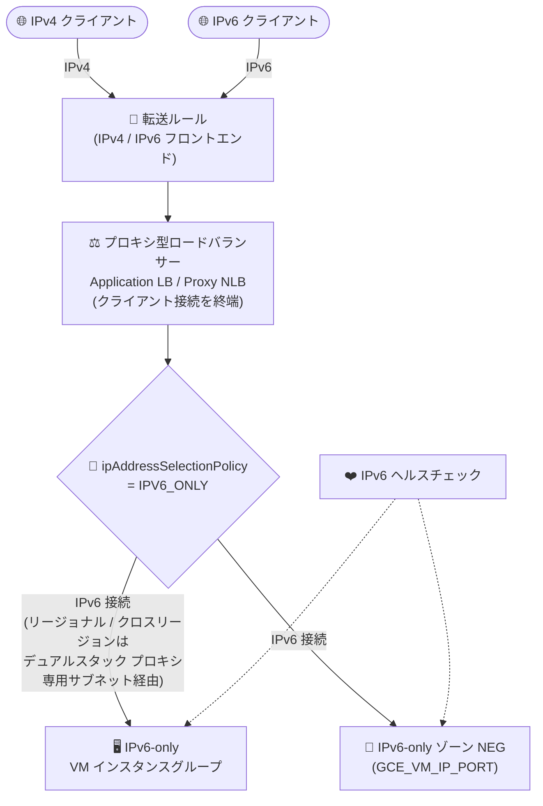

# Cloud Load Balancing: IPv6-only バックエンドのサポート (Preview)

**リリース日**: 2026-11-23

**サービス**: Cloud Load Balancing

**機能**: IPv6-only バックエンドのサポート

**ステータス**: Preview

📊 [このアップデートのインフォグラフィックを見る](https://takech9203.github.io/google-cloud-news-summary/20261123-cloud-load-balancing-ipv6-only-backends-preview.html)

## 概要

Cloud Load Balancing において、IPv6-only バックエンドのサポートが Preview として提供開始されました。対象となるのは、グローバル / リージョナル / クロスリージョンのアプリケーションロードバランサーおよびプロキシネットワークロードバランサーです (クラシックロードバランサーは除く)。クライアントからの IPv4 または IPv6 トラフィックを、IPv6 経由で IPv6-only の VM インスタンスグループバックエンド、および `GCE_VM_IP_PORT` エンドポイントを持つゾーン NEG バックエンドにルーティングできるようになります。

利用するには、バックエンドサービスの IP アドレス選択ポリシー (`ipAddressSelectionPolicy`) を `IPV6_ONLY` に設定します。リージョナルおよびクロスリージョンのロードバランサー (Envoy ベース) では、デュアルスタック (`IPV4_IPV6`) のプロキシ専用サブネットが必要です。

IPv6 への移行を進める組織にとって、VM に IPv4 アドレスを割り当てずに IPv6 のみで構成されたバックエンドインフラを、プロキシ型ロードバランサーの背後で直接運用できるようになる重要なアップデートです。IPv4 アドレスの枯渇対策や、政府・通信事業者などで求められる IPv6 単一スタック要件への対応に有効です。

**アップデート前の課題**

- プロキシ型ロードバランサー (アプリケーションロードバランサー / プロキシネットワークロードバランサー) のバックエンドへの IPv6 接続は、デュアルスタック (IPv4 + IPv6) バックエンドのみがサポート対象であり、IPv6-only バックエンドは利用できなかった
- IPv6 単一スタック環境を構築したい場合でも、バックエンド VM には IPv4 アドレスの割り当てが必要となり、IPv4 アドレスの管理・消費が避けられなかった
- IP アドレス選択ポリシーには `IPV4_ONLY` / `PREFER_IPV6` / `IPV6_ONLY` があるが、`IPV6_ONLY` を活用するにもバックエンド自体はデュアルスタックで構成する必要があった

**アップデート後の改善**

- IPv6-only の VM インスタンスグループ、および `GCE_VM_IP_PORT` エンドポイントを持つゾーン NEG をプロキシ型ロードバランサーのバックエンドとして直接利用できるようになった
- クライアント側は IPv4 / IPv6 のどちらのトラフィックでも受け付けつつ、バックエンドへは IPv6 経由でルーティングできるため、クライアント互換性を維持したままバックエンドの IPv6 単一スタック化が可能になった
- バックエンドサービスの `ipAddressSelectionPolicy` を `IPV6_ONLY` に設定するだけで、ヘルスチェックも IPv6 のみで実行される構成を実現できる

## アーキテクチャ図



クライアントの IPv4 / IPv6 トラフィックはプロキシ型ロードバランサーで終端され、バックエンドサービスの IP アドレス選択ポリシー `IPV6_ONLY` に従って、IPv6 経由で IPv6-only バックエンド (インスタンスグループ / ゾーン NEG) にルーティングされます。

## サービスアップデートの詳細

### 主要機能

1. **IPv6-only バックエンドへの IPv6 ルーティング (Preview)**
   - クライアントの IPv4 または IPv6 トラフィックを、ロードバランサーで終端した後、IPv6 経由で IPv6-only バックエンドに転送可能
   - 対象バックエンドタイプ: IPv6-only の VM インスタンスグループ、および `GCE_VM_IP_PORT` エンドポイントを持つゾーン NEG

2. **対象ロードバランサー**
   - グローバル外部アプリケーションロードバランサー / グローバル外部プロキシネットワークロードバランサー
   - リージョナル (外部 / 内部) アプリケーションロードバランサー / プロキシネットワークロードバランサー
   - クロスリージョン内部アプリケーションロードバランサー / プロキシネットワークロードバランサー
   - クラシックアプリケーションロードバランサーおよびクラシックプロキシネットワークロードバランサーは対象外

3. **IP アドレス選択ポリシーによる制御**
   - バックエンドサービスの `ipAddressSelectionPolicy` を `IPV6_ONLY` に設定することで有効化
   - `IPV6_ONLY` 設定時は、バックエンドへのトラフィックとヘルスチェックの両方が IPv6 のみで実行される

## 技術仕様

### IP アドレス選択ポリシー

| ポリシー | 動作 |
|------|------|
| `IPV4_ONLY` (Only IPv4) | クライアントのトラフィック種別に関係なく、バックエンドへは IPv4 のみで送信。ヘルスチェックも IPv4 のみ |
| `PREFER_IPV6` (Prefer IPv6) | バックエンドへの IPv6 接続を優先。IPv6 接続が不調な場合は happy eyeballs (RFC 6555) により IPv4 にフォールバック |
| `IPV6_ONLY` (Only IPv6) | クライアントのトラフィック種別に関係なく、バックエンドへは IPv6 のみで送信。ヘルスチェックも IPv6 のみ |

### 対応ロードバランサーとバックエンド接続

| ロードバランサー | クライアント → LB | LB → バックエンド |
|------|------|------|
| グローバル外部 Application LB / グローバル外部プロキシ NLB | IPv4 / IPv6 両方を終端 | IPv4 または IPv6 (IPv6-only バックエンドは Preview) |
| リージョナル / クロスリージョンの Application LB / プロキシ NLB | IPv4 / IPv6 両方を終端 | IPv4 または IPv6 (IPv6-only バックエンドは Preview)。IPv6 接続にはデュアルスタックのプロキシ専用サブネットが必要 |
| クラシック Application LB / クラシックプロキシ NLB | IPv4 / IPv6 両方を終端 | IPv4 のみ (対象外) |

### バックエンドサービス設定例

```bash
# バックエンドサービスの IP アドレス選択ポリシーを IPv6 のみに設定 (リージョナルの例)
gcloud compute backend-services update BACKEND_SERVICE \
    --load-balancing-scheme=EXTERNAL_MANAGED \
    --protocol=TCP \
    --ip-address-selection-policy=IPV6_ONLY \
    --region=REGION
```

## 設定方法

### 前提条件

1. 対象のロードバランサーがグローバル / リージョナル / クロスリージョンのアプリケーションロードバランサーまたはプロキシネットワークロードバランサーであること (クラシックは不可)
2. バックエンドが IPv6-only の VM インスタンスグループ、または `GCE_VM_IP_PORT` エンドポイントを持つゾーン NEG であること
3. リージョナル / クロスリージョンのロードバランサーの場合、デュアルスタック (`IPV4_IPV6`) のプロキシ専用サブネットが必要
4. デュアルスタックサブネットはカスタムモード VPC ネットワークでのみサポートされ、内部 IPv6 を使用する場合は VPC ネットワークで ULA 内部 IPv6 範囲の有効化 (`--enable-ula-internal-ipv6`) が必要

### 手順

#### ステップ 1: VPC ネットワークと IPv6-only サブネットの準備

```bash
# ULA 内部 IPv6 範囲を有効にしたカスタムモード VPC を作成
gcloud compute networks create lb-network \
    --subnet-mode=custom \
    --enable-ula-internal-ipv6

# IPv6-only サブネットを作成 (内部 IPv6 の例)
gcloud compute networks subnets create lb-subnet-ipv6-only \
    --network=lb-network \
    --region=REGION \
    --stack-type=IPV6_ONLY \
    --ipv6-access-type=INTERNAL
```

バックエンド VM を配置する IPv6-only サブネットを作成します。外部 IPv6 アドレスを使う場合は `--ipv6-access-type=EXTERNAL` を指定します。

#### ステップ 2: デュアルスタックのプロキシ専用サブネットを作成 (リージョナル / クロスリージョンの場合)

```bash
gcloud compute networks subnets create proxy-only-subnet \
    --purpose=REGIONAL_MANAGED_PROXY \
    --role=ACTIVE \
    --region=REGION \
    --network=lb-network \
    --range=10.1.2.0/24 \
    --stack-type=IPV4_IPV6
```

`--purpose` はリージョナルロードバランサーでは `REGIONAL_MANAGED_PROXY`、クロスリージョンロードバランサーでは `GLOBAL_MANAGED_PROXY` を指定します。IPv6 アドレス範囲は VPC ネットワークの ULA 範囲から自動割り当てされます (手動指定は不可)。

#### ステップ 3: バックエンドサービスの IP アドレス選択ポリシーを IPV6_ONLY に設定

```bash
gcloud compute backend-services update BACKEND_SERVICE \
    --load-balancing-scheme=EXTERNAL_MANAGED \
    --protocol=TCP \
    --ip-address-selection-policy=IPV6_ONLY \
    --region=REGION
```

Google Cloud コンソールの場合は、ロードバランサーの「バックエンド構成」で対象バックエンドサービスを選択し、「IP アドレス選択ポリシー」から設定できます。バックエンドタイプはゾーン NEG またはインスタンスグループである必要があります。

## メリット

### ビジネス面

- **IPv4 アドレスコストと管理負荷の削減**: バックエンド VM への IPv4 アドレス割り当てが不要になり、枯渇が進む IPv4 アドレス資源の消費を抑えられる
- **IPv6 移行要件への対応**: 政府機関や通信事業者などで求められる IPv6 単一スタック化の要件に、クライアント互換性 (IPv4 クライアントの受け入れ) を維持したまま対応できる

### 技術面

- **アドレススタックの分離**: クライアント側 (IPv4 / IPv6) とバックエンド側 (IPv6-only) の接続をロードバランサーで分離して独立に構成できるため、段階的な IPv6 移行が可能
- **ネットワーク構成の簡素化**: バックエンドを IPv6 単一スタックに統一することで、デュアルスタック運用に伴うアドレス管理・ファイアウォールルールの二重管理を解消できる
- **一貫したヘルスチェック**: `IPV6_ONLY` ポリシーではヘルスチェックも IPv6 のみで実行され、実際のトラフィック経路と一致した正常性監視ができる

## デメリット・制約事項

### 制限事項

- Preview 段階の機能であり、GA 前の利用には SLA などの制約が伴う
- クラシックアプリケーションロードバランサーおよびクラシックプロキシネットワークロードバランサーは対象外 (バックエンドへの接続は IPv4 のみ)
- 対応バックエンドタイプは VM インスタンスグループと `GCE_VM_IP_PORT` エンドポイントを持つゾーン NEG に限定される
- プロキシ専用サブネットを `IPV6_ONLY` スタックタイプで作成することはできない (選択肢は `IPV4_ONLY` または `IPV4_IPV6` のみ)
- デュアルスタックサブネットはカスタムモード VPC のみサポート (自動モード VPC、レガシーネットワークは非対応)

### 考慮すべき点

- `IPV6_ONLY` ポリシー設定時、バックエンドのトラフィック種別とポリシーの整合性はバリデーションされない。IPv4-only バックエンドに `IPV6_ONLY` を設定するとバックエンドが異常 (unhealthy) となり、クライアントに HTTP 503 が返される
- 既存のプロキシ専用サブネットをデュアルスタックに変更する場合、サブネットの直接更新はできないため、デュアルスタックのバックアッププロキシ専用サブネットを作成してアクティブに昇格させる手順が必要
- バックエンドへの ingress 許可ファイアウォールルールに、プロキシ専用サブネットの IPv6 範囲を含める必要がある
- サブネットのスタックタイプを一度デュアルスタックに変更すると IPv4-only には戻せない

## ユースケース

### ユースケース 1: バックエンドの IPv6 単一スタック化によるアドレス管理の簡素化

**シナリオ**: 大規模な VM フリートを運用しており、内部 IPv4 アドレス空間の枯渇と重複が課題。バックエンドを IPv6-only に統一しつつ、インターネット上の IPv4 クライアントへのサービス提供は継続したい。

**実装例**:
```bash
# IPv6-only サブネットに MIG を配置し、バックエンドサービスを IPV6_ONLY に設定
gcloud compute backend-services update web-backend \
    --load-balancing-scheme=EXTERNAL_MANAGED \
    --ip-address-selection-policy=IPV6_ONLY \
    --global
```

**効果**: グローバル外部アプリケーションロードバランサーが IPv4 / IPv6 クライアントの接続を終端し、バックエンドへは IPv6 のみで接続。IPv4 アドレスの割り当て・管理が不要になり、広大な IPv6 アドレス空間でフリートを設計できる。

### ユースケース 2: リージョナル内部ロードバランサー配下の段階的 IPv6 移行

**シナリオ**: VPC 内部のマイクロサービス間通信を IPv6 に移行したい。まず新規サービスを IPv6-only サブネットにデプロイし、既存の IPv4 サービスと並行稼働させる。

**効果**: デュアルスタックのプロキシ専用サブネットを用意すれば、リージョナル内部アプリケーションロードバランサーの背後で IPv6-only バックエンドを運用可能。既存サービスは IPv4 のまま、新規サービスから順次 IPv6 単一スタックに移行できる。

## 料金

IPv6-only バックエンドの利用自体に追加料金に関する記載はありません。ロードバランサーおよび IP アドレスの料金は通常の料金体系に従います。

- [ネットワーク料金: Cloud Load Balancing](https://cloud.google.com/vpc/network-pricing#cloud-load-balancing)
- [ネットワーク料金: Virtual Private Cloud (IP アドレス)](https://cloud.google.com/vpc/network-pricing#virtual-private-cloud)

## 利用可能リージョン

リージョン単位の提供状況に関する個別の記載はありません。対象ロードバランサー (グローバル / リージョナル / クロスリージョンのアプリケーションロードバランサーおよびプロキシネットワークロードバランサー) で Preview として利用可能です。詳細は [IPv6 ドキュメント](https://docs.cloud.google.com/load-balancing/docs/ipv6)を参照してください。

## 関連サービス・機能

- **Virtual Private Cloud (VPC)**: IPv6-only / デュアルスタックサブネットの作成、ULA 内部 IPv6 範囲の有効化など、本機能の前提となるネットワーク構成を提供
- **Compute Engine**: IPv6-only の VM インスタンスおよびマネージドインスタンスグループ (MIG) がバックエンドの実体となる
- **Cloud Load Balancing ヘルスチェック**: `IPV6_ONLY` ポリシー設定時は IPv6 ヘルスチェックのみでバックエンドの正常性を監視
- **Cloud Firewall**: プロキシ専用サブネットの IPv6 範囲からバックエンドへの ingress を許可するファイアウォールルールの設定が必要

## 参考リンク

- 📊 [インフォグラフィック](https://takech9203.github.io/google-cloud-news-summary/20261123-cloud-load-balancing-ipv6-only-backends-preview.html)
- [公式リリースノート](https://docs.cloud.google.com/release-notes#November_23_2026)
- [IPv6 for Application Load Balancers and proxy Network Load Balancers](https://docs.cloud.google.com/load-balancing/docs/ipv6)
- [バックエンドサービスの概要 (サポートされるバックエンド)](https://docs.cloud.google.com/load-balancing/docs/backend-service#supported-backends-scheme)
- [Envoy ベースのロードバランサー向けプロキシ専用サブネット (デュアルスタック)](https://docs.cloud.google.com/load-balancing/docs/proxy-only-subnets#dual_stack_proxy_only)
- [料金ページ](https://cloud.google.com/vpc/network-pricing#cloud-load-balancing)

## まとめ

プロキシ型ロードバランサーのバックエンドとして IPv6-only の VM インスタンスグループとゾーン NEG が利用可能になり、クライアント互換性を維持したままバックエンドインフラの IPv6 単一スタック化を進められるようになりました。IPv6 移行を計画している組織は、まず非本番環境でバックエンドサービスの `ipAddressSelectionPolicy=IPV6_ONLY` とデュアルスタックプロキシ専用サブネットの構成を検証し、ヘルスチェックとファイアウォールルールの IPv6 対応を確認することを推奨します。

---

**タグ**: Cloud Load Balancing, IPv6, Application Load Balancer, Proxy Network Load Balancer, ネットワーキング, Preview
