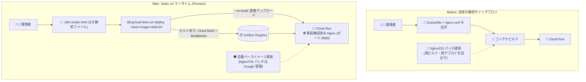

# Cloud Run / Buildpacks: Static 24 (static24) ランタイムが Preview

**リリース日**: 2026-11-23

**サービス**: Cloud Run / Buildpacks

**機能**: Static 24 (static24) ランタイムのサポート

**ステータス**: Preview

📊 [このアップデートのインフォグラフィックを見る](https://takech9203.github.io/google-cloud-news-summary/20261123-cloud-run-static-24-runtime-preview.html)

## 概要

Google Cloud の Buildpacks と Cloud Run で、静的コンテンツ配信専用の新ランタイム **Static 24 (ランタイム ID: `static24`)** のサポートが Preview として発表されました。静的ウェブサイト、シングルページアプリケーション (SPA)、静的サイトジェネレーター (SSG) の出力 (HTML / CSS / JavaScript / メディアファイル) を、**Dockerfile を書かずに、事前構成済みの Nginx ウェブサーバーを使ってソースから直接 Cloud Run にデプロイ**できます。

React、Vue、Angular などの SPA フレームワークのビルド成果物や、Astro、Hugo、Jekyll、Eleventy、Next.js / Nuxt の静的エクスポートのホスティングを想定しており、`gcloud beta run deploy --base-image=static24` を実行するだけで、最適化された Nginx 構成 (sendfile、tcp_nopush、tcp_nodelay、オープンファイルキャッシュ) 上でコンテンツが配信されます。Nginx と OS のセキュリティパッチは[自動ベースイメージ更新](https://docs.cloud.google.com/run/docs/configuring/services/automatic-base-image-updates)によって Google が管理します。

本アップデートは Buildpacks と Cloud Run の両方のリリースノートで発表された同一機能です。フロントエンドエンジニアや、静的フロントエンドと Cloud Run バックエンドを組み合わせて運用するチームにとって、コンテナ運用の負担を大きく減らすアップデートです。

**アップデート前の課題**

- 静的サイトを Cloud Run でホストするには、Nginx などのウェブサーバーのコンテナイメージを自分で用意する必要があり、Dockerfile の記述と `nginx.conf` の設定 (ポート 8080 での listen、gzip、SPA フォールバックなど) を自前で行う必要があった
- 自前の Nginx イメージを使う場合、Nginx 本体や OS のセキュリティパッチ適用 (イメージの再ビルド・再デプロイ) を利用者自身が継続的に実施する必要があった
- SPA のクライアントサイドルーティング対応 (未知のパスを `/index.html` にフォールバックさせる設定) やセキュリティヘッダー、キャッシュ制御を個別に設計・実装する必要があった

**アップデート後の改善**

- `--base-image=static24` を指定するだけで、Dockerfile もウェブサーバー設定も書かずに、`index.html` を含むディレクトリをソースから直接デプロイできるようになった
- 自動ベースイメージ更新により、Nginx と OS のセキュリティパッチが Google 管理で適用されるようになった
- SPA フォールバック、クリーン URL (`/about` → `/about.html`)、gzip 圧縮、`X-Content-Type-Options: nosniff` ヘッダー、隠しファイル (`.git`、`.env` など) へのアクセスブロック、非 root 実行などがゼロコンフィグで提供されるようになった

## アーキテクチャ図



従来は Dockerfile と Nginx 設定を自作してコンテナを運用する必要がありましたが、Static 24 ランタイムでは静的ファイルのディレクトリを指定してデプロイするだけで、事前構成済み Nginx による配信とパッチ管理が Google 側で提供されます。

## サービスアップデートの詳細

### 主要機能

1. **ゼロコンフィグの静的配信**
   - `index.html` を含むディレクトリを `--source` で指定するだけでデプロイ可能
   - Nginx はポート 8080 (Cloud Run のデフォルトポート) で自動構成される
   - クリーン URL に対応 (`/about` へのリクエストを拡張子なしで `/about.html` にマッピング)

2. **SPA クライアントサイドルーティング対応**
   - リクエストされたパスが物理ファイル・ディレクトリ・`.html` ファイルに一致しない場合、ブラウザの URL をリダイレクトせずに `/index.html` をフォールバックとして返す
   - React Router などのクライアントサイドルーター (`/dashboard/settings` のようなルート) がそのまま動作

3. **パフォーマンス最適化**
   - `sendfile`、`tcp_nopush`、`tcp_nodelay`、オープンファイルキャッシュを有効化した最適化済み Nginx 構成
   - 動的 gzip 圧縮が組み込み。さらに `gzip_static on;` により事前圧縮済み `.gz` ファイルの直接配信に対応
   - `ETag` / `Last-Modified` ヘッダーを自動付与し、ブラウザが `304 Not Modified` で再検証可能。一方でデフォルトの `Cache-Control: max-age` は付与せず、新しいデプロイが即座に反映される

4. **組み込みセキュリティ**
   - `X-Content-Type-Options: nosniff` ヘッダーを付与
   - `.git` や `.env` などの隠しファイル・ディレクトリへのリクエストをブロック
   - コンテナは非 root ユーザーで実行

5. **2 つのデプロイ方式**
   - **ビルドなし (`--no-build`)**: ビルド済みファイルを `static24` ベースイメージに直接アップロードし、Cloud Build をバイパス (ローカルや CI でビルド済みの場合に推奨)
   - **ビルドあり**: Cloud Build と Buildpacks で静的ファイルをコンテナイメージ化し、Artifact Registry 経由でデプロイ

## 技術仕様

### ランタイム情報

| 項目 | 詳細 |
|------|------|
| ランタイム名 | Static 24 (Preview) |
| ランタイム ID (エイリアス) | `static24` |
| スタック | `google-24` (デフォルト) |
| ベースイメージ | `us-central1-docker.pkg.dev/serverless-runtimes/google-24/runtimes/static24` |
| ウェブサーバー | 事前構成済み Nginx |
| 配信ポート | 8080 (Cloud Run デフォルト) |
| 廃止 (Deprecation) / 提供終了 (Decommission) | 未定 (Preview のため未スケジュール) |
| 対象コンテンツ | HTML、CSS、JavaScript、メディアファイルなどの静的ファイル |

### ディレクトリ検出の仕様

Static ランタイムはサブディレクトリをスキャンしません。`index.html` を含む静的ファイルは、カレントディレクトリまたは `--source` フラグで指定したディレクトリ (例: `--source ./dist`) の直下に置く必要があります。

| 状況 | 挙動 |
|------|------|
| `dist/index.html` があるのに `--source .` + `--no-build` でデプロイ | Nginx が `/workspace` ルートから配信し `403 Forbidden` になる |
| `dist/index.html` があるのに `--source .` + ビルドありでデプロイ | Buildpacks がビルドステップで静的ファイルを検出できず失敗 |
| `--source ./dist` を指定 | 正常にデプロイ・配信される |

また、`gcloud run deploy` は `.gitignore` / `.gcloudignore` を尊重します。一般的なフロントエンドリポジトリでは `dist/` や `build/` がデフォルトで ignore されているため、デプロイ時にビルド成果物が除外されていないか確認が必要です。

## 設定方法

### 前提条件

1. Google Cloud プロジェクトと gcloud CLI (Preview ランタイムのため `gcloud beta` コマンドを使用)
2. `index.html` を含む静的ファイル一式 (SPA / SSG の場合はビルド済み成果物)

### 手順

#### ステップ 1: 静的ファイルを準備する

```bash
# 例: SPA / SSG プロジェクトをビルドして ./dist に成果物を出力
npm run build
```

`index.html` が出力ディレクトリ (例: `./dist`) の直下にあることを確認します。

#### ステップ 2a: ビルドなしでデプロイする (ビルド済みファイル向け、推奨)

```bash
gcloud beta run deploy SERVICE \
  --source ./dist \
  --no-build \
  --base-image=static24 \
  --project PROJECT_ID
```

静的ファイルが `static24` ベースイメージへ直接アップロードされ、Cloud Build をバイパスして高速にデプロイされます。

#### ステップ 2b: ビルドありでデプロイする

```bash
gcloud beta run deploy SERVICE \
  --source ./dist \
  --base-image=static24 \
  --project PROJECT_ID
```

Cloud Build と Buildpacks が静的ファイルをコンテナイメージにパッケージ化し、Artifact Registry に格納してからデプロイします。

#### ステップ 3 (任意): 事前圧縮アセットを用意する

```bash
# HTML/CSS/JS/JSON/SVG を元ファイルを残したまま gzip 圧縮 (-9 で最小サイズ)
find ./dist -type f \
  \( -name "*.html" -o -name "*.css" -o -name "*.js" \
     -o -name "*.json" -o -name "*.svg" \) \
  -exec gzip -9 --keep {} +
```

`Accept-Encoding: gzip` を含むリクエストに対して、対応する `.gz` ファイルが存在すれば Nginx がそれを直接配信し、リクエストごとの圧縮 CPU コストを削減できます。元ファイルは `.gz` ファイルと同じ場所に残しておく必要があります。

## メリット

### ビジネス面

- **フロントエンド配信の運用コスト削減**: Dockerfile・Nginx 設定の作成とメンテナンス、セキュリティパッチ適用の運用が不要になり、開発チームはアプリケーション開発に集中できる
- **デリバリーの高速化**: `--no-build` では CI でビルドした成果物をそのままアップロードでき、Cloud Build を経由しない分デプロイが速い

### 技術面

- **セキュアバイデフォルト**: 非 root 実行、`nosniff` ヘッダー、隠しファイルブロック、Google 管理のパッチ適用が標準で提供される
- **SPA / SSG にそのまま対応**: クライアントサイドルーティングのフォールバックやクリーン URL が設定なしで機能し、React / Vue / Angular / Astro / Hugo / Jekyll / Eleventy / Next.js / Nuxt の静的出力をそのままホストできる
- **Cloud Run の機能をそのまま利用可能**: スケールトゥゼロ、リビジョン管理、カスタムドメインなど Cloud Run サービスとしての機能を静的サイトでも活用できる

## デメリット・制約事項

### 制限事項

- **静的ファイルの配信のみ**: カスタムのサーバーサイドコードは実行できない
- **`nginx.conf` のカスタム上書きは不可**: Nginx 構成は事前定義されたものに固定される
- **コンテナ内からのリバースプロキシ不可**: コンテナ内からバックエンドの Cloud Run サービスへリクエストをプロキシすることはできない。`/api/*` をバックエンドへルーティングするなど単一ドメインでの振り分けには、[外部アプリケーションロードバランサ](https://docs.cloud.google.com/load-balancing/docs/https/setup-global-ext-https-serverless)または [Firebase Hosting の rewrites](https://firebase.google.com/docs/hosting/cloud-run#direct_requests_to_container) を使用する
- **サブディレクトリは検出されない**: `index.html` は `--source` で指定したディレクトリ直下に必要

### 考慮すべき点

- **Preview 段階**: 本番環境での利用は Preview の提供条件を確認のうえ判断が必要。デプロイには `gcloud beta run deploy` を使用する
- **`.gitignore` / `.gcloudignore` の影響**: `dist/` や `build/` がデフォルトで除外されがちなため、デプロイ対象から漏れていないか確認が必要
- **デフォルトで `Cache-Control: max-age` が付かない**: 新しいデプロイが即時反映される一方、CDN 的な長期キャッシュが必要な場合は Cloud CDN などとの組み合わせを検討する

## ユースケース

### ユースケース 1: SPA フロントエンド + Cloud Run API バックエンド

**シナリオ**: React 製の管理画面 (SPA) と Cloud Run 上の API サービスを単一ドメインで運用したい。

**実装例**:
```bash
# フロントエンド (静的) を Static 24 でデプロイ
npm run build
gcloud beta run deploy frontend \
  --source ./dist --no-build --base-image=static24

# 外部アプリケーションロードバランサで
#   /        -> frontend (static24)
#   /api/*   -> backend (Cloud Run API サービス)
# にルーティング
```

**効果**: フロントエンドの Nginx コンテナを自作・保守することなく、SPA ルーティング対応済みの配信基盤と API バックエンドを統一ドメインで運用できる。

### ユースケース 2: SSG サイトの CI/CD デプロイ

**シナリオ**: Hugo や Astro で生成するドキュメントサイト・コーポレートサイトを、CI パイプラインから毎回自動デプロイしたい。

**効果**: CI でビルドした `public/` や `dist/` を `--no-build` でそのままアップロードするだけでよく、Cloud Build を経由しないためデプロイが高速。ETag による再検証とデプロイ即時反映の両立で、更新頻度の高いサイトにも適する。

## 料金

Static 24 ランタイム自体の追加料金に関する公式情報は確認できませんでした。Cloud Run サービスとしてデプロイされるため、通常の Cloud Run の料金体系 (リクエスト数、CPU・メモリの使用時間など) が適用されます。ビルドありのデプロイでは Cloud Build と Artifact Registry の料金も発生し得ます。詳細は料金ページを参照してください。

- [Cloud Run 料金](https://cloud.google.com/run/pricing)

## 利用可能リージョン

リージョンごとの提供状況に関する個別の記載は確認できませんでした。Cloud Run の提供リージョンについては[公式ドキュメント](https://cloud.google.com/run/docs/locations)を参照してください。

## 関連サービス・機能

- **Cloud Run**: Static 24 ランタイムのデプロイ先。スケールトゥゼロやリビジョン管理など Cloud Run の機能を静的サイトでも利用できる
- **Google Cloud's buildpacks**: ビルドありデプロイ時に静的ファイルをコンテナイメージへパッケージ化する仕組み
- **Cloud Build / Artifact Registry**: ビルドありデプロイ時のイメージビルドと格納に使用
- **外部アプリケーションロードバランサ**: 静的フロントエンドとバックエンド API を単一ドメインで振り分ける際に使用
- **Firebase Hosting**: rewrites によって Cloud Run サービスへのルーティングが可能な代替・補完サービス
- **自動ベースイメージ更新**: Nginx と OS のセキュリティパッチを Google 管理で適用する仕組み

## 参考リンク

- 📊 [インフォグラフィック](https://takech9203.github.io/google-cloud-news-summary/20261123-cloud-run-static-24-runtime-preview.html)
- [公式リリースノート](https://docs.cloud.google.com/release-notes#November_23_2026)
- [Configure the Static runtime (Buildpacks)](https://docs.cloud.google.com/docs/buildpacks/static)
- [Buildpacks runtime support - Static](https://docs.cloud.google.com/docs/buildpacks/runtime-support#static)
- [Cloud Run runtime support - Static](https://docs.cloud.google.com/run/docs/runtime-support#static)
- [Cloud Run 料金](https://cloud.google.com/run/pricing)

## まとめ

Static 24 ランタイムの登場により、静的サイトや SPA を Cloud Run でホストする際の Dockerfile・Nginx 設定・パッチ運用が不要になり、`gcloud beta run deploy --base-image=static24` だけで最適化済みのセキュアな配信基盤を利用できるようになりました。フロントエンドの配信に自前の Nginx コンテナを使っているチームは、まずステージング環境で `--no-build` デプロイを試し、ロードバランサと組み合わせた API ルーティング構成を検証することをおすすめします。

---

**タグ**: #CloudRun #Buildpacks #Static24 #Nginx #SPA #StaticSite #Serverless #Preview
