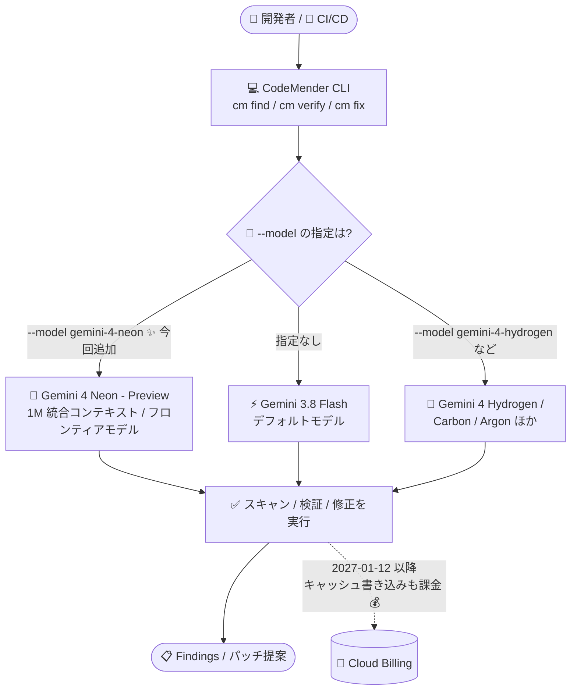

# Gemini Enterprise Agent Platform: CodeMender が Gemini 4 Neon をサポート (Preview)

**リリース日**: 2026-11-23

**サービス**: Gemini Enterprise Agent Platform (CodeMender)

**機能**: CodeMender での Gemini 4 Neon サポート (Preview)

**ステータス**: Feature (Preview)

📊 [このアップデートのインフォグラフィックを見る](https://takech9203.github.io/google-cloud-news-summary/20261123-codemender-gemini-4-neon-support.html)

## 概要

Gemini Enterprise Agent Platform の AI コードセキュリティエージェント「CodeMender」が、フロンティアモデル **Gemini 4 Neon** (`gemini-4-neon`) をサポートした (Preview)。`cm find` (スキャン)、`cm verify` (検証)、`cm fix` (修正) の各コマンドに `--model gemini-4-neon` を渡すことで利用できる。デフォルトモデルは引き続き Gemini 3.8 Flash である。

Gemini 4 Neon は 2026 年 11 月 18 日に Gemini Enterprise Agent Platform で GA となったモデルで、「複雑なソフトウェアエンジニアリング・ナレッジワーク・サイエンスワークフローにおけるフロンティアレベルの知能と高速なタスク完了」を特徴とし、位置付けとしては Gemini 4 Hydrogen と Gemini 4 Carbon の中間にあたる。他の Gemini 4 系モデルと同様に、入力・思考・出力を共有する 1,048,576 トークンの統合コンテキストウィンドウと、最大 1M トークンの long decode を備える。11 月 19 日の Gemini 4 Hydrogen サポートに続き、CodeMender で選択できる最新世代モデルがさらに拡充された形である。

料金面では、**2027 年 1 月 12 日から Gemini 4 Neon 上の CodeMender セッションでキャッシュ書き込み (cache writes) も課金対象になる**点に注意が必要である。対象ユーザーは、スキャン・検証・修正の品質をモデル選択で最適化したいセキュリティチームや DevSecOps チームである。

**アップデート前の課題**

- CodeMender で選択できる Gemini 4 系モデルは Hydrogen / Carbon / Argon までで、2026 年 11 月 18 日に GA となった最新のフロンティアモデル Gemini 4 Neon は選択できなかった
- 複雑な脆弱性のスキャン・修正に、より高い推論能力を持つモデルを使いたくても、Gemini 4 Carbon などの既存モデルから選ぶしかなかった

**アップデート後の改善**

- `--model gemini-4-neon` を `cm find` / `cm verify` / `cm fix` に渡すだけで、1M 統合コンテキストウィンドウを持つフロンティアモデル Gemini 4 Neon を CodeMender で利用できるようになった (Preview)
- 日常のスキャンはデフォルトの Gemini 3.8 Flash、重要なスキャン・修正は Gemini 4 Neon といった、コマンド単位でのモデル使い分けの選択肢が広がった

## アーキテクチャ図



`cm find` / `cm verify` / `cm fix` の `--model` フラグによるモデル選択フローを示す。今回のアップデートで `gemini-4-neon` が選択肢に加わり、2027 年 1 月 12 日以降は Gemini 4 Neon 上のセッションでキャッシュ書き込みも課金対象になる。

## サービスアップデートの詳細

### 主要機能

1. **Gemini 4 Neon のサポート (Preview)**
   - `cm find`、`cm verify`、`cm fix` に `--model gemini-4-neon` を渡すことで利用可能
   - デフォルトモデルは引き続き Gemini 3.8 Flash
   - Gemini 4 Neon は 2026-11-18 に Gemini Enterprise Agent Platform で GA となったフロンティアモデルで、高性能なコーディング、マルチステップ推論、マルチモーダル理解を低レイテンシで提供する。エージェンティックなエンタープライズワークフロー向けに設計されている

2. **Gemini 4 Neon のモデル特性**
   - 入力・思考・出力を共有する 1,048,576 トークンの統合コンテキストウィンドウと、最大 1M トークンの long decode (`continuation_token`)
   - Thinking レベルは `LOW` / `MEDIUM` / `HIGH` (デフォルト) / `XHIGH` の 4 段階をサポート。深い推論が必要なワークロードには `XHIGH` が利用できる
   - コンテキストキャッシュは Implicit caching のみサポート (最小 4,096 トークン、durable caching がデフォルトで有効)。Explicit caching は非サポート

3. **Gemini 4 Neon のキャッシュ書き込み課金 (2027 年 1 月 12 日開始)**
   - 2027 年 1 月 12 日から、Gemini 4 Neon 上の CodeMender セッションではキャッシュ書き込み (cache writes) も課金対象となる
   - ドキュメントによると、Gemini 4 Hydrogen 以降のモデルでは同日から TTL 設定付きのキャッシュ制御機能がサポートされ、キャッシュ書き込みはデフォルトで標準入力トークン価格の 1.25 倍、保持期間が長いほど高くなる

## 技術仕様

### CodeMender がサポートするモデル (2026-11-23 時点)

| モデル | `--model` 識別子 | 備考 |
|--------|------------------|------|
| Gemini 3.8 Flash | `gemini-3.8-flash` | デフォルト |
| **Gemini 4 Neon** | `gemini-4-neon` | ✨ 今回追加 (Preview) |
| Gemini 4 Hydrogen | `gemini-4-hydrogen` | 2026-11-19 に追加 |
| Gemini 4 Carbon | `gemini-4-carbon` | - |
| Gemini 4 Argon | `gemini-4-argon` | - |
| Gemini 3.7 Flash | `gemini-3.7-flash` | 2027-01-28 に廃止予定 |
| Gemini 3.6 Flash | `gemini-3.6-flash` | 非推奨。新規・非アクティブプロジェクトは 2026-11-19 からブロック。2027-01-28 に廃止予定 |
| Gemini 3.5 Flash | `gemini-3.5-flash` | - |
| Gemini 3.1 Pro Preview | `gemini-3.1-pro-preview` | Preview |
| Gemini 3.8 Flash Cyber | `gemini-3.8-flash-cyber` | Fairwind Program アクセスが必要 |
| Gemini 4 Argon Cyber Permissive | `gemini-4-argon-cyber-permissive` | 同上 |
| Gemini 4 Carbon for cyber | `gemini-4-carbon-cyber-permissive` | 同上 |

`--model` フラグは `cm find` / `cm verify` / `cm fix` でサポートされる。非推奨モデルはアクティブなプロジェクトでは廃止日まで動作し、使用時に CLI が警告を表示する。廃止後はリクエストが失敗するため、廃止日前に Gemini 3.8 Flash への切り替えが推奨されている。

なお、Gemini 4 Argon / Carbon / Hydrogen には組み込みのサイバー安全機能があり、エクスプロイト生成や脆弱性検証を伴うリクエストをブロックする場合がある。ブロック時は Gemini 3.8 Flash Cyber で自動再試行され、アクセスがない場合は Gemini 3.8 Flash にフォールバックする。`cm verify` はサイバー系モデルとの組み合わせで最も効果を発揮する。

### Gemini 4 Neon のモデル仕様 (抜粋)

| 項目 | 詳細 |
|------|------|
| モデル ID | `gemini-4-neon` |
| コンテキストウィンドウ | 1,048,576 トークン (入力・思考・出力の統合) |
| 最大出力トークン | 最大 1,048,576 (long decode 利用時。単一フォアグラウンドセグメントは最大 65,536) |
| Thinking | サポート (`LOW` / `MEDIUM` / `HIGH` (デフォルト) / `XHIGH`) |
| コンテキストキャッシュ | Implicit context caching をサポート (Explicit caching は非サポート) |
| Function calling / Code execution / Computer use | サポート |
| Tuning | 非サポート |
| エンドポイント | `global`、`us` / `eu` マルチリージョン |
| 提供条件 | 検証済みエンタープライズ顧客向けに一部リージョンで提供 (Google Frontier Model、Service Specific Terms Section 34 の対象) |

参考: サイバーセキュリティ用途向けの **Gemini 4 Neon for cyber** (`gemini-4-neon-cyber-permissive`) も Fairwind Program のアロウリスト経由で GA 提供されている (過去のサイバー系モデルへのアクセスは引き継がれず、個別申請が必要)。

## 設定方法

### 前提条件

1. CodeMender へのアクセス権を持つ Google Cloud プロジェクト (CodeMender は Preview)
2. CodeMender CLI のインストールと Application Default Credentials (ADC) の設定
3. Gemini 4 Neon は検証済みエンタープライズ顧客向けに提供されるため、プロジェクトで Gemini 4 Neon が利用可能であること

### 手順

#### ステップ 1: CLI を最新バージョンに更新

```bash
cm update
```

#### ステップ 2: Gemini 4 Neon を指定して実行

```bash
# スキャンを Gemini 4 Neon で実行
cm find ./src --model gemini-4-neon

# 検証・修正にも同じフラグを指定可能
cm verify FINDING_ID --model gemini-4-neon
cm fix FINDING_ID --model gemini-4-neon
```

`--model` を省略した場合はデフォルトの Gemini 3.8 Flash が使用される。

#### ステップ 3: トークン使用量の確認

```bash
# 実行中の累積トークン数をステータスラインで表示
cm find ./src --compact
```

`--compact` フラグでセッションの入力・出力・合計トークン数を実行中に確認できる。コマンド完了時には経過時間とトークン合計のサマリーが表示される。課金対象のトークン使用量とコスト推移は Cloud Billing のレポートで確認する。

## メリット

### ビジネス面

- **モデル選択肢の拡充によるコスト・品質最適化**: デフォルトの Gemini 3.8 Flash、速度・効率重視の Gemini 4 Hydrogen に加えて、フロンティアレベルの Gemini 4 Neon を選択でき、ワークロードの重要度に応じたモデル使い分けの幅が広がる
- **最新モデルの迅速な活用**: Gemini 4 Neon の GA (2026-11-18) から 5 日で CodeMender に展開され、プラットフォームの最新モデルをセキュリティワークフローにすぐ適用できる

### 技術面

- **フロンティアレベルの推論能力**: Gemini 4 Neon は高性能なコーディングとマルチステップ推論を低レイテンシで提供し、複雑な脆弱性の分析・修正に適する。Thinking レベル `XHIGH` による深い推論もサポートする
- **1M 統合コンテキストウィンドウ**: 入力・思考・出力を共有する 1,048,576 トークンのコンテキストにより、大きなコードコンテキストを扱うスキャン・修正ワークフローに対応できる
- **コマンド単位の切り替え**: `--model` フラグを渡すだけでモデルを切り替えられ、既存の CI/CD パイプラインへの導入が容易

## デメリット・制約事項

### 制限事項

- CodeMender の Gemini 4 Neon サポートは Preview であり、Pre-GA Offerings Terms が適用される
- Gemini 4 Neon は検証済みエンタープライズ顧客向けに一部リージョンで提供される Google Frontier Model であり、すべてのプロジェクトで利用できるとは限らない
- `cm verify` はサイバー系モデルとの組み合わせで最も効果を発揮するとドキュメントに明記されており、Gemini 4 Neon 単体では検証品質が最適でない可能性がある。サイバー系モデル (Gemini 4 Neon for cyber を含む) の利用には Fairwind Program でのアクセスが必要

### 考慮すべき点

- **2027 年 1 月 12 日からのキャッシュ書き込み課金**: Gemini 4 Neon 上の CodeMender セッションはキャッシュ書き込みも課金されるようになる。キャッシュ書き込みはデフォルトで標準入力トークン価格の 1.25 倍であり、保持期間 (TTL) が長いほど高くなるため、長時間・大規模なスキャンではコスト見積もりの再確認が必要
- Gemini 3.6 Flash は非推奨となっており、新規・非アクティブプロジェクトでは 2026-11-19 からブロック済み、2027-01-28 に廃止予定。Gemini 3.7 Flash も 2027-01-28 に廃止予定のため、旧モデルを使うワークフローは移行計画を立てること

## ユースケース

### ユースケース 1: 複雑な脆弱性の修正を Gemini 4 Neon で実行

**シナリオ**: 複数モジュールにまたがる複雑な脆弱性の修正パッチ生成に、より高い推論能力を持つモデルを使いたい。

**実装例**:
```bash
cm find ./src --model gemini-4-neon
cm fix FINDING_ID --model gemini-4-neon
```

**効果**: フロンティアレベルの推論能力と 1M 統合コンテキストウィンドウを持つ Gemini 4 Neon で、複雑なコードコンテキストを踏まえたスキャン・修正を実行できる。

### ユースケース 2: ワークロード重要度に応じたモデル使い分け

**シナリオ**: 日常の PR ゲートは高速・低コストに回し、リリース前の重点スキャンだけ高性能モデルを使いたい。

**実装例**:
```bash
# 日常の PR ゲート (デフォルトの Gemini 3.8 Flash)
cm find . --diff=origin/main --fail-on=CRITICAL,HIGH

# リリース前の重点スキャン (Gemini 4 Neon)
cm find ./src --model gemini-4-neon
```

**効果**: コマンド単位で `--model` を切り替えるだけで、コストと品質のバランスをワークフローごとに最適化できる。

### ユースケース 3: キャッシュ書き込み課金開始前のコスト評価

**シナリオ**: Gemini 4 Neon の本格採用を検討しており、2027 年 1 月 12 日のキャッシュ書き込み課金開始前にコスト影響を把握したい。

**実装例**:
```bash
cm find ./src --model gemini-4-neon --compact
```

**効果**: `--compact` のステータスラインと完了時サマリーでセッションのトークン消費を把握し、Cloud Billing のレポートと合わせて課金開始後のコストを事前に見積もれる。

## 料金

CodeMender の利用はセッションのトークン使用量に基づいて課金される。今回のアップデートに伴う料金面のポイントは以下のとおり。

- **2027 年 1 月 12 日から、Gemini 4 Neon 上の CodeMender セッションではキャッシュ書き込み (cache writes) も課金対象になる**
- コンテキストキャッシュのドキュメントによると、Gemini 4 Hydrogen 以降のモデルでは同日から TTL 設定付きのキャッシュ制御機能がサポートされ、キャッシュ書き込みはデフォルトで標準入力トークン価格の 1.25 倍で課金され、保持期間が長いほど高くなる
- 具体的な単価は CodeMender の料金ページを参照

<!-- 料金リンク -->
- [CodeMender 料金](https://cloud.google.com/model-garden/pricing#codemender)

## 利用可能リージョン

CodeMender はグローバルに利用可能。Gemini 4 Neon 自体は `global` エンドポイントと `us` / `eu` マルチリージョンで提供され、検証済みエンタープライズ顧客向けに一部リージョンで利用できる。

## 関連サービス・機能

- **Gemini 4 Neon (Gemini Enterprise Agent Platform)**: 今回 CodeMender で利用可能になったフロンティアモデル。2026-11-18 に GA。1M 統合コンテキストウィンドウ、4 段階の Thinking レベル、Implicit context caching を持つ
- **Gemini 4 Neon for cyber**: 脆弱性発見・リバースエンジニアリング・エクスプロイト検証・パッチ生成などの防御的サイバーセキュリティ用途向けバージョン (`gemini-4-neon-cyber-permissive`)。Fairwind Program のアロウリスト経由で GA 提供
- **Gemini 4 Hydrogen / Carbon / Argon**: CodeMender で選択可能な他の Gemini 4 系モデル。Hydrogen は 2026-11-19 に CodeMender サポートが追加された
- **Cloud Billing**: Gemini 4 Neon のキャッシュ書き込み課金開始 (2027-01-12) 後のコスト推移の確認に、課金レポートを活用できる

## 参考リンク

- 📊 [インフォグラフィック](https://takech9203.github.io/google-cloud-news-summary/20261123-codemender-gemini-4-neon-support.html)
- [公式リリースノート](https://docs.cloud.google.com/release-notes#November_23_2026)
- [CodeMender ドキュメント (Specifying the model)](https://docs.cloud.google.com/gemini-enterprise-agent-platform/agents/codemender#specifying-the-model)
- [Gemini 4 Neon モデルページ](https://docs.cloud.google.com/gemini-enterprise-agent-platform/models/gemini/4-neon)
- [Gemini 4 Neon 開発者ガイド](https://docs.cloud.google.com/gemini-enterprise-agent-platform/models/guides/gemini-4-neon)
- [コンテキストキャッシュの概要 (キャッシュ書き込み課金)](https://docs.cloud.google.com/gemini-enterprise-agent-platform/models/context-cache/context-cache-overview)
- [CodeMender 料金](https://cloud.google.com/model-garden/pricing#codemender)
- [Google Cloud Blog: Find and fix software vulnerabilities with CodeMender](https://cloud.google.com/blog/products/identity-security/find-and-fix-software-vulnerabilities-with-codemender)

## まとめ

今回のアップデートにより、CodeMender でフロンティアモデルの Gemini 4 Neon を `--model gemini-4-neon` で選択できるようになり (Preview)、11 月 19 日の Gemini 4 Hydrogen に続いてスキャン・検証・修正のモデル選択の幅がさらに広がった。複雑な脆弱性分析・修正にフロンティアレベルの推論能力を適用したいチームは評価を始める価値がある。採用する場合は、2027 年 1 月 12 日からキャッシュ書き込みが課金対象になる点を踏まえ、`--compact` でのトークン消費の把握と Cloud Billing でのコスト影響の事前評価を推奨する。

---

**タグ**: #GeminiEnterpriseAgentPlatform #CodeMender #Gemini4Neon #DevSecOps #セキュリティ #AIエージェント #Preview
