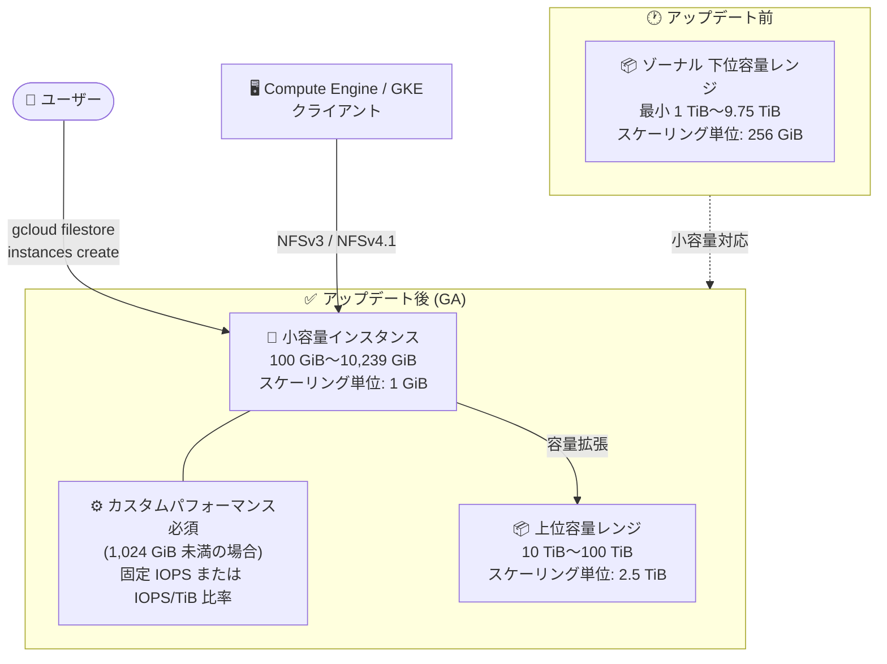

# Filestore: ゾーナルサービスティアの小容量インスタンスが GA

**リリース日**: 2026-11-23

**サービス**: Filestore

**機能**: ゾーナルサービスティアの小容量 (Small capacity) インスタンス

**ステータス**: GA (一般提供)

📊 [このアップデートのインフォグラフィックを見る](https://takech9203.github.io/google-cloud-news-summary/20261123-filestore-zonal-small-capacity-instances-ga.html)

## 概要

Filestore のゾーナル (Zonal) サービスティアで、小容量 (Small capacity) インスタンスが一般提供 (GA) になりました。これにより、ゾーナルインスタンスを 100 GiB から作成し、1 GiB 単位で最大 10,239 GiB まで容量をスケールできるようになります。

小容量インスタンスは、開発・テスト環境や、トラフィックが少ないアプリケーション、基本的なストレージニーズを持つワークロードに適したオプションです。小さく始めて、アプリケーションの成長に合わせて容量を拡張していく運用が可能になります。なお、Regional サービスティアの小容量インスタンスは 2026 年 9 月 16 日に先行して GA となっており、今回のアップデートでゾーナルティアにも同等の選択肢が揃いました。

ゾーナルティアは HPC (ハイパフォーマンスコンピューティング)、バッチ処理、ローカライズされたワークロード向けに最適化されたティアで、無停止アップグレード (NDU) や、容量とは独立して性能を定義できるカスタムパフォーマンスをサポートしています。

**アップデート前の課題**

- ゾーナルティアの下位容量レンジは最小 1 TiB からの提供であり、小規模な用途でも 1 TiB 以上をプロビジョニングする必要があった
- ゾーナルティア (下位容量レンジ) の容量スケーリングは 256 GiB 単位であり、細かな容量調整ができなかった
- 100 GiB から始められる小容量インスタンスは Regional ティアのみで提供されており (2026 年 9 月 GA)、ゾーナルティアでは利用できなかった

**アップデート後の改善**

- ゾーナルインスタンスを 100 GiB から作成できるようになり、小規模ワークロードでの初期コストを抑えられるようになった
- 容量を 1 GiB 単位で最大 10,239 GiB までスケールできるようになり、必要な分だけ細かくプロビジョニングできるようになった
- 開発・テスト環境や低トラフィックのアプリケーションでも、ゾーナルティアの特長 (カスタムパフォーマンス、NDU、NFSv4.1 対応など) を活用できるようになった

## アーキテクチャ図



ゾーナルティアの下位容量レンジが 100 GiB からの作成・1 GiB 単位のスケーリングに対応し、小規模ワークロードから大規模ワークロードまで段階的に拡張できる構成になりました。

## サービスアップデートの詳細

### 主要機能

1. **100 GiB からのインスタンス作成**
   - ゾーナルインスタンスを 100 GiB (約 0.097 TiB) から作成可能
   - 開発、テスト、低トラフィックのアプリケーション、基本的なストレージニーズに適したオプション

2. **1 GiB 単位の容量スケーリング**
   - 下位容量レンジ (100 GiB〜10,239 GiB) では 1 GiB 単位で容量を増減可能
   - IOPS は 100 単位で調整可能

3. **カスタムパフォーマンスによる性能設定**
   - 1,024 GiB 未満のインスタンスを作成する場合はカスタムパフォーマンスの利用が必須
   - 固定 IOPS レート (2,000 IOPS 以上) または IOPS/TiB 比率 (4,000〜17,000、算出 IOPS は 2,000 以上) で設定

## 技術仕様

### 容量レンジと増分 (ゾーナル / Regional 共通)

| 容量レンジ | 仕様 |
|------|------|
| 下位容量レンジ | 100 GiB〜10,239 GiB (約 0.097 TiB〜9.99 TiB)、容量増分: 1 GiB、IOPS 増分: 100 |
| 上位容量レンジ | 10 TiB〜100 TiB、容量増分: 2.5 TiB、IOPS 増分: 1,000 |

### 1,024 GiB 未満のインスタンス作成時のルール

| 項目 | 詳細 |
|------|------|
| カスタムパフォーマンス | 必須 (性能設定を容量とは独立に定義) |
| 固定 IOPS レート | 2,000 IOPS 以上を指定 |
| IOPS/TiB 比率 | 4,000〜17,000 の範囲で指定 (算出される IOPS は 2,000 以上であること) |

### ゾーナルティアの主な特性

| 項目 | 詳細 |
|------|------|
| 可用性 | ゾーナル |
| プロトコル | NFSv3、NFSv4.1 |
| データ保護 | バックアップ、スナップショット、インスタンスレプリケーション |
| CMEK (顧客管理の暗号鍵) | サポート |
| 無停止メンテナンス | サポート (メンテナンス中もインスタンスは利用可能) |
| スケーリング方向 | 拡張・縮小の両方向 |

## 設定方法

### 前提条件

1. Filestore API が有効化されたプロジェクト
2. インスタンスを接続する VPC ネットワークの構成
3. 1,024 GiB 未満の場合はカスタムパフォーマンス設定 (固定 IOPS または IOPS/TiB 比率) の決定

### 手順

#### ステップ 1: 小容量のゾーナルインスタンスを作成

```bash
gcloud filestore instances create small-zonal-nfs \
    --zone=us-central1-a \
    --tier=ZONAL \
    --performance=max-iops=2000 \
    --file-share=name="vol1",capacity=100GB \
    --network=name="default"
```

`--performance` フラグで固定 IOPS (`max-iops`) または IOPS/TiB 比率 (`max-iops-per-tb`) を指定します。1,024 GiB 未満のインスタンスではカスタムパフォーマンスの設定が必須です。

#### ステップ 2: インスタンスの確認

```bash
gcloud filestore instances describe small-zonal-nfs \
    --zone=us-central1-a
```

出力の `customPerformanceSupported` と `performanceConfig` でカスタムパフォーマンスの状態を確認できます。容量は後から 1 GiB 単位でスケールできます。

## メリット

### ビジネス面

- **初期コストの削減**: 従来の最小 1 TiB ではなく 100 GiB から始められるため、小規模ワークロードのストレージコストを抑えられる
- **スモールスタート**: 開発・テスト環境や PoC を小さく始め、本番移行や成長に合わせて段階的に拡張できる

### 技術面

- **細粒度のスケーリング**: 1 GiB 単位の増減により、実際の使用量に合わせた無駄のないプロビジョニングが可能
- **性能と容量の分離**: カスタムパフォーマンスにより、容量が小さくても必要な IOPS を独立して設定できる
- **ゾーナルティアの機能を継承**: NFSv4.1、スナップショット、レプリケーション、CMEK、無停止メンテナンスなどをそのまま利用可能

## デメリット・制約事項

### 制限事項

- 1,024 GiB 未満のインスタンスではカスタムパフォーマンスの利用が必須 (固定 IOPS は 2,000 以上、IOPS/TiB 比率は 4,000〜17,000)
- 容量レンジ (下位/上位) の選択は恒久的で、レンジの上限・下限に達しても別レンジへは自動的に移行しない。別レンジが必要な場合は新しいインスタンスの作成が必要
- ゾーナルティアのため単一ゾーン障害への耐性はない (ゾーン障害への耐性が必要な場合は Regional ティアを検討)

### 考慮すべき点

- カスタムパフォーマンスは一度有効化するとそのインスタンスでは無効化できず、課金は購入した IOPS に基づく
- 下位容量レンジの最大は 10,239 GiB であり、それ以上が必要な場合は上位容量レンジ (10 TiB〜100 TiB、2.5 TiB 単位) のインスタンスが必要

## ユースケース

### ユースケース 1: 開発・テスト環境の NFS 共有ストレージ

**シナリオ**: 開発チームがビルド環境や CI 用の共有ファイルストレージを必要としているが、必要容量は数百 GiB 程度で、従来の 1 TiB 最小構成ではオーバープロビジョニングになっていた。

**実装例**:
```bash
gcloud filestore instances create dev-nfs \
    --zone=asia-northeast1-a \
    --tier=ZONAL \
    --performance=max-iops=2000 \
    --file-share=name="dev",capacity=200GB \
    --network=name="default"
```

**効果**: 必要な容量だけをプロビジョニングしてコストを削減しつつ、成長に応じて 1 GiB 単位で拡張できる。

### ユースケース 2: 低トラフィックアプリケーションの段階的拡張

**シナリオ**: トラフィックの少ない社内アプリケーションで NFS ストレージが必要。将来的なデータ増加が見込まれるが、当初から大容量を確保したくない。

**効果**: 100 GiB からスモールスタートし、使用量の増加に合わせて 1 GiB 単位で最大 10,239 GiB まで無停止で拡張できる。IOPS もワークロードに合わせて独立に調整可能。

## 料金

小容量インスタンスを含む 1,024 GiB 未満のインスタンスではカスタムパフォーマンスが必須であり、カスタムパフォーマンスを有効化したインスタンスは購入した IOPS に基づいて課金されます (容量課金とは別)。各サービスティアの詳細な料金は公式の料金ページを参照してください。

- [Filestore 料金ページ](https://cloud.google.com/filestore/pricing)

## 利用可能リージョン

ゾーナルティアがサポートされるリージョン・ゾーンの最新情報は公式ドキュメントを参照してください。

- [Filestore のリージョンとゾーン](https://docs.cloud.google.com/filestore/docs/regions)

## 関連サービス・機能

- **Filestore Regional ティア**: 小容量インスタンスは 2026 年 9 月 16 日に GA 済み。ゾーン障害への耐性が必要な場合の選択肢
- **カスタムパフォーマンス**: 容量と独立して IOPS を設定する機能。小容量インスタンスでは必須
- **Google Kubernetes Engine (GKE)**: Filestore CSI ドライバー経由でゾーナル/Regional インスタンスの動的なパフォーマンススケーリングが可能
- **Compute Engine**: NFSv3 / NFSv4.1 クライアントとして Filestore インスタンスをマウント

## 参考リンク

- 📊 [インフォグラフィック](https://takech9203.github.io/google-cloud-news-summary/20261123-filestore-zonal-small-capacity-instances-ga.html)
- [公式リリースノート](https://docs.cloud.google.com/release-notes#November_23_2026)
- [Small capacity instances (サービスティア)](https://docs.cloud.google.com/filestore/docs/service-tiers#small-instances)
- [ゾーナルサービスティア](https://docs.cloud.google.com/filestore/docs/service-tiers-zonal)
- [カスタムパフォーマンス](https://docs.cloud.google.com/filestore/docs/custom-performance)
- [容量のスケーリング](https://docs.cloud.google.com/filestore/docs/scale)
- [料金ページ](https://cloud.google.com/filestore/pricing)

## まとめ

Filestore ゾーナルティアの小容量インスタンス GA により、従来 1 TiB だった最小容量が 100 GiB に引き下げられ、1 GiB 単位での柔軟なスケーリングが可能になりました。開発・テスト環境や小規模ワークロードで Filestore の導入コストを大きく下げられるため、オーバープロビジョニングになっている既存のゾーナル/Basic インスタンスの見直しや、新規ワークロードでの小容量スタートを検討することをおすすめします。なお、1,024 GiB 未満ではカスタムパフォーマンス設定が必須である点に注意してください。

---

**タグ**: #Filestore #Storage #NFS #GA #SmallCapacity #Zonal
