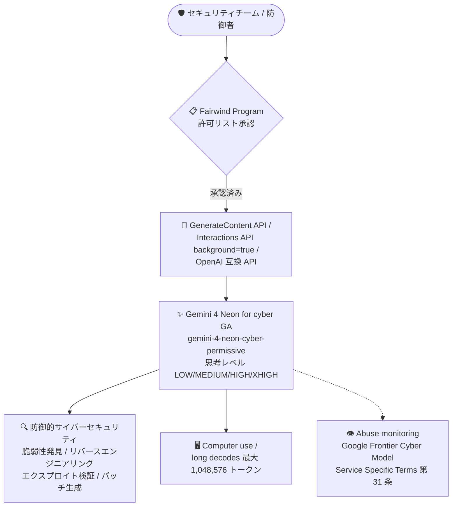

# Gemini Enterprise Agent Platform: Gemini 4 Neon for cyber (gemini-4-neon-cyber-permissive) が GA

**リリース日**: 2026-11-23

**サービス**: Gemini Enterprise Agent Platform

**機能**: Gemini 4 Neon for cyber (`gemini-4-neon-cyber-permissive`) の一般提供開始 (GA)

**ステータス**: GA (一般提供・許可リスト制)

📊 [このアップデートのインフォグラフィックを見る](https://takech9203.github.io/google-cloud-news-summary/20261123-gemini-4-neon-cyber-ga.html)

## 概要

Gemini Enterprise Agent Platform で、**Gemini 4 Neon for cyber (`gemini-4-neon-cyber-permissive`)** が一般提供 (GA) になりました。Gemini 4 Neon for cyber は、脆弱性発見 (vulnerability discovery)、リバースエンジニアリング、エクスプロイト検証 (exploit verification)、パッチ生成といった**防御的サイバーセキュリティユースケース**向けの Gemini 4 Neon のバリアントです。通常はブロックされるデュアルユース (攻防両用) のサイバー能力を、承認された防御者 (defender) が利用できるように制限を緩和した "permissive" モデルとして提供されます。

本モデルは **Google Frontier Cyber Model** として Service Specific Terms の **Section 31** が適用され、不正利用モニタリング (Abuse monitoring) の対象となります。利用は許可リスト制で、Google の担当チームへの連絡、または [Fairwind Program](https://deepmind.google/fairwind-program/) を通じた申請により承認を受ける必要があります。なお、Gemini 4 Carbon for cyber、Gemini 4 Argon Cyber Permissive、Gemini 3.8 Flash Cyber など、過去の Gemini Cyber モデルへのアクセス承認は引き継がれず、別途申請が必要です。

技術的には、ベースの Gemini 4 Neon と同じ Gemini 4 世代の API 規約を踏襲しており、入出力統合 1,048,576 トークン制限、`continuation_token` による最大 1,048,576 トークンまでの long decodes、4 段階の思考レベル (LOW / MEDIUM / HIGH / XHIGH、デフォルト HIGH)、暗黙的コンテキストキャッシュ (durable caching、最小 4,096 トークン)、Computer use、Microsoft Office / OpenDocument ファイル入力をサポートします。GenerateContent API、Interactions API (`background=true` を含む)、OpenAI 互換 Chat Completions API から利用でき、`global` エンドポイントおよび `us` / `eu` マルチリージョンで提供されます。対象ユーザーは、セキュリティリサーチ、脆弱性管理、レッドチーム支援 (防御目的) などを行うセキュリティチームやセキュリティベンダーです。

**アップデート前の課題**

- 汎用モデルでは、エクスプロイト検証やリバースエンジニアリングなどのデュアルユースな防御的サイバーセキュリティタスクが安全ポリシーによりブロックされ、正当なセキュリティ業務に活用しにくかった
- 先行する Gemini 4 Argon Cyber Permissive は Computer use をサポートしておらず、思考レベルも LOW / MEDIUM / HIGH の 3 段階 (XHIGH 非対応) だった
- 先行する Cyber モデル (Gemini 4 Carbon for cyber など) は、低レイテンシなエージェント型ワークフロー向けに最適化された Neon 世代の性能・API 規約 (統合 1M トークン制限、long decodes など) を利用できなかった

**アップデート後の改善**

- Fairwind Program で承認された組織が、脆弱性発見・リバースエンジニアリング・エクスプロイト検証・パッチ生成などの防御的サイバーセキュリティワークロードに、フロンティア級の Gemini 4 Neon を GA モデルとして利用できるようになった
- Cyber バリアントとして初めて XHIGH を含む 4 段階の思考レベルと Computer use に対応し、深い推論が必要な脆弱性解析や、ブラウザ操作を伴うセキュリティ検証エージェントを構築できるようになった
- 統合 1,048,576 トークン制限と long decodes により、大規模なバイナリ解析結果やコードベース全体を入力し、詳細な解析レポートやパッチ一式を一度に生成できるようになった
- Standard / Priority / Off-peak PayGo、バッチ推論、Provisioned Throughput (345 tokens/sec/GSU) といった消費オプションを、本番セキュリティワークロードの特性に応じて選択できるようになった

## アーキテクチャ図



Gemini 4 Neon for cyber は Fairwind Program の許可リスト承認を前提に、3 つの API サーフェスから防御的サイバーセキュリティワークロードに利用でき、Google Frontier Cyber Model として不正利用モニタリングの対象となります。

## サービスアップデートの詳細

### 主要機能

1. **防御的サイバーセキュリティ向けの permissive モデル**
   - 脆弱性発見、リバースエンジニアリング、エクスプロイト検証、パッチ生成などの防御的ユースケースを想定
   - デュアルユース (攻防両用) の攻撃的サイバー防御能力を、Fairwind Program で承認された防御者に提供
   - Google Frontier Cyber Model として Service Specific Terms Section 31 の対象 (不正利用モニタリングあり)

2. **許可リスト制のアクセス管理**
   - 利用には Google 担当チームへの連絡、または [Fairwind Program](https://deepmind.google/fairwind-program/) 経由の申請が必要
   - 過去の Gemini Cyber モデル (Gemini 4 Carbon for cyber、Gemini 4 Argon Cyber Permissive、Gemini 3.8 Flash Cyber) のアクセス承認は引き継がれず、個別に申請が必要

3. **ベース Gemini 4 Neon と同等のモデル能力**
   - 入力と出力を合算した統合 1,048,576 トークン制限 (出力は思考トークン・関数呼び出し・最終レスポンスを含む)
   - 単一フォアグラウンドセグメントで最大 65,536 出力トークン、long decodes (`continuation_token`) により最大 1,048,576 トークン (入力トークン分を除く) まで出力を拡張可能
   - 思考レベル LOW / MEDIUM / HIGH (デフォルト) / XHIGH。Computer use をサポート (Gemini 4 Argon Cyber Permissive では非サポートだった)
   - 暗黙的コンテキストキャッシュ (最小 4,096 トークンの共有プレフィックス) + durable caching デフォルト有効。明示的キャッシュは非サポート
   - Microsoft Office (.docx / .pptx / .xlsx など) / OpenDocument (.odt / .odp / .ods) ファイル入力に対応

4. **3 つの API サーフェスと柔軟な消費オプション**
   - GenerateContent API、Interactions API (`background=true` による非同期バックグラウンド実行を含む)、OpenAI 互換 Chat Completions API に対応
   - Standard PayGo (Usage Tiers)、Priority PayGo、Off-peak PayGo、バッチ推論、Provisioned Throughput (345 tokens/sec/GSU、最小 1 GSU) を選択可能

## 技術仕様

### ベースモデル (Gemini 4 Neon) との比較

| 項目 | Gemini 4 Neon | Gemini 4 Neon for cyber |
|------|---------------|-------------------------|
| モデル ID | `gemini-4-neon` | `gemini-4-neon-cyber-permissive` |
| アクセス | 検証済みエンタープライズ顧客 (一部リージョン) | 許可リストのみ ([Fairwind Program](https://deepmind.google/fairwind-program/)) |
| モデル分類 | Google Frontier Model (Section 34) | Google Frontier Cyber Model (Section 31) |
| デフォルト思考レベル | HIGH (LOW / MEDIUM / HIGH / XHIGH 対応) | HIGH (LOW / MEDIUM / HIGH / XHIGH 対応) |
| Computer use | サポート | サポート |
| 提供リージョン | `global`, `us`, `eu` | `global`, `us`, `eu` |

### モデル仕様

| 項目 | 詳細 |
|------|------|
| トークン制限 | 入力 + 出力の統合 1,048,576 トークン (出力は思考・関数呼び出し・最終レスポンスを含む) |
| 単一セグメント出力 | 最大 65,536 出力トークン (ストリーミング / 非ストリーミング共通) |
| long decodes | 最大 1,048,576 トークン (入力トークン分を除く)。Interactions API と GenerateContent (`v1beta1`) で対応 |
| バックグラウンド実行 | Interactions API の `background=true` (非同期・サーバー管理) |
| 思考レベル | LOW / MEDIUM / HIGH (デフォルト) / XHIGH。`thinking_budget` と `thinking_level="MINIMAL"` は HTTP 400 |
| コンテキストキャッシュ | 暗黙的キャッシュのみ (4,096 トークン以上の共有プレフィックス)、durable caching デフォルト有効 |
| ファイル入力 | PDF / テキストに加え、Office (.docx / .pptx / .xlsx など)、OpenDocument (.odt / .odp / .ods) |
| API サーフェス | GenerateContent API、Interactions API、OpenAI 互換 Chat Completions API |
| ロケーション | `global` エンドポイント、`us` / `eu` マルチリージョン |

### Provisioned Throughput (PT)

| 項目 | 詳細 |
|------|------|
| GSU あたりスループット | 345 tokens/sec |
| 最小 GSU 購入単位 | 1 GSU |
| バーンダウンレート (入力) | テキスト / 画像 / 動画 / 音声の入力トークン 1 = 1 トークン |
| バーンダウンレート (キャッシュ読み取り) | 入力キャッシュ読み取りトークン 1 = 0.05 トークン |
| バーンダウンレート (出力) | 出力 (レスポンス / 推論) テキストトークン 1 = 5 トークン |
| 2027-01-12 以降 (デフォルト) | 入力キャッシュ書き込みトークン 1 = 1.25 トークン |

## 設定方法

### 前提条件

1. 課金が有効な Google Cloud プロジェクトと Agent Platform API の有効化
2. **許可リストへの登録**: Google 担当チームへの連絡、または [Fairwind Program](https://deepmind.google/fairwind-program/) を通じた申請・承認 (過去の Cyber モデルの承認は引き継がれない)
3. API キーまたはアプリケーションデフォルト認証情報 (ADC) による認証

### 手順

#### ステップ 1: Fairwind Program への申請

Google の担当チームに連絡するか、[Fairwind Program](https://deepmind.google/fairwind-program/) から防御的サイバーセキュリティワークロードでの利用を申請し、許可リストへの登録を受けます。

#### ステップ 2: Gemini 4 Neon for cyber へのリクエスト

```bash
curl -X POST \
  -H "Authorization: Bearer $(gcloud auth print-access-token)" \
  -H "Content-Type: application/json" \
  "https://aiplatform.googleapis.com/v1/projects/PROJECT_ID/locations/global/publishers/google/models/gemini-4-neon-cyber-permissive:generateContent" \
  -d '{
    "contents": {"role": "USER", "parts": {"text": "このバイナリの逆アセンブル結果から脆弱性の兆候を分析してください。"}}
  }'
```

`global` エンドポイントまたは `us` / `eu` マルチリージョンを指定します。long decodes (`continuation_token`) を直接 REST で使う場合は `v1beta1` エンドポイントパスを使用します。

#### ステップ 3: 思考レベルと実行モードの調整

```text
- 深い脆弱性解析には thinking_level="XHIGH" を指定 (デフォルトは HIGH)
- 長時間の解析ジョブは Interactions API の background=true で非同期実行
- thinking_budget と thinking_level="MINIMAL" は HTTP 400 になるため使用しない
```

## メリット

### ビジネス面

- **正当な防御業務での生成 AI 活用**: 通常はブロックされるデュアルユースのサイバー能力を、許可リスト制の統制のもとで正当なセキュリティ業務に利用でき、脆弱性対応やインシデント対応のリードタイム短縮が期待できる
- **GA による本番採用のしやすさ**: GA モデルとして提供され、Provisioned Throughput を含む消費オプションと組み合わせて本番のセキュリティオペレーションに組み込める
- **コスト最適化の選択肢**: Standard / Priority / Off-peak PayGo、バッチ推論など、ワークロード特性 (対話的解析か大量バッチ解析か) に応じた課金モデルを選択できる

### 技術面

- **Cyber バリアント初の XHIGH + Computer use**: 深い推論が必要な脆弱性解析に XHIGH を使え、Computer use により GUI / ブラウザ操作を伴う検証エージェントを構築できる (Gemini 4 Argon Cyber Permissive では Computer use 非対応だった)
- **大規模解析への対応**: 統合 1M トークンコンテキストと long decodes により、大規模なコードベースや解析ログを入力し、詳細な解析レポートやパッチ一式を途切れずに生成できる
- **キャッシュによるコスト・レイテンシ削減**: 共通の解析手順書やツール定義 (4,096 トークン以上) を先頭に置くだけで、暗黙的キャッシュ + durable caching によるコスト削減が追加実装なしに効く
- **OpenAI 互換 API 対応**: 既存のセキュリティツールチェーンが OpenAI Chat Completions ベースであっても少ない変更で統合できる

## デメリット・制約事項

### 制限事項

- 利用は許可リスト制で、Fairwind Program などを通じた承認が必須。過去の Gemini Cyber モデル (Gemini 4 Carbon for cyber、Gemini 4 Argon Cyber Permissive、Gemini 3.8 Flash Cyber) のアクセス承認は引き継がれない
- Google Frontier Cyber Model として Service Specific Terms Section 31 の対象であり、不正利用モニタリング (プロンプト・レスポンスのロギングを含む) が適用される
- `thinking_budget` の指定や `thinking_level="MINIMAL"` は HTTP 400 バリデーションエラーになる
- 明示的コンテキストキャッシュは非サポート。暗黙的キャッシュは共有プレフィックスが 4,096 トークン以上の場合のみ適用
- 提供ロケーションは `global` と `us` / `eu` マルチリージョンに限定される

### 考慮すべき点

- あくまで「防御的」ユースケース向けの提供であり、Acceptable Use Policy / Prohibited Use Policy に沿った利用統制 (社内ポリシー、利用者の限定など) を自組織側でも整備する必要がある
- 出力トークンには思考トークンと関数呼び出しが含まれるため、HIGH / XHIGH ではトークン予算にヘッドルームを持たせた設計が必要
- 2027 年 1 月 12 日以降、キャッシュ書き込みがデフォルトで標準入力トークン料金の 1.25 倍で課金されるため (保持期間が長いほど高コスト)、キャッシュ利用パターンとコストの再評価が必要

## ユースケース

### ユースケース 1: 大規模コードベースの脆弱性発見とパッチ生成

**シナリオ**: 自社プロダクトのリポジトリ全体を対象に、脆弱性の洗い出しと根本原因レベルのパッチ案生成を自動化したい。汎用モデルではエクスプロイトの再現・検証を伴う解析がブロックされてしまう。

**実装例**:
```python
interaction = client.interactions.create(
    model="gemini-4-neon-cyber-permissive",
    input="このリポジトリの脆弱性を分析し、PoC による検証手順と修正パッチを生成してください。",
    generation_config={
        "max_output_tokens": 500000,
        "thinking_level": "xhigh",
    },
    background=True,  # サーバー管理の非同期バックグラウンド実行
)
```

**効果**: 統合 1M トークンコンテキストに大規模コードを読み込ませ、long decodes で詳細な解析レポートとパッチ一式を一度に取得できる。XHIGH の深い推論により根本原因レベルのパッチ品質が期待できる。

### ユースケース 2: マルウェア / バイナリのリバースエンジニアリング支援

**シナリオ**: SOC / CSIRT がインシデント対応で取得した検体の逆アセンブル結果・挙動ログを解析し、挙動の特定と対策 (検知ルール・緩和策) の立案を高速化したい。

**効果**: 防御的ユースケースとして許可された permissive モデルのため、リバースエンジニアリングやエクスプロイト検証を含む解析をブロックされずに実行でき、インシデント対応のリードタイムを短縮できる。

### ユースケース 3: Computer use を使った脆弱性検証エージェント

**シナリオ**: 発見した脆弱性の再現・検証のために、検証環境上の Web アプリをブラウザ操作で実際に操作しながら確認するエージェントを構築したい。

**効果**: Cyber バリアントとして Computer use に対応しているため、GUI 操作を伴う検証フローをエージェントとして自動化できる (先行の Gemini 4 Argon Cyber Permissive では不可能だった)。

## 料金

Gemini 4 Neon for cyber はトークンベースの従量課金で、以下の消費オプションが利用できます。固有の単価は公式料金ページを参照してください。

- **Standard PayGo**: Usage Tiers に対応した標準の従量課金
- **Priority PayGo / Off-peak PayGo**: 優先処理 / オフピーク処理向けの従量課金
- **バッチ推論**: 大量の非対話ワークロード向け
- **Provisioned Throughput**: 345 tokens/sec/GSU、最小 1 GSU から購入可能 (出力トークンはバーンダウンレート 5 倍)

キャッシュについては、暗黙的キャッシュの読み取りが Provisioned Throughput のバーンダウンレートで 0.05 トークン換算と優遇されます。**2027 年 1 月 12 日以降**、キャッシュ書き込みはデフォルトで標準入力トークン料金の **1.25 倍** で課金されます (保持期間が長いほど高コスト)。

詳細: [Gemini Enterprise Agent Platform の生成 AI 料金](https://cloud.google.com/gemini-enterprise-agent-platform/generative-ai/pricing)

## 利用可能リージョン

- グローバルエンドポイント: `global`
- マルチリージョン: `us`、`eu`

## 関連サービス・機能

- **Gemini 4 Neon (`gemini-4-neon`)**: ベースとなる Google Frontier Model。2026-11-18 に GA (関連レポート: [Gemini 4 Neon GA](./2026-11-18-gemini-enterprise-agent-platform-gemini-4-neon-ga.md))
- **Gemini 4 Carbon for cyber / Gemini 4 Argon Cyber Permissive / Gemini 3.8 Flash Cyber**: 先行する Gemini Cyber クラスのモデル群。アクセス承認は Neon for cyber には引き継がれない
- **Fairwind Program**: 防御的サイバーセキュリティワークロード向けに許可リストアクセスを提供する Google DeepMind のプログラム
- **Interactions API**: `continuation_token` による long decodes や `background=true` の非同期バックグラウンド実行をサポートするステートフルな API
- **Provisioned Throughput**: 安定稼働が必要な本番セキュリティワークロード向けに、コミットメントベースでスループットを保証する消費オプション
- **Abuse monitoring**: Google Frontier Cyber Model に適用される不正利用モニタリングの仕組み

## 参考リンク

- 📊 [インフォグラフィック](https://takech9203.github.io/google-cloud-news-summary/20261123-gemini-4-neon-cyber-ga.html)
- [公式リリースノート](https://docs.cloud.google.com/release-notes#November_23_2026)
- [Gemini 4 Neon for cyber (モデルドキュメント)](https://docs.cloud.google.com/gemini-enterprise-agent-platform/models/gemini/4-neon#cyber)
- [Gemini 4 Neon 開発者ガイド / 移行ガイド](https://docs.cloud.google.com/gemini-enterprise-agent-platform/models/guides/gemini-4-neon#migration-guide)
- [Fairwind Program](https://deepmind.google/fairwind-program/)
- [Abuse monitoring](https://docs.cloud.google.com/gemini-enterprise-agent-platform/models/abuse-monitoring)
- [Provisioned Throughput 対応モデル](https://docs.cloud.google.com/gemini-enterprise-agent-platform/models/provisioned-throughput/supported-models)
- [料金ページ](https://cloud.google.com/gemini-enterprise-agent-platform/generative-ai/pricing)

## まとめ

Gemini 4 Neon for cyber の GA により、Fairwind Program で承認された防御者は、脆弱性発見・リバースエンジニアリング・エクスプロイト検証・パッチ生成といったデュアルユースなサイバーセキュリティタスクに、XHIGH 思考レベルと Computer use を備えたフロンティア級モデルを本番利用できるようになりました。利用には許可リスト承認が必須で、過去の Gemini Cyber モデルの承認は引き継がれないため、利用を検討する組織は早めに Google 担当チームまたは Fairwind Program へ申請してください。あわせて、Google Frontier Cyber Model としての不正利用モニタリング (Service Specific Terms 第 31 条) と、2027 年 1 月 12 日開始のキャッシュ書き込み課金 (標準入力料金の 1.25 倍) を踏まえた統制・コスト設計を推奨します。

---

**タグ**: Gemini Enterprise Agent Platform, Gemini 4 Neon for cyber, GA, 生成 AI, サイバーセキュリティ, Fairwind Program, Google Frontier Cyber Model, Computer use, long decodes, Provisioned Throughput
