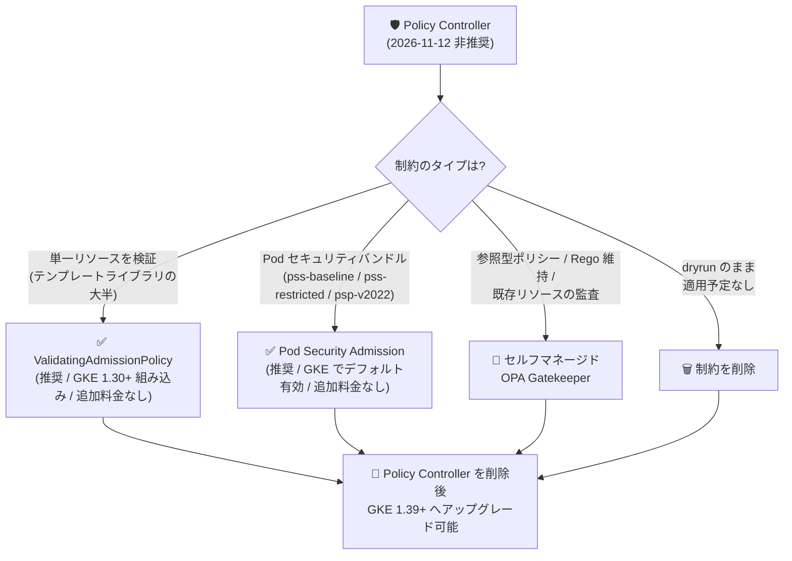

# Google Kubernetes Engine: Policy Controller の非推奨化

**リリース日**: 2026-11-23

**サービス**: Google Kubernetes Engine (GKE)

**機能**: Policy Controller の非推奨化とサポート終了スケジュール

**ステータス**: Deprecated (非推奨)

📊 [このアップデートのインフォグラフィックを見る](https://takech9203.github.io/google-cloud-news-summary/20261123-gke-policy-controller-deprecation.html)

## 概要

Policy Controller が 2026 年 11 月 12 日付けで非推奨 (Deprecated) となり、2027 年 12 月 31 日にサポート終了 (End of Support) を迎えることが発表されました。Policy Controller はオープンソースの Open Policy Agent (OPA) Gatekeeper をベースとした、Kubernetes クラスタ向けのプログラマブルなポリシー適用・監査機能で、Google Cloud に統合されたダッシュボードや事前定義済みポリシーライブラリを提供してきました。

非推奨化は段階的に進行します。2027 年 1 月 31 日以降は、Policy Controller が有効化されていないフリートホストプロジェクトで新規に有効化できなくなります。また、GKE は Policy Controller がインストールされたクラスタのバージョン 1.39 以降へのアップグレードをブロックし、GKE 1.39 以降のクラスタでは Policy Controller がサポートされません。2027 年 12 月 31 日には、テクニカルサポート、GKE 1.38 以前でのセキュリティパッチ提供、Google Cloud コンソールのダッシュボードがすべて終了します。

Policy Controller でアドミッションポリシーを運用しているフリート管理者・セキュリティ担当者は、Kubernetes 標準の ValidatingAdmissionPolicy、Pod Security Admission、またはセルフマネージドの OPA Gatekeeper への移行が必要です。なお、Policy Controller はリソースの作成・更新リクエストを評価する仕組みであるため、移行作業自体は実行中のワークロードに影響を与えません (Pod の再起動や変更は発生しません)。

**アップデート前の課題**

- Policy Controller は Google が管理するマネージドなポリシー適用機能として、フリート単位でのポリシー管理や専用ダッシュボードを提供していた
- ポリシーロジックは主に Rego で記述され、Gatekeeper ベースの Webhook を介して評価されていた

**アップデート後の変更 (非推奨化の影響)**

- 2027 年 1 月 31 日以降、未使用のフリートホストプロジェクトでは Policy Controller を新規に有効化できなくなる (すでに有効なプロジェクトでは GKE 1.38 以前のメンバークラスタへの有効化は引き続き可能)
- Policy Controller がインストールされたクラスタは GKE 1.39 以降へアップグレードできなくなる
- 2027 年 12 月 31 日にテクニカルサポート、GKE 1.38 以前へのセキュリティパッチ、コンソールダッシュボードが終了する
- 移行先として、Kubernetes 組み込みで追加料金不要の ValidatingAdmissionPolicy と Pod Security Admission (いずれも Cloud カスタマーケアのサポート対象)、またはセルフマネージドの OPA Gatekeeper が案内されている

## アーキテクチャ図



Policy Controller の各制約 (Constraint) をタイプごとに評価し、適切な移行先を選択するフローです。1 つのクラスタ内で複数の移行先を組み合わせることもできます。

## サービスアップデートの詳細

### 非推奨化のタイムライン

| 日付 / バージョン | 内容 |
|------|------|
| 2026 年 11 月 12 日 | Policy Controller が非推奨 (Deprecated) に |
| 2027 年 1 月 31 日 | Policy Controller 未有効のフリートホストプロジェクトで新規有効化が不可に。有効済みプロジェクトでは GKE 1.38 以前のメンバークラスタへの有効化は引き続き可能 |
| GKE 1.39 | Policy Controller がインストールされたクラスタの 1.39 以降へのアップグレードをブロック。1.39 以降のクラスタは Policy Controller 非サポート。GKE 1.38 以前では 2027 年 12 月 31 日まで動作し、重要なセキュリティパッチを受領 |
| 2027 年 12 月 31 日 | テクニカルサポート、セキュリティパッチ、Google Cloud コンソールダッシュボードが終了 |

### 移行先の選択肢

1. **ValidatingAdmissionPolicy (推奨)**
   - 作成・更新時に単一リソースを検証するポリシーに適する。Policy Controller テンプレートライブラリの大半のテンプレートがこの方式で動作
   - Kubernetes 組み込み機能で、GKE 1.30 以降で追加料金なしに利用可能。Cloud カスタマーケアが GKE の一部としてサポート
   - ポリシーロジックは Rego ではなく CEL (Common Expression Language) で記述し、Webhook を介さず API サーバーが直接評価

2. **Pod Security Admission (Pod セキュリティバンドルに推奨)**
   - `pss-baseline-v2022`、`pss-restricted-v2022`、`psp-v2022` バンドルの事前定義 Pod セキュリティ制御の置き換え先
   - Kubernetes 組み込みの PodSecurity アドミッションコントローラーが、Namespace ラベルに基づき Pod Security Standards を適用。GKE でデフォルト有効、追加料金なし、カスタマーケアのサポート対象
   - `pss-baseline-v2022` は baseline レベル、`pss-restricted-v2022` は restricted レベルに対応

3. **セルフマネージド OPA Gatekeeper**
   - ValidatingAdmissionPolicy で表現できないポリシー向け: クラスタ内の他リソースを参照する参照型ポリシー、Rego を維持したいポリシー、既存リソースの監査 (audit) など
   - インストール・アップグレード・運用はユーザー自身が実施。カスタマーケアはオープンソース Gatekeeper をサポートせず、サポートは GitHub の Gatekeeper コミュニティ経由
   - Gatekeeper の ConstraintTemplate に CEL ルールを追加すれば、Gatekeeper が ValidatingAdmissionPolicy を生成して API サーバーで適用し、audit コントローラーで既存リソースを検査する構成も可能

### 制約タイプ別の移行パス

| 制約タイプ | 移行パス |
|------|------|
| 単一リソース制約 | ValidatingAdmissionPolicy |
| 適用予定のない dryrun 制約 | 制約を削除 |
| Pod セキュリティバンドル制約 | Pod Security Admission (カバーされない制御は ValidatingAdmissionPolicy) |
| 参照型制約 (`data.inventory` を読む) | セルフマネージド Gatekeeper |
| Cloud Service Mesh / Istio / Google Cloud 制約 | 個別にレビュー。多くは ValidatingAdmissionPolicy で動作するが、参照型の `AsmAuthzPolicyDefaultDeny` と `AsmPeerAuthnMeshStrictMtls` はセルフマネージド Gatekeeper が必要。`K8sRequireBinAuthZ` は Binary Authorization、`K8sRequireCosNodeImage` はノードイメージ設定で代替 |

## 技術仕様

### Constraint と ValidatingAdmissionPolicy のフィールド対応

| Constraint のフィールド | ValidatingAdmissionPolicy / Binding のフィールド |
|------|------|
| `spec.enforcementAction` | Binding の `validationActions` (`deny` → `["Deny"]`、`warn` → `["Warn"]`、`dryrun` → `["Audit"]`) |
| `spec.parameters` | Policy の `variables`、または Binding の `paramRef` で参照するパラメータリソース |
| `spec.match.kinds` | Policy の `matchConstraints.resourceRules` (kind ではなく API グループとリソース名を使用) |
| `spec.match.namespaces` / `excludedNamespaces` | Binding の `matchResources.namespaceSelector` (`kubernetes.io/metadata.name` ラベルに `In` / `NotIn`) |
| `spec.match.labelSelector` | Binding の `matchResources.objectSelector` |
| `spec.match.scope` | 各リソースルールの `scope` フィールド |

### 移行時に注意すべき挙動差分 (ValidatingAdmissionPolicy)

- **フェイルポリシー**: Policy Controller の Webhook はフェイルオープンだが、`failurePolicy: Fail` の ValidatingAdmissionPolicy は式のエラーや CEL コスト上限超過時にリクエストを拒否する
- **欠落フィールド**: Rego は欠落フィールドを違反なしと扱うが、CEL はエラーを返すため、省略可能なフィールドは `has()` マクロで存在確認が必要
- **除外設定**: デフォルトでは Namespace を除外しない。GKE Standard では `kube-system` などのシステム Namespace を含む全 Namespace に適用されるため、明示的な除外が必要。Autopilot では GKE が管理対象 Namespace を自動的に除外
- **サブリソース**: エフェメラルコンテナの追加を検証するには、リソースルールに `pods/ephemeralcontainers` を含める
- **既存リソースの監査なし**: ValidatingAdmissionPolicy は受信リクエストのみを評価し、既存の違反リソースは報告しない
- **違反メッセージ**: リクエストごとに最初に失敗した検証のみを報告する (全違反の列挙ではない)

## 設定方法

### 前提条件

1. フリート内で Policy Controller が稼働しているクラスタを特定する
2. ポリシー (ConstraintTemplate / Constraint) をバックアップする。Policy Controller を削除すると、クラスタ上のすべての ConstraintTemplate、制約、同期設定、ミューテーターが削除されるため、バックアップが必須

### 手順

#### ステップ 1: ポリシーのインベントリとバックアップ

```bash
# フリート内で Policy Controller が稼働するクラスタを特定
gcloud container fleet policycontroller describe \
  --project=PROJECT_ID

# 各クラスタで制約の一覧と適用アクション・違反数を確認
kubectl get constraints \
  -o custom-columns='KIND:.kind,NAME:.metadata.name,'\
'ACTION:.spec.enforcementAction,VIOLATIONS:.status.totalViolations,'\
'BUNDLE:.metadata.labels.policycontroller\.gke\.io/bundleName'

# ConstraintTemplate と制約をバックアップ
kubectl get constrainttemplates -o yaml \
  > policy-controller-templates-backup.yaml
kubectl get constraints -o yaml \
  > policy-controller-constraints-backup.yaml
```

デフォルトではテンプレートライブラリ全体がインストールされ、ポリシーバンドルの制約は dryrun で入るため、実際に「適用」しているポリシーを棚卸しすることが重要です。

#### ステップ 2: ValidatingAdmissionPolicy を並行稼働させて検証

```yaml
apiVersion: admissionregistration.k8s.io/v1
kind: ValidatingAdmissionPolicyBinding
metadata:
  name: allowed-repos
spec:
  policyName: allowed-repos
  validationActions: ["Warn", "Audit"]  # まず Warn/Audit で並行稼働
  matchResources:
    namespaceSelector:
      matchExpressions:
        - key: kubernetes.io/metadata.name
          operator: NotIn
          values: ["kube-system", "gatekeeper-system"]
```

適用ギャップを避けるため、Policy Controller の制約を残したまま `validationActions: ["Warn", "Audit"]` で ValidatingAdmissionPolicy を並行稼働させ、監査ログで結果を比較します。結果が一致したら `["Deny"]` に変更し、その後 Policy Controller の制約を削除します。

#### ステップ 3: Policy Controller の削除と GKE 1.39+ へのアップグレード

移行完了後に Policy Controller を削除します。ポリシー移行前に、アップグレードブロック解除のためだけに Policy Controller を削除することは、クラスタがポリシー適用のない状態になるため避けるべきです。セルフマネージド Gatekeeper へ移行する場合、Policy Controller が稼働中のクラスタに Gatekeeper をインストールしてはいけません (同じ `gatekeeper-system` Namespace、CRD、Webhook 名を使用するため)。

## メリット

### ビジネス面

- **追加コストなしの移行先**: 推奨移行先の ValidatingAdmissionPolicy と Pod Security Admission はいずれも Kubernetes / GKE 組み込みで追加料金が不要
- **サポート継続性**: ValidatingAdmissionPolicy と Pod Security Admission は GKE の一部として Cloud カスタマーケアのサポート対象

### 技術面

- **Kubernetes 標準への統合**: CEL ベースの ValidatingAdmissionPolicy は Webhook を介さず API サーバーが直接評価するため、Kubernetes ネイティブな仕組みでポリシーを運用できる
- **ワークロードへの無影響**: 移行・Policy Controller の削除は実行中のワークロードを再起動・変更しない

## デメリット・制約事項

### 制限事項

- GKE 1.39 以降は Policy Controller をサポートせず、インストール済みクラスタは 1.39 以降へアップグレードできない
- 2027 年 12 月 31 日以降、テクニカルサポート・セキュリティパッチ・コンソールダッシュボードが終了する
- ValidatingAdmissionPolicy は既存リソースの監査 (audit) 機能を持たない。監査が必要な場合はセルフマネージド Gatekeeper が必要
- Pod Security Admission は `psp-v2022` バンドルの一部制御 (ホストパス・ユーザー・ケイパビリティ・sysctl の許可リストなど) をカバーせず、`exemptImages` のようなイメージ単位の除外も不可。GKE は Pod Security Admission の除外設定をサポートしない

### 考慮すべき点

- セルフマネージド Gatekeeper はユーザー自身での運用が必要で、カスタマーケアのサポート対象外 (コミュニティサポートのみ)
- Gatekeeper の Helm チャートのデフォルト設定は Policy Controller と異なる (ミューテーションがデフォルト有効、参照データは自動同期されない、イメージは Docker Hub から取得、メトリクス名が異なる等)。Autopilot クラスタではミューテーション Webhook のワイルドカードルールが拒否されるため `disableMutation: true` などの設定が必要
- Gatekeeper のメトリクス名は Policy Controller が Cloud Monitoring に送信していた名前と異なるため、ダッシュボードとアラートの更新が必要

## ユースケース

### ユースケース 1: テンプレートライブラリの単一リソース制約を ValidatingAdmissionPolicy に移行

**シナリオ**: `K8sAllowedRepos` 制約で Pod のコンテナイメージを特定の Artifact Registry リポジトリに制限している。

**実装例**: 制約の `parameters.repos` を ValidatingAdmissionPolicy の `variables` に移し、CEL 式で `containers`、`initContainers`、`ephemeralContainers` の全イメージが許可リポジトリで始まることを検証する。Binding はまず `["Warn", "Audit"]` で適用し、監査ログで Policy Controller と結果を比較してから `["Deny"]` に切り替える。

**効果**: Webhook に依存しない Kubernetes 組み込みの仕組みで、適用ギャップなしに同等のポリシーを維持できる。

### ユースケース 2: Pod セキュリティバンドルを Pod Security Admission に置き換え

**シナリオ**: `pss-restricted-v2022` バンドルで Pod のセキュリティ基準を強制している。

**効果**: 制約を個別に変換せず、Namespace ラベルで Pod Security Standards の restricted レベルを適用するだけで置き換えが完了する。GKE でデフォルト有効のため追加インストールも不要。

## 料金

Policy Controller の非推奨化に伴う推奨移行先のコストは以下のとおりです。

- **ValidatingAdmissionPolicy**: GKE 1.30 以降で追加料金なしで利用可能
- **Pod Security Admission**: GKE でデフォルト有効、追加料金なし
- **セルフマネージド OPA Gatekeeper**: ソフトウェア自体はオープンソース。運用 (インストール・アップグレード・監視) はユーザー負担

## 関連サービス・機能

- **Kubernetes ValidatingAdmissionPolicy**: 推奨される主要な移行先。CEL ベースで API サーバーが直接評価
- **Pod Security Admission (PodSecurity)**: Pod セキュリティバンドルの移行先。Pod Security Standards を Namespace ラベルで適用
- **OPA Gatekeeper (オープンソース)**: Policy Controller のベースとなったプロジェクト。参照型ポリシーや監査が必要な場合のセルフマネージド移行先
- **Binary Authorization**: `K8sRequireBinAuthZ` テンプレートの組み込み代替機能
- **Cloud Logging / Cloud Monitoring**: 移行時の監査ログ比較や、Gatekeeper 移行後のメトリクス名変更に伴うダッシュボード・アラート更新に関係

## 参考リンク

- 📊 [インフォグラフィック](https://takech9203.github.io/google-cloud-news-summary/20261123-gke-policy-controller-deprecation.html)
- [公式リリースノート](https://docs.cloud.google.com/release-notes#November_23_2026)
- [Migrate from Policy Controller (移行ガイド)](https://docs.cloud.google.com/kubernetes-engine/docs/deprecations/policy-controller)
- [Policy Controller の概要 (非推奨タイムライン)](https://docs.cloud.google.com/kubernetes-engine/policy-controller/docs/overview)
- [Apply predefined Pod-level security policies using PodSecurity](https://docs.cloud.google.com/kubernetes-engine/docs/how-to/podsecurityadmission)

## まとめ

Policy Controller は 2026 年 11 月 12 日に非推奨となり、GKE 1.39 以降では利用できず、2027 年 12 月 31 日にサポートが完全終了します。Policy Controller を利用中のクラスタは 1.39 以降へのアップグレードがブロックされるため、まず `gcloud container fleet policycontroller describe` と `kubectl get constraints` で適用中のポリシーを棚卸しし、バックアップを取得することを推奨します。その上で、単一リソース制約は ValidatingAdmissionPolicy、Pod セキュリティバンドルは Pod Security Admission、参照型ポリシーや監査が必要なものはセルフマネージド Gatekeeper へ、適用ギャップが生じないよう並行稼働で検証しながら計画的に移行してください。

---

**タグ**: #GKE #PolicyController #Deprecation #ValidatingAdmissionPolicy #PodSecurityAdmission #OPAGatekeeper #Kubernetes #Security
