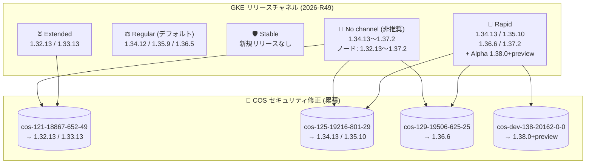

# Google Kubernetes Engine (GKE): 2026-R49 バージョンおよびセキュリティアップデート

**リリース日**: 2026-11-23

**サービス**: Google Kubernetes Engine (GKE)

**機能**: 2026-R49 バージョンアップデートおよび Container-Optimized OS セキュリティ修正

**ステータス**: GA (Alpha 1.38.0+preview を含む)

📊 [このアップデートのインフォグラフィックを見る](https://takech9203.github.io/google-cloud-news-summary/20261123-gke-version-security-updates-2026-r49.html)

## 概要

GKE 2026-R49 リリースとして、Rapid、Regular、Extended、No channel の各リリースチャネルに新しいクラスタバージョンが提供された。Rapid チャネルには 1.34.13 から 1.37.2 までの 4 つのマイナーバージョン系列の最新パッチが追加され、Alpha クラスタ向けには 1.38.0-gke.5273000+preview が新たに利用可能になった (従来の 1.38.0-gke.4162000+preview は提供終了)。Regular チャネルには 1.34.12 / 1.35.9 / 1.36.5 系の新パッチが、Extended チャネルには 1.32.13 / 1.33.13 系の新パッチが追加されている。なお、今回のリリースでは Stable チャネルへの新規リリースはない。

セキュリティ面では、更新された Container-Optimized OS (COS) イメージを使用する新しい GKE バージョンが含まれる。更新された COS イメージは累積的であり、前回の GKE リリース以降にリリースされたすべての COS バージョンのセキュリティ修正を取り込んでいる。対象は GKE 1.32.13 から 1.38.0+preview までの各バージョンで、COS 121 / 125 / 129 / dev-138 の各系列が更新されている。

本アップデートは GKE を利用するすべてのユーザーに影響する定期的なバージョンアップデートであり、特に COS イメージのセキュリティ修正を取り込むためのノードアップグレードは、すべての本番環境クラスタで推奨される。

**アップデート前の課題**

- 以前の GKE ノードが使用する COS イメージには、前回リリース以降に公開されたセキュリティ修正が適用されていなかった
- Rapid チャネルでは 1.34.13 / 1.35.10 / 1.36.6 / 1.37.2 系の最新パッチバージョンが利用できなかった
- Alpha クラスタで Kubernetes 1.38 系を検証するには旧ビルド (1.38.0-gke.4162000+preview) を使用する必要があった

**アップデート後の改善**

- 更新された COS イメージ (cos-121 / cos-125 / cos-129 / cos-dev-138) を使用する新しい GKE バージョンにより、累積的なセキュリティ修正を適用可能になった
- Rapid / Regular / Extended / No channel の各チャネルで新しいパッチバージョンが利用可能になり、新規クラスタ作成および既存クラスタのアップグレードの選択肢が拡大した
- Alpha クラスタ向けに 1.38.0-gke.5273000+preview が提供され、次期マイナーバージョンの早期検証が最新ビルドで可能になった

## アーキテクチャ図



2026-R49 で各リリースチャネルにロールアウトされるバージョンと、更新された Container-Optimized OS イメージの対応関係を示す。Rapid / No channel には最新パッチが提供され、Stable チャネルは今回新規リリースがない。

## サービスアップデートの詳細

### 主要機能

1. **Rapid チャネルのバージョン更新**
   - 1.34.13-gke.1051000、1.35.10-gke.1122000、1.36.6-gke.1146000、1.37.2-gke.1606000 が新たに利用可能に
   - Alpha クラスタ向けに 1.38.0-gke.5273000+preview が提供開始。旧 Alpha ビルド 1.38.0-gke.4162000+preview は提供終了
   - Rapid チャネルは新しい Kubernetes バージョンを最も早く提供するチャネルであり、本番環境前の検証に推奨

2. **Regular / Extended チャネルのバージョン更新**
   - Regular チャネル: 1.34.12-gke.1698000、1.35.9-gke.1673000、1.36.5-gke.2262000 が追加
   - Extended チャネル: 1.32.13-gke.3169000、1.33.13-gke.2480000 が追加され、長期サポート対象の古いマイナーバージョンにもセキュリティ修正が提供
   - Stable チャネル: 今回のリリースでは新規リリースなし

3. **No channel (非推奨) のバージョン更新**
   - クラスタバージョン: 1.34.13-gke.1051000、1.35.10-gke.1122000、1.36.6-gke.1146000、1.37.2-gke.1606000
   - ノードバージョン: 1.32.13-gke.3169000、1.33.13-gke.2480000、1.34.13-gke.1051000、1.35.10-gke.1122000、1.36.6-gke.1146000、1.37.2-gke.1606000

4. **Container-Optimized OS セキュリティ修正**
   - 更新された COS イメージを使用する新しい GKE バージョンを含むリリース
   - 更新イメージは累積的で、前回の GKE リリース以降に公開されたすべての COS セキュリティ修正を含む
   - 解消された個別の脆弱性は、各 COS イメージのセキュリティリリースノートで確認可能

## 技術仕様

### チャネル別バージョン一覧

#### Rapid チャネル

| マイナーバージョン | パッチバージョン |
|------|------|
| 1.34 | 1.34.13-gke.1051000 |
| 1.35 | 1.35.10-gke.1122000 |
| 1.36 | 1.36.6-gke.1146000 |
| 1.37 | 1.37.2-gke.1606000 |
| 1.38 (Alpha) | 1.38.0-gke.5273000+preview (1.38.0-gke.4162000+preview は提供終了) |

#### Regular チャネル

| マイナーバージョン | パッチバージョン |
|------|------|
| 1.34 | 1.34.12-gke.1698000 |
| 1.35 | 1.35.9-gke.1673000 |
| 1.36 | 1.36.5-gke.2262000 |

#### Stable チャネル

| 項目 | 詳細 |
|------|------|
| 新規リリース | なし |

#### Extended チャネル

| マイナーバージョン | パッチバージョン |
|------|------|
| 1.32 | 1.32.13-gke.3169000 |
| 1.33 | 1.33.13-gke.2480000 |

#### No channel (非推奨)

| 項目 | 詳細 |
|------|------|
| クラスタバージョン | 1.34.13-gke.1051000 / 1.35.10-gke.1122000 / 1.36.6-gke.1146000 / 1.37.2-gke.1606000 |
| ノードバージョン | 1.32.13-gke.3169000 / 1.33.13-gke.2480000 / 1.34.13-gke.1051000 / 1.35.10-gke.1122000 / 1.36.6-gke.1146000 / 1.37.2-gke.1606000 |

### セキュリティ修正: GKE バージョンと COS イメージの対応

| GKE バージョン | Container-Optimized OS バージョン |
|------|------|
| 1.32.13-gke.3169000 | cos-121-18867-652-49 |
| 1.33.13-gke.2480000 | cos-121-18867-652-49 |
| 1.34.13-gke.1051000 | cos-125-19216-801-29 |
| 1.35.10-gke.1122000 | cos-125-19216-801-29 |
| 1.36.6-gke.1146000 | cos-129-19506-625-25 |
| 1.38.0-gke.5273000+preview | cos-dev-138-20162-0-0 |

### リリースチャネルの選択基準

| チャネル | 特徴 | 推奨用途 |
|------|------|------|
| Rapid | 最新バージョンを最も早く提供 | 開発・検証環境、新機能の早期評価 |
| Regular (デフォルト) | Rapid の後に十分な検証を経て提供 | 一般的な本番環境 |
| Stable | Regular の後にさらに検証を経て提供 | 安定性を最優先する本番環境 |
| Extended | 古いマイナーバージョンを長期サポート | 長期サポートが必要な環境 |
| No channel | 非推奨。手動でのバージョン管理 | 自動アップグレードを独自管理したい場合 (非推奨) |

## 設定方法

### 前提条件

1. Google Cloud プロジェクトで GKE API が有効化されていること
2. `gcloud` CLI がインストールおよび認証済みであること
3. 対象クラスタに対する `container.clusters.update` 権限があること

### 手順

#### ステップ 1: 利用可能なバージョンを確認

```bash
# 各チャネルで利用可能なバージョンとデフォルトバージョンを確認
gcloud container get-server-config \
  --zone=asia-northeast1-a \
  --format="yaml(channels)"
```

ロールアウトはリリースノート公開時点で進行中のため、ゾーンによってはまだ新バージョンが表示されない場合がある。

#### ステップ 2: クラスタのコントロールプレーンをアップグレード

```bash
# コントロールプレーンを指定バージョンにアップグレード
gcloud container clusters upgrade my-cluster \
  --zone=asia-northeast1-a \
  --master \
  --cluster-version=1.36.5-gke.2262000
```

コントロールプレーンのアップグレードは数分から数十分かかる。アップグレード中もワークロードは引き続き実行される。

#### ステップ 3: ノードプールをアップグレード (COS セキュリティ修正の適用)

```bash
# ノードプールを指定バージョンにアップグレード
gcloud container clusters upgrade my-cluster \
  --zone=asia-northeast1-a \
  --node-pool=default-pool \
  --cluster-version=1.36.5-gke.2262000
```

COS イメージのセキュリティ修正はノードのアップグレードによって適用される。サージアップグレード方式で実行され、ワークロードの可用性が維持される。

## メリット

### ビジネス面

- **セキュリティリスクの低減**: 累積的な COS セキュリティ修正を含む新バージョンへのアップグレードにより、既知の脆弱性に対するリスクが軽減される。コンプライアンス要件を満たすためにも定期的なアップデート適用が重要
- **運用の安定性向上**: 各チャネルで検証済みのパッチバージョンが提供されるため、安定した運用が可能

### 技術面

- **最新 Kubernetes パッチへのアクセス**: Rapid チャネルで 1.37.2 までの最新パッチが利用可能になり、最新の修正や改善を早期に検証できる
- **次期バージョンの早期検証**: Alpha 1.38.0-gke.5273000+preview により、Kubernetes 1.38 系の新機能を Alpha クラスタで評価できる
- **長期サポート環境への修正提供**: Extended チャネルの 1.32.13 / 1.33.13 により、古いマイナーバージョンを使用する環境にもセキュリティ修正が届く

## デメリット・制約事項

### 制限事項

- ロールアウトはリリースノート公開時点で既に進行中であり、すべての Google Cloud ゾーンで利用可能になるまで数日かかる場合がある
- 今回のリリースでは Stable チャネルに新規リリースがないため、Stable チャネル利用クラスタは今回の新パッチを取得できない
- Alpha バージョン (1.38.0+preview) は Alpha クラスタ専用であり、本番環境には使用できない。また旧 Alpha ビルド 1.38.0-gke.4162000+preview は提供終了となった
- No channel は非推奨 (deprecated) である

### 考慮すべき点

- COS イメージのセキュリティ修正はノードイメージに含まれるため、ノードプールのアップグレードが必要。コントロールプレーンのアップグレードだけでは適用されない
- 解消された具体的な脆弱性 (CVE) は、対応する COS イメージ (cos-121-18867-652-49 / cos-125-19216-801-29 / cos-129-19506-625-25 / cos-dev-138-20162-0-0) のセキュリティリリースノートで確認する必要がある
- コントロールプレーンとノードプールのバージョン差 (バージョンスキュー) は許容範囲内に保つことが推奨される
- メンテナンスウィンドウやメンテナンス除外を設定している場合、自動アップグレードのタイミングが影響を受ける

## ユースケース

### ユースケース 1: 本番環境へのセキュリティパッチ適用

**シナリオ**: Regular チャネルを使用している本番クラスタで、更新された COS イメージのセキュリティ修正を早期に適用したい。

**実装例**:
```bash
# 現在のクラスタバージョンを確認
gcloud container clusters describe my-prod-cluster \
  --zone=asia-northeast1-a \
  --format="value(currentMasterVersion,currentNodeVersion)"

# Regular チャネルの新パッチバージョンにコントロールプレーンをアップグレード
gcloud container clusters upgrade my-prod-cluster \
  --zone=asia-northeast1-a \
  --master \
  --cluster-version=1.35.9-gke.1673000

# ノードプールもアップグレードして COS セキュリティ修正を適用
gcloud container clusters upgrade my-prod-cluster \
  --zone=asia-northeast1-a \
  --node-pool=default-pool
```

**効果**: 更新された COS イメージの累積セキュリティ修正が適用され、既知の脆弱性に対するリスクが解消される。

### ユースケース 2: Kubernetes 1.37 / 1.38 の早期検証

**シナリオ**: 開発環境で Kubernetes 1.37 系の最新パッチや 1.38 系の新機能を検証し、本番環境への移行計画を立てたい。

**実装例**:
```bash
# Rapid チャネルで 1.37.2 のクラスタを新規作成
gcloud container clusters create dev-cluster-137 \
  --zone=asia-northeast1-a \
  --release-channel=rapid \
  --cluster-version=1.37.2-gke.1606000 \
  --num-nodes=3

# Alpha クラスタで 1.38.0+preview を検証 (本番利用不可)
gcloud container clusters create alpha-cluster-138 \
  --zone=asia-northeast1-a \
  --enable-kubernetes-alpha \
  --cluster-version=1.38.0-gke.5273000+preview \
  --num-nodes=3
```

**効果**: 最新の Kubernetes バージョンを早期に評価でき、本番環境への移行に向けた互換性テストを実施できる。

### ユースケース 3: Extended チャネル環境のセキュリティ維持

**シナリオ**: アプリケーションの互換性要件により 1.32 / 1.33 系を継続利用している環境で、セキュリティ修正を取り込みたい。

**効果**: Extended チャネルの 1.32.13-gke.3169000 / 1.33.13-gke.2480000 (cos-121-18867-652-49 使用) へのアップグレードにより、古いマイナーバージョンのまま最新のセキュリティ修正を適用できる。

## 料金

GKE の料金はクラスタモード (Autopilot / Standard) によって異なる。バージョンアップデート自体に追加料金は発生しない。

- **Autopilot**: Pod のリソースリクエスト (vCPU、メモリ、エフェメラルストレージ) に基づく従量課金
- **Standard**: クラスタ管理手数料 + ノードの Compute Engine インスタンス料金
- **Extended サポート**: 延長サポート期間に入ったマイナーバージョンを使用する場合、追加料金が発生

詳細は [GKE 料金ページ](https://cloud.google.com/kubernetes-engine/pricing) を参照。

## 利用可能リージョン

すべての GKE 提供リージョンに順次ロールアウトされる。リリースノート公開時点でロールアウトは進行中であり、すべての Google Cloud ゾーンで利用可能になるまで数日かかる場合がある。

## 関連サービス・機能

- **Container-Optimized OS**: GKE ノードで使用される OS イメージ。セキュリティ修正は COS イメージの更新として提供される
- **GKE リリースチャネル**: Rapid / Regular / Stable / Extended の各チャネルにより、安定性と新機能提供のバランスを選択できる
- **Cloud Monitoring / Cloud Logging**: クラスタのバージョン情報やアップグレード状況の監視に活用
- **GKE Security Posture**: クラスタのセキュリティ構成を評価し、推奨事項を提示。バージョンアップデート後のセキュリティ状態確認に有用

なお、同日に発表された Policy Controller の非推奨化については、別レポート「GKE: Policy Controller の非推奨化」([2026-11-23-gke-policy-controller-deprecation.md](./2026-11-23-gke-policy-controller-deprecation.md)) を参照。

## 参考リンク

- 📊 [インフォグラフィック](https://takech9203.github.io/google-cloud-news-summary/20261123-gke-version-security-updates-2026-r49.html)
- [公式リリースノート](https://docs.cloud.google.com/release-notes#November_23_2026)
- [GKE バージョニングとサポート](https://cloud.google.com/kubernetes-engine/versioning)
- [GKE クラスタアップグレードについて](https://cloud.google.com/kubernetes-engine/upgrades)
- [リリースチャネルの概要](https://cloud.google.com/kubernetes-engine/docs/concepts/release-channels)
- [GKE セキュリティ情報](https://cloud.google.com/kubernetes-engine/docs/security-bulletins)
- [Container-Optimized OS リリースノート](https://cloud.google.com/container-optimized-os/docs/release-notes)
- [料金ページ](https://cloud.google.com/kubernetes-engine/pricing)

## まとめ

GKE 2026-R49 は、Rapid / Regular / Extended / No channel への新パッチバージョン提供と、COS イメージ (cos-121 / cos-125 / cos-129 / cos-dev-138) の累積セキュリティ修正を含む定期アップデートである。セキュリティ修正はノードアップグレードによって適用されるため、コントロールプレーンだけでなくノードプールの計画的なアップグレードが重要となる。各チャネルの特性と自組織の運用要件を踏まえ、早期のパッチ適用を推奨する。

---

**タグ**: #GKE #GoogleKubernetesEngine #Kubernetes #セキュリティ #バージョンアップデート #ContainerOptimizedOS #リリースチャネル #2026-R49
