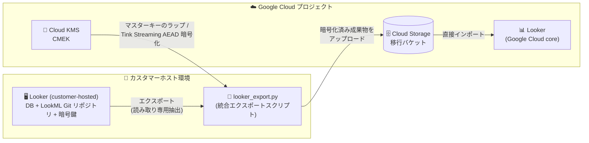

# Looker: カスタマーホスト型インスタンスから Looker (Google Cloud core) へのシングルホップ・セルフサービス移行 (Preview)

**リリース日**: 2026-11-23

**サービス**: Looker

**機能**: カスタマーホスト型 Looker インスタンスから Looker (Google Cloud core) へのシングルホップ・セルフサービス移行

**ステータス**: Preview

📊 [このアップデートのインフォグラフィックを見る](https://takech9203.github.io/google-cloud-news-summary/20261123-looker-core-self-service-migration-preview.html)

## 概要

カスタマーホスト型 (オンプレミスやセルフマネージド環境で稼働する) Looker インスタンスから Looker (Google Cloud core) へ、中間ステップを挟まずに直接移行できる「シングルホップ・セルフサービス移行」が Preview として利用可能になりました。統合された Python スクリプト (`looker_export.py`) を実行するだけで、データベース・LookML モデルの Git リポジトリ・Looker 暗号鍵のエクスポートと、Cloud KMS の顧客管理暗号鍵 (CMEK) による暗号化が一括して行われます。暗号化された成果物を Cloud Storage にアップロードすれば、そのまま Looker (Google Cloud core) インスタンスにインポートでき、手動のハンドオフやサポートチケットは不要です。

対象ユーザーは、カスタマーホスト型 Looker を運用しており、インフラ管理の負担を手放してマネージドな Looker (Google Cloud core) に移行したい管理者です。鍵の生成・共有から成果物の受け渡しまでを自分のプロジェクト内で完結できるため、移行のスケジュールとセキュリティを自らコントロールできます。

**アップデート前の課題**

従来のカスタマーホスト型インスタンスの移行 (Looker 支援型の移行) では、次のような手間が必要でした。

- Looker チームへのチケット起票と移行アンケートの記入から始まり、Looker SRE が GPG 鍵ペアを生成して公開鍵を共有するなど、Google 側との手動のやり取りが複数回発生していた
- ファイルシステム・データベース・CMK 鍵のバックアップ、暗号化、チェックサム生成をそれぞれ個別のスクリプト/コマンドで実行する必要があった
- エクスポートしたバックアップファイルは Looker チームに引き渡し、Looker 側でインポート・検証してもらう必要があり、顧客側で完結できなかった

**アップデート後の改善**

- 統合された単一の Python スクリプト (`looker_export.py`) が、事前チェック・データベース抽出・ファイルシステムのステージング・暗号化・マニフェスト生成までを一括実行するようになった
- 暗号化に自分の Cloud KMS CMEK を使用するため、GPG 鍵ペアの受け渡しが不要になり、鍵のライフサイクルを顧客自身が管理できるようになった
- 暗号化済み成果物を Cloud Storage にアップロードし、ターゲットインスタンスに直接インポートできるため、手動のハンドオフやサポートチケットなしで移行が完結するようになった

## アーキテクチャ図



カスタマーホスト型 Looker のデータを統合 Python スクリプトでエクスポートし、Cloud KMS CMEK で暗号化したうえで Cloud Storage にアップロードし、Looker (Google Cloud core) に直接インポートするデータフローです。

## サービスアップデートの詳細

### 主要機能

1. **統合エクスポートスクリプト `looker_export.py`**
   - ツール・KMS アクセス・KEK アンラップ・ディスク容量の事前チェックを実行
   - `mysqldump --single-transaction` または mydumper による読み取り専用のデータベース抽出
   - `models`、`bare_models`、`deploy_keys`、`git_hooks`、`.persistent_store` などのファイルシステムディレクトリをステージング
   - `LOOKER_MASTER_KEY` を CMEK でラップし、アーカイブを Tink Streaming AEAD (`AES128_CTR_HMAC_SHA256_1MB`) で暗号化し、`metadata.json` (マニフェスト) を生成

2. **Cloud KMS CMEK による顧客管理の暗号化**
   - 移行専用の CMEK (インスタンスレベルの CMEK とは別) を使用してエクスポートデータを暗号化
   - GPG 鍵ペアの共有が不要になり、鍵の管理を顧客自身のプロジェクト内で完結

3. **2 つのエクスポートモード**
   - シングルスレッドモード (`mysqldump`): ソース DB への負荷が低く、追加パッケージ不要。大規模 DB では低速
   - マルチスレッドモード (`mydumper`): エクスポートが約 3〜10 倍高速化し、`myloader` による並列リストアにも対応。CPU/I/O/接続数の負荷は高め。`MYDUMPER_THREADS` (デフォルト 4) と `MYDUMPER_CHUNK_ROWS` でチューニング可能

4. **診断スクリプト `collect_looker_diagnostics.py` (任意)**
   - 読み取り専用・標準ライブラリのみ・ダウンタイム不要で実行可能
   - ディスク使用量、ディレクトリ構造、DB バージョン/照合順序、テーブルごとのサイズを確認し、レポートを `/tmp/looker_infra_report.txt` に出力
   - ステージングに必要な 1.5 倍の空きディスク容量の確認と、エクスポートモードの選択に役立つ (DB が 75 GB を超える場合は mydumper を推奨)

## 技術仕様

### 前提条件

| 項目 | 要件 |
|------|------|
| Looker バージョン | サポート対象のリリースバージョン |
| 外部データベース | MySQL 8.0.0 以降、または MariaDB 10.4.0 以降 |
| 文字セット/照合順序 | `utf8mb4` (推奨) または `utf8` |
| 暗号化 | AWS KMS 使用中の場合、エクスポート前に Looker の AES-256 GCM 暗号化へ切り替え |
| 必要ツール | Python 3.9+、Git 2.36.0+、`mysql` クライアント、`tar`、`gzip`、gcloud CLI |
| マルチスレッドモード追加要件 | `mydumper` 0.16.0 以降、`zstd` |

### 必要な IAM 権限

| リソース | 権限 | ロール |
|------|------|------|
| Cloud KMS CryptoKey | `cloudkms.cryptoKeyVersions.useToEncrypt` / `useToDecrypt` | `roles/cloudkms.cryptoKeyEncrypterDecrypter` |
| Cloud Storage バケット | `storage.objects.create` / `get` / `list` (上書き時は `delete` も) | `roles/storage.objectUser` または `roles/storage.objectAdmin` |

### エクスポート成果物

`${BACKUP_DIR}/final_artifacts/` に生成される 5 つのファイルのみを Cloud Storage にアップロードします (スクリプト・ログ・未暗号化のステージングファイルはアップロードしない)。

| ファイル | 内容 |
|------|------|
| `mysql-data` / `mysql-handle` | 暗号化されたデータベースバックアップと鍵ハンドル |
| `fs-data` / `fs-handle` | 暗号化されたファイルシステムバックアップと鍵ハンドル |
| `metadata.json` | ソースバージョン、CMEK パス、`"source": "LOOKER_ORIGINAL"` を含むマニフェスト |

## 設定方法

### 前提条件

1. ターゲットとなる「空の」Looker (Google Cloud core) インスタンス、移行専用の Cloud KMS CMEK、Cloud Storage バケットを作成しておく
2. 未コミットの LookML をすべてコミット/プッシュしておく (開発者ワークスペース `models-user-*` はエクスポートされない。共有の `models-user-looker` は除く)
3. `LOOKER_MASTER_KEY` を手元に用意する (スクリプトが KEK の検証と CMEK によるラップに使用)

### 手順

#### ステップ 1: 移行用サービスアカウントの作成と権限付与 (任意)

```bash
gcloud iam service-accounts create EXPORT_SA_NAME \
    --project=PROJECT_ID \
    --display-name="Looker Core migration export"

gcloud kms keys add-iam-policy-binding KEY_NAME \
    --project=PROJECT_ID --location=REGION --keyring=KEY_RING \
    --member="serviceAccount:EXPORT_SA_NAME@PROJECT_ID.iam.gserviceaccount.com" \
    --role="roles/cloudkms.cryptoKeyEncrypterDecrypter"

gcloud storage buckets add-iam-policy-binding gs://YOUR_MIGRATION_BUCKET_NAME \
    --member="serviceAccount:EXPORT_SA_NAME@PROJECT_ID.iam.gserviceaccount.com" \
    --role="roles/storage.objectUser"
```

エクスポート用とインポート用の ID は別々でも構いません。サービスアカウントキーを使う場合は `chmod 600` で保護し、移行完了後に削除します。

#### ステップ 2: エクスポートホストの準備

```bash
git clone https://github.com/looker-open-source/customer-scripts.git
cd customer-scripts/export-to-core
pip3 install -r requirements.txt
```

認証は `gcloud auth application-default login`、または `GOOGLE_APPLICATION_CREDENTIALS` にサービスアカウントの JSON キーを設定して行います。

#### ステップ 3: エクスポートと暗号化

まず全ノードで Looker を停止し (DB ダンプと Git リポジトリのポイントインタイム整合性を確保)、環境変数を設定してスクリプトを実行します。

```bash
export ON_PREM_LOOKER_DATA_DIR="ON_PREM_LOOKER_DATA_DIR"
export BACKUP_DIR="BACKUP_DIR"
export DB_HOST="DB_HOST"
export DB_USER="DB_USER"
export DB_NAME="DB_NAME"
export KMS_KEY_NAME="projects/PROJECT_ID/locations/REGION/keyRings/KEY_RING/cryptoKeys/KEY_NAME"
# export USE_MYDUMPER="true"   # 任意: マルチスレッドモード

./looker_export.py
```

`MYSQL_PWD` と `LOOKER_MASTER_KEY` は実行時にエコーなしでプロンプト入力されます。

#### ステップ 4: Cloud Storage へのアップロード

```bash
gcloud storage cp "${BACKUP_DIR}/final_artifacts/*" "gs://YOUR_MIGRATION_BUCKET_NAME/MIGRATION_FOLDER/"
gcloud storage ls -l "gs://YOUR_MIGRATION_BUCKET_NAME/MIGRATION_FOLDER/"
```

#### ステップ 5: インポート

Cloud Storage からのインポート手順に従ってターゲットの Looker (Google Cloud core) インスタンスでインポートを実行し、インポート後の最終設定 (接続・認証などの確認) を行います。

## メリット

### ビジネス面

- **移行の内製化**: サポートチケットや Looker チームとの手動ハンドオフが不要になり、自社のスケジュールで移行を計画・実行できる
- **マネージド環境への移行促進**: インフラの設置・構成・保守の負担を手放し、Looker (Google Cloud core) のマネージドな運用に移行しやすくなる

### 技術面

- **セキュリティの自己管理**: 暗号化に自分の Cloud KMS CMEK を使用するため、鍵を外部に共有する必要がなく、鍵のローテーションや無効化も顧客側で制御できる
- **運用の単純化**: 複数の個別スクリプトによるバックアップ・暗号化・チェックサム生成が単一の統合スクリプトに集約され、事前チェック (ツール、KMS アクセス、ディスク容量) も自動化されている
- **大規模環境への対応**: mydumper によるマルチスレッドモードでエクスポートを約 3〜10 倍高速化できる

## デメリット・制約事項

### 制限事項

- Preview 段階であり、Pre-GA Offerings Terms が適用される。Preview 期間中は Cloud Customer Care のサポート対象外 (フィードバックは専用メールアドレス宛)
- 増分・再開不可: エクスポートは毎回最初からやり直しとなり、インポートはターゲットの既存データ/設定を完全に上書きする
- 設定の大部分はコピーされない (`setting` テーブルのうち転送されるのは `closed_system` と `crypt_canary_gcm` のみ)。その他の設定はインポート後に再構成が必要
- OAuth のデータベーストークンはセキュリティ上の理由で除外されるため、インポート後にユーザーの再認証が必要
- 個々の開発者ワークスペース (`models-user-*`) はエクスポートされない
- Enterprise/Embed エディションのインスタンスレベル CMEK はインスタンス作成時にのみ設定可能で、後から有効化できない

### 考慮すべき点

- エクスポート実行前に全ノードで Looker を停止する必要があり、ダウンタイムが発生する
- ステージング用にソースデータの約 1.5 倍の空きディスク容量が必要 (診断スクリプトで事前確認を推奨)
- データベースが 75 GB を超える場合は mydumper (マルチスレッドモード) の利用が推奨されるが、ソース DB への CPU/I/O 負荷が高くなる
- Cloud Storage には `final_artifacts/` 内の 5 つの成果物のみをアップロードし、スクリプト・ログ・未暗号化ファイルはアップロードしない

## ユースケース

### ユースケース 1: オンプレミス Looker のマネージド環境への移行

**シナリオ**: オンプレミスで Looker を自社運用している企業が、サーバー保守やアップグレード作業の負担を削減するため、Looker (Google Cloud core) への移行を計画している。セキュリティポリシー上、データの暗号鍵を外部 (Looker チーム) と共有することは避けたい。

**実装例**:
```bash
# 1. 診断スクリプトで移行可否とエクスポートモードを確認
python3 collect_looker_diagnostics.py

# 2. Looker を停止してエクスポート + CMEK 暗号化
./looker_export.py

# 3. Cloud Storage にアップロードしてインポート
gcloud storage cp "${BACKUP_DIR}/final_artifacts/*" \
    "gs://YOUR_MIGRATION_BUCKET_NAME/MIGRATION_FOLDER/"
```

**効果**: 鍵の受け渡しや Looker チームとのハンドオフなしに、自社の Cloud KMS CMEK で暗号化したまま移行が完結する。

### ユースケース 2: 大規模データベースを持つインスタンスの高速移行

**シナリオ**: 内部データベースが 75 GB を超える大規模なカスタマーホスト型 Looker インスタンスを、ダウンタイムを最小限に抑えて移行したい。

**効果**: `USE_MYDUMPER="true"` によるマルチスレッドモードでエクスポートを約 3〜10 倍高速化し、`myloader` による並列リストアと合わせて移行時間 (ダウンタイム) を短縮できる。

## 料金

移行機能自体の料金は公式情報では確認できませんでした。移行に使用する Cloud KMS (CMEK) と Cloud Storage については、各サービスの料金が適用されます。Looker (Google Cloud core) の利用にはエディションに応じたライセンスが必要です。

- [Looker 料金ページ](https://cloud.google.com/looker/pricing)
- [Cloud KMS 料金ページ](https://cloud.google.com/kms/pricing)
- [Cloud Storage 料金ページ](https://cloud.google.com/storage/pricing)

## 関連アナウンス

同日、Conversational Analytics の機能比較ガイドも公開されました。Looker UI、Looker API、Conversational Analytics API の 3 つのプラットフォームについて、機能面・管理面・セキュリティ面の capabilities を比較し、ユースケースに最適な選択肢を判断できます。詳細は [Conversational Analytics の比較ガイド](https://docs.cloud.google.com/looker/docs/conversational-analytics-looker-comparison) を参照してください。

## 関連サービス・機能

- **Cloud KMS**: エクスポートデータの暗号化に使用する CMEK を管理。移行専用の鍵を作成し、`roles/cloudkms.cryptoKeyEncrypterDecrypter` を付与する
- **Cloud Storage**: 暗号化済み成果物のアップロード先であり、Looker (Google Cloud core) へのインポート元となるバケットを提供
- **IAM**: エクスポート/インポートに使用する ID (ユーザーまたはサービスアカウント) への最小権限の付与を管理
- **Looker (Google Cloud core) インポート/エクスポート機能**: Cloud Storage 上の成果物をターゲットインスタンスに取り込む既存のインポート機構を利用

## 参考リンク

- 📊 [インフォグラフィック](https://takech9203.github.io/google-cloud-news-summary/20261123-looker-core-self-service-migration-preview.html)
- [公式リリースノート](https://docs.cloud.google.com/release-notes#November_23_2026)
- [ドキュメント: カスタマーホスト型インスタンスから Looker (Google Cloud core) へのエクスポート](https://docs.cloud.google.com/looker/docs/customer-hosted-export-to-core)
- [ドキュメント: Looker (Google Cloud core) のデータインポート/エクスポート](https://docs.cloud.google.com/looker/docs/looker-core-import-export)
- [ドキュメント: Conversational Analytics の比較ガイド](https://docs.cloud.google.com/looker/docs/conversational-analytics-looker-comparison)
- [料金ページ](https://cloud.google.com/looker/pricing)

## まとめ

カスタマーホスト型 Looker から Looker (Google Cloud core) への移行が、統合 Python スクリプトと Cloud KMS CMEK によるセルフサービス方式で完結できるようになり、サポートチケットや鍵の受け渡しといった従来の手動プロセスが不要になりました。オンプレミス Looker の移行を検討している場合は、まず診断スクリプトでインスタンスの移行適合性を確認し、前提条件 (MySQL 8.0+/MariaDB 10.4+、utf8mb4 など) を満たしたうえで Preview を評価することを推奨します。なお、エクスポート時のダウンタイムと、インポート後の設定再構成・ユーザー再認証を移行計画に織り込んでください。

---

**タグ**: #Looker #LookerGoogleCloudCore #Migration #CloudKMS #CMEK #CloudStorage #Preview
