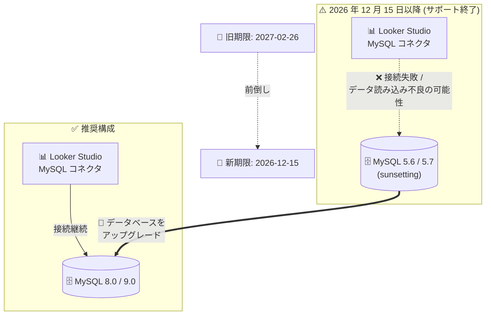

# Looker Studio (Data Studio): MySQL コネクタの MySQL 5.6/5.7 サポート終了日が前倒し

**リリース日**: 2026-11-23

**サービス**: Data Studio (Looker Studio)

**機能**: MySQL コネクタにおける MySQL 5.6/5.7 のサポート終了日変更

**ステータス**: Deprecated (非推奨 / サポート終了日の前倒し)

📊 [このアップデートのインフォグラフィックを見る](https://takech9203.github.io/google-cloud-news-summary/20261123-looker-studio-mysql-5-6-5-7-end-of-support.html)

## 概要

Looker Studio (Data Studio) の MySQL コネクタにおける MySQL 5.6 および 5.7 のサポート終了日が、**2027 年 2 月 26 日から 2026 年 12 月 15 日に前倒し** されました。当初予定より約 2 か月半早くサポートが終了するため、該当バージョンの MySQL に接続しているユーザーは早急な対応が必要です。

2026 年 12 月 15 日以降、MySQL 5.6 または 5.7 に接続する新規・既存のデータソースは、接続に失敗したり、データが正しく読み込まれなくなる可能性があります。公式ドキュメントでも MySQL 5.6 と 5.7 は「sunsetting (サポート終了予定)」と明記されており、サポート対象バージョンは MySQL 8.0 および 9.0 です。

影響を受けるのは、Looker Studio の MySQL コネクタ経由で MySQL 5.6/5.7 のデータベースに接続してレポートやダッシュボードを構築しているすべてのユーザーです。中断を回避するには、接続先データベースを MySQL 8.0 以降にアップグレードする必要があります。

**アップデート前の課題**

- 従来のサポート終了日は 2027 年 2 月 26 日であり、移行計画をその日程を前提に立てているユーザーが存在した
- MySQL 5.6/5.7 は MySQL コミュニティでも既に EOL を迎えた古いバージョンであり、セキュリティ・機能面でリスクを抱えたまま利用が継続されていた

**アップデート後の改善 (変更点)**

- サポート終了日が 2026 年 12 月 15 日に前倒しされ、移行期限が約 2 か月半短縮された
- 期限以降は MySQL 5.6/5.7 への接続失敗やデータ読み込み不良が発生する可能性があるため、MySQL 8.0 以降への早期アップグレードが明確に推奨されるようになった

## アーキテクチャ図



サポート終了日が 2027 年 2 月 26 日から 2026 年 12 月 15 日に前倒しされ、期限以降は MySQL 5.6/5.7 への接続が失敗する可能性があります。MySQL 8.0 以降へのアップグレードにより接続を継続できます。

## サービスアップデートの詳細

### 主要な変更点

1. **サポート終了日の前倒し**
   - 旧: 2027 年 2 月 26 日 → 新: **2026 年 12 月 15 日**
   - 対象は Looker Studio の MySQL コネクタにおける MySQL 5.6 および 5.7

2. **期限後の影響**
   - 新規・既存を問わず、MySQL 5.6/5.7 に接続するデータソースは接続に失敗する可能性がある
   - 接続できた場合でも、データが正しく読み込まれない可能性がある

3. **推奨される対応**
   - 接続先データベースを MySQL 8.0 以降にアップグレードする
   - 公式ドキュメント上のサポート対象バージョンは MySQL 8.0 および 9.0

## 技術仕様

### MySQL コネクタのバージョンサポート状況

| MySQL バージョン | サポート状況 |
|------|------|
| 5.6 | ⚠️ Sunsetting (2026-12-15 でサポート終了) |
| 5.7 | ⚠️ Sunsetting (2026-12-15 でサポート終了) |
| 8.0 | ✅ サポート対象 |
| 9.0 | ✅ サポート対象 |

### MySQL コネクタの主な制限事項 (参考)

| 項目 | 詳細 |
|------|------|
| 接続単位 | 1 データソースにつき 1 テーブル (またはカスタムクエリ) |
| クエリ上限 | 1 クエリあたり最大 15 万行 (超過分は切り捨て) |
| 基盤 | Cloud SQL for MySQL をベースとしており、同じバージョン・機能制限に準拠 |
| 非対応 | MySQL Spatial Data Extensions、非 ASCII の列ヘッダー |

## 設定方法 (移行手順)

### 前提条件

1. Looker Studio の MySQL コネクタで接続しているデータベースのバージョンを確認する (`SELECT VERSION();`)
2. MySQL 8.0 へのアップグレードに伴う非互換性を確認する (例: `character_set_server` のデフォルトが `utf8` から `utf8mb4` に変更される)

### 手順 (Cloud SQL for MySQL のインプレースアップグレードの例)

#### ステップ 1: アップグレード可能なバージョンを確認

```bash
gcloud sql instances describe INSTANCE_NAME
# レスポンスの upgradableDatabaseVersions を確認 (例: MYSQL_8_0)
```

#### ステップ 2: アップグレードのプリチェックを実行

```bash
gcloud beta sql instances pre-check-major-version-upgrade INSTANCE_NAME \
  --target-database-version=MYSQL_8_0 \
  --project=PROJECT_ID
```

非互換性や警告を事前に検出できます。プリチェックはデータベース負荷が低い時間帯での実行が推奨されます。

#### ステップ 3: メジャーバージョンアップグレードを実行

```bash
gcloud sql instances patch INSTANCE_NAME \
  --database-version=MYSQL_8_0
```

Cloud SQL はアップグレードの前後に自動でオンデマンドバックアップ (pre-upgrade / post-upgrade) を作成します。アップグレード後は受け入れテストを実施し、必要に応じてユーザー権限を更新します。

**注意**: MySQL はメジャーバージョンのスキップをサポートしていません。MySQL 5.6 からは直接 8.0 にアップグレードできないため、5.6 → 5.7 → 8.0 の順で段階的にアップグレードする必要があります。

#### ステップ 4: Looker Studio のデータソースを確認

アップグレード後、Looker Studio の該当データソースが正常に接続・データ読み込みできることを確認します。

## メリット

### ビジネス面

- **レポート停止リスクの回避**: 期限前にアップグレードすることで、ダッシュボードやレポートの突然の停止を防止できる
- **セキュリティ向上**: EOL 済みの MySQL 5.6/5.7 から脱却し、セキュリティ更新が提供されるバージョンに移行できる

### 技術面

- **新機能の活用**: MySQL 8.0 のウィンドウ関数、CTE、`utf8mb4` デフォルト化などの改善を利用可能になる
- **Cloud SQL との整合性**: Looker Studio の MySQL コネクタは Cloud SQL for MySQL ベースのため、サポートバージョンを揃えることで互換性問題を回避できる

## デメリット・制約事項

### 制限事項

- 2026 年 12 月 15 日以降、MySQL 5.6/5.7 への接続は失敗またはデータ読み込み不良となる可能性がある
- MySQL のメジャーバージョンアップグレードはスキップ不可 (5.6 → 8.0 の直接アップグレードは不可)

### 考慮すべき点

- 当初の 2027 年 2 月 26 日を前提にした移行計画は、**約 2 か月半の前倒し** に合わせて見直しが必要
- MySQL 8.0 への移行では非互換の変更 (システム変数のデフォルト値変更、認証プラグインの変更など) があるため、アプリケーションコードやスキーマ、データベース設定の確認が必要
- Cloud SQL で 5.7 → 8.0 にアップグレードしたユーザーは、8.0 で直接作成されたユーザーと権限が異なる場合がある (例: `CONNECTION_ADMIN` 権限が付与されない)
- テーブル数が 512,000 を超えるインスタンスのアップグレードは時間がかかり、タイムアウトする可能性がある

## ユースケース

### ユースケース 1: オンプレミス MySQL 5.7 に接続しているダッシュボードの移行

**シナリオ**: 社内のオンプレミス MySQL 5.7 データベースに Looker Studio の MySQL コネクタで接続し、営業ダッシュボードを運用している。

**実装例**:
```
1. MySQL 5.7 のバックアップを取得
2. MySQL 8.0 のアップグレードチェッカー (mysqlsh util.checkForServerUpgrade) で非互換性を確認
3. MySQL 8.0 にアップグレード
4. Looker Studio のデータソースで接続・データ表示を確認
```

**効果**: 2026 年 12 月 15 日以降もダッシュボードが中断なく稼働する。

### ユースケース 2: Cloud SQL for MySQL 5.7 インスタンスのインプレースアップグレード

**シナリオ**: Cloud SQL for MySQL 5.7 インスタンスに Looker Studio から接続している。マイグレーション用の新インスタンス構築は避けたい。

**効果**: インプレースアップグレードにより、インスタンス名・IP アドレス・接続設定を変えずに MySQL 8.0 へ移行でき、Looker Studio 側のデータソース設定変更を最小限にできる。アップグレード前後の自動バックアップによりロールバックも可能。

## 関連サービス・機能

- **Cloud SQL for MySQL**: Looker Studio の MySQL コネクタの基盤。インプレースメジャーバージョンアップグレード機能で 5.7 → 8.0 への移行が可能
- **Looker Studio Cloud SQL for MySQL コネクタ**: Cloud SQL インスタンスへの接続には専用コネクタも利用可能 (`cloudsql.client` 権限が必要、プライベート IP 接続にも対応)
- **Database Migration Service**: 外部 MySQL から Cloud SQL for MySQL への移行に利用可能

## 参考リンク

- 📊 [インフォグラフィック](https://takech9203.github.io/google-cloud-news-summary/20261123-looker-studio-mysql-5-6-5-7-end-of-support.html)
- [公式リリースノート](https://docs.cloud.google.com/release-notes#November_23_2026)
- [Connect to MySQL (Looker Studio ドキュメント)](https://docs.cloud.google.com/data-studio/connect-to-mysql)
- [Connect to Cloud SQL for MySQL (Looker Studio ドキュメント)](https://docs.cloud.google.com/data-studio/connect-to-google-cloud-sql-for-mysql)
- [Cloud SQL for MySQL: メジャーバージョンのインプレースアップグレード](https://docs.cloud.google.com/sql/docs/mysql/upgrade-major-db-version-inplace)

## まとめ

Looker Studio の MySQL コネクタにおける MySQL 5.6/5.7 のサポート終了日が 2027 年 2 月 26 日から 2026 年 12 月 15 日へ約 2 か月半前倒しされました。該当バージョンに接続しているデータソースは期限後に接続失敗やデータ読み込み不良が発生する可能性があるため、残り期間が短い点に注意し、早急に MySQL 8.0 以降へのアップグレード計画を実行することを推奨します。

---

**タグ**: #LookerStudio #DataStudio #MySQL #Deprecation #CloudSQL #EndOfSupport
