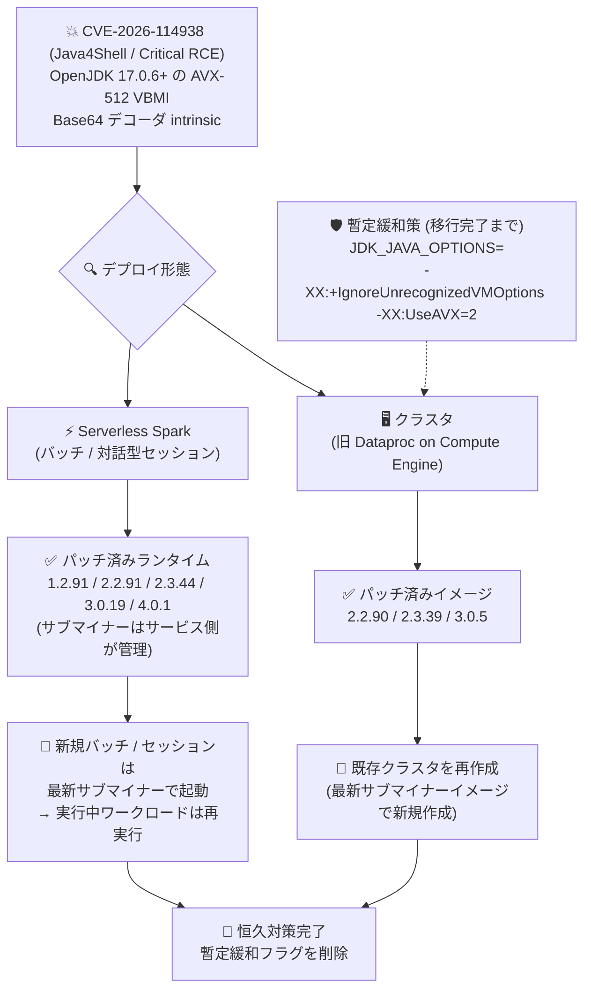

# Managed Service for Apache Spark: Java4Shell (CVE-2026-114938) 対応のパッチ済みランタイム / クラスタイメージをリリース

**リリース日**: 2026-11-23

**サービス**: Managed Service for Apache Spark (旧 Dataproc on Compute Engine / 旧 Serverless for Apache Spark)

**機能**: 新しいサブマイナーバージョンのリリースと OpenJDK 脆弱性 CVE-2026-114938 (Java4Shell) への対応

**ステータス**: リリース済み (Announcement / Security)

📊 [このアップデートのインフォグラフィックを見る](https://takech9203.github.io/google-cloud-news-summary/20261123-managed-spark-java4shell-cve-2026-114938.html)

## 概要

2026 年 11 月 23 日、Managed Service for Apache Spark は新しいサブマイナーバージョンをリリースしました。Serverless Spark ランタイム (旧 Google Cloud Serverless for Apache Spark) では **1.2.91 / 2.2.91 / 2.3.44 / 3.0.19 / 4.0.1** が、クラスタイメージ (旧 Dataproc on Compute Engine) では **2.2.90** (debian12 / rocky9 / ubuntu22 / ubuntu22-arm)、**2.3.39** (debian12 / ml-ubuntu22 / rocky9 / ubuntu22 / ubuntu22-arm)、**3.0.5** (debian13 / ml-ubuntu24 / rocky9 / ubuntu24) が利用可能になりました。

今回のリリースで最も重要なのはセキュリティ対応です。クラスタイメージ **2.2.90 / 2.3.39 / 3.0.5** と Serverless Spark ランタイム **1.2.91 / 2.2.91 / 2.3.44 / 3.0.19 / 4.0.1** は、OpenJDK の Critical 脆弱性 **CVE-2026-114938 (Java4Shell)** に対応しています。CVE-2026-114938 は、AVX-512 VBMI をサポートする x86-64 プロセッサ上の OpenJDK 17.0.6 以降 (21.x、25.x、27.x を含む) に存在するリモートコード実行 (RCE) 脆弱性で、HotSpot の AVX-512 VBMI Base64 デコーダ intrinsic における整数アンダーフローにより、不正な形式の Base64 入力のデコード時にヒープ領域外書き込みが発生し、認証不要のリモート攻撃者が JVM プロセス内で任意コードを実行できる可能性があります。詳細はセキュリティ速報 **GCP-2026-082** を参照してください。

セキュリティ速報 GCP-2026-082 では、Managed Service for Apache Spark について「ワーカー JVM に `JDK_JAVA_OPTIONS` 緩和策を適用し、パッチ済みイメージの公開後にクラスタを再作成する」ことが案内されていました。今回のリリースによりパッチ済みのクラスタイメージと Serverless ランタイムが提供されたため、**既存クラスタの再作成 (または最新サブマイナーイメージでの新規クラスタ作成) とバッチワークロード / セッションの再実行**によって恒久対策へ移行できるようになりました。

**アップデート前の課題**

- Managed Service for Apache Spark 上で OpenJDK 17.0.6 以降 (Java 17 / 21 / 25) を実行するワークロードは、AVX-512 VBMI 対応マシン上で CVE-2026-114938 (Java4Shell) の影響を受ける可能性があった
- セキュリティ速報 GCP-2026-082 では、パッチ済みの Java 17 / 21 / 25 ワーカーイメージと Serverless ランタイムは「作成中 (in progress)」とされ、ワーカー JVM への `JDK_JAVA_OPTIONS="-XX:+IgnoreUnrecognizedVMOptions -XX:UseAVX=2"` 設定という暫定緩和策のみが案内されていた
- 恒久対策に移行するためのパッチ済みイメージ / ランタイムが提供されていなかった

**アップデート後の改善**

- CVE-2026-114938 に対応したクラスタイメージ (2.2.90 / 2.3.39 / 3.0.5) が Debian / Rocky Linux / Ubuntu / Arm / ML の各 OS バリエーションで提供された
- CVE-2026-114938 に対応した Serverless Spark ランタイム (1.2.91 / 2.2.91 / 2.3.44 / 3.0.19 / 4.0.1) がサポート対象の全メジャー・マイナーバージョン (1.2 LTS / 2.2 LTS / 2.3 LTS / 3.0 / 4.0) に対して提供された
- GCP-2026-082 のガイダンスに沿って、クラスタの再作成とワークロードの再実行により暫定緩和策 (`JDK_JAVA_OPTIONS`) から恒久対策へ移行できるようになった

## アーキテクチャ図



Managed Service for Apache Spark の 2 つのデプロイ形態 (Serverless / クラスタ) それぞれにパッチ済みバージョンが提供されました。Serverless は新規ワークロードが最新サブマイナーランタイムで起動する一方、クラスタは再作成しない限りパッチが適用されない点が対応のポイントです。

## サービスアップデートの詳細

### 主要なポイント

1. **Serverless Spark ランタイムの新サブマイナーバージョン (CVE-2026-114938 対応)**
   - 1.2.91 (1.2 LTS)、2.2.91 (2.2 LTS / デフォルト)、2.3.44 (2.3 LTS)、3.0.19 (3.0)、4.0.1 (4.0) をリリース
   - サポート対象のすべてのランタイムバージョンに対してパッチ済みサブマイナーが提供された
   - Serverless ランタイムはサブマイナーバージョンの固定 (ピン留め) がサポートされておらず、サブマイナーはサービス側が管理するため、新規に起動するバッチワークロード / 対話型セッションは最新のパッチ済みサブマイナーを使用する

2. **クラスタイメージの新サブマイナーバージョン (CVE-2026-114938 対応)**
   - 2.2.90: debian12 / rocky9 / ubuntu22 / ubuntu22-arm
   - 2.3.39: debian12 / ml-ubuntu22 / rocky9 / ubuntu22 / ubuntu22-arm
   - 3.0.5: debian13 / ml-ubuntu24 / rocky9 / ubuntu24
   - 新規クラスタは、マイナーバージョン指定 (例: `2.3`) で作成すると、リリース済みのサブマイナーパッチを含む最新イメージで作成される

3. **OpenJDK 脆弱性 CVE-2026-114938 (Java4Shell) への対応**
   - 上記のイメージ / ランタイムは、セキュリティ速報 GCP-2026-082 で案内されている OpenJDK の Critical 脆弱性 CVE-2026-114938 に対応
   - GCP-2026-082 の Managed Service for Apache Spark 向けガイダンスでは、暫定緩和策としてワーカー JVM への `JDK_JAVA_OPTIONS` 設定、恒久対策としてパッチ済みイメージ公開後のクラスタ再作成が案内されている

## 技術仕様

### CVE-2026-114938 (Java4Shell) の概要

| 項目 | 詳細 |
|------|------|
| CVE ID | CVE-2026-114938 (通称: Java4Shell) |
| 深刻度 | Critical |
| 脆弱性の種類 | 整数アンダーフローによるヒープ領域外書き込み → リモートコード実行 (RCE) |
| 発生箇所 | OpenJDK HotSpot の AVX-512 VBMI Base64 デコーダ intrinsic (`UseAVX=3` 有効時) |
| トリガー | 不正な形式の標準 / URL-safe Base64 入力のデコード (`Base64.getDecoder()` / `Base64.getUrlDecoder()`) |
| 影響を受けるバージョン | OpenJDK 17.0.6 以降 (17.0.6+、21.x、25.x、27.x。Eclipse Temurin などのディストリビューションを含む)。AVX-512 VBMI 対応の x86-64 プロセッサ上で影響 |
| 影響を受けないバージョン | OpenJDK 8、11、17.0.0〜17.0.5 |
| インフラへの影響 | Google Cloud のハイパーバイザーおよび顧客 VM / コンテナ間のハードウェア分離境界は影響を受けない |
| セキュリティ速報 | GCP-2026-082 (2026-11-17 公開、2026-11-23 更新) |

### 今回リリースされたパッチ済みバージョン

| デプロイ形態 | バージョン | OS バリエーション |
|--------------|-----------|-------------------|
| Serverless Spark ランタイム | 1.2.91 | - |
| Serverless Spark ランタイム | 2.2.91 (デフォルトバージョン) | - |
| Serverless Spark ランタイム | 2.3.44 | - |
| Serverless Spark ランタイム | 3.0.19 | - |
| Serverless Spark ランタイム | 4.0.1 | - |
| クラスタイメージ | 2.2.90 | debian12 / rocky9 / ubuntu22 / ubuntu22-arm |
| クラスタイメージ | 2.3.39 | debian12 / ml-ubuntu22 / rocky9 / ubuntu22 / ubuntu22-arm |
| クラスタイメージ | 3.0.5 | debian13 / ml-ubuntu24 / rocky9 / ubuntu24 |

### バージョン管理の違い (Serverless vs クラスタ)

| 項目 | Serverless ランタイム | クラスタイメージ |
|------|----------------------|------------------|
| バージョン指定 | マイナーバージョン (例: `2.3`) のみ指定可能。サブマイナーの固定は不可 | マイナー / サブマイナーの両方を指定可能 |
| サブマイナーの管理 | サービス側が管理 (新規ワークロードは最新サブマイナーを使用) | ユーザーが管理 (新規クラスタはマイナー指定で最新サブマイナーを取得) |
| パッチの適用方法 | 新規バッチ / セッションの起動で自動的に適用 | クラスタの再作成が必要 |
| サポート期間 | LTS: 30 か月 / 非 LTS: 12 か月 | 初回リリースから 24 か月 |

## 設定方法

### 前提条件

1. 対象プロジェクトで Managed Service for Apache Spark のクラスタ作成・削除、バッチ / セッションの実行権限を持っていること
2. 影響の有無を確認していること: OpenJDK 17.0.6 以降 (Java 17 / 21 / 25) を使用し、AVX-512 VBMI 対応マシン上で信頼できない Base64 入力をデコードするワークロードが対象

### 手順

#### ステップ 1: クラスタをパッチ済みイメージで再作成する

```bash
# マイナーバージョン指定で、最新サブマイナー (パッチ済み) イメージのクラスタを作成
# 例: 2.3 を指定すると 2.3.39-debian12 が選択される
gcloud dataproc clusters create CLUSTER_NAME \
  --region=REGION \
  --image-version=2.3

# Ubuntu / Rocky Linux を使う場合は OS サフィックスを明示
gcloud dataproc clusters create CLUSTER_NAME \
  --region=REGION \
  --image-version=2.3-ubuntu22
```

既存クラスタはイメージのインプレース更新ができないため、パッチ済みイメージ (2.2.90 / 2.3.39 / 3.0.5) を含む最新サブマイナーバージョンでクラスタを再作成します。再作成の手順は[クラスタの再作成ガイド](https://docs.cloud.google.com/managed-spark/docs/guides/recreate-cluster)を参照してください。

#### ステップ 2: Serverless ワークロードを再実行する

```bash
# 新規バッチワークロードは最新のパッチ済みサブマイナーランタイムで起動する
gcloud dataproc batches submit spark \
  --region=REGION \
  --version=2.3 \
  --jar-files=JAR_FILE \
  -- ARGS
```

Serverless Spark はサブマイナーバージョンの固定をサポートしておらず、サブマイナーはサービス側が管理します。新規に起動するバッチワークロード / 対話型セッションはパッチ済みランタイム (1.2.91 / 2.2.91 / 2.3.44 / 3.0.19 / 4.0.1) を使用するため、長時間実行中のワークロードやセッションは再実行 / 再作成します。

#### ステップ 3: 暫定緩和策を確認し、移行完了後に削除する

```bash
# GCP-2026-082 の暫定緩和策 (パッチ済みイメージへの移行が完了するまで)
JDK_JAVA_OPTIONS="-XX:+IgnoreUnrecognizedVMOptions -XX:UseAVX=2"
```

パッチ済みイメージへの移行が完了していないクラスタでは、GCP-2026-082 の案内に従ってワーカー JVM に上記の `JDK_JAVA_OPTIONS` を設定 (または既存の値に追記) して悪用をブロックします。パッチ済みイメージ / ランタイムへの移行が完了したら、暫定緩和フラグは削除します。

## メリット

### ビジネス面

- **Critical 脆弱性への恒久対策が可能に**: 暫定緩和策 (`JDK_JAVA_OPTIONS`) に頼らず、パッチ済みイメージ / ランタイムへの移行という恒久対策で Java4Shell のリスクを解消できる
- **全サポートバージョンを網羅**: クラスタイメージ 2.2 / 2.3 / 3.0、Serverless ランタイム 1.2 / 2.2 / 2.3 / 3.0 / 4.0 と、サポート対象のバージョン系列すべてにパッチが提供されており、メジャーバージョンアップなしで対応できる

### 技術面

- **Serverless は新規ワークロードが自動的に保護される**: サブマイナーバージョンはサービス側が管理するため、新規バッチ / セッションは追加設定なしでパッチ済みランタイムを使用する
- **幅広い OS バリエーションに対応**: Debian / Rocky Linux / Ubuntu に加え、Arm (ubuntu22-arm) や ML イメージ (ml-ubuntu22 / ml-ubuntu24) にもパッチ済みイメージが提供されている

## デメリット・制約事項

### 制限事項

- 既存クラスタにはパッチが自動適用されない。パッチ済みイメージの適用にはクラスタの再作成が必要
- 長時間実行中の Serverless バッチ / 対話型セッションは、再実行 / 再作成するまで既存のランタイムで動作し続ける
- クラスタイメージ 2.1 以前にはパッチ済みサブマイナーが提供されていない (2.1 は 2026/03/31 にサポート終了済み)

### 考慮すべき点

- クラスタ再作成に伴うワークロードの停止・切り替えの計画が必要 (ジョブの退避、初期化アクションやカスタム構成の再適用など)
- `JDK_JAVA_OPTIONS="-XX:+IgnoreUnrecognizedVMOptions -XX:UseAVX=2"` はあくまで暫定緩和策であり、AVX-512 コードパスを無効化するものである。恒久対策はパッチ済みイメージ / ランタイムへの移行
- Artifact Analysis や Security Command Center を利用している場合、脆弱性フィードの更新に伴い CVE-2026-114938 の通知を受け取れるため、未対応ワークロードの検出に活用できる

## ユースケース

### ユースケース 1: 長期稼働クラスタの計画的な再作成

**シナリオ**: ETL ジョブを常時実行する長期稼働の 2.2 系クラスタを運用しており、Java4Shell への恒久対策としてパッチ済みイメージへ移行したい。

**実装例**:
```bash
# 1. 暫定緩和策を適用済みであることを確認 (JDK_JAVA_OPTIONS)
# 2. パッチ済みイメージで新クラスタを作成
gcloud dataproc clusters create etl-cluster-v2 \
  --region=asia-northeast1 \
  --image-version=2.2-debian12

# 3. ジョブを新クラスタへ切り替え、旧クラスタを削除
gcloud dataproc clusters delete etl-cluster-v1 --region=asia-northeast1
```

**効果**: 2.2.90 イメージ (パッチ済み OpenJDK を含む) 上でワークロードが動作し、暫定緩和フラグを削除して恒久対策へ移行できる。

### ユースケース 2: Serverless バッチワークロードの棚卸しと再実行

**シナリオ**: Serverless Spark で多数のバッチワークロードと対話型セッションを運用しており、CVE-2026-114938 への対応状況を確認したい。

**効果**: Serverless はサブマイナーをサービス側が管理するため、2026 年 11 月 23 日以降に新規起動したワークロードはパッチ済みランタイム (1.2.91 / 2.2.91 / 2.3.44 / 3.0.19 / 4.0.1) を使用する。対応が必要なのは長時間実行中のバッチ / セッションのみで、これらを再実行 / 再作成すれば移行が完了する。

## 料金

本セキュリティアップデート (新サブマイナーバージョン) の利用自体に追加料金は発生しません。クラスタの再作成やワークロードの再実行に伴うリソース使用には、通常の Managed Service for Apache Spark 料金が適用されます。

- 料金ページ: https://cloud.google.com/dataproc/pricing

## 関連サービス・機能

- **セキュリティ速報 GCP-2026-082**: CVE-2026-114938 の詳細、Google Cloud 各サービスでの対応状況、暫定緩和策 (`JDK_JAVA_OPTIONS`) が公開されている。2026-11-23 時点で継続的に更新中
- **Dataflow**: 同じ GCP-2026-082 / CVE-2026-114938 への対応として、サービス側の Base64 intrinsic 無効化と Apache Beam 2.78.0 ワーカーイメージのパッチを提供 (関連レポート: [2026-11-20 Dataflow Java ワーカーセキュリティアップデート](./2026-11-20-dataflow-java-security-gcp-2026-082.md))
- **Managed Service for Apache Airflow**: 同脆弱性に対し修正版の準備と `JAVA_TOOL_OPTIONS` による暫定緩和策を案内 (関連レポート: [2026-11-19 Managed Airflow CVE-2026-114938 対応](./2026-11-19-managed-airflow-cve-2026-114938-mitigation.md))
- **Cloud Run / App Engine / Buildpacks**: パッチ済み Java 17 / 21 / 25 ランタイムベースイメージのロールアウトが 2026-11-20 に完了済み
- **Artifact Analysis / Security Command Center**: 脆弱性フィードの更新に伴い CVE-2026-114938 の通知を受け取れる

## 参考リンク

- 📊 [インフォグラフィック](https://takech9203.github.io/google-cloud-news-summary/20261123-managed-spark-java4shell-cve-2026-114938.html)
- [公式リリースノート (2026 年 11 月 23 日)](https://docs.cloud.google.com/release-notes#November_23_2026)
- [Serverless Spark ランタイムバージョン一覧](https://docs.cloud.google.com/managed-spark/docs/concepts/versions/serverless-versions)
- [クラスタイメージバージョン一覧](https://docs.cloud.google.com/managed-spark/docs/concepts/versioning/image-version-lists)
- [CVE-2026-114938 (CVE Record)](https://www.cve.org/CVERecord?id=CVE-2026-114938)
- [セキュリティ速報 GCP-2026-082](https://docs.cloud.google.com/support/bulletins#gcp-2026-082)
- [クラスタの再作成ガイド](https://docs.cloud.google.com/managed-spark/docs/guides/recreate-cluster)
- [料金ページ](https://cloud.google.com/dataproc/pricing)

## まとめ

Managed Service for Apache Spark は、OpenJDK の Critical 脆弱性 CVE-2026-114938 (Java4Shell) に対応したクラスタイメージ (2.2.90 / 2.3.39 / 3.0.5) と Serverless Spark ランタイム (1.2.91 / 2.2.91 / 2.3.44 / 3.0.19 / 4.0.1) をリリースしました。Serverless の新規ワークロードは自動的にパッチ済みランタイムで起動しますが、**既存クラスタはパッチ済みイメージでの再作成、長時間実行中の Serverless ワークロードは再実行が必要**です。移行が完了するまでは GCP-2026-082 の暫定緩和策 (`JDK_JAVA_OPTIONS="-XX:+IgnoreUnrecognizedVMOptions -XX:UseAVX=2"`) を維持し、完了後にフラグを削除してください。

---

**タグ**: Managed Service for Apache Spark, Dataproc, Serverless Spark, セキュリティ, CVE-2026-114938, Java4Shell, GCP-2026-082, OpenJDK, リモートコード実行, クラスタイメージ, ランタイムバージョン
