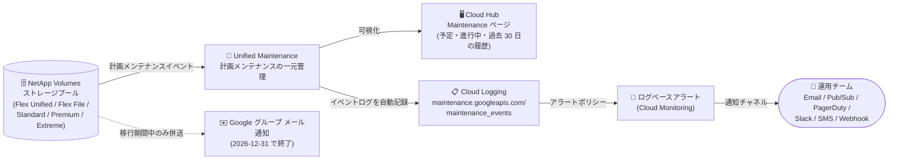

# Google Cloud NetApp Volumes: Unified Maintenance 統合

**リリース日**: 2026-11-23

**サービス**: Google Cloud NetApp Volumes

**機能**: Unified Maintenance 統合によるメンテナンスイベントの可視化と通知

**ステータス**: Feature (および通知方式変更に関する Announcement)

📊 [このアップデートのインフォグラフィックを見る](https://takech9203.github.io/google-cloud-news-summary/20261123-netapp-volumes-unified-maintenance-integration.html)

## 概要

Google Cloud NetApp Volumes が Unified Maintenance と統合されました。Unified Maintenance は Google Cloud サービス全体の計画メンテナンスを一元管理するサービスで、今回の統合は Flex Unified、Flex File、Standard、Premium、Extreme のすべてのサービスレベルをサポートします。これにより、ストレージプールに影響する今後および過去の計画メンテナンスイベントを Google Cloud コンソールの Cloud Hub (Maintenance ページ) で確認できるほか、Cloud Logging に自動的に書き込まれるメンテナンスイベントログを追跡し、ログベースのアラートポリシーで自動通知を構成できるようになりました。

あわせて通知方式の移行もアナウンスされています。2026 年 12 月 31 日までは、従来どおり NetApp Volumes メンテナンス用 Google グループへのメール通知が Unified Maintenance のアラートに加えて送信されますが、2027 年以降は Google グループへのメール送信が終了し、Unified Maintenance が計画メンテナンス通知の唯一のソースになります。NetApp Volumes を利用するストレージ管理者・SRE チームは、移行期間中に Cloud Logging ベースのアラートへ切り替えておく必要があります。

**アップデート前の課題**

- 計画メンテナンスの通知は NetApp Volumes メンテナンス用 Google グループへの参加とメール確認に依存しており、プロジェクトやストレージプール単位での機械的な追跡が難しかった
- メンテナンスイベントを Cloud Logging で追跡したり、ログベースのアラートポリシーで PagerDuty や Slack などの運用ツールに自動連携する標準的な手段がなかった
- 他の Google Cloud サービスの計画メンテナンスとあわせて、コンソール上で一元的に確認するビューがなかった

**アップデート後の改善**

- Cloud Hub の Maintenance ページで、ストレージプールに対する予定・進行中のメンテナンスと、過去 30 日間の完了・キャンセル済みイベント履歴を一元的に確認できるようになった
- Unified Maintenance が標準化されたメンテナンスライフサイクルイベント (ログ ID: `maintenance.googleapis.com/maintenance_events`) を Cloud Logging に自動記録し、Logs Explorer でのクエリが可能になった
- ログベースのアラートポリシーにより、メール、Pub/Sub、PagerDuty、Slack、SMS、Webhook などの通知チャネルへ計画メンテナンス通知を自動ルーティングできるようになった
- 業務に支障があるメンテナンスウィンドウについて、開始の 5 営業日前までであればリスケジュールをリクエストできる (Cloud Customer Care ケース経由)

## アーキテクチャ図



NetApp Volumes のストレージプールに対する計画メンテナンスイベントは Unified Maintenance に集約され、Cloud Hub での可視化と Cloud Logging へのイベントログ記録を経由して、ログベースアラートで任意の通知チャネルに配信されます。Google グループへのメール通知は 2026 年 12 月 31 日までの併送です。

## サービスアップデートの詳細

### 主要機能

1. **Cloud Hub でのメンテナンスイベント可視化**
   - Maintenance テーブルに予定・進行中のメンテナンスイベントを表示
   - Maintenance history テーブルに過去 30 日間の完了・キャンセル済みイベントを表示
   - イベントの説明、タイムライン、影響を受けるストレージプール名、ロケーション、進行状態などの詳細を確認可能

2. **Cloud Logging によるイベントログ追跡**
   - Unified Maintenance がログ ID `maintenance.googleapis.com/maintenance_events` で標準化されたメンテナンスライフサイクルイベントを自動記録
   - リソースタイプ `netapp.googleapis.com/StoragePool` でフィルタリング可能
   - `jsonPayload.state` により `SCHEDULED` / `STARTED` / `SUCCEEDED` / `CANCELLED` の各状態で絞り込み可能

3. **ログベースアラートによる自動通知**
   - 新規メンテナンスのスケジュール、状態変化、開始・終了時刻の変更、特定ロケーションへの影響などを条件にアラートを構成可能
   - 通知チャネルとして Email、Pub/Sub、PagerDuty、Slack、SMS、Webhook をサポート。Webhook 経由で ServiceNow、Datadog、OpsGenie などのサードパーティツールにも連携可能

4. **メンテナンスウィンドウのリスケジュール**
   - 業務と競合する破壊的メンテナンスウィンドウについて、開始の 5 営業日前までに Cloud Customer Care ケースでリスケジュールをリクエスト可能
   - リクエストにはプロジェクト ID、リージョン、ストレージプール ID、メンテナンス名、現在のウィンドウ、希望ウィンドウ (UTC)、ビジネス上の理由を含める

## 技術仕様

### 対応サービスレベルとメンテナンスイベントの状態

| 項目 | 詳細 |
|------|------|
| 対応サービスレベル | Flex Unified、Flex File、Standard、Premium、Extreme |
| 対象リソースタイプ | `netapp.googleapis.com/StoragePool` |
| ログ ID | `maintenance.googleapis.com/maintenance_events` |
| イベント状態 | `SCHEDULED` (予定) / `STARTED` (進行中) / `SUCCEEDED` (完了) / `CANCELLED` (キャンセル) |
| Cloud Hub の履歴保持 | 完了・キャンセル済みイベントは過去 30 日分を表示 |
| Unified Maintenance のデータ保持 | メンテナンスアクティビティデータは 60 日間の保持期間後に削除 (完全消去には最大 80 日) |

### メンテナンス中のストレージプールへの影響

計画メンテナンスおよび計画外のサービスインシデント発生時には、ストレージプールに以下の影響があります。

- ストレージプールが `DEGRADED` 状態になる
- プール更新、レプリケーション、CMEK ワークフローなどの操作が利用不可になる
- 書き込みレイテンシが増加し、スループットが低下する
- 復旧は自動で、数秒から数時間を要する

ファイルプロトコル (NFS/SMB) の観点では、アプリケーションが I/O ポーズを処理できる限りメンテナンスは非破壊的とされており、I/O ポーズは Standard/Premium/Extreme では通常数秒〜最大 30 秒程度、Flex では最大 70 秒程度です。

## 設定方法

### 前提条件

1. Cloud Hub の利用には Cloud Hub ドキュメントの「Before you begin」に記載された前提条件と IAM ロールが必要
2. アラート通知には Cloud Monitoring の通知チャネルの設定が必要

### 手順

#### ステップ 1: Logs Explorer でメンテナンスイベントログを確認

```
log_id("maintenance.googleapis.com/maintenance_events") AND
jsonPayload.resource.type="netapp.googleapis.com/StoragePool"
```

Google Cloud コンソールの Logs Explorer で上記フィルタを実行すると、NetApp Volumes ストレージプールの Unified Maintenance イベントログを確認できます。特定の状態に絞り込む場合は `jsonPayload.state="SCHEDULED"` などを追加します。

#### ステップ 2: ログベースのアラートポリシーを作成

```
log_id("maintenance.googleapis.com/maintenance_events") AND
jsonPayload.resource.type="netapp.googleapis.com/StoragePool" AND
jsonPayload.state="SCHEDULED"
```

Logs Explorer の「Create log alert」から、上記のような包含フィルタでアラートポリシーを作成し、Email、Pub/Sub、PagerDuty、Slack、SMS、Webhook などの通知チャネルを割り当てます。アラートは Cloud Monitoring の上限の対象です。

#### ステップ 3: Cloud Hub でメンテナンスイベントを確認

Google Cloud コンソールの Cloud Hub「Maintenance」ページに移動し、ストレージプールに対する予定・進行中のメンテナンスと過去 30 日間の履歴を確認します。

## メリット

### ビジネス面

- **計画メンテナンスの予見性向上**: メンテナンスウィンドウを事前に把握し、業務影響のある時間帯と競合する場合は 5 営業日前までにリスケジュールを依頼できるため、業務影響を最小化できる
- **他サービスとの一元管理**: Cloud Hub 上で他の Unified Maintenance 対応サービスとあわせて計画メンテナンスを一元的に把握でき、運用ガバナンスが向上する

### 技術面

- **標準化されたログスキーマ**: Cloud SQL や Managed Lustre など他サービスと共通の `maintenance.googleapis.com/maintenance_events` ログ ID と状態モデルを使うため、サービス横断で同じアラート基盤を再利用できる
- **既存の運用ツールとの統合**: ログベースアラートと通知チャネル (Webhook/Pub/Sub 含む) により、PagerDuty、Slack、ServiceNow などの既存インシデント管理フローへ自動連携できる

## デメリット・制約事項

### 制限事項

- Google グループへのメール通知は 2026 年 12 月 31 日で終了し、それ以降は Unified Maintenance が計画メンテナンス通知の唯一のソースとなるため、期限までにログベースアラートへの移行が必要
- Unified Maintenance は計画メンテナンスのみを対象とし、計画外のインシデント (障害・性能劣化など) はカバーしない。計画外イベントは Personalized Service Health ダッシュボードで確認する
- Unified Maintenance のメンテナンスアクティビティデータは 60 日間の保持期間後に削除される (完全消去には最大 80 日)
- 定期的またはリージョン全体にわたる必須のインフラ更新は、リスケジュールの対象外となる場合がある

### 考慮すべき点

- リスケジュールのリクエストはメンテナンス開始の 5 営業日前までに Cloud Customer Care ケースで行う必要がある
- ログベースアラートは Cloud Monitoring のアラート上限 (クォータ) の対象となる
- メンテナンス中はストレージプールが `DEGRADED` 状態となり書き込みレイテンシが増加するため、iSCSI 利用時はタイムアウト設定 (特に Windows の MPIO 設定) をメンテナンスイベントに合わせて構成しておくことが推奨される

## ユースケース

### ユースケース 1: オンコールチームへのメンテナンス自動通知

**シナリオ**: NetApp Volumes 上で基幹ファイル共有を運用しており、メンテナンス予定を見逃すと業務時間帯の性能劣化がインシデント扱いになってしまう。

**実装例**:
```
log_id("maintenance.googleapis.com/maintenance_events") AND
jsonPayload.resource.type="netapp.googleapis.com/StoragePool" AND
jsonPayload.state="SCHEDULED"
```
上記フィルタでログベースアラートを作成し、通知チャネルに PagerDuty / Slack を設定する。

**効果**: メンテナンスがスケジュールされた時点でオンコールチームに自動通知され、事前のユーザー周知やバッチ処理のスケジュール調整が可能になる。メンテナンス起因の性能劣化を誤って障害対応しないで済む。

### ユースケース 2: 業務ピークと競合するメンテナンスウィンドウのリスケジュール

**シナリオ**: 月末バッチの実行時間帯に破壊的メンテナンスがスケジュールされていることを Cloud Hub で発見した。

**効果**: メンテナンス開始の 5 営業日前までに、ストレージプール ID・メンテナンス名・希望ウィンドウ (UTC)・ビジネス上の理由を添えて Cloud Customer Care ケースを起票することで、ウィンドウの変更をリクエストできる。業務ピークとメンテナンスの競合を回避できる。

## 関連サービス・機能

- **Unified Maintenance**: Google Cloud サービス横断の計画メンテナンス管理サービス。今回 NetApp Volumes が統合された
- **Cloud Hub**: Google Cloud コンソールでメンテナンスイベントを一元表示する Maintenance ページを提供
- **Cloud Logging / Logs Explorer**: メンテナンスイベントログの記録・クエリ基盤
- **Cloud Monitoring (ログベースアラート・通知チャネル)**: Email、Pub/Sub、PagerDuty、Slack、SMS、Webhook への通知配信
- **Personalized Service Health**: 計画外のサービスインシデント (障害) の確認用ダッシュボード。Unified Maintenance がカバーしない領域を補完

## 参考リンク

- 📊 [インフォグラフィック](https://takech9203.github.io/google-cloud-news-summary/20261123-netapp-volumes-unified-maintenance-integration.html)
- [公式リリースノート](https://docs.cloud.google.com/release-notes#November_23_2026)
- [Monitor and plan for maintenance events (NetApp Volumes)](https://docs.cloud.google.com/netapp/volumes/docs/monitor/maintenance-events)
- [Unified Maintenance overview](https://docs.cloud.google.com/unified-maintenance/docs/overview)
- [Configure alerts and notifications (Unified Maintenance)](https://docs.cloud.google.com/unified-maintenance/docs/configure-alerts-and-notifications)
- [Unified Maintenance log schema](https://docs.cloud.google.com/unified-maintenance/docs/log-schema)

## まとめ

NetApp Volumes の計画メンテナンス情報が Unified Maintenance に統合され、Cloud Hub での可視化と Cloud Logging ベースの自動アラートが可能になりました。Google グループへのメール通知は 2026 年 12 月 31 日で終了するため、NetApp Volumes を運用しているチームは移行期間中に `maintenance.googleapis.com/maintenance_events` ログに対するログベースアラートを構成し、通知経路を切り替えておくことを強く推奨します。

---

**タグ**: NetApp Volumes, Unified Maintenance, Cloud Hub, Cloud Logging, メンテナンス, ストレージ, 運用監視
