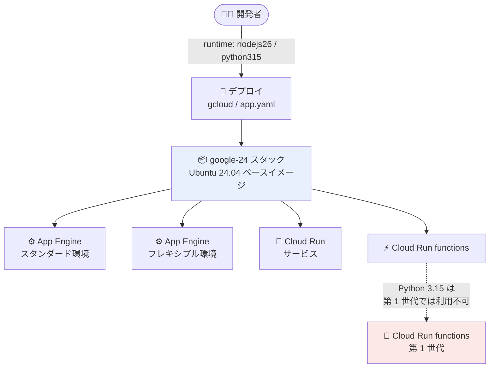

# App Engine / Cloud Run / Cloud Run functions: Node.js 26 と Python 3.15 ランタイムが GA

**リリース日**: 2026-11-23

**サービス**: App Engine (フレキシブル環境 / スタンダード環境)、Cloud Run、Cloud Run functions

**機能**: Node.js 26 ランタイムおよび Python 3.15 ランタイムのサポート

**ステータス**: GA (一般提供)

📊 [このアップデートのインフォグラフィックを見る](https://takech9203.github.io/google-cloud-news-summary/20261123-serverless-nodejs-26-python-3-15-runtimes-ga.html)

## 概要

2026 年 11 月 23 日、Google Cloud のサーバーレス実行基盤である App Engine (フレキシブル環境およびスタンダード環境)、Cloud Run、Cloud Run functions において、**Node.js 26 ランタイム**と **Python 3.15 ランタイム**のサポートが一般提供 (GA) になりました。これはサーバーレスのアプリケーション実行基盤を横断する、ランタイムの一斉アップデートです。

両ランタイムは Ubuntu 24.04 ベースの `google-24` スタック (デフォルト) および `google-24-full` スタック上で提供され、ランタイム ID はそれぞれ `nodejs26`、`python315` です。GA となったことで、本番ワークロードでの利用が GA レベルのサポート対象となり、セキュリティ アップデート ポリシーに基づく定期的なセキュリティ修正・バグ修正が適用されます。

なお、Python 3.15 は Cloud Run functions でのみ利用可能で、Cloud Run functions (第 1 世代) ではサポートされない点に注意が必要です。

**アップデート前の課題**

- Node.js 26 および Python 3.15 は Preview 段階であり、本番ワークロードで GA レベルのサポートを受けられなかった
- Cloud Run functions では、Preview 段階のランタイムをデプロイする場合、`gcloud beta functions deploy` コマンドを使用する必要があった
- GA の最新ランタイムは Node.js 24 (非推奨予定日: 2028-04-30) / Python 3.14 (非推奨予定日: 2030-10-10) であり、言語の最新バージョンを GA サポート付きで利用できなかった

**アップデート後の改善**

- Node.js 26 / Python 3.15 を App Engine (フレキシブル / スタンダード)、Cloud Run、Cloud Run functions の全サーバーレス基盤で GA サポート付きで利用可能になった
- GA ランタイムとして、セキュリティ アップデート ポリシーに従った定期的なセキュリティ修正・バグ修正の適用対象になった
- 破壊的変更はランタイムに実装されず、実施される場合はリリースノートで事前に告知される運用が適用される

## アーキテクチャ図



Node.js 26 / Python 3.15 は Ubuntu 24.04 ベースの `google-24` スタックとして提供され、App Engine、Cloud Run、Cloud Run functions の各サーバーレス基盤に共通のランタイムとしてデプロイできます。Python 3.15 のみ Cloud Run functions (第 1 世代) では利用できません。

## サービスアップデートの詳細

### 主要機能

1. **Node.js 26 ランタイムの GA**
   - App Engine フレキシブル環境、App Engine スタンダード環境、Cloud Run、Cloud Run functions で一般提供
   - ランタイム ID: `nodejs26`、実行環境: Ubuntu 24.04 (`google-24` / `google-24-full` スタック)

2. **Python 3.15 ランタイムの GA**
   - App Engine フレキシブル環境、App Engine スタンダード環境、Cloud Run、Cloud Run functions で一般提供
   - ランタイム ID: `python315`、実行環境: Ubuntu 24.04 (`google-24` / `google-24-full` スタック)
   - Cloud Run functions でのみ利用可能で、Cloud Run functions (第 1 世代) ではサポートされない

3. **GA ランタイムとしてのライフサイクル サポート**
   - ランタイム コンポーネントにセキュリティ修正・バグ修正が定期的に適用される
   - 更新はワークロードのセキュリティ アップデート ポリシーに従って適用される
   - 非推奨 (Deprecation) 到達の 90 日前から Google Cloud コンソールで通知が行われる

## 技術仕様

### ランタイム仕様

| 項目 | Node.js 26 | Python 3.15 |
|------|-----------|-------------|
| ランタイム ID | `nodejs26` | `python315` |
| スタック | `google-24` (デフォルト) / `google-24-full` | `google-24` (デフォルト) / `google-24-full` |
| OS (App Engine) | Ubuntu 24.04 | Ubuntu 24.04 |
| 提供サービス | App Engine (Flex / Standard)、Cloud Run、Cloud Run functions | App Engine (Flex / Standard)、Cloud Run、Cloud Run functions (第 1 世代は非対応) |

### 既存 GA ランタイムとのサポート期限比較 (Cloud Run / Cloud Run functions)

| ランタイム | 非推奨予定日 | 廃止予定日 |
|------------|-------------|-----------|
| Node.js 26 | 未定 (今回 GA) | 未定 |
| Node.js 24 | 2028-04-30 | 2028-10-31 |
| Node.js 22 | 2027-04-30 | 2027-10-31 |
| Python 3.15 | 未定 (今回 GA) | 未定 |
| Python 3.14 | 2030-10-10 | 2031-04-10 |
| Python 3.13 | 2029-10-10 | 2030-04-10 |

## 設定方法

### 前提条件

1. Google Cloud プロジェクトと gcloud CLI のセットアップ
2. デプロイ対象サービス (App Engine / Cloud Run / Cloud Run functions) の有効化

### 手順

#### ステップ 1: App Engine で新ランタイムを指定

```yaml
# app.yaml (Node.js の場合)
runtime: nodejs26
```

```yaml
# app.yaml (Python の場合)
runtime: python315
```

`app.yaml` の `runtime` にランタイム ID を指定し、`gcloud app deploy` でデプロイします。

#### ステップ 2: Cloud Run functions で新ランタイムを指定

```bash
gcloud functions deploy my-function \
  --runtime=nodejs26 \
  --trigger-http \
  --region=REGION
```

GA となったため、Preview 時に必要だった `gcloud beta functions deploy` ではなく、通常の `gcloud functions deploy` コマンドでデプロイできます。Python の場合は `--runtime=python315` を指定します。

## メリット

### ビジネス面

- **本番利用可能なサポートレベル**: GA となったことで、GA レベルのカスタマーサポートとランタイム サポートの対象になり、本番ワークロードへ安心して採用できる
- **長期的なランタイム戦略**: 最新言語バージョンに早期に移行することで、既存ランタイム (Node.js 22: 2027-04-30 非推奨、Python 3.13: 2029-10-10 非推奨など) の廃止対応を先取りできる

### 技術面

- **最新の言語バージョン**: Node.js 26 / Python 3.15 の最新の言語機能・改善をサーバーレス環境で利用できる
- **サーバーレス基盤間での一貫性**: App Engine、Cloud Run、Cloud Run functions で同一のランタイム ID・スタック (`google-24`) が使えるため、サービス間の移行や併用がしやすい
- **安定性の担保**: GA ランタイムには破壊的変更が原則実装されず、変更時はリリースノートで事前告知される

## デメリット・制約事項

### 制限事項

- Python 3.15 は Cloud Run functions (第 1 世代) ではサポートされない
- Node.js 26 / Python 3.15 の非推奨・廃止スケジュールは現時点で未定であり、今後ドキュメントで告知される

### 考慮すべき点

- 新ランタイムは Ubuntu 24.04 ベースの `google-24` スタックで動作するため、古いスタック (`google-22` など) 向けのシステムパッケージ依存がある場合は動作確認が必要
- 依存ライブラリ (npm パッケージ / pip パッケージ) が Node.js 26 / Python 3.15 に対応しているか事前に検証する

## ユースケース

### ユースケース 1: 旧ランタイムからの計画的アップグレード

**シナリオ**: Node.js 20 (非推奨: 2026-04-30 到達済み) や Python 3.10 (非推奨: 2026-10-04 到達済み) で稼働中の App Engine / Cloud Run functions アプリケーションを、サポート期限の長い最新ランタイムへ移行する。

**実装例**:
```yaml
# app.yaml を変更して再デプロイ
runtime: python315  # 旧: python310
```

**効果**: 非推奨ランタイムの再デプロイブロックのリスクを回避し、最も長いサポートウィンドウを確保できる。

### ユースケース 2: 複数サーバーレス基盤での統一ランタイム採用

**シナリオ**: フロントエンド API を Cloud Run、イベント処理を Cloud Run functions、既存アプリを App Engine で運用しているチームが、全サービスのランタイムを Node.js 26 に統一する。

**効果**: 全基盤で同一のランタイム ID (`nodejs26`) と `google-24` スタックを利用でき、ローカル開発環境・CI の言語バージョンを一本化できる。

## 料金

ランタイム バージョンの GA 自体による料金変更はアナウンスされていません。料金は各サービスの料金体系に従います。

- [App Engine の料金](https://cloud.google.com/appengine/pricing)
- [Cloud Run の料金](https://cloud.google.com/run/pricing)

## 関連サービス・機能

- **Cloud Build / Buildpacks**: ソースデプロイ時に Google Cloud の Buildpacks がランタイム ベースイメージ (`google-24/nodejs26`、`google-24/python315` など) を使用してコンテナをビルドする
- **Artifact Registry**: ランタイム ベースイメージは `us-central1-docker.pkg.dev/serverless-runtimes` リポジトリで提供される
- **Cloud Run functions (第 1 世代)**: Python 3.15 は非対応のため、第 1 世代の関数は Cloud Run functions への移行を検討する対象となる

## 参考リンク

- 📊 [インフォグラフィック](https://takech9203.github.io/google-cloud-news-summary/20261123-serverless-nodejs-26-python-3-15-runtimes-ga.html)
- [公式リリースノート (2026-11-23)](https://docs.cloud.google.com/release-notes#November_23_2026)
- [App Engine フレキシブル環境 Node.js ランタイム](https://docs.cloud.google.com/appengine/docs/flexible/nodejs/runtime)
- [App Engine スタンダード環境 Node.js ランタイム](https://docs.cloud.google.com/appengine/docs/standard/nodejs/runtime)
- [Cloud Run ランタイム サポート スケジュール](https://docs.cloud.google.com/run/docs/runtime-support)
- [Cloud Run functions 実行環境](https://docs.cloud.google.com/functions/docs/concepts/execution-environment)
- [Cloud Run functions ランタイム サポート](https://docs.cloud.google.com/functions/docs/runtime-support)
- [App Engine スタンダード環境 サポート スケジュール](https://docs.cloud.google.com/appengine/docs/standard/lifecycle/support-schedule)

## まとめ

Node.js 26 と Python 3.15 が Google Cloud の主要サーバーレス基盤 (App Engine、Cloud Run、Cloud Run functions) で一斉に GA となり、最新言語バージョンを本番サポート付きで利用できるようになりました。旧ランタイム (Node.js 20、Python 3.10 など) はすでに非推奨日を迎えているため、このタイミングで最新ランタイムへの移行計画を立てることを推奨します。Python 3.15 を Cloud Run functions で使う場合は、第 1 世代が非対応である点に注意してください。

---

**タグ**: App Engine, Cloud Run, Cloud Run functions, Node.js, Python, Runtime, Serverless, GA
