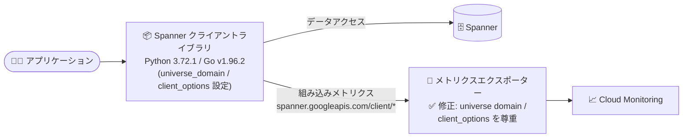

# Spanner: クライアントライブラリのメトリクスエクスポーターが universe domain を尊重するよう修正 (Python 3.72.1 / Go 1.96.2)

**リリース日**: 2026-11-23 (ライブラリリリース日: 2026-11-22)

**サービス**: Spanner (クライアントライブラリ)

**機能**: Python `google-cloud-spanner` 3.72.1 / Go `cloud.google.com/go/spanner` v1.96.2 (Bug Fixes)

**ステータス**: GA (ライブラリリリース)

📊 [このアップデートのインフォグラフィックを見る](https://takech9203.github.io/google-cloud-news-summary/20261123-spanner-client-libraries-universe-domain-fix.html)

## 概要

Spanner の Python クライアントライブラリ (`google-cloud-spanner`) 3.72.1 と Go クライアントライブラリ (`cloud.google.com/go/spanner`) v1.96.2 が 2026 年 11 月 22 日にリリースされ、2026 年 11 月 23 日付の Google Cloud Release Notes に掲載されました。いずれも新機能を含まない小規模なバグ修正リリースで、修正内容は共通して「組み込みメトリクス (クライアントサイドメトリクス) のエクスポーターが universe domain などのクライアント設定を尊重する」ことです。

Spanner クライアントライブラリには、RPC のレイテンシなどを自動的に Cloud Monitoring にエクスポートする組み込みのクライアントサイドメトリクス機能があります (Go 1.71.0 以降、Python 3.60.0 以降でサポート)。一方、Google Cloud には標準の `googleapis.com` とは別の「ユニバース」(独立した自己完結型クラウド環境。universe domain で識別) が存在します。今回の修正により、標準以外の universe domain やカスタムの `client_options` を設定しているクライアントでも、メトリクスエクスポーターがその設定に従って動作するようになりました。

標準の Google Cloud (`googleapis.com`) のみを利用しているユーザーへの影響は限定的ですが、universe domain を設定して利用している環境や、`client_options` でエンドポイント等をカスタマイズしている Python ユーザーにとっては重要な修正です。

**アップデート前の課題**

- Python: 組み込みメトリクスのエクスポーターが、Spanner クライアントに設定した `universe_domain` と `client_options` を尊重していなかった
- Go: 組み込みメトリクスのエクスポーターが、設定した universe domain (`GOOGLE_CLOUD_UNIVERSE_DOMAIN`) を尊重していなかった
- その結果、標準以外のユニバースで利用する場合に、メトリクスエクスポートがクライアント本体と異なる設定で動作する可能性があった

**アップデート後の改善**

- Python 3.72.1: メトリクスエクスポーターが `universe_domain` と `client_options` を尊重するようになった ([#19172](https://github.com/googleapis/google-cloud-python/pull/19172))
- Go v1.96.2: 組み込みメトリクスエクスポーターが universe domain (`GOOGLE_CLOUD_UNIVERSE_DOMAIN`) を尊重するようになった ([#20953](https://github.com/googleapis/google-cloud-go/pull/20953) / リリースブランチへの反映 [#20956](https://github.com/googleapis/google-cloud-go/pull/20956))
- universe domain を利用する環境でも、Spanner へのデータアクセスと組み込みメトリクスのエクスポートが一貫した設定で動作するようになった

## アーキテクチャ図



Spanner クライアントライブラリはデータアクセスと並行して組み込みメトリクスを Cloud Monitoring にエクスポートします。今回の修正で、このエクスポート経路もクライアントに設定した universe domain / `client_options` に従うようになりました。

## サービスアップデートの詳細

### 修正内容

1. **Python `google-cloud-spanner` 3.72.1 (2026-11-22)**
   - メトリクスエクスポーターで `universe_domain` と `client_options` を尊重するよう修正 ([#19172](https://github.com/googleapis/google-cloud-python/pull/19172))
   - 本バージョンに含まれる変更はこの 1 件のみ

2. **Go `cloud.google.com/go/spanner` v1.96.2 (2026-11-22)**
   - 組み込みメトリクスエクスポーターで universe domain を尊重するよう修正 ([#20953](https://github.com/googleapis/google-cloud-go/pull/20953)、リリースブランチへのチェリーピック [#20956](https://github.com/googleapis/google-cloud-go/pull/20956))
   - `GOOGLE_CLOUD_UNIVERSE_DOMAIN` の設定がメトリクスエクスポートに引き継がれるようになった

### 背景: 組み込みクライアントサイドメトリクスと universe domain

- **クライアントサイドメトリクス**: Spanner クライアントライブラリは、リクエストがアプリケーションを出てからレスポンスを受け取るまでのレイテンシ情報 (operation_latencies、attempt_latencies、GFE/AFE レイテンシなど) を `spanner.googleapis.com/client/*` という名前空間で Cloud Monitoring に自動エクスポートします。Go は 1.71.0 以降、Python は 3.60.0 以降でサポートされています
- **ユニバース (universe)**: Google Cloud のリソース階層の最上位概念で、独自のネットワークを持つ自己完結型クラウドです。標準の Google Cloud に加え、同じ技術を基盤としつつ単一の管轄区域内・パートナー運営のデータセンターで稼働するユニバース (Google Cloud Dedicated プログラム) が存在し、強力なデータ主権・運用主権の保証を提供します。クライアントライブラリでは universe domain の設定によって接続先ユニバースを切り替えます

## 技術仕様

### リリース情報

| 項目 | Python | Go |
|------|--------|-----|
| パッケージ | `google-cloud-spanner` | `cloud.google.com/go/spanner` |
| バージョン | 3.72.1 | v1.96.2 |
| リリース日 | 2026-11-22 | 2026-11-22 |
| 変更の種類 | Bug Fix 1 件 | Bug Fix 1 件 |
| 破壊的変更 | なし (パッチリリース) | なし (パッチリリース) |
| ソースコード | [googleapis/google-cloud-python](https://github.com/googleapis/google-cloud-python) | [googleapis/google-cloud-go](https://github.com/googleapis/google-cloud-go) |

### 組み込みメトリクスの前提条件とオプトアウト

組み込みメトリクスの利用には Cloud Monitoring API の有効化と、サービスアカウントへの Monitoring Metric Writer (`roles/monitoring.metricWriter`) ロールの付与が必要です。OpenTelemetry で独自にメトリクスを収集している場合などは、以下のようにオプトアウトできます。

```python
# Python
spanner_client = spanner.Client(disable_builtin_metrics=True)
```

```go
// Go
client, err := spanner.NewClientWithConfig(ctx, database, spanner.ClientConfig{
    DisableNativeMetrics: true,
})
```

## 設定方法

### 手順

#### ステップ 1: Python ライブラリの更新

```bash
pip install --upgrade "google-cloud-spanner>=3.72.1"
```

#### ステップ 2: Go ライブラリの更新

```bash
go get cloud.google.com/go/spanner@v1.96.2
go mod tidy
```

更新後、特に universe domain や `client_options` を設定している環境では、Cloud Monitoring の Metrics Explorer で `spanner.googleapis.com/client` を検索し、メトリクスが意図どおりエクスポートされていることを確認してください。

## メリット

### ビジネス面

- **ソブリンクラウド環境での可観測性**: universe domain を利用する環境 (データ主権要件のある環境など) でも、標準環境と同様にクライアントサイドメトリクスによるレイテンシ分析・トラブルシューティングが行える

### 技術面

- **設定の一貫性**: データアクセスとメトリクスエクスポートが同一の universe domain / `client_options` 設定で動作し、挙動が予測可能になる
- **Python のカスタム設定への対応**: `client_options` によるエンドポイント等のカスタマイズがメトリクスエクスポーターにも反映される

## デメリット・制約事項

### 考慮すべき点

- バグ修正のみのリリースであり、新機能は含まれない
- 標準の Google Cloud (`googleapis.com`) のみを既定設定で利用している場合、実質的な挙動の変化はほぼない
- 組み込みメトリクスのエクスポートには `roles/monitoring.metricWriter` の付与が必要 (ユーザーアカウントではなくサービスアカウントに付与する)

## ユースケース

### ユースケース: universe domain を利用する環境での Spanner レイテンシ分析

**シナリオ**: データ主権要件により、標準の Google Cloud とは別のユニバース上で Spanner を利用している。クライアントサイドメトリクス (operation_latencies、attempt_latencies など) を使ってアプリケーションから見たレイテンシを分析したい。

**効果**: 本修正により、クライアントに設定した universe domain がメトリクスエクスポーターにも適用され、該当環境で一貫した設定のもとクライアントサイドメトリクスを収集・分析できる。

## 料金

クライアントライブラリ自体は無料で利用できます。クライアントサイドメトリクスの Cloud Monitoring での閲覧は無料ですが、Monitoring API の利用には料金が発生する場合があります。詳細は [Google Cloud Observability の料金](https://cloud.google.com/stackdriver/pricing) および [Spanner の料金ページ](https://cloud.google.com/spanner/pricing) を参照してください。

## 関連サービス・機能

- **Spanner**: 本ライブラリがアクセスするグローバル分散リレーショナルデータベース本体
- **Cloud Monitoring**: 組み込みクライアントサイドメトリクス (`spanner.googleapis.com/client/*`) のエクスポート先。Metrics Explorer で可視化できる
- **OpenTelemetry**: カスタムのクライアントメトリクス・トレースを収集する場合の代替手段 (Java / Go クライアントでサポート)

## 参考リンク

- 📊 [インフォグラフィック](https://takech9203.github.io/google-cloud-news-summary/20261123-spanner-client-libraries-universe-domain-fix.html)
- [公式リリースノート](https://docs.cloud.google.com/release-notes#November_23_2026)
- [Python 3.72.0 → 3.72.1 の変更差分](https://github.com/googleapis/google-cloud-python/compare/google-cloud-spanner-v3.72.0...google-cloud-spanner-v3.72.1)
- [Go spanner/v1.96.1 → v1.96.2 の変更差分](https://github.com/googleapis/google-cloud-go/compare/spanner/v1.96.1...spanner/v1.96.2)
- [クライアントサイドメトリクスの表示と管理](https://docs.cloud.google.com/spanner/docs/view-manage-client-side-metrics)
- [クライアントサイドメトリクスの説明](https://docs.cloud.google.com/spanner/docs/client-side-metrics-descriptions)
- [Google Cloud の概要 (ユニバース・リージョン・ゾーン)](https://docs.cloud.google.com/docs/overview)
- [Spanner 料金ページ](https://cloud.google.com/spanner/pricing)

## まとめ

Spanner の Python 3.72.1 / Go v1.96.2 クライアントライブラリは、組み込みメトリクスエクスポーターが universe domain と `client_options` を尊重するようにする小規模かつ対象の明確なバグ修正リリースです。universe domain を利用する環境や `client_options` でクライアント設定をカスタマイズしている環境では、本バージョンへのアップデートを推奨します。

---

**タグ**: Spanner, クライアントライブラリ, Python, Go, バグ修正, universe domain, クライアントサイドメトリクス, Cloud Monitoring
