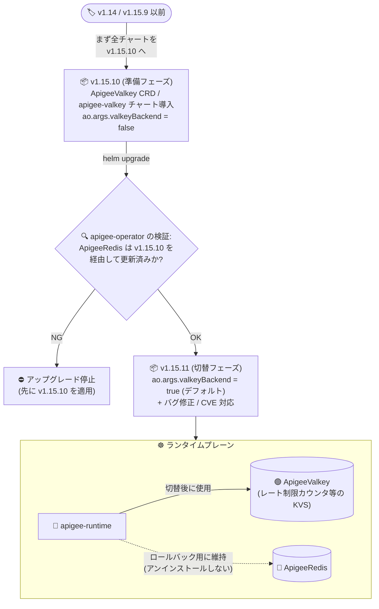

# Apigee hybrid: v1.15.11 パッチリリース (Valkey 移行の既定化と多数のセキュリティ修正)

**リリース日**: 2026-11-24

**サービス**: Apigee hybrid

**機能**: v1.15.11 パッチリリース (ApigeeRedis → ApigeeValkey 移行の既定化、ランタイム不具合修正、コンポーネント横断のセキュリティ修正)

**ステータス**: Announcement / Security (パッチリリース)

📊 [このアップデートのインフォグラフィックを見る](https://takech9203.github.io/google-cloud-news-summary/20261124-apigee-hybrid-v1-15-11.html)

## 概要

2026 年 11 月 24 日、Google Cloud は Apigee hybrid ソフトウェアの更新バージョン v1.15.11 をリリースしました。本リリースはパッチリリースであり、使用されるコンテナイメージは Apigee hybrid の Helm チャートに統合されています。Helm チャートでパッチにアップグレードするとイメージも自動更新されるため、通常は手動でのイメージ変更は不要です。

本リリースの最大のポイントは、**ApigeeRedis から ApigeeValkey への段階的移行 (phased migration) の一環として、`ao.args.valkeyBackend` のデフォルト値が `true` に変更され、ランタイムのキーバリューストアが Valkey に切り替わる**ことです。このため **v1.15.11 へアップグレードする前に、必ず v1.15.10 を経由する必要があります**。`apigee-operator` のアップグレード時には、ApigeeRedis が v1.15.10 を経由して更新済みであることが検証され、満たさない場合はアップグレードがエラーで停止します (v1.14 からのアップグレードもまず v1.15.10 へ)。

機能面では、`apigee-runtime` の HTTP サーバー管理ポートにおけるコネクションカウントリークによる HPA の異常スケール、デバッグセッションでのマスキング不備、OAuth 2.0 の `redirect_uri` 検証バイパス、Jython サンドボックスエスケープなどの重要な修正が含まれるほか、`apigee-asm-ingress`、`istiod`、Cassandra、オペレーター、ランタイム、シンクロナイザーなど多数のコンポーネントにわたる CVE 対応が行われています。v1.15 系を運用するプラットフォームチーム・API 管理者は、アップグレードパスの制約を理解した上で計画的な適用が推奨されます。

**アップデート前の課題**

- v1.15.10 以前では、ランタイムのキーバリューストアは引き続き ApigeeRedis が使われており (`ao.args.valkeyBackend` のデフォルトは `false`)、Valkey への移行は完了していなかった
- `apigee-runtime` の HTTP サーバー管理ポート (例: 8843) でコネクションカウントがリークし、HPA の `AverageValue` メトリクスが実態より大きくなり、ランタイムのレプリカ数が `maxReplicas` に張り付く問題があった
- 別のデバッグセッションやマスキングエラーが介在した場合に、デバッグセッションでペイロード・クエリパラメータ・ヘッダー・フロー変数がマスクされずに表示される問題があった
- OAuth 2.0 の `redirect_uri` 検証に非厳密なサブリソースマッチングによるバイパスの問題があり、Jython サンドボックスエスケープなどポリシー実行環境のセキュリティ上の問題も存在した
- OASValidation ポリシーで大きな OpenAPI 3.0 仕様をコンパイル・検証する際、Message Processor でメモリリークや `OutOfMemoryError` が発生することがあった
- `synchronizer.pollInterval` などの同期間隔設定が `apigee-env` Helm チャートとオペレーターに無視されていた

**アップデート後の改善**

- `ao.args.valkeyBackend` のデフォルトが `true` になり、ランタイムが ApigeeValkey を使用するようになった。`apigee-operator` が v1.15.10 経由の更新を自動検証するため、誤ったアップグレードパスを防止できる
- コネクションカウントリークが修正され、HPA が実際の負荷に基づいて適切にスケールするようになった
- デバッグセッションのマスキング処理が修正され、機微情報の露出リスクが低減した
- `redirect_uri` 検証の修正と `GenerateAuthorizationCode` ポリシーでの `<EnforceStrictCallbackURI>` の強制、Jython サンドボックスエスケープ修正、`JavaCallout` / `Script` / `JavaScript` ポリシーサンドボックスの強化により、ポリシー実行環境と OAuth フローのセキュリティが向上した
- OASValidation のコンパイル済み仕様がコンテンツハッシュで共有されるようになり、メモリリークが解消。再帰スキーマはスタックオーバーフローではなく検証エラーとして報告されるようになった
- `pollInterval` の設定値が有効になった (60 秒未満の値は 60 秒に引き上げ)。圧縮された `text/event-stream` レスポンスの EventFlow による破損、HTTP/2 フローでの `:path` / `:authority` 疑似ヘッダー設定不可の問題も修正された
- 多数のコンテナイメージの CVE が修正され、ポート 7070 (Prometheus `jmx_exporter`) の弱い Diffie-Hellman TLS 暗号スイートも無効化された

## アーキテクチャ図



v1.15.11 は Valkey 移行の「切替フェーズ」にあたり、v1.15.10 (準備フェーズ) を必ず経由する必要があります。`apigee-operator` がアップグレードパスを検証し、切替後もロールバックに備えて `apigee-redis` チャートは維持します。

## サービスアップデートの詳細

### 主要機能

1. **ApigeeRedis → ApigeeValkey 移行の既定化 (段階的移行の切替フェーズ)**
   - `ao.args.valkeyBackend` のデフォルト値が `true` に変更され、ランタイムのキーバリューストアが ApigeeValkey に移行する
   - v1.15.11 へのアップグレード前に v1.15.10 の適用が必須。`apigee-operator` のアップグレード時 (`--dry-run=server` 時も含む) に ApigeeRedis の `hybrid-version` ラベルが `1.15.10` 以降であることを検証し、満たさない場合は `ApigeeRedis default in namespace ...` で始まるエラーで停止する
   - 検証をスキップする `disableMandatoryPreviousHybridVersionCheckForValkey` プロパティは設定しないこと (公式ドキュメントで明示的に非推奨)
   - `overrides.yaml` の `redis` ブロックと同じ内容の `valkey` ブロックを追加する (`redis.image` プロパティはコピーしない)。`redis` ブロックがない場合は `valkey` ブロックも不要
   - 切替後も `apigee-redis` チャートはアンインストールせず、他のチャートと一緒にアップグレードを継続する (ApigeeValkey が稼働していない場合やロールバック時に必要)

2. **ランタイム・運用面の主要な修正**
   - **583672651**: `apigee-runtime` HTTP サーバーの管理ポート (例: 8843) のコネクションカウントリークを修正。HPA の `AverageValue` が実態より膨らみ、レプリカ数が `maxReplicas` に張り付く問題を解消
   - **582790971**: 別セッションやマスキングエラー介在時にデバッグセッションでペイロード・クエリパラメータ・ヘッダー・フロー変数がマスクされず表示される問題を修正
   - **582790249**: メッセージのない例外で失敗したポリシーの Execution エントリがデバッグトレースから欠落する問題を修正
   - **579213551**: OASValidation ポリシーで大きな OpenAPI 3.0 仕様を扱う際の Message Processor のメモリリーク・`OutOfMemoryError` を修正。コンパイル済み仕様をコンテンツハッシュで共有し、再帰スキーマは検証エラーとして報告
   - **572875915**: `synchronizer.pollInterval`、`envs[].pollInterval` などの設定が無視される問題を修正 (60 秒未満は 60 秒に引き上げ)
   - **572025634**: 圧縮された `text/event-stream` レスポンスが EventFlow を持つプロキシで破損する問題を修正 (圧縮済み SSE は EventFlow 処理をスキップしてパススルー)
   - **554114419**: HTTP/2 フローで `createNew="true"` の `AssignMessage` / `HTTPModifier` / `RaiseFault` ポリシーが `:path` / `:authority` 疑似ヘッダーを設定できない問題を修正

3. **Apigee 固有のセキュリティ修正**
   - **579642864**: OAuth 2.0 の `redirect_uri` 検証における非厳密なサブリソースマッチングのバイパスを修正し、`GenerateAuthorizationCode` ポリシーで `<EnforceStrictCallbackURI>` を強制
   - **579642568**: Jython サンドボックスエスケープを修正
   - **579640924**: `JavaCallout`、`Script`、`JavaScript` ポリシーのサンドボックスを強化
   - **519116013**: `apigee-hybrid-cassandra` コンテナのポート 7070 (Prometheus `jmx_exporter`) で弱い Diffie-Hellman (DH) TLS 暗号スイートを無効化

4. **コンポーネント横断の CVE 対応**
   - インフラストラクチャ系のコンテナイメージに対して多数の CVE 修正が適用された (個別の列挙は公式リリースノートを参照)
   - 対象コンポーネントの例: `apigee-asm-ingress` / `apigee-asm-istiod` (CVE-2026-111943、CVE-2026-116587、CVE-2026-128085 など)、`apigee-connect-agent` / `apigee-operators` / `apigee-redis` / `apigee-prometheus-adapter` (CVE-2026-97033〜97054 系列)、`apigee-fluent-bit` (CVE-2026-27171、CVE-2026-85091)、`apigee-hybrid-cassandra` / `apigee-hybrid-cassandra-client`、`apigee-mart-server` / `apigee-mint-task-scheduler`、`apigee-runtime` / `apigee-synchronizer` (CVE-2026-102554、CVE-2026-49875、CVE-2026-50645)、`apigee-stackdriver-logging-agent`、`apigee-open-telemetry-collector` など

## 技術仕様

### リリース概要

| 項目 | 詳細 |
|------|------|
| バージョン | Apigee hybrid v1.15.11 |
| リリース日 | 2026 年 11 月 24 日 |
| リリース種別 | パッチリリース (コンテナイメージは Helm チャートに統合) |
| 前提バージョン | v1.15.10 (必須。v1.14 からの場合もまず v1.15.10 へ) |
| 主要変更 | `ao.args.valkeyBackend` のデフォルトが `true` に変更 (ランタイムが ApigeeValkey へ移行) |
| 検証機構 | `apigee-operator` が ApigeeRedis の v1.15.10 経由更新を検証 (`--dry-run=server` でも実行) |
| アップグレード手順 | [Upgrading Apigee hybrid to v1.15.11](https://docs.cloud.google.com/apigee/docs/hybrid/v1.15/upgrade) |

### Valkey 移行に関する構成ポイント

| 項目 | 詳細 |
|------|------|
| `ao.args.valkeyBackend` | v1.15.11 でデフォルト `true`。`false` を明示設定している場合はその行を削除する |
| `valkey` ブロック | `overrides.yaml` の `redis` ブロックと同じプロパティ・値で追加 (`redis.image` はコピーしない)。`redis` ブロックがなければ不要 |
| プライベートレジストリ | `gcr.io/apigee-release/hybrid/apigee-valkey` イメージも他の hybrid イメージと同じタグでコピーする |
| Secret / Vault 利用時 | `redis.auth.secret` → `valkey.auth.secret` に同じ Secret を設定。Vault の `apigee-redis` ロールに `apigee-valkey-default` と `apigee-valkey-envoy-default` を追加 |
| `apigee-redis` チャート | 切替後もアンインストールせず維持 (ApigeeValkey 非稼働時のフォールバックとロールバックに必要) |
| ロールバック | v1.15.10 へのロールバック手順が提供されており、ロールバック後はランタイムが ApigeeRedis に戻る |

### overrides.yaml の例 (valkey ブロックの追加)

```yaml
redis:
  auth:
    password: "PASSWORD"
  replicaCount: 2
valkey:
  auth:
    password: "PASSWORD"
  replicaCount: 2
```

## 設定方法

### 前提条件

1. クラスタが Apigee hybrid v1.15.10 以降で稼働していること (v1.14 からの場合は先に v1.15.10 へアップグレード)
2. 現行クラスタ構成を反映した `overrides.yaml` が利用できること
3. Valkey 切替時にレート制限カウンタがゼロにリセットされるため、トラフィックの少ない時間帯にアップグレードを計画すること

### 手順

#### ステップ 1: ApigeeRedis のバージョン確認と overrides の更新

```bash
# ApigeeRedis リソースのバージョンラベルを確認 (1.15.10 以降であること)
kubectl -n APIGEE_NAMESPACE get apigeeredis default \
  -o jsonpath='{.metadata.labels.apigee\.cloud\.google\.com/hybrid-version}'
```

出力が空、または 1.15.10 より前の場合は、先に全チャートを v1.15.10 にアップグレードします。あわせて `overrides.yaml` に `valkey` ブロックを追加し、`ao.args.valkeyBackend: false` を設定している場合はその行を削除します。

#### ステップ 2: CRD の更新とオペレーター・各チャートのアップグレード

```bash
# 更新された Apigee CRD (ApigeeValkey CRD を含む) をインストールした後、
# apigee-operator をアップグレード (ApigeeRedis の v1.15.10 経由更新が検証される)
helm upgrade operator apigee-operator/ \
  --install \
  --namespace APIGEE_NAMESPACE \
  --atomic \
  -f overrides.yaml
```

オペレーターのアップグレード後、`apigee-valkey` チャートをインストールし、`default` という名前の ApigeeValkey リソースが稼働状態になるのを待ってから、組織 (org) と環境 (env) をアップグレードします。`apigee-redis` チャートもアンインストールせず、他のチャートと一緒にアップグレードを継続します。詳細な順序は「[Upgrading Apigee hybrid to v1.15.11](https://docs.cloud.google.com/apigee/docs/hybrid/v1.15/upgrade)」を参照してください。

#### ステップ 3: ランタイムが Valkey を使用していることを確認

組織・環境のアップグレード後、公式手順の「verify that the runtime uses Valkey」に従い、ランタイムが ApigeeValkey を使用していることを確認します。問題が発生した場合は、v1.15.10 で使用していた overrides ファイルを用いた v1.15.10 へのロールバック手順が提供されています (ロールバック後はランタイムが ApigeeRedis に戻り、レート制限カウンタは再度リセットされます)。

## メリット

### ビジネス面

- **セキュリティリスクの低減**: OAuth 2.0 の `redirect_uri` 検証バイパスやポリシーサンドボックスエスケープ、デバッグセッションでの機微情報露出といった API 基盤の根幹に関わる問題が修正され、コンプライアンス・監査対応の負担が軽減される
- **運用コストの最適化**: HPA のレプリカ数が `maxReplicas` に張り付く問題の修正により、不要なランタイム Pod によるリソース消費が解消される

### 技術面

- **Valkey 移行の自動検証**: `apigee-operator` がアップグレードパス (v1.15.10 経由) を自動検証するため、誤った順序でのアップグレードによる障害を未然に防げる
- **適用の容易さ**: パッチリリースのコンテナイメージは Helm チャートに統合されており、通常のチャートアップグレードフローで修正済みイメージが自動反映される
- **安全なロールバック経路**: `apigee-redis` チャートを維持する設計により、ApigeeValkey に問題が発生した場合でも v1.15.10 へのロールバックでランタイムを ApigeeRedis に戻せる

## デメリット・制約事項

### 制限事項

- **v1.15.10 の経由が必須**: v1.15.9 以前や v1.14 から直接 v1.15.11 へはアップグレードできない。`apigee-operator` の検証により満たさない場合はエラーで停止する
- 検証をスキップする `disableMandatoryPreviousHybridVersionCheckForValkey` は設定しないことが公式に明記されている

### 考慮すべき点

- **レート制限カウンタのリセット**: ランタイムが ApigeeValkey へ移行する際、キーバリューストア内のレート制限カウンタがゼロにリセットされる。ランタイム Pod の再起動中は新旧 Pod が別々のカウンタを保持するため、一時的にレート制限を超えるリクエストが許可される可能性がある。トラフィックの少ない時間帯での実施が推奨される
- **`apigee-redis` チャートの維持**: 切替後もアンインストールしてはならない。ApigeeValkey が稼働していない場合のフォールバックとロールバックに必要
- Vault で Redis パスワードを管理している場合は、`apigee-redis` ロールの `bound_service_account_names` に `apigee-valkey-default` と `apigee-valkey-envoy-default` の追加が必要
- プライベートレジストリを使用している場合は `apigee-valkey` イメージの事前コピーが必要
- 修正された CVE は多数のコンポーネントにまたがるため、自組織の脆弱性スキャン指摘と公式リリースノートの CVE 一覧を突き合わせて対応状況を確認することが望ましい

## ユースケース

### ユースケース 1: HPA の異常スケールに悩む環境の是正

**シナリオ**: `apigee-runtime` のレプリカ数が負荷に関係なく常に `maxReplicas` に張り付いており、クラスタリソースを過剰に消費している。

**効果**: v1.15.11 の修正 (Bug ID: 583672651) により、管理ポートのコネクションカウントリークが解消され、HPA の `AverageValue` メトリクスが実際の負荷を反映するようになる。結果として適正なレプリカ数での運用が可能になり、ノードリソースのコストが最適化される。

### ユースケース 2: 規制産業における OAuth フローの脆弱性対応

**シナリオ**: 金融・医療など規制産業の API 基盤で OAuth 2.0 認可コードフローを利用しており、`redirect_uri` 検証バイパス (Bug ID: 579642864) のようなセキュリティ問題への SLA 内対応が求められている。

**効果**: v1.15.11 への Helm チャートアップグレードのみで `redirect_uri` 検証修正と `<EnforceStrictCallbackURI>` の強制が適用され、サンドボックス強化 (Jython / JavaCallout / Script / JavaScript) もあわせて取り込める。

### ユースケース 3: Valkey 移行を含むバージョンアップ計画の策定

**シナリオ**: v1.15.9 以前を運用中で、サポート継続のために最新パッチへの追随が必要だが、Redis → Valkey というデータストア移行が含まれるため慎重に計画したい。

**効果**: v1.15.10 (準備) → v1.15.11 (切替) という公式の段階的移行パスに沿い、オペレーターの自動検証とロールバック手順を活用することで、リスクを抑えた移行計画を立てられる。レート制限カウンタのリセットを考慮し、低トラフィック時間帯に切替を実施する。

## 料金

本アップデートはパッチリリースであり、料金体系の変更はありません。Apigee の料金はサブスクリプション (Standard / Enterprise / Enterprise Plus) または従量課金 (Pay-as-you-go) で提供されます。詳細は[料金ページ](https://cloud.google.com/apigee/pricing)を参照してください。

## 利用可能リージョン

Apigee hybrid のランタイムプレーンはユーザー管理の Kubernetes クラスタ (GKE、他クラウド、オンプレミス) 上で稼働するため、本リリース自体に固有のリージョン制約はありません。サポート対象プラットフォームは[公式ドキュメント](https://docs.cloud.google.com/apigee/docs/hybrid/supported-platforms)を参照してください。

## 関連サービス・機能

- **Valkey (ApigeeValkey)**: Redis 互換のオープンソースキーバリューストア。本リリースでランタイムの既定の KVS バックエンドとなり、レート制限カウンタなどを保持する
- **ApigeeRedis (apigee-redis)**: 従来の KVS バックエンド。切替後もフォールバック・ロールバック用にチャートを維持する。本リリースでは CVE 修正も適用されている
- **Helm**: Apigee hybrid のインストール・アップグレード・構成管理の標準ツール。`apigee-valkey` チャートが移行の中核となる
- **HashiCorp Vault**: Redis / Valkey のパスワードを外部シークレットマネージャーで管理している場合、Vault ロールへのサービスアカウント追加が必要
- **Cloud Monitoring / HPA**: コネクションカウントリーク修正により、ランタイムのオートスケーリング (Horizontal Pod Autoscaler) の挙動が正常化する
- **Google Kubernetes Engine (GKE)**: Apigee hybrid ランタイムプレーンの主要な稼働基盤

## 参考リンク

- 📊 [インフォグラフィック](https://takech9203.github.io/google-cloud-news-summary/20261124-apigee-hybrid-v1-15-11.html)
- [公式リリースノート](https://docs.cloud.google.com/release-notes#November_24_2026)
- [Apigee hybrid リリースノート](https://docs.cloud.google.com/apigee/docs/hybrid/release-notes)
- [Apigee hybrid v1.15.11 へのアップグレード手順 (Valkey 移行手順を含む)](https://docs.cloud.google.com/apigee/docs/hybrid/v1.15/upgrade)
- [ao.args.valkeyBackend 構成プロパティ](https://docs.cloud.google.com/apigee/docs/hybrid/v1.15/config-prop-ref#ao-args-valkeybackend)
- [新規インストール (The big picture)](https://docs.cloud.google.com/apigee/docs/hybrid/v1.15/big-picture)
- [Apigee リリースプロセス (コンテナイメージサポート)](https://docs.cloud.google.com/apigee/docs/release/apigee-release-process#apigee-hybrid-container-images)
- [外部シークレットマネージャー (Vault) でのデータ保管](https://docs.cloud.google.com/apigee/docs/hybrid/v1.15/storing-secrets-in-vault)
- [料金ページ](https://cloud.google.com/apigee/pricing)

## まとめ

Apigee hybrid v1.15.11 は、ApigeeRedis から ApigeeValkey への段階的移行の「切替フェーズ」にあたる重要なパッチリリースであり、`ao.args.valkeyBackend` のデフォルトが `true` になるため v1.15.10 の経由が必須です。HPA の異常スケールや OAuth `redirect_uri` 検証バイパス、ポリシーサンドボックスエスケープなど運用・セキュリティ両面の重要な修正と多数の CVE 対応が含まれるため、v1.15 系の運用環境では、レート制限カウンタのリセットを考慮して低トラフィック時間帯に切替を計画し、検証環境での確認を経て早期に適用することを推奨します。

---

**タグ**: #ApigeeHybrid #Apigee #Valkey #Redis #Security #PatchRelease #Helm #Kubernetes #APIManagement #OAuth
