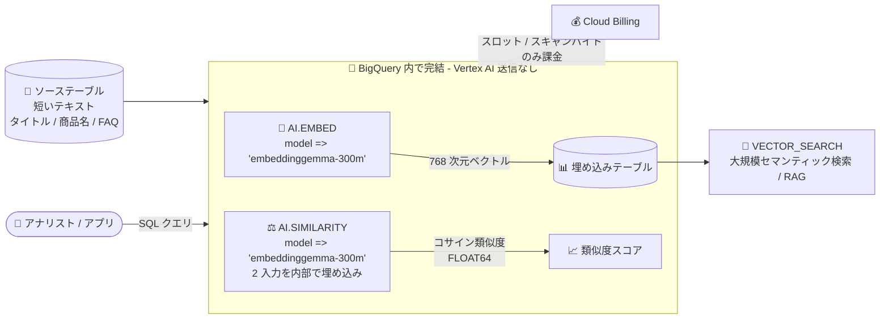

# BigQuery: 組み込みテキスト埋め込みモデル embeddinggemma-300m が AI.EMBED / AI.SIMILARITY で GA に

**リリース日**: 2026-11-24

**サービス**: BigQuery (BigQuery ML)

**機能**: AI.EMBED および AI.SIMILARITY 関数向け組み込みモデル embeddinggemma-300m

**ステータス**: GA (一般提供)

📊 [このアップデートのインフォグラフィックを見る](https://takech9203.github.io/google-cloud-news-summary/20261124-bigquery-embeddinggemma-300m-ga.html)

## 概要

BigQuery ML の組み込みテキスト埋め込みモデル `embeddinggemma-300m` が、`AI.EMBED` 関数と `AI.SIMILARITY` 関数の両方で GA (一般提供) になりました。`model => 'embeddinggemma-300m'` と指定するだけで、Vertex AI エンドポイントや Cloud リソース接続のセットアップなしに、BigQuery 内で直接テキスト埋め込みの生成とコサイン類似度の計算を実行できます。

embeddinggemma-300m は最大 2,048 トークンのシーケンス長と 768 次元の出力をサポートし、短い文字列 (128 トークン以下を推奨) の埋め込みと多言語タスクに最適化されています。埋め込み処理はすべて BigQuery 内で完結し、データが Vertex AI (Agent Platform) に送信されることはありません。課金も BigQuery コンピュート (スロット使用量またはスキャンバイト) のみで、Vertex AI 側の課金は発生しません。

なお、前日 2026-11-23 には長文・コード向けの組み込みモデル `embeddinggemma-2` (8,192 トークンコンテキスト、入力トークン課金あり) が Preview として発表されています。今回の GA により、短い文字列向けの embeddinggemma-300m は本番ワークロードで安心して利用できる選択肢となり、embeddinggemma-2 (Preview) と用途に応じて使い分けられる体制が整いました。

**アップデート前の課題**

- embeddinggemma-300m は Preview 段階であり、SLA の対象外で仕様変更の可能性があったため、本番環境のセマンティック検索や類似度計算パイプラインへの組み込みには慎重な判断が必要だった
- GA の埋め込み手段は Vertex AI エンドポイント (`text-embedding-005` など) に限られ、Cloud リソース接続の作成や Vertex AI User ロールの付与といったセットアップ、Vertex AI 側の課金が発生していた
- 2 つのテキストの意味的な類似度を SQL だけで手軽に計算する GA の手段 (事前の埋め込み計算が不要な方法) がなかった

**アップデート後の改善**

- embeddinggemma-300m が GA となり、AI.EMBED による埋め込み生成と AI.SIMILARITY による類似度計算を本番ワークロードで利用できるようになった
- `bigquery.jobs.create` と `bigquery.tables.getData` 権限のみで利用でき、Vertex AI の接続・権限・課金が一切不要な埋め込みパイプラインを GA 品質で構築できるようになった
- データが BigQuery の外に出ないため、Assured Workloads プロジェクト (embeddinggemma-2 は利用不可) を含め、データ所在要件が厳しい環境でも採用しやすくなった

## アーキテクチャ図



AI.EMBED で生成した 768 次元ベクトルは VECTOR_SEARCH による大規模検索に、AI.SIMILARITY は事前の埋め込み計算なしに 2 つのテキスト間の類似度を直接算出する用途に使います。どちらも埋め込み処理が BigQuery 内で完結します。

## サービスアップデートの詳細

### 主要機能

1. **AI.EMBED での組み込み埋め込み生成が GA**
   - `model => 'embeddinggemma-300m'` の指定だけで 768 次元のテキスト埋め込みを生成
   - 最大シーケンス長 2,048 トークン。128 トークン以下の短い文字列の埋め込みに最適で、多言語タスクに特化
   - Vertex AI エンドポイント・Cloud リソース接続・`roles/aiplatform.user` が一切不要

2. **AI.SIMILARITY での類似度計算が GA**
   - 2 つのテキスト入力の埋め込みを実行時に内部生成し、コサイン類似度 (FLOAT64、1 に近いほど類似) を返すスカラー関数
   - 事前に埋め込みを計算していないデータ同士の比較や、SELECT / WHERE 句での行ごとのペア比較に適する
   - 組み込みモデルとして指定できるのは embeddinggemma-300m のみ (embeddinggemma-2 は AI.SIMILARITY では未対応)

3. **BigQuery 内で完結する処理とシンプルな課金**
   - データは Vertex AI (Agent Platform) に送信されず、埋め込みはスロットを使用して BigQuery 内で生成される
   - 課金は BigQuery コンピュート (スロットまたはスキャンバイト) のみ。モデル入力トークン課金 (embeddinggemma-2 で採用) は発生しない
   - Assured Workloads プロジェクトでも利用可能 (embeddinggemma-2 は利用不可のため、こちらを使用)

## 技術仕様

### embeddinggemma-300m の仕様

| 項目 | 詳細 |
|------|------|
| 対応関数 | AI.EMBED、AI.SIMILARITY |
| 出力次元 | 768 |
| 最大シーケンス長 | 2,048 トークン |
| 推奨入力 | 短い文字列 (128 トークン以下) |
| 得意分野 | 多言語タスク |
| 埋め込み処理の場所 | BigQuery 内 (Vertex AI へのデータ送信なし) |
| 課金 | BigQuery コンピュートのみ (スロットまたはスキャンバイト) |
| 必要権限 | `bigquery.jobs.create` (クエリ実行プロジェクト)、`bigquery.tables.getData` (ソーステーブル) |
| Vertex AI セットアップ | 不要 (接続・ロール不要) |

### 組み込みモデルの比較 (embeddinggemma-300m GA vs embeddinggemma-2 Preview)

| 項目 | embeddinggemma-300m (GA) | embeddinggemma-2 (Preview) |
|------|--------------------------|----------------------------|
| ステータス | GA (2026-11-24) | Preview (2026-11-23 発表) |
| 対応関数 | AI.EMBED、AI.SIMILARITY | AI.EMBED のみ |
| 最大シーケンス長 | 2,048 トークン | 8,192 トークン |
| 出力次元 | 768 | 768 |
| 得意分野 | 短い文字列 (128 トークン以下)、多言語タスク | 長文テキスト・コード、多言語・コーディングタスク |
| 課金 | BigQuery コンピュートのみ | モデル入力トークン + BigQuery コンピュート |
| Assured Workloads | 利用可 | 利用不可 |

### パラメータに関する注意

- `model` を指定した場合、`endpoint`、`model_params`、`connection_id` は指定できない (AI.EMBED では `title` も不可)
- AI.SIMILARITY の `model` 引数でサポートされる値は `embeddinggemma-300m` のみ
- 異なる埋め込みモデル同士は数学的に互換性がないため、他モデルで生成済みのベクトルと混在させて比較・検索することはできない

## 設定方法

### 前提条件

1. クエリを実行するプロジェクトに対する `bigquery.jobs.create` 権限
2. ソーステーブルに対する `bigquery.tables.getData` 権限

(Cloud リソース接続や Vertex AI ロールは不要)

### 手順

#### ステップ 1: AI.EMBED で埋め込みを生成

```sql
SELECT AI.EMBED(
  'A piece of text to embed',
  model => 'embeddinggemma-300m') AS embedding;
```

`embedding.result` 列に 768 次元の配列が返されます。`embedding.status` が空文字列であれば成功です。

#### ステップ 2: AI.SIMILARITY で 2 つのテキストの類似度を計算

```sql
SELECT AI.SIMILARITY(
  'How to bake a cake',
  'Recipes for desserts',
  model => 'embeddinggemma-300m') AS score;
-- 結果例: 0.7175671203214448
```

コサイン類似度 (FLOAT64) が返されます。1 に近いほど類似、0 に近いほど非類似です。エラー時は NULL が返ります。

#### ステップ 3: テーブル全体の埋め込みを保存して VECTOR_SEARCH で検索

```sql
CREATE OR REPLACE TABLE mydataset.product_embeddings AS
SELECT
  product_id,
  product_name,
  AI.EMBED(product_name, model => 'embeddinggemma-300m').result AS embedding
FROM mydataset.products;

SELECT base.product_id, base.product_name
FROM VECTOR_SEARCH(
  TABLE mydataset.product_embeddings,
  'embedding',
  (SELECT AI.EMBED('ワイヤレスイヤホン', model => 'embeddinggemma-300m').result),
  top_k => 5);
```

大量データに対する検索では、埋め込みをテーブルに保存して VECTOR_SEARCH (ベクトルインデックス利用可) を使うことが推奨されています。

## メリット

### ビジネス面

- **本番利用への移行が可能**: GA により SLA の対象となり、Preview 段階で検証していたセマンティック検索・類似度計算パイプラインを本番ワークロードへ昇格できる
- **導入コストの低さ**: Vertex AI の接続・権限設定や追加課金が不要なため、データアナリストが SQL だけで埋め込み・類似度計算を開始できる
- **コストの予測しやすさ**: 課金が BigQuery コンピュートのみで、既存のオンデマンド / Editions の料金モデルの枠内で運用できる

### 技術面

- **BigQuery 内で完結**: データが Vertex AI に送信されないため、データ移動を避けたい環境や Assured Workloads プロジェクトでも利用できる
- **2 つの関数での一貫した利用**: AI.EMBED (バッチ埋め込み + VECTOR_SEARCH) と AI.SIMILARITY (アドホックなペア比較) を同じモデルで使い分けられる
- **プロトタイピングの容易さ**: AI.SIMILARITY は事前の埋め込み計算なしで動作するため、設計イテレーション中のクエリ試作に適する

## デメリット・制約事項

### 制限事項

- 最大シーケンス長は 2,048 トークンで、推奨は 128 トークン以下の短い文字列。長文やコードの埋め込みには embeddinggemma-2 (Preview) または Vertex AI エンドポイントモデルが必要
- AI.SIMILARITY で組み込みモデルとして指定できるのは embeddinggemma-300m のみ
- `model` 指定時は `endpoint`、`model_params` (出力次元の変更など)、`connection_id` を併用できない (出力次元は 768 固定)

### 考慮すべき点

- AI.SIMILARITY は呼び出しごとに 2 つの入力の埋め込みを実行時に生成するため、大量の比較を行う場合は AI.EMBED で事前計算した埋め込み + VECTOR_SEARCH の方が効率的
- 埋め込みはスロットを使用して生成されるため、大規模なバッチ埋め込みではスロット消費 (またはスキャンバイト) がコストに直結する。ワークロードに応じた料金モデルの確認が必要
- 既存の Vertex AI エンドポイントモデル (text-embedding-005 など) で生成済みのベクトル資産とは互換性がないため、モデルを切り替える場合は埋め込みの再生成が必要

## ユースケース

### ユースケース 1: 商品名・FAQ タイトルのセマンティック検索 (本番運用)

**シナリオ**: EC サイトの商品名や FAQ タイトル (数十〜百数十トークン程度の短いテキスト) に対するセマンティック検索を、GA 品質のコンポーネントのみで構築したい。

**実装例**:
```sql
CREATE OR REPLACE TABLE faq.title_embeddings AS
SELECT
  faq_id,
  title,
  AI.EMBED(title, model => 'embeddinggemma-300m').result AS embedding
FROM faq.articles;
```

**効果**: Vertex AI のセットアップなしに GA の埋め込みパイプラインを構築でき、VECTOR_SEARCH と組み合わせてキーワード一致に依存しない検索を本番提供できる。

### ユースケース 2: 重複レコード・類似問い合わせの検出

**シナリオ**: サポート問い合わせの件名やマスタデータの名称について、表記ゆれを含む重複・類似レコードを SQL だけで検出したい。

**実装例**:
```sql
SELECT a.id, b.id,
  AI.SIMILARITY(a.subject, b.subject,
    model => 'embeddinggemma-300m') AS score
FROM tickets a
JOIN tickets b ON a.id < b.id
WHERE AI.SIMILARITY(a.subject, b.subject,
  model => 'embeddinggemma-300m') > 0.9;
```

**効果**: 事前の埋め込みテーブル構築なしで、意味的な類似度に基づく重複候補の抽出を実現できる。多言語テキストにも対応する。

### ユースケース 3: Assured Workloads 環境での埋め込み生成

**シナリオ**: コンプライアンス要件により Assured Workloads プロジェクトで運用しており、データを BigQuery 外に出さずに埋め込みを生成したい。

**効果**: embeddinggemma-2 が利用できない Assured Workloads プロジェクトでも、GA の embeddinggemma-300m で埋め込み生成・類似度計算が可能。

## 料金

embeddinggemma-300m は Vertex AI (Agent Platform) 課金が発生せず、**BigQuery コンピュートのみ** (使用スロットまたはスキャンバイトに基づく、オンデマンド / Editions の料金モデルに従う) で課金されます。embeddinggemma-2 のようなモデル入力トークン課金はありません。

| 課金要素 | embeddinggemma-300m (GA) | 参考: embeddinggemma-2 (Preview) |
|---------|--------------------------|----------------------------------|
| モデル入力トークン | なし | あり |
| BigQuery コンピュート | あり (スロットまたはスキャンバイト) | あり |
| Vertex AI 課金 | なし | なし |

詳細は [BigQuery ML の料金ページ](https://cloud.google.com/bigquery/pricing#bigquery-ml-pricing) を参照してください。

## 利用可能リージョン

AI.SIMILARITY は Gemini モデルをサポートするすべてのリージョンに加え、us / eu マルチリージョンで実行できます。AI.EMBED の組み込みモデルも BigQuery 内で埋め込みを生成するため、Vertex AI エンドポイントのロケーション制約を受けません。最新のロケーション情報は[公式ドキュメント](https://docs.cloud.google.com/bigquery/docs/reference/standard-sql/bigqueryml-syntax-ai-embed)を確認してください。

## 関連サービス・機能

- **embeddinggemma-2 (Preview)**: 2026-11-23 発表の長文・コード向け組み込みモデル (8,192 トークン)。長文ワークロードではこちらを検証し、短い文字列中心であれば GA の embeddinggemma-300m を使う使い分けが可能
- **VECTOR_SEARCH 関数 / ベクトルインデックス**: AI.EMBED で事前計算した埋め込みに対する大規模な近似最近傍検索。性能が重要な大量データの検索では AI.SIMILARITY よりこちらを推奨
- **Vertex AI エンドポイントモデル (gemini-embedding-001 / gemini-embedding-2 など)**: 最大 3,072 次元やマルチモーダル入力 (画像・音声・動画・PDF) が必要な場合の選択肢。Vertex AI 課金と接続セットアップが必要
- **ML.TREND / ML.SEASONALITY など時系列分析 TVF**: 同日 (2026-11-24) に GA となった BigQuery のデータ分析用テーブル値関数群
- **Assured Workloads**: 規制対応ワークロード向け環境。組み込みモデルでは embeddinggemma-300m のみ利用可能

## 参考リンク

- 📊 [インフォグラフィック](https://takech9203.github.io/google-cloud-news-summary/20261124-bigquery-embeddinggemma-300m-ga.html)
- [公式リリースノート](https://docs.cloud.google.com/release-notes#November_24_2026)
- [AI.EMBED 関数リファレンス](https://docs.cloud.google.com/bigquery/docs/reference/standard-sql/bigqueryml-syntax-ai-embed)
- [AI.SIMILARITY 関数リファレンス](https://docs.cloud.google.com/bigquery/docs/reference/standard-sql/bigqueryml-syntax-ai-similarity)
- [モデルの選択ガイド](https://docs.cloud.google.com/bigquery/docs/reference/standard-sql/bigqueryml-syntax-ai-embed#choose_a_model)
- [BigQuery ML 料金ページ](https://cloud.google.com/bigquery/pricing#bigquery-ml-pricing)
- [関連レポート: embeddinggemma-2 Preview (2026-11-23)](./2026-11-23-bigquery-embeddinggemma-2-preview.md)

## まとめ

embeddinggemma-300m の GA により、Vertex AI のセットアップや追加課金なしに、BigQuery 内で完結する埋め込み生成 (AI.EMBED) と類似度計算 (AI.SIMILARITY) を本番ワークロードで利用できるようになりました。短い文字列中心のセマンティック検索・重複検出・レコメンドを SQL だけで構築したいチームは、本番採用を検討する好機です。8,192 トークンの長文対応が必要な場合は Preview の embeddinggemma-2 と使い分けてください。

---

**タグ**: BigQuery, BigQuery ML, AI.EMBED, AI.SIMILARITY, embeddinggemma-300m, Embeddings, Vector Search, GA, Generative AI
