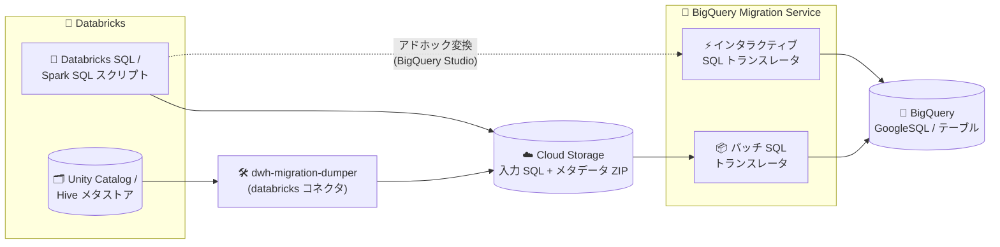

# BigQuery: BigQuery Migration Service が Databricks SQL / Apache Spark SQL 変換をサポート (Preview)

**リリース日**: 2026-11-24

**サービス**: BigQuery (BigQuery Migration Service)

**機能**: Databricks SQL / Apache Spark SQL 3.x・4.x から GoogleSQL への変換とスキーマメタデータ抽出

**ステータス**: Preview

📊 [このアップデートのインフォグラフィックを見る](https://takech9203.github.io/google-cloud-news-summary/20261124-bigquery-migration-databricks-sql-translation.html)

## 概要

BigQuery Migration Service が、Databricks SQL および Apache Spark SQL 3.x / 4.x から GoogleSQL への SQL 変換 (translation) と、Databricks からのスキーマメタデータ抽出を Preview としてサポートしました。クエリ、Delta Lake テーブル定義 (DDL)、Unity Catalog の名前空間を変換でき、Databricks のレイクハウス / データウェアハウスワークロードを BigQuery に移行する際の SQL 書き換え作業を大幅に自動化できます。

変換は単一の統合トランスレータとして提供され、Databricks SQL (Spark SQL の拡張) と オープンソースの Spark SQL を分離することなくまとめて変換できます。一括変換にはバッチ SQL トランスレータまたは BigQuery Migration API、アドホックな変換には BigQuery Studio のインタラクティブ SQL トランスレータを利用できます。また、`dwh-migration-dumper` ツールの `databricks` コネクタにより、Unity Catalog やレガシー Hive メタストアからスキーマメタデータを抽出し、変換精度の向上や移行後のデータ検証に活用できます。

Databricks から BigQuery への移行を検討している組織にとって、Teradata、Snowflake、Redshift などと同様の体系的な移行ツールチェーンが Databricks に対しても利用可能になった重要なアップデートです。

**アップデート前の課題**

- BigQuery Migration Service の SQL 変換は Teradata、Snowflake、Redshift、Hive などが対象で、Databricks SQL 固有の構文 (Delta Lake DDL の `USING DELTA`、`CLUSTER BY`、Unity Catalog の 3 階層名など) を体系的に変換する手段がなかった
- Databricks から BigQuery への移行では、SQL スクリプトの書き換えを手動または独自ツールで行う必要があり、工数とエラーのリスクが大きかった
- Databricks Unity Catalog やレガシー Hive メタストアからスキーマメタデータを抽出して変換・検証に利用する公式の仕組みがなかった

**アップデート後の改善**

- Databricks SQL と Spark SQL 3.x / 4.x (および Legacy Spark SQL 2.x) のクエリ、DDL、DML を GoogleSQL へ自動変換できるようになった
- Delta Lake テーブル定義 (`USING DELTA`、`PARTITIONED BY`、`CLUSTER BY`) を BigQuery の `PARTITION BY` / `CLUSTER BY` を含む `CREATE TABLE` 文に変換できるようになった
- `dwh-migration-dumper` ツールの `databricks` コネクタで Unity Catalog / レガシー Hive メタストアからメタデータを抽出し、変換精度の向上、スキーママッピング YAML の生成、移行検証に活用できるようになった
- Unity Catalog の 3 階層名 (`catalog.schema.table`) を BigQuery の `project_id.dataset.table` にマッピングするための設定 (環境設定 YAML、出力名マッピング) が整備された

## アーキテクチャ図



Databricks の SQL スクリプトと Unity Catalog / Hive メタストアのメタデータ (dwh-migration-dumper で抽出) を Cloud Storage に配置し、BigQuery Migration Service のバッチ / インタラクティブ SQL トランスレータで GoogleSQL に変換して BigQuery に移行するデータフローです。

## サービスアップデートの詳細

### 主要機能

1. **Databricks SQL / Spark SQL の統合トランスレータ**
   - Databricks SQL は Spark SQL の拡張であるため、両ダイアレクトを分離せずにまとめて変換できる単一の統合トランスレータとして提供
   - サポート対象: Databricks SQL (Databricks SQL ウェアハウス / Databricks Runtime の構文)、Spark SQL 3.x / 4.x、Legacy Spark SQL 2.x (Apache Hive 由来の構文を含む)
   - クエリ (`SELECT`、`WITH`、集合演算)、DDL (`CREATE TABLE`、`CREATE TABLE AS SELECT`、`CREATE VIEW`、`ALTER TABLE`、`DROP TABLE` など)、DML (`INSERT`、`UPDATE`、`DELETE`、`MERGE`、`TRUNCATE TABLE` など) に対応
   - CTE、ウィンドウ関数、`LATERAL VIEW explode` (→ `CROSS JOIN UNNEST`)、高階配列関数、日付・文字列関数 (`date_format` → `FORMAT_TIMESTAMP`、`nvl` → `COALESCE` など) を等価な GoogleSQL 式に変換

2. **Delta Lake テーブル DDL の変換**
   - `USING DELTA`、カラムコメント、テーブルプロパティ、`PARTITIONED BY`、`CLUSTER BY` / `CLUSTERED BY` 句を BigQuery の `CREATE TABLE` 文に変換
   - デフォルトでは標準 BigQuery テーブルの DDL を生成。設定 YAML により Apache Iceberg 用 BigQuery マネージドテーブルや外部テーブルの DDL 生成にも変更可能
   - BigQuery の制限 (パーティショニング列は 1 列、クラスタリング列は最大 4 列) を超える場合は、制限に収まる列のサブセットを自動選択。設定 YAML でカスタマイズも可能
   - 自動リキッドクラスタリング (`CLUSTER BY AUTO`) は列名がないため `CLUSTER BY` 句を省略

3. **Databricks からのスキーマメタデータ抽出**
   - `dwh-migration-dumper` ツールの `databricks` コネクタで Unity Catalog およびレガシー `hive_metastore` カタログからメタデータを抽出 (セルフマネージド Hive Metastore は `hiveql` コネクタ)
   - 3 階層オブジェクト識別子、列名・データ型・NULL 許容・コメント、データソース形式 (`DELTA` / `ICEBERG` / `PARQUET`)、マネージド / 外部のテーブル種別とストレージ URI、パーティショニング・クラスタリング列を CSV として ZIP アーカイブに収録
   - メタデータ ZIP を変換ジョブに添付すると、非修飾列参照の解決、正確な型キャスト、テーブルレイアウトの保持が可能
   - メタデータ変換によりテーブルごとのスキーママッピング YAML (tables.yaml) を生成し、移行検証サービス (validation service) で SQL スクリプトなしでもテーブル移行の正確性を検証可能

4. **Unity Catalog 3 階層名のマッピング**
   - `catalog.schema.table` を BigQuery の `project_id.dataset.table` に対応付け (Catalog → プロジェクト ID、Schema → データセット、Table/View → テーブル / ビュー)
   - 設定 YAML (`type: environment`) の `defaultDatabase` / `schemaSearchPath`、または Migration API の `sourceEnv` でデフォルトカタログ・スキーマ検索パスを指定
   - 出力名マッピングルール (`.config.yaml`) で Unity Catalog 名 (例: `main`) を実際の Google Cloud プロジェクト ID にマッピング

## 技術仕様

### 変換インターフェースとダイアレクト識別子

Google Cloud コンソールでは統合ダイアレクトが「Databricks/SparkSQL」として表示されます。既存の Spark SQL 変換ワークフローとの後方互換性のため、API / CLI / MCP サーバーでは従来の Spark SQL 識別子を継続使用します。

| インターフェース | 設定 / フィールド | Databricks / Spark SQL の値 |
|------|------|------|
| Google Cloud コンソール (インタラクティブ / バッチ SQL トランスレータ) | Source dialect | `Databricks/SparkSQL` |
| Google Cloud CLI (`gcloud alpha bq migration`) | `--source-dialect` | `SparkSQL` |
| BigQuery Migration API (`TranslationConfigDetails`) | `sourceDialect` | `{"sparksqlDialect": {}}` |
| BigQuery Migration API (`MigrationTask`) | `type` | `Translation_SparkSQL2BQ` または `SparkSQL2BigQuery_Translation` |
| BigQuery Migration Service MCP サーバー (`translate_query` / `translate_batch_queries`) | `sourceDialect` | `SparkSQL` |
| dwh-migration-dumper 抽出ツール | `--connector` | `databricks` (Unity Catalog / レガシー `hive_metastore`)、`hiveql` (セルフマネージド Hive Metastore) |

### 変換例 (Delta Lake DDL → GoogleSQL)

| Databricks SQL 入力 | 変換後の GoogleSQL 出力 |
|------|------|
| `CREATE TABLE ... USING DELTA PARTITIONED BY (order_date) CLUSTER BY (customer_id) COMMENT 'Customer orders'` | `CREATE TABLE ... PARTITION BY order_date CLUSTER BY customer_id OPTIONS (description = 'Customer orders')` |
| `BIGINT` / `DECIMAL(18, 2)` | `INT64` / `NUMERIC(31, 2)` |
| `LATERAL VIEW explode(o.line_items) items AS item` | `CROSS JOIN UNNEST(o.line_items) AS item` |
| `date_format(o.order_ts, 'yyyy-MM')` / `nvl(x, 0.0)` | `FORMAT_TIMESTAMP('%Y-%m', o.order_ts)` / `COALESCE(x, 0.0)` |

## 設定方法

### 前提条件

1. BigQuery Migration API が有効であること (2022 年 2 月 15 日以降に作成されたプロジェクトでは自動的に有効)
2. IAM ロール: `roles/bigquerymigration.viewer` (ジョブの閲覧)、`roles/bigquerymigration.editor` (ジョブの送信)、入出力用 Cloud Storage バケットへの `roles/storage.objectAdmin`
3. メタデータ抽出時: Databricks 側で認証プリンシパルにメタストア管理者権限、または対象カタログへの `USE CATALOG`、`USE SCHEMA`、`BROWSE` 権限

### 手順

#### ステップ 1: Databricks からメタデータを抽出 (推奨)

```bash
dwh-migration-dumper \
  --connector databricks \
  --output gs://MIGRATION-BUCKET/databricks-metadata.zip
```

`databricks` コネクタで Unity Catalog / レガシー `hive_metastore` のメタデータを ZIP アーカイブとして抽出し、Cloud Storage に配置します。メタデータを添付すると変換精度が向上し、`RelationNotFound` / `AttributeNotFound` エラーを回避できます。

#### ステップ 2: 名前マッピングを設定 (必要に応じて)

```yaml
# environment.yaml (デフォルトカタログとスキーマ検索パス)
type: environment
defaultDatabase: main
schemaSearchPath:
  - sales
```

Unity Catalog 名 (例: `main`) は通常 Google Cloud プロジェクト ID と一致しないため、`.config.yaml` の出力名マッピングルールで `catalog.schema` を `project_id.dataset` にマッピングします。

#### ステップ 3: 変換ジョブを実行

Google Cloud コンソールの BigQuery ページで **Migration > SQL translation** に移動し、ソースダイアレクトとして **Databricks/SparkSQL** を選択してバッチ変換ジョブを作成します。アドホックな変換は BigQuery Studio のインタラクティブ SQL トランスレータで実行できます。API の場合は `sourceDialect` に `{"sparksqlDialect": {}}` を指定します。

## メリット

### ビジネス面

- **移行工数の削減**: Databricks から BigQuery への SQL 書き換えが自動化され、移行プロジェクトの期間とコストを大幅に削減できる
- **移行リスクの低減**: メタデータ駆動の変換とスキーママッピング YAML による移行検証により、手動書き換えに起因する変換ミスやデータ不整合のリスクを低減できる

### 技術面

- **統合ダイアレクト対応**: Databricks SQL と Spark SQL を分離せずにまとめて変換でき、両者が混在する実ワークロードをそのまま扱える
- **Delta Lake / Unity Catalog への対応**: `USING DELTA` DDL や 3 階層名前空間といった Databricks 固有の構造を BigQuery の等価な構造 (パーティショニング / クラスタリング、`project.dataset.table`) に自動マッピング
- **柔軟な出力先**: 標準 BigQuery テーブルだけでなく、設定 YAML により Apache Iceberg 用 BigQuery マネージドテーブルや外部テーブルの DDL 生成にも対応し、オープンレイクハウス構成への移行も可能

## デメリット・制約事項

### 制限事項

- Preview 段階では SQL ステートメントのみサポート。PySpark、Scala、R、Python のノートブックコードは変換されない
- Delta Live Tables / Lakeflow Declarative Pipelines (`CREATE OR REFRESH STREAMING TABLE`、`STREAM` 関数) は未サポート
- `OPTIMIZE` (`ZORDER BY` 含む)、`VACUUM`、`CACHE TABLE`、`REFRESH TABLE`、`ANALYZE TABLE` などの運用・ストレージ管理コマンドは BigQuery に等価機能がなく (BigQuery が自動管理)、変換時に警告として報告される
- Unity Catalog のガバナンス・ストレージオブジェクト (`GRANT` / `REVOKE`、行フィルタ、列マスク、外部ロケーション、ストレージ認証情報、ボリューム) は変換されない。BigQuery 側で IAM、行レベル / 列レベルセキュリティを別途構成する必要がある
- 未サポートの UDF (Python / Scala UDF、未対応の言語機能を使う SQL UDF) は BigQuery UDF として書き直しが必要。`dwh-migration-dumper` はレガシー `hive_metastore` から UDF メタデータを抽出しない

### 考慮すべき点

- 変換後のクエリは BigQuery のデフォルト ANSI SQL セマンティクスで動作する。非 ANSI モードに依存するレガシーワークロード (ゼロ除算やオーバーフローで NULL を返す挙動) は、`SAFE_CAST`、`SAFE_DIVIDE`、`SAFE.` プレフィックスへの書き換えが必要
- 変換の成功 (SUCCEEDED) は出力の正しさを保証しない。変換ログの ERROR を確認し、BigQuery のドライランで検証することが推奨される
- 大規模な Unity Catalog からのメタデータ抽出では Databricks REST API のレートリミット (HTTP 429) に注意。`--database` フラグでカタログを絞るなどの対策がある
- 変換ジョブはプロジェクトあたり同時 10 件まで。入力ファイル数は 1,000 未満が推奨

## ユースケース

### ユースケース 1: Databricks レイクハウスから BigQuery への全面移行

**シナリオ**: Databricks 上で Delta Lake テーブルと SQL ウェアハウスを運用している企業が、分析基盤を BigQuery に統合したい。数百の SQL スクリプトと Unity Catalog 配下の多数のテーブル定義が存在する。

**実装例**:
```bash
# 1. メタデータ抽出
dwh-migration-dumper --connector databricks \
  --output gs://migration-bucket/databricks-metadata.zip

# 2. SQL スクリプトを Cloud Storage にアップロードし、
#    コンソールで Databricks/SparkSQL ダイアレクトのバッチ変換ジョブを作成
# 3. 変換された GoogleSQL とスキーママッピング YAML を検証サービスで確認
```

**効果**: SQL 書き換えとテーブル定義変換が自動化され、移行検証サービスによるデータ整合性チェックまで一貫したツールチェーンで実施できる。

### ユースケース 2: BigQuery Studio でのアドホックなクエリ移植

**シナリオ**: データアナリストが Databricks で利用していた分析クエリを BigQuery で再利用したいが、`LATERAL VIEW explode` や `date_format` などの構文差異を手動で書き換えるのは負担が大きい。

**効果**: BigQuery Studio のインタラクティブ SQL トランスレータにクエリを貼り付けるだけで GoogleSQL に変換され、構文差異を意識せずに移植できる。

## 料金

BigQuery Migration API およびバッチ SQL トランスレータの利用は無料です。ただし、入出力ファイルの保存に使用する Cloud Storage には通常のストレージ料金が発生します。

- [BigQuery 料金 (ストレージ)](https://cloud.google.com/bigquery/pricing#storage)

## 利用可能リージョン

SQL 変換がサポートされるリージョンは公式ドキュメントを参照してください。

- [Enable SQL translations (サポートリージョン)](https://docs.cloud.google.com/bigquery/docs/enable-sql-translations)

## 関連サービス・機能

- **BigQuery 移行評価 (Migration Assessment)**: 変換前に Databricks 環境を評価し、移行計画の立案を支援 (Databricks 対応)
- **BigQuery Data Transfer Service**: ソースから BigQuery へのデータ転送を自動化
- **移行検証サービス (Validation Service, Preview)**: スキーママッピング YAML を用いて移行後のテーブルの正確性を検証
- **BigQuery Migration Service MCP サーバー**: AI エージェント経由で `translate_query` / `translate_batch_queries` ツールを使った SQL 変換が可能
- **BigQuery managed tables for Apache Iceberg**: 設定 YAML により Delta Lake テーブルを Iceberg マネージドテーブルとして移行する選択肢

## 参考リンク

- 📊 [インフォグラフィック](https://takech9203.github.io/google-cloud-news-summary/20261124-bigquery-migration-databricks-sql-translation.html)
- [公式リリースノート](https://docs.cloud.google.com/release-notes#November_24_2026)
- [Databricks and Apache Spark SQL translation reference](https://docs.cloud.google.com/bigquery/docs/migration/databricks-sql)
- [Supported SQL dialects](https://docs.cloud.google.com/bigquery/docs/enable-sql-translations#supported_sql_dialects)
- [Generate metadata for translation and assessment](https://docs.cloud.google.com/bigquery/docs/generate-metadata)
- [Batch SQL translator](https://docs.cloud.google.com/bigquery/docs/batch-sql-translator)
- [Interactive SQL translator](https://docs.cloud.google.com/bigquery/docs/interactive-sql-translator)
- [料金ページ (BigQuery Storage)](https://cloud.google.com/bigquery/pricing#storage)

## まとめ

BigQuery Migration Service が Databricks SQL / Spark SQL 変換に対応したことで、Databricks から BigQuery への移行が Teradata や Snowflake と同様の体系的なツールチェーンで実施可能になりました。Databricks からの移行を検討している場合は、まず移行評価と `dwh-migration-dumper` によるメタデータ抽出を行い、メタデータ駆動の変換で精度を確保することを推奨します。Preview 段階のため SQL のみが対象であり、ノートブックコードや Delta Live Tables は別途移行設計が必要な点に注意してください。

---

**タグ**: BigQuery, BigQuery Migration Service, Databricks, Apache Spark, SQL Translation, Delta Lake, Unity Catalog, Preview, データ移行
