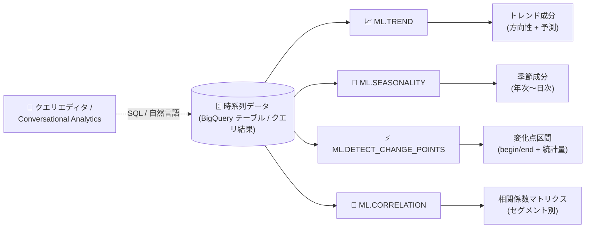

# BigQuery: データ分析支援テーブル値関数 (ML.TREND / ML.SEASONALITY / ML.DETECT_CHANGE_POINTS / ML.CORRELATION) が GA

**リリース日**: 2026-11-24

**サービス**: BigQuery (BigQuery ML)

**機能**: データ分析支援テーブル値関数 (TVF) の一般提供開始

**ステータス**: GA (一般提供)

📊 [このアップデートのインフォグラフィックを見る](https://takech9203.github.io/google-cloud-news-summary/20261124-bigquery-ml-analysis-tvf-ga.html)

## 概要

BigQuery ML のデータ分析を支援する 4 つのテーブル値関数 (TVF) が GA (一般提供) になりました。これらの関数はクエリエディタから直接呼び出せるほか、conversational analytics (データエージェントとの対話型分析) の一部としても利用できます。

GA になった関数は以下の 4 つです。

- **ML.TREND**: データの方向性 (トレンド) を特定。短期的な変動やノイズを除いた、メトリクスの長期的な軌跡を抽出
- **ML.SEASONALITY**: データの繰り返しパターン (季節性) を特定。年次・四半期・月次・週次・日次の季節成分を分解
- **ML.DETECT_CHANGE_POINTS**: 時系列データの統計的な振る舞いが変化した区間 (変化点) を特定。一時的なスパイクではなく、持続的な構造変化を検出
- **ML.CORRELATION**: ターゲット列と 1 つ以上のメトリクス列の統計的相関を計算。ディメンションによるスライス分析にも対応

いずれもモデルの作成・管理を必要とせず、SQL クエリ 1 つで時系列分解や相関分析を実行できる点が特徴です。データアナリストやビジネスユーザーが、機械学習の専門知識なしにデータの傾向・季節性・構造変化・相関を素早く把握できます。

**アップデート前の課題**

- トレンドや季節性の分解には ARIMA_PLUS モデルを `CREATE MODEL` で作成・管理する必要があり、手軽な探索的分析には手間がかかった
- これらの関数は Preview (プレビュー) として提供されており、Pre-GA Offerings Terms の下で「現状有姿」での利用に限られ、本番ワークロードへの採用判断が難しかった
- 相関分析をディメンション別に行うには、GROUP BY を組み合わせた複雑なクエリを自前で書く必要があった

**アップデート後の改善**

- 4 つの TVF が GA となり、SLA を含む一般提供条件の下で本番環境で利用できるようになった
- モデル作成なしで、クエリエディタから 1 つの SQL でトレンド分解・季節性分解・変化点検出・相関分析を実行できる
- conversational analytics のデータエージェントが自然言語の質問に応答する際に、これらの関数を自動的に利用できる (時系列分析: ML.TREND / ML.SEASONALITY / ML.DETECT_CHANGE_POINTS、統計分析: ML.CORRELATION)

## アーキテクチャ図



BigQuery テーブルまたはクエリ結果の時系列データを各 TVF に渡すと、モデル作成なしでトレンド・季節性・変化点・相関の分析結果がテーブルとして返されます。クエリエディタからの直接実行に加え、conversational analytics のデータエージェント経由でも利用できます。

## サービスアップデートの詳細

### 主要機能

1. **ML.TREND: トレンド成分の抽出**
   - 短期的な変動やノイズを無視した、メトリクスの方向性 (トレンド) を抽出
   - `smoothing_window_size` (デフォルト 5) による中心移動平均スムージング、`adjust_step_changes` によるステップ変化の自動検出・調整に対応
   - `horizon` を指定すると将来の時点 (1〜10,000 ポイント) の予測も可能

2. **ML.SEASONALITY: 季節成分の分解**
   - 年次 (YEARLY)・四半期 (QUARTERLY)・月次 (MONTHLY)・週次 (WEEKLY)・日次 (DAILY) の季節パターンを分解
   - `seasonalities` 引数で抽出する季節性を指定可能。省略時はすべての季節性を自動検出し、検出されなかった成分は NULL を返す
   - ARIMA_PLUS モデルと同じアルゴリズムで構築されている

3. **ML.DETECT_CHANGE_POINTS: 変化点の検出**
   - 時系列データの統計的性質が変化した区間を `begin_timestamp` / `end_timestamp` の時間ウィンドウとして特定
   - 一時的なスパイクや外れ値ではなく、徐々に現れる異常や持続的な構造変化の検出に最適化
   - 各変化点区間の統計量 (平均・最小・最大・標準偏差・データ点数) を STRUCT で返す

4. **ML.CORRELATION: 統計的相関の計算**
   - 1 つのターゲット列と複数のメトリクス列の相関を同時に計算 (マルチカラムマトリクス)
   - `dimension_cols` (最大 12 列) を指定すると、GROUP BY CUBE に類似した全ディメンション組み合わせごとの相関を自動計算 (ディメンショナルスライシング)
   - Pearson (デフォルト)・Spearman・Kendall の 3 つの相関手法をサポート

5. **Conversational Analytics との統合**
   - データエージェントへのチャットや、作成する検証済み SQL クエリの中でこれらの関数を利用可能
   - 時系列分析 (ML.TREND / ML.SEASONALITY / ML.DETECT_CHANGE_POINTS) と統計分析・データプロファイリング (ML.CORRELATION / ML.DESCRIBE_DATA) として位置づけられている

## 技術仕様

### 時系列系関数 (ML.TREND / ML.SEASONALITY / ML.DETECT_CHANGE_POINTS) の共通仕様

| 項目 | 詳細 |
|------|------|
| 入力 | `TABLE テーブル名` または `(クエリ文)` |
| `data_col` | 分析対象データ列。INT64 / NUMERIC / BIGNUMERIC / FLOAT64 |
| `timestamp_col` | タイムスタンプ列。TIMESTAMP / DATE / DATETIME |
| `id_cols` (任意) | ARRAY&lt;STRING&gt;。複数時系列を 1 クエリで分析する ID 列 (STRING / INT64 / ARRAY&lt;STRING&gt; / ARRAY&lt;INT64&gt;) |
| `horizon` (任意) | 予測する時点数。デフォルト 0 (履歴のみ)、有効範囲 [1, 10000]。ML.TREND / ML.SEASONALITY で利用可能 |
| 出力の共通列 | ID 列、タイムスタンプ列、`time_series_type` (history / forecast)、入力データ列、`status` (エラーメッセージ、成功時は空) |

### 各関数の固有仕様

| 関数 | 固有の引数 | 固有の出力 |
|------|-----------|-----------|
| ML.TREND | `smoothing_window_size` (デフォルト 5)、`adjust_step_changes` (デフォルト FALSE) | `trend` (FLOAT64): 各時点のトレンド成分 |
| ML.SEASONALITY | `seasonalities` (YEARLY / QUARTERLY / MONTHLY / WEEKLY / DAILY の配列) | `yearly` / `quarterly` / `monthly` / `weekly` / `daily` (FLOAT64): 季節成分。未検出は NULL |
| ML.DETECT_CHANGE_POINTS | なし (data_col / timestamp_col / id_cols のみ) | `begin_timestamp` / `end_timestamp`、`metrics` STRUCT (avg / min / max / stddev / count) |

### ML.CORRELATION の仕様

| 項目 | 詳細 |
|------|------|
| `target_col` | 分析対象の主数値列 (STRING で列名を指定) |
| `target_correlation_cols` | 相関を計算するメトリクス列。STRING または ARRAY&lt;STRING&gt; |
| `dimension_cols` (任意) | スライスするディメンション列。最大 12 列、groupable 型のみ |
| `method` (任意) | PEARSON (デフォルト) / SPEARMAN / KENDALL |
| 出力 | `segment` (ARRAY&lt;STRUCT&gt;)、ディメンション列、`target_col`、`corr_col`、`correlation` (-1.0〜1.0)、`segment_size`、`segment_proportion` |

## 設定方法

### 前提条件

1. BigQuery が有効なプロジェクトと、時系列データまたは数値データを含むテーブル (もしくはクエリ結果)
2. conversational analytics で生成 AI 系の機能を使う場合は、対応する権限が必要

### 手順

#### ステップ 1: トレンドの抽出 (ML.TREND)

```sql
WITH DailyVisits AS (
  SELECT
    PARSE_TIMESTAMP('%Y%m%d', date) AS visit_timestamp,
    SUM(totals.visits) AS total_visits
  FROM `bigquery-public-data.google_analytics_sample.ga_sessions_*`
  GROUP BY visit_timestamp
)
SELECT *
FROM ML.TREND(
  TABLE DailyVisits,
  data_col => 'total_visits',
  timestamp_col => 'visit_timestamp')
ORDER BY visit_timestamp;
```

日次のウェブサイト訪問数からトレンド成分 (`trend` 列) を抽出します。

#### ステップ 2: 変化点の検出 (ML.DETECT_CHANGE_POINTS)

```sql
WITH daily_trips AS (
  SELECT
    EXTRACT(DATE FROM pickup_datetime) AS trip_date,
    COUNT(*) AS total_trips
  FROM `bigquery-public-data.new_york_taxi_trips.tlc_yellow_trips_20*`
  WHERE _TABLE_SUFFIX BETWEEN '19' AND '20'
    AND EXTRACT(DATE FROM pickup_datetime) BETWEEN '2019-01-01' AND '2020-12-31'
  GROUP BY trip_date
)
SELECT *
FROM ML.DETECT_CHANGE_POINTS(
  TABLE daily_trips,
  data_col => 'total_trips',
  timestamp_col => 'trip_date');
```

タクシー乗車数の日次推移から、構造変化が発生した区間 (begin/end タイムスタンプと統計量) を検出します。

#### ステップ 3: ディメンション別の相関分析 (ML.CORRELATION)

```sql
SELECT *
FROM ML.CORRELATION(
  (SELECT * FROM my_dataset.marketing_sample WHERE country = 'USA'),
  target_col => 'revenue',
  target_correlation_cols => ['ad_spend', 'budget'],
  dimension_cols => ['city', 'product_category'])
ORDER BY segment_size DESC, corr_col
LIMIT 5;
```

売上 (`revenue`) と広告費・予算の相関を、都市 × 商品カテゴリの全組み合わせでスライスして計算します。

## メリット

### ビジネス面

- **分析の民主化**: SQL だけで (さらに conversational analytics なら自然言語だけで) トレンド・季節性・変化点・相関を把握でき、データサイエンティスト以外のユーザーにも高度な分析が開放される
- **意思決定の高速化**: マーケティングキャンペーン後の売上の構造変化 (変化点) や、売上と相関の強い指標 (相関分析) を即座に特定でき、施策の評価サイクルが短縮される
- **本番利用可能**: GA により一般提供条件での利用が可能になり、本番の分析パイプラインやダッシュボードへの組み込みを正式に進められる

### 技術面

- **モデル管理不要**: ARIMA_PLUS モデルの `CREATE MODEL` によるトレーニングや管理なしで、実績あるアルゴリズム (ARIMA_PLUS 由来) を利用できる
- **スケーラブルな複数時系列分析**: `id_cols` 指定により、複数の時系列を 1 クエリで一括分析できる
- **柔軟な相関分析**: `dimension_cols` による GROUP BY CUBE 相当のスライス分析が組み込みで提供され、複雑なクエリを自前で書く必要がない

## デメリット・制約事項

### 制限事項

- データ列は INT64 / NUMERIC / BIGNUMERIC / FLOAT64、タイムスタンプ列は TIMESTAMP / DATE / DATETIME に限定される
- `horizon` の有効範囲は [1, 10000] (ML.TREND / ML.SEASONALITY)
- ML.CORRELATION の `dimension_cols` は最大 12 列で、groupable なデータ型のみ指定可能
- ML.CORRELATION の KENDALL 法は計算量が大きく、大規模データセットでは低速になる可能性がある (大きなテーブルには PEARSON または SPEARMAN を推奨)

### 考慮すべき点

- ML.DETECT_CHANGE_POINTS は持続的な構造変化の検出に最適化されており、突発的なスパイクや外れ値の検出には ML.DETECT_ANOMALIES / AI.DETECT_ANOMALIES などの異常検出機能が適する
- ML.SEASONALITY で季節性が検出されない期間成分は NULL が返るため、後続処理では NULL ハンドリングが必要
- ML.CORRELATION のディメンションスライス結果では、ロールアップ由来の NULL とデータ自体の NULL を `segment` 列で区別する必要がある

## ユースケース

### ユースケース 1: マーケティングキャンペーンの効果測定

**シナリオ**: キャンペーン実施後に日次売上の水準が変化したかを確認したい。

**実装例**:
```sql
SELECT *
FROM ML.DETECT_CHANGE_POINTS(
  TABLE my_dataset.daily_sales,
  data_col => 'sales',
  timestamp_col => 'sales_date');
```

**効果**: キャンペーン前後で売上の統計的な水準が変化した区間を自動検出でき、効果の発現時期と定着時期 (begin/end) を客観的に評価できる。

### ユースケース 2: 需要予測の前段としての時系列理解

**シナリオ**: 小売の売上データについて、長期トレンドと週次・年次の季節パターンを分けて把握し、在庫計画に活かしたい。

**効果**: ML.TREND と ML.SEASONALITY により、ノイズを除いた成長トレンドと曜日・季節ごとの繰り返しパターンを分離して可視化できる。`horizon` 指定で先の時点の成分予測も得られる。

### ユースケース 3: 自然言語でのアドホック分析 (conversational analytics)

**シナリオ**: ビジネスユーザーがデータエージェントに「売上と最も相関が強い指標は何か」「この指標のトレンドはどうなっているか」と自然言語で質問する。

**効果**: データエージェントが ML.CORRELATION や ML.TREND を利用して回答を生成するため、SQL を書けないユーザーでも統計的な裏付けのある分析結果を得られる。

## 料金

これらの TVF は BigQuery のクエリとして実行されるため、BigQuery の分析 (コンピュート) 料金が適用されます。詳細は料金ページを参照してください。

- [BigQuery の料金](https://cloud.google.com/bigquery/pricing)

## 関連サービス・機能

- **ARIMA_PLUS モデル (BigQuery ML)**: ML.TREND / ML.SEASONALITY は ARIMA_PLUS モデルと同じアルゴリズムで構築されている。より本格的な予測・異常検出には `CREATE MODEL` による ARIMA_PLUS / ARIMA_PLUS_XREG モデルを利用
- **AI.FORECAST / AI.DETECT_ANOMALIES**: 組み込みの TimesFM モデルを使ったモデル管理不要の予測・異常検出関数。今回の TVF と同じく conversational analytics でサポートされる
- **Conversational Analytics (Gemini データエージェント)**: 自然言語でのデータ分析機能。今回 GA になった 4 関数を時系列分析・統計分析の手段として利用する
- **ML.DESCRIBE_DATA / AI.KEY_DRIVERS**: ML.CORRELATION と同じく統計分析・データプロファイリングを支援する関数群

## 参考リンク

- 📊 [インフォグラフィック](https://takech9203.github.io/google-cloud-news-summary/20261124-bigquery-ml-analysis-tvf-ga.html)
- [公式リリースノート](https://docs.cloud.google.com/release-notes#November_24_2026)
- [ML.TREND 関数のドキュメント](https://docs.cloud.google.com/bigquery/docs/reference/standard-sql/bigqueryml-syntax-trend)
- [ML.SEASONALITY 関数のドキュメント](https://docs.cloud.google.com/bigquery/docs/reference/standard-sql/bigqueryml-syntax-seasonality)
- [ML.DETECT_CHANGE_POINTS 関数のドキュメント](https://docs.cloud.google.com/bigquery/docs/reference/standard-sql/bigqueryml-syntax-detect-change-points)
- [ML.CORRELATION 関数のドキュメント](https://docs.cloud.google.com/bigquery/docs/reference/standard-sql/bigqueryml-syntax-correlation)
- [Conversational Analytics の BigQuery AI / ML サポート](https://docs.cloud.google.com/bigquery/docs/conversational-analytics#bigquery-ml-support)
- [時系列予測の概要 (Component analysis)](https://docs.cloud.google.com/bigquery/docs/forecasting-overview)
- [料金ページ](https://cloud.google.com/bigquery/pricing)

## まとめ

モデル作成不要でトレンド分解・季節性分解・変化点検出・相関分析を実行できる 4 つの TVF が GA となり、本番の分析パイプラインや conversational analytics での活用を正式に進められるようになりました。まずは手元の時系列テーブルに対して ML.TREND / ML.DETECT_CHANGE_POINTS を実行し、ビジネス指標の構造変化を確認してみることをおすすめします。SQL を書かないユーザー向けには、データエージェント経由での利用も検討してください。

---

**タグ**: BigQuery, BigQuery ML, 時系列分析, トレンド分析, 季節性, 変化点検出, 相関分析, TVF, Conversational Analytics, GA
