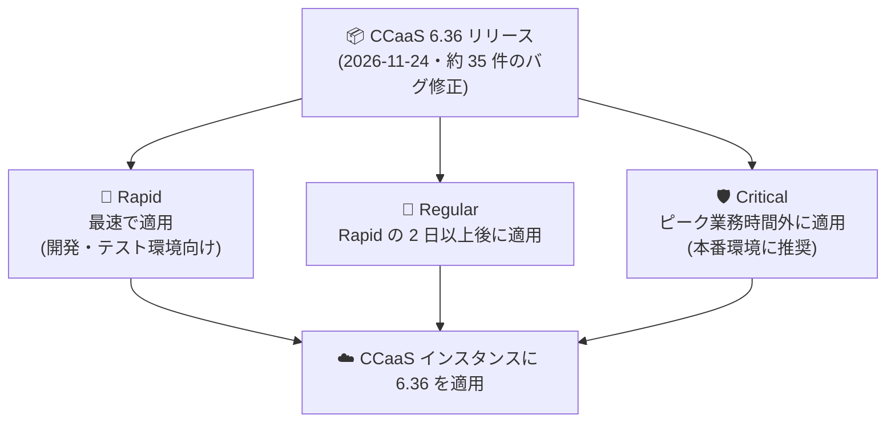

# Google Cloud Contact Center as a Service (CCaaS): バージョン 6.36 リリース (バグ修正)

**リリース日**: 2026-11-24

**サービス**: Google Cloud Contact Center as a Service (CCaaS)

**機能**: バージョン 6.36 リリース (約 35 件のバグ修正)

**ステータス**: Announcement (リリース済み)

📊 [このアップデートのインフォグラフィックを見る](https://takech9203.github.io/google-cloud-news-summary/20261124-ccaas-6-36.html)

## 概要

Google Cloud CCaaS (旧 CCAI Platform) のバージョン 6.36 がリリースされました。本リリースは新機能を含まないバグ修正リリースで、約 35 件の不具合が修正されています。修正範囲はコールルーティング・キューイング、仮想エージェント (Virtual Agent) のエスカレーション処理、レポーティングの精度、CRM・外部サービス連携、プラットフォームのパフォーマンスと安定性、UI・ローカライゼーションと多岐にわたります。

各インスタンスへの適用タイミングは、選択しているデプロイメントスケジュール (Rapid / Regular / Critical) に依存します。Rapid は最速で適用され、Regular は Rapid の 2 日以上後、Critical はピーク業務時間外に適用されます (本番環境には Critical が推奨されています)。

**アップデート前の課題**

バージョン 6.36 以前には、以下のような不具合が存在していました。

- フェイルオーバーやタイムアウトなどのタイミング依存の障害時に、チャットやコール、エージェントの予約状態が「スタック」したまま復帰しない問題が複数存在した
- 転送コールのキュー滞在時間や仮想エージェントのタイムスタンプなど、レポーティングデータが不正確になるケースがあった
- Vertex AI の旧モデル廃止に伴い、スマートディスポジション (通話後の対応内容サジェスト) が候補を返さなくなっていた
- 高負荷時のメッセージ参照や着信音の再読み込みにより、プラットフォーム全体の性能低下や接続障害が発生することがあった

**アップデート後の改善**

- フェイルオーバー・タイムアウト時のスタック状態 (モバイルチャット、IVR エスカレーション、エージェント予約など) が解消され、復旧性が向上した
- キュー滞在時間、仮想エージェントの接続タイムスタンプ・処理時間、Telnyx 着信のキャンセル分類など、レポーティング精度が改善された
- スマートディスポジションの基盤モデルが更新され、サジェストが再び機能するようになった
- 大量のメッセージ参照や着信音リクエストに起因する性能問題が解消され、高トラフィック時の安定性が向上した

## アーキテクチャ図

バージョン 6.36 の適用タイミングは、インスタンスごとに選択しているデプロイメントスケジュールによって決まります。

## サービスアップデートの詳細

本リリースの修正内容を領域ごとに整理すると以下のとおりです。

### 主要な修正内容

1. **コールルーティング・キューイング**
   - ネストされたオーバーキャパシティデフレクション時に、ボイスメールが宛先キューではなく対象エージェントに誤って紐付けられる問題を修正
   - 高度なコールスケジューリングで、スロットが静的キャパシティ上限に達した後も予約を受け付けてしまう (オーバーブッキング) 問題を修正
   - 仮想エージェントからのエスカレーションやエージェント間転送時に、エージェントが設定した対応可能時間 (availability hours) が無視され、勤務時間外のエージェントにコールがルーティングされる問題を修正
   - 対応可能チェックのタイムアウト時に、新しいコールが待機制限を回避して古いコールを追い越してしまうキュー順序の問題を修正
   - キュー内アナウンス有効時に、発信者がプライマリキューに長時間留まり続ける問題を修正
   - アクティブな SMS チャットを、転送先として表示されている他の SMS キューに転送できない問題を修正
   - 自動リダイレクト設定のある親キューへの転送時に発信者が切断される問題、および自動リダイレクトとエージェント優先度オーバーライドを併用したキューへの転送時に不要なアウトバウンド API 呼び出しが発生する問題を修正
   - カスケードグループのタイマー満了後も自動応答コールが保留され続ける問題と、キューからカスケードグループを削除できず「Internal server error」が発生する問題を修正
   - アサインの瞬間にアナウンスへ迂回したコールが原因で、エージェントが予約状態のままスタックし新規コールを受けられなくなる問題を修正

2. **仮想エージェント (Virtual Agent)**
   - IVR の仮想エージェントエスカレーションで、リダイレクトリクエストのタイムアウト時にコールが接続状態のままスタックする問題を修正
   - メディアストリームの切断が検知されず、仮想エージェントとの会話が技術エラーメッセージで終了する問題、およびセッションが会話の途中で予期せず終了しデフォルトのエントリキューへ誤ルーティングされる問題を修正
   - 仮想エージェントセッションのメディアストリームエラー後に、ポストセッションサーベイから発信者が切断される問題を修正
   - 人間のエージェントキューへの転送前に顧客が切断した仮想エージェントコールバックが、システムエラーとして誤記録される問題を修正
   - スマートディスポジションが、基盤となる Vertex AI モデルの廃止 (リタイア) によりサジェストを返さなくなっていた問題を修正
   - タスク型仮想エージェントセッションの終了・キャンセル後に、非アクティブチャットの解散タイマーがリセットされない問題を修正

3. **レポーティング・データ精度**
   - 仮想エージェントコールの接続タイムスタンプとハンドル時間 (handle duration) が不正確に記録される問題を修正
   - 転送コールのキュー滞在時間が、キュー内アナウンスのたびに待機時間がリセットされることで不正確になる問題を修正
   - 応答前に発信者がキャンセルした Telnyx の着信コールが、エンドユーザーの放棄ではなく「Agent canceled」として誤記録・誤表示される問題を修正
   - プレセッション SmartActions の表示時刻や写真数の欠損により、該当チャットセッションの SmartActions レポーティングデータがすべて欠落する問題を修正

4. **CRM・外部サービス連携**
   - CRM へのアップロード失敗後も、アウトバウンドのメディア添付ファイルがアップロード保留状態のまま残り続ける問題を修正
   - 再訪した SDK ユーザーが Salesforce で正しく識別されず、重複した連絡先レコードが作成される問題を修正
   - カスタムの外部ストレージパステンプレートとファイル名規則が、セッションサマリーのエクスポートに適用されない問題を修正

5. **パフォーマンス・安定性**
   - フェイルオーバーがチャットのタイムアウト予定時刻と重なった場合に、モバイルアプリのチャットが「Ongoing」ステータスのまま無期限にスタックする問題を修正
   - 大量の音声メッセージ (audible message) 参照により、コール設定・時間外メッセージ・CCaaS ポータル一覧表示が遅延する問題を修正
   - インスタンス設定の変更のたびにエージェントアダプターがカスタム着信音を不必要に再読み込みし、高トラフィック時にプラットフォームの不安定化や接続障害を引き起こす問題、および複数エージェントウィンドウからの同時着信音リクエストによる大幅な性能低下を修正
   - カスタムエージェントデスクトップパネルの保存時に、全アクティブユーザーに対してシステムの不安定化や接続タイムアウトが発生する問題を修正
   - エージェント別・チーム別の挨拶メッセージが、グローバルの音声設定参照に誤って含まれる問題を修正
   - 仮想エージェントのエスカレーション失敗時や高サーバー負荷時に切断すると、発信者側でリクエストタイムアウトが発生する問題を修正

6. **UI・ローカライゼーション**
   - ブラウザの localStorage が満杯の場合に DTMF 信号が送信されず、IVR ナビゲーションがサイレントに失敗する問題を修正
   - 言語設定がフランス語 (カナダ) の場合に、コールアダプターの自己参加者サフィックスとコール種別が英語で表示される問題を修正
   - 名前に特定の日本語文字を含むユーザーでチャットウィジェットが起動しない問題を修正

## 技術仕様

### デプロイメントスケジュールと適用タイミング

| スケジュール | 適用タイミング | 推奨環境 |
|------|------|------|
| Rapid | 最速で適用 | 開発・テストなど非本番環境 |
| Regular | Rapid 適用から 2 日以上後 | - |
| Critical | ピーク業務時間外に適用 (通常 Rapid 完了後 1 週間以内、遅延の可能性あり) | 本番環境 |

セキュリティパッチは Regular / Critical でも遅延なく即時適用されます。リリースはおおよそ 3 週間ごとに行われ、アップグレードのブロックは最大 1 リリース分 (約 6 週間) までです。

## メリット

### ビジネス面

- **顧客体験の改善**: 発信者のキュー内スタック、キュー順序の追い越し、チャットウィジェットの起動失敗 (日本語名ユーザー) など、エンドユーザーに直接影響する不具合が解消される
- **レポーティングの信頼性向上**: キュー滞在時間、仮想エージェントのハンドル時間、放棄コールの分類などの精度が改善され、KPI 分析やワークフォースマネジメントの正確性が向上する

### 技術面

- **高負荷時の安定性向上**: 着信音の再読み込みや音声メッセージ参照に起因する性能問題が解消され、高トラフィック時の接続障害リスクが低減する
- **障害時の復旧性向上**: フェイルオーバーやタイムアウトと重なった際のスタック状態 (チャット、コール、エージェント予約) が解消される

## デメリット・制約事項

### 考慮すべき点

- 適用タイミングはインスタンスのデプロイメントスケジュールに依存するため、本番環境 (Critical) への反映は Rapid 環境より遅れる
- 本リリースは新機能を含まないため、新たな設定作業は不要だが、修正対象の不具合に対する独自の回避策 (ワークアラウンド) を実施している場合は、適用後に見直しを推奨

## 関連サービス・機能

- **Conversational Agents (Dialogflow) / 仮想エージェント**: 本リリースでエスカレーション・転送・メディアストリーム関連の多数の修正が行われた対象
- **Vertex AI**: スマートディスポジションの基盤モデルとして利用されており、旧モデル廃止に伴う不具合が修正された
- **Salesforce / CRM 連携**: SDK ユーザーの重複連絡先レコード作成やメディア添付のアップロード保留の修正が含まれる
- **Telnyx**: テレフォニープロバイダーとしての着信コールのキャンセル分類が修正された

## 参考リンク

- 📊 [インフォグラフィック](https://takech9203.github.io/google-cloud-news-summary/20261124-ccaas-6-36.html)
- [公式リリースノート (Google Cloud Release Notes)](https://docs.cloud.google.com/release-notes#November_24_2026)
- [CCaaS リリースノート](https://docs.cloud.google.com/contact-center/ccai-platform/docs/release-notes)
- [デプロイメントスケジュール](https://docs.cloud.google.com/contact-center/ccai-platform/docs/deployment-schedules)

## まとめ

CCaaS 6.36 は新機能のないバグ修正リリースですが、ルーティング精度、レポーティングの信頼性、高負荷時の安定性に関わる約 35 件の修正を含む重要なアップデートです。CCaaS を本番運用している場合は、自社インスタンスのデプロイメントスケジュールを確認し、既知の不具合に対して実施中のワークアラウンドがあれば適用後に見直すことを推奨します。

---

**タグ**: #CCaaS #ContactCenter #CCAIPlatform #BugFix #リリース6.36
