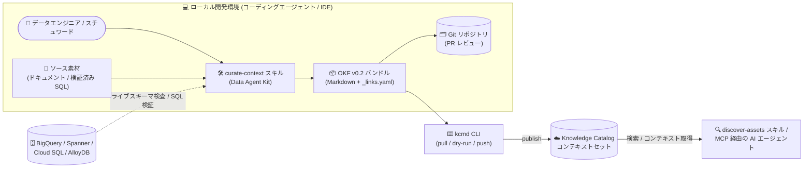

# Knowledge Catalog: Data Agent Kit の curate-context スキルによるコンテキストセットのローカルキュレーション (Preview)

**リリース日**: 2026-11-24

**サービス**: Knowledge Catalog (旧 Dataplex Universal Catalog)

**機能**: Google Cloud Data Agent Kit の curate-context スキル

**ステータス**: Preview

📊 [このアップデートのインフォグラフィックを見る](https://takech9203.github.io/google-cloud-news-summary/20261124-knowledge-catalog-curate-context-data-agent-kit.html)

## 概要

Google Cloud Data Agent Kit の **curate-context スキル**が Preview として利用可能になりました。対応するコーディングエージェント (Antigravity CLI、Claude Code、Codex CLI、VS Code およびその派生 IDE など) 上で、Knowledge Catalog (旧 Dataplex Universal Catalog) の**コンテキストセット**を Open Knowledge Format (OKF v0.2) の Markdown バンドルとしてローカルに作成・インポート・編集・検証できます。作成したバンドルは **kcmd CLI** (`@google-cloud/kcmd` npm パッケージ) で Knowledge Catalog に公開し、同梱の **discover-assets スキル**でコンテキストセットの取得 (リトリーバル) をテストできます。

コンテキストセットは、テーブルのガイダンス、ビジネス定義、検証済み SQL などのドメイン知識をパッケージ化し、AI エージェントを一貫したドメイン知識でグラウンディングするための仕組みです。今回のアップデートにより、これらを Git などのバージョン管理システム配下のローカル Markdown ファイルとして「Metadata as Code」のスタイルで管理できるようになりました。データエンジニア、アナリティクスエンジニア、データスチュワードが主な対象ユーザーです。

Data Agent Kit で構築したコンテキストセットは、Knowledge Studio のエンリッチメントタスクで構築したコンテキストセットと同じエントリ階層を共有するため、両方のアプローチは相互運用可能です。クラウド管理のコンテキストセットをローカルに pull して、エディタやコーディングエージェントで洗練させることもできます。

**アップデート前の課題**

- コンテキストセットの作成・管理は、Google Cloud コンソールの Knowledge Studio (エンリッチメントタスク) またはプログラマティックな API / CLI によるエントリ管理が中心で、開発者が慣れたコーディングエージェントや IDE から直接オーサリングするワークフローがなかった
- テーブルガイダンスやビジネス定義、検証済み SQL を Git のプルリクエストでレビューするような、バージョン管理ベースの編集・レビューフローを組みにくかった
- 公開前に SQL の妥当性を検証したり、変更の影響範囲 (関連するコンセプト文書・テーブルページ・SQL クエリ) を確認したりする作業を開発環境内で完結できなかった

**アップデート後の改善**

- コーディングエージェントへの自然言語プロンプトで、BigQuery / Spanner / Cloud SQL / AlloyDB などのライブスキーマ検査とローカルドキュメントの取り込みを行い、OKF v0.2 Markdown バンドルとしてコンテキストセットをローカルに作成・編集できるようになった
- kcmd CLI で既存のコンテキストセットの pull、`--dry-run` による差分プレビュー、承認済みバンドルの Knowledge Catalog への push が可能になり、Git リポジトリでの PR レビューと組み合わせた「Metadata as Code」運用ができるようになった
- 保存する SQL は公開前にコンパイルチェック (BigQuery ドライラン、Spanner クエリプラン、Cloud SQL / AlloyDB の EXPLAIN) で検証され、discover-assets スキルで公開後のコンテキスト取得を即座にテストできるようになった

## アーキテクチャ図



ローカルでのオーサリング (curate-context スキルによる OKF バンドル作成) から、kcmd CLI での Knowledge Catalog への公開、discover-assets スキルやダウンストリーム AI エージェントによるコンテキスト取得までの流れを示しています。

## サービスアップデートの詳細

### 主要機能

1. **curate-context スキルによるローカルオーサリング**
   - コーディングエージェントに対して、ソーステーブル・ローカルファイル・ターゲット設定 (プロジェクト、ロケーション、コンテキストセット ID) を含むプロンプトを与えると、ライブスキーマの検査、類似 (lookalike)・ステージング・非推奨テーブルのフラグ付け、既存のビジネス用語集とのマッチングを行い、オーサリングプランを提示する
   - 提供されたソースに基づいてカラムを文書化し、カラム名からの推測による説明の捏造を避ける設計
   - 具体的な実行可能 SQL クエリを各テーブルページの `dataplex-types.global.queries` アスペクト (`userManaged: true`) に保存し、公開前にテーブル行を読まずにコンパイルチェックする (BigQuery ドライラン、Spanner クエリプラン、Cloud SQL for MySQL / PostgreSQL および AlloyDB の EXPLAIN)

2. **Open Knowledge Format (OKF v0.2) バンドル**
   - YAML フロントマター付き Markdown ファイルと `_links.yaml` を含むローカルの `bundle/` ディレクトリとしてコンテキストセットを表現
   - ルートルーター (`agents.md`)、データアセットインデックス、データセット/テーブルコンテキストページ、ビジネス文書 (コンセプトドキュメント) という段階的開示 (progressive-disclosure) レイアウトを採用
   - `_links.yaml` に `reference`、`definition`、`related` のエントリリンクを記述

3. **kcmd CLI による公開・同期**
   - スコープ付き npm パッケージ `@google-cloud/kcmd` として提供 (Node.js 22.12 以降が必要)
   - リモートのコンテキストセットのローカルへの pull、`--dry-run` フラグによる差分プレビュー、承認済みバンドルの Knowledge Catalog への push を実行
   - ルートの `catalog.yaml` ファイルを管理 (手動編集は非推奨)

4. **discover-assets スキルによるリトリーバルテスト**
   - curate-context でオーサリング・公開し、Data Agent Kit に同梱の discover-assets スキルでコンテキストセットへの問い合わせをテストできる
   - `search_entries` でコンテキストセットのエントリ (`parent_entrygroup_type=context-set`) を優先的に検索し、リモート MCP サーバーの `lookup_context` を呼び出して、エージェントの回答や SQL 生成をキュレート済み定義でグラウンディングする
   - Gemini Enterprise やカスタムエージェントも、MCP または Knowledge Catalog API を通じて公開済みコンテキストセットを読み取れる

5. **既存ワークフローとの相互運用**
   - Knowledge Studio のエンリッチメントタスクで構築したコンテキストセットと同じエントリ階層を共有し、相互運用が可能
   - 編集時は変更の波及効果 (影響を受けるコンセプト文書・テーブルページ・SQL クエリ) をフラグ表示し、プランの承認・公開プレビューの承認という明示的なヒューマンインザループを経て push する

## 技術仕様

### 構成コンポーネント

| コンポーネント | 役割 |
|------|------|
| Data Agent Kit | CLI コーディングエージェント向けプラグイン / VS Code 系 IDE 向け拡張機能。Cloud Shell と Cloud Workstations にはプリインストール |
| curate-context スキル | ライブスキーマとローカルドキュメントを検査し、コンテキストセットファイルをオーサリングし、公開前に SQL を検証するようエージェントに指示するスキル |
| OKF v0.2 バンドル | YAML フロントマター付き Markdown と `_links.yaml` を含むローカル `bundle/` ディレクトリ |
| kcmd CLI | `@google-cloud/kcmd` (スコープ付き npm パッケージ)。pull / dry-run / push と `catalog.yaml` の管理 |
| discover-assets スキル | 公開済みコンテキストセットの検索・コンテキスト取得をテストする同梱スキル |

### 対応データソース

| 項目 | 詳細 |
|------|------|
| データソース | BigQuery、Spanner、BigLake (Apache Iceberg REST カタログ、Apache Hive 用 Lakehouse ランタイムカタログ、Delta Sharing)、Cloud SQL (MySQL / PostgreSQL / SQL Server)、AlloyDB、Dataproc Metastore (Hive Metastore)。ドキュメントのみのコンテキストセットも可 |
| ローカルドキュメント | Markdown、YAML、プレーンテキスト (SOP、指標定義、ポリシー更新、注意事項など) |
| 検証済み SQL | パラメータ化された `@param` プレースホルダではなくリテラル値を使う実行可能なクエリの SQL ファイル |
| インポート | `type:` フロントマター付き Markdown、`index.md`、`_links.yaml` を含む既存の OKF v0.2 バンドル |

### 対応環境

| 環境 | インストール方法 |
|------|------|
| VS Code / Cursor などの VS Code 系 IDE | 拡張機能「Google Cloud Data Agent Kit」(Visual Studio Marketplace) |
| Antigravity (IDE / CLI / 2.0 / VS Code 拡張) | 拡張機能またはプラグイン (`agy plugin install ...`) |
| Claude Code CLI | `claude plugin marketplace add https://github.com/GoogleCloudPlatform/data-agent-kit-plugin` → `claude plugin install dak@dak-marketplace` |
| Codex CLI | `codex plugin marketplace add GoogleCloudPlatform/data-agent-kit-plugin` → `codex plugin add dak@dak-marketplace` |
| Cloud Shell / Cloud Workstations | プリインストール済み |

### バンドルのレイアウト例

```text
bundle/
├── agents.md                             # ルートルーター (Context Set)
├── assets.md                             # データアセットのインデックス
├── assets/bigquery/cymbal-analytics/
│   ├── crm.md                            # データセットインデックス
│   ├── crm/accounts.md                   # テーブルコンテキストページ
│   ├── billing.md                        # データセットインデックス
│   └── billing/mrr_movements.md          # テーブルコンテキストとクエリ
├── documents.md                          # ビジネス文書のインデックス
├── documents/net-revenue-retention.md    # コンセプトドキュメント
└── _links.yaml                           # エントリリンク
```

## 設定方法

### 前提条件

1. Google Cloud プロジェクトの作成と課金の有効化
2. 対応する IDE またはコーディングエージェントと Node.js のインストール (リモート公開には Node.js 22.12 以降)
3. Data Agent Kit のインストール (拡張機能またはプラグイン) とサインイン。プラグインの場合は gcloud CLI の認証 (`gcloud auth login && gcloud auth application-default login`)
4. 利用するサービスに応じた IAM 権限 (不足時は Data Agent Kit が通知)

### 手順

#### ステップ 1: kcmd CLI のインストール (リモート pull / publish を行う場合)

```bash
node --version   # 22.12 以降を確認
npm install -g @google-cloud/kcmd
kcmd --version
```

スコープ付きの `@google-cloud/kcmd` パッケージのみをインストールします (npm / PyPI のスコープなし `kcmd` パッケージはインストールしないこと)。ローカルの OKF ファイルのオーサリングのみであればスキップ可能で、未インストールの場合はエージェントがオーサリングプラン提示時に検出し、確認のうえインストールします。

#### ステップ 2: コンテキストセットの作成

コーディングエージェントに、ソーステーブル・ローカルファイル・ターゲット設定を含むプロンプトを入力します。

```text
Build a Knowledge Catalog context set named sales-analytics in project
cymbal-analytics (location us) from BigQuery tables
cymbal-analytics.crm.accounts and cymbal-analytics.billing.mrr_movements,
using ./docs/revenue_definitions.md and ./sql/revenue_queries.sql.
```

エージェントが提示するオーサリングプラン (ターゲットレイアウト、検出アセット、計画された OKF ファイルとリンク、競合・未解決の質問) をレビューして承認すると、`bundle/` のオーサリングと検証が行われます。

#### ステップ 3: 公開とアクセス付与

検証サマリーと公開プレビューをレビューして承認すると、kcmd 経由で Knowledge Catalog に push されます。コンテキストセットは標準のプロジェクト閲覧者ロールや Dataplex Catalog Admin から読み取りアクセスを継承しないため、公開後に明示的にリーダーアクセスを付与します。

```bash
gcloud dataplex entry-groups add-iam-policy-binding CONTEXT_SET_ID \
  --location=LOCATION \
  --project=PROJECT_ID \
  --member=PRINCIPAL \
  --role=roles/dataplex.contentUser
```

#### ステップ 4: discover-assets スキルでリトリーバルをテスト

新しいエージェントプロンプトで、「net revenue retention を計算するにはどのテーブルとフィルタを使うべきか」のようなビジネス上の質問を投げかけ、キュレートした定義でグラウンディングされた回答・SQL が返ることを確認します。Knowledge Studio の「Context sets」ページやコンテキストグラフの Explore でもエントリとリンクを確認できます。

## メリット

### ビジネス面

- **ドメイン知識の一貫したグラウンディング**: テーブルガイダンス、ビジネス定義、検証済み SQL を一元的にパッケージ化し、Gemini Enterprise やカスタムエージェントなどのダウンストリーム AI エージェントが一貫した定義で回答・SQL を生成できる
- **ガバナンスとレビューの強化**: バンドルと `catalog.yaml` を Git にコミットすることで、プルリクエストベースのレビューと変更履歴管理を実現できる。公開はプラン承認・公開プレビュー承認という明示的なヒューマンインザループを経る

### 技術面

- **Metadata as Code**: コンテキストセットをローカルの Markdown ファイルとしてコードと同様に扱え、開発者の既存ワークフロー (コーディングエージェント、IDE、Git) に自然に統合できる
- **公開前の SQL 検証**: 保存する SQL はテーブル行を読まずにコンパイルチェックされる (BigQuery ドライランは無料)。ハルシネーションしたクエリが公開されるリスクを低減
- **相互運用性**: Knowledge Studio エンリッチメントタスクと同じエントリ階層を共有するため、クラウド管理とローカルキュレーションを組み合わせられる。BigQuery 以外にも Spanner、Cloud SQL、AlloyDB、BigLake、Dataproc Metastore など複数データソースに対応

## デメリット・制約事項

### 制限事項

- **Preview 段階**: Pre-GA Offerings Terms の対象であり、サポートが限定される場合がある
- **スコープ外の操作**: エントリの認定 (certify)、IAM 許可ポリシーの変更、ビジネス用語集の用語の作成・編集 (既存用語へのリンクは可)、ソースエントリへのアスペクト書き込み、パラメータ化されたクエリテンプレートエントリのオーサリング、スキーマ結合エントリリンクの作成、OSI セマンティックオントロジー YAML のオーサリングは curate-context スキルでは行えない
- **ロケーション互換性**: 各エントリリンクのターゲットはコンテキストセットのロケーションと一致するか、グローバルなビジネス用語集の用語である必要がある。複数ロケーションのテーブルを文書化する場合はロケーションごとに別のコンテキストセットを作成する
- **クォータ**: 大規模なコンテキストセット (100 エントリ以上、または 200 リンク以上) はリージョンごとのユーザー単位エントリリンクリクエストクォータの対象
- **バージョン履歴・Git 同期は非内蔵**: Knowledge Catalog は最後に push された状態のみを保持し、Git とは自動同期しない。履歴管理には自前の Git リポジトリへのコミットが必要

### 考慮すべき点

- コンテキストセットは標準のプロジェクト閲覧者ロールや `roles/dataplex.catalogAdmin` から読み取りアクセスを継承しないため、公開後に `roles/dataplex.contentUser` を明示的に付与する必要がある
- コンテキストセットへのアクセス権はセマンティックメタデータとクエリテンプレートの読み取りを許可するのみで、基盤テーブルのアクセス制御はバイパスしない (ゼロコピーのデータプレーンセキュリティ)
- チームメイトが先に公開した変更と競合する場合は、push を承認せず、pull して変更を再適用してから再度公開プレビューを行う運用が推奨される
- サードパーティのコーディングエージェントを使う場合、別途サブスクリプションやモデル使用料金が発生する可能性がある

## ユースケース

### ユースケース 1: 収益分析ドメインのコンテキストセットを新規作成

**シナリオ**: アナリティクスエンジニアが、CRM と課金の BigQuery テーブル、社内の指標定義ドキュメント、検証済みの収益系 SQL をもとに、AI エージェント向けの収益分析コンテキストセットを整備したい。

**実装例**:
```text
Build a Knowledge Catalog context set named sales-analytics in project
cymbal-analytics (location us) from BigQuery tables
cymbal-analytics.crm.accounts and cymbal-analytics.billing.mrr_movements,
using ./docs/revenue_definitions.md and ./sql/revenue_queries.sql.
```

**効果**: 類似・ステージング・非推奨テーブルの除外確認を経て、検証済み SQL とビジネス定義を含むコンテキストセットが公開され、discover-assets や Gemini Enterprise 経由のエージェントがキュレート済み定義でグラウンディングされた SQL を生成できる。

### ユースケース 2: ポリシー変更に伴う既存コンテキストセットの更新

**シナリオ**: データスチュワードが、Q4 のポリシー更新 (社内テストアカウントの除外) を net-revenue-retention の定義に反映させたい。

**実装例**:
```text
Pull the sales-analytics context set from project cymbal-analytics (location us).
Update the net-revenue-retention definition to exclude internal test accounts
(test_account_flag = FALSE) based on ./docs/q4_policy_update.md, check for
affected queries, and publish the update.
```

**効果**: 影響を受けるコンセプト文書・テーブルページ・SQL クエリが波及効果としてフラグ表示され、レビュー・承認を経て一貫性を保ったまま更新を公開できる。

### ユースケース 3: 公開済みコンテキストセットのリトリーバルテスト

**シナリオ**: 公開したコンテキストセットが実際にエージェントの回答をグラウンディングするか検証したい。

**実装例**: 新しいエージェントプロンプトで discover-assets スキルを通じて質問する。
```text
Which tables and filters should I use to calculate net revenue retention?
Write a BigQuery SQL query for monthly expansion MRR using our curated revenue context.
```

**効果**: コンテキストセットのエントリが優先的に検索され (`parent_entrygroup_type=context-set`)、リモート MCP サーバーの `lookup_context` を通じてキュレート済み定義に基づく回答・SQL が返ることを確認できる。

## 料金

- **メタデータストレージ**: コンテキストセットは標準の Knowledge Catalog エントリグループ・カスタムエントリ・アスペクトとして保存され、エントリが作成されると標準の Knowledge Catalog メタデータストレージ料金が、エントリグループをホストするプロジェクトに適用される。空のエントリグループには課金されない
- **SQL 検証**: SQL コンパイルチェックはテーブル行を読み取らない。BigQuery ドライランはクエリ料金が発生せず、Spanner / Cloud SQL / AlloyDB のクエリプラン・EXPLAIN は既存のプロビジョニング済みインスタンスを使用 (標準のインスタンス料金が適用)
- **任意のライブテストクエリ**: 集計や行数制限でスコープされたライブテストクエリを実行した場合は標準のクエリ料金が発生
- **コーディングエージェント**: サードパーティのコーディングエージェントを使用する場合、別途サブスクリプションまたはモデル使用料金が発生する可能性がある

詳細は [Knowledge Catalog の料金ページ](https://cloud.google.com/products/knowledge-catalog/pricing) および [BigQuery の料金ページ](https://cloud.google.com/bigquery/pricing) を参照してください。

## 関連サービス・機能

- **Knowledge Studio**: Google Cloud コンソールでのコンテキストセットの閲覧・管理、エンリッチメントタスクによるクラウド管理のコンテキストセット構築。Data Agent Kit によるローカルキュレーションと同じエントリ階層を共有し相互運用可能
- **Knowledge Catalog リモート MCP サーバー**: 公開済みコンテキストセットを `search_entries` / `lookup_context` を通じてダウンストリーム AI エージェントに公開。discover-assets スキルのバックエンド
- **BigQuery / Spanner / BigLake / Cloud SQL / AlloyDB / Dataproc Metastore**: curate-context スキルが対応するデータソース。ライブスキーマ検査と SQL 検証の対象
- **Gemini Enterprise / Agent Development Kit (ADK)**: 公開済みコンテキストセットを MCP または Knowledge Catalog API (`ListEntries` / `LookupEntry`) 経由で消費し、回答や SQL 生成をグラウンディングするエージェント基盤
- **Dataplex (gcloud CLI / IAM)**: `gcloud dataplex entries list` によるエントリ確認、`gcloud dataplex entry-groups add-iam-policy-binding` による `roles/dataplex.contentUser` の付与

## 参考リンク

- 📊 [インフォグラフィック](https://takech9203.github.io/google-cloud-news-summary/20261124-knowledge-catalog-curate-context-data-agent-kit.html)
- [公式リリースノート](https://docs.cloud.google.com/release-notes#November_24_2026)
- [Curate context sets with Data Agent Kit](https://docs.cloud.google.com/knowledge-catalog/docs/curate-context-sets-data-agent-kit)
- [Context sets overview](https://docs.cloud.google.com/knowledge-catalog/docs/context-sets)
- [Install Data Agent Kit](https://docs.cloud.google.com/data-agent-kit/install)
- [Data Agent Kit overview](https://docs.cloud.google.com/data-agent-kit/overview)
- [Open Knowledge Format リポジトリ (GitHub)](https://github.com/GoogleCloudPlatform/open-knowledge-format)
- [data-agent-kit-plugin リポジトリ (GitHub)](https://github.com/GoogleCloudPlatform/data-agent-kit-plugin)
- [Knowledge Catalog 料金ページ](https://cloud.google.com/products/knowledge-catalog/pricing)

## まとめ

curate-context スキルの Preview 提供により、Knowledge Catalog のコンテキストセットを「Metadata as Code」として、使い慣れたコーディングエージェントと Git ワークフローの中でキュレーションできるようになりました。公開前の SQL コンパイルチェックや明示的な承認フローにより、AI エージェントをグラウンディングするドメイン知識の品質を保ちながら運用できます。データガバナンスと生成 AI 活用を両立させたいチームは、Data Agent Kit をインストールし、小規模なドメインのコンテキストセットから試行を始めることをおすすめします。

---

**タグ**: #KnowledgeCatalog #Dataplex #DataAgentKit #ContextSets #OKF #kcmd #MCP #DataGovernance #Preview
