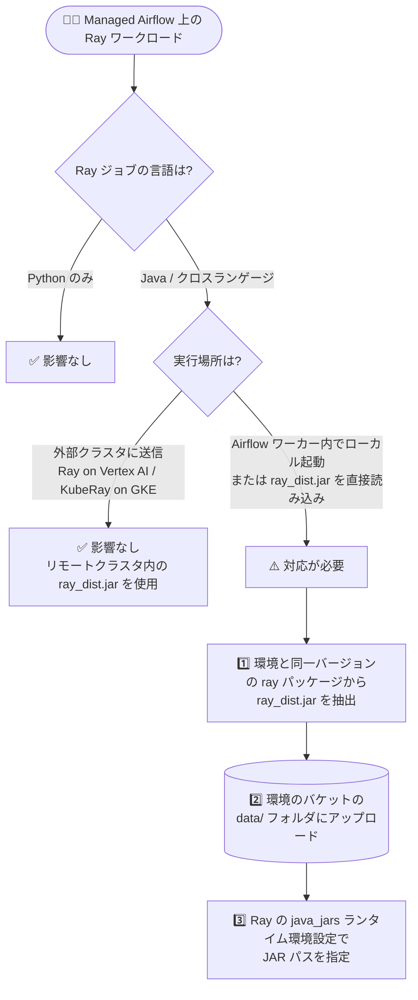
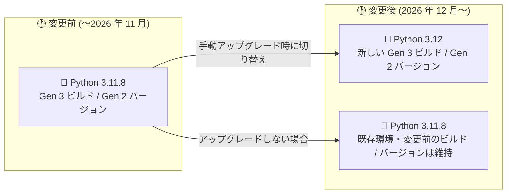

# Managed Service for Apache Airflow: 2026 年 12 月のランタイム変更 (Ray の ray_dist.jar プリインストール廃止 / Python 3.12 移行) 事前発表

**リリース日**: 2026-11-24

**サービス**: Managed Service for Apache Airflow (Managed Airflow)

**機能**: 2026 年 12 月のランタイム変更 (ray_dist.jar プリインストール廃止 / Python 3.12 移行)

**ステータス**: 事前発表 (Announcement、2026 年 12 月に適用予定)

📊 [このアップデートのインフォグラフィックを見る](https://takech9203.github.io/google-cloud-news-summary/20261124-managed-airflow-december-2026-runtime-changes.html)

## 概要

Managed Service for Apache Airflow (Managed Airflow、旧 Cloud Composer) について、2026 年 12 月に予定されている 2 つのランタイム変更が事前発表されました。いずれも既存環境には即座に影響せず、新しいバージョン / ビルドへのアップグレード時に適用される変更です。

1 つ目は **Ray の Java ランタイム (ray_dist.jar) のプリインストール廃止**です。2026 年 12 月以降、新しい Managed Airflow イメージ / ビルドは `site-packages/ray/jars/ray_dist.jar` (Ray が Java / クロスランゲージ (Python-Java) ワークロードに使用する Java ランタイム) をプリインストールしなくなります。Python のみの Ray ワークロードや、外部クラスタ (Ray on Vertex AI、KubeRay on GKE など) に送信するリモート Java / クロスランゲージジョブは影響を受けません。対応が必要なのは、Airflow ワーカー内で直接ローカル Java / クロスランゲージ Ray ランタイムを起動するワークロード、または `ray_dist.jar` を直接読み込むカスタムコードのみです。

2 つ目は **Python 3.12 への移行**です。2026 年 12 月以降、Managed Airflow (Gen 3) の新しい Airflow ビルドと Managed Airflow (Gen 2) の新しいバージョンが Python 3.12 を使用し、Python 3.11.8 は新しいバージョン / ビルドでは提供されなくなります。既存環境は手動でアップグレードするまで Python 3.11.8 を使い続けます。Airflow 環境を運用するプラットフォームチームや、カスタム PyPI パッケージ・Ray ワークロードを利用するデータエンジニアリングチームは、12 月以降のアップグレード計画に先立って影響範囲の確認が推奨されます。

**アップデート前 (現行) の状態**

- Managed Airflow のイメージ / ビルドには `site-packages/ray/jars/ray_dist.jar` がプリインストールされており、Airflow ワーカー内でローカルに Java / クロスランゲージ Ray ランタイムを起動するワークロードがそのまま動作していた
- Managed Airflow (Gen 3) のビルドおよび (Gen 2) のバージョンは Python 3.11.8 を使用していた

**アップデート後 (2026 年 12 月以降) の変更**

- 新しいイメージ / ビルドでは `ray_dist.jar` がプリインストールされなくなり、ローカル Java / クロスランゲージ Ray ランタイムを使うワークロードは JAR の手動供給 (抽出 → `data/` フォルダへのアップロード → `java_jars` 指定) が必要になる
- 新しい Airflow ビルド (Gen 3) / バージョン (Gen 2) は Python 3.12 に切り替わり、Python 3.11.8 は新規提供されなくなる
- いずれの変更も、既存環境は該当するバージョン / ビルドにアップグレードした時点で初めて影響を受ける (アップグレードしない限り現状維持)

## アーキテクチャ図

### Ray ワークロードの影響判定フロー



Airflow ワーカー内でローカルに Java / クロスランゲージ Ray ランタイムを起動する場合のみ、`ray_dist.jar` を手動で供給する 3 ステップの対応が必要です。それ以外の Ray 利用パターンは影響を受けません。

### Python バージョンの Before / After



Python 3.12 への切り替えは強制移行ではなく、新しいビルド / バージョンへの手動アップグレードを実行した時点で適用されます。

## サービスアップデートの詳細

### 発表 1: Ray の Java ランタイム (ray_dist.jar) のプリインストール廃止

1. **変更内容**
   - 2026 年 12 月以降、新しい Managed Airflow イメージ / ビルドは `site-packages/ray/jars/ray_dist.jar` をプリインストールしない
   - `ray_dist.jar` は Ray が Java および クロスランゲージ (Python-Java) ワークロードに使用する Java ランタイム

2. **影響範囲の判定基準**

   | ワークロードのパターン | 影響 |
   |----------------------|------|
   | Python のみの Ray ワークロード | ✅ 影響なし |
   | 外部クラスタ (Ray on Vertex AI、KubeRay on GKE など) に送信するリモート Java / クロスランゲージ Ray ジョブ | ✅ 影響なし (リモートクラスタイメージ内の `ray_dist.jar` を使用するため) |
   | Airflow ワーカー内で直接ローカル Java / クロスランゲージ Ray ランタイムを起動するワークロード | ⚠️ 対応が必要 |
   | `site-packages/ray/jars/ray_dist.jar` を直接読み込むカスタムコード | ⚠️ 対応が必要 |

3. **既存環境への影響タイミング**
   - 既存環境は、`ray/jars/ray_dist.jar` がプリインストールされないバージョン / ビルドにアップグレードした時点で影響を受ける
   - アップグレードしない限り、現行環境の動作は変わらない

### 発表 2: Python 3.12 への移行

1. **変更内容**
   - 2026 年 12 月以降、Managed Airflow (Gen 3) の新しい Airflow ビルドと Managed Airflow (Gen 2) の新しいバージョンが Python 3.12 に切り替わる
   - Python 3.11.8 は新しいバージョン / ビルドでは提供されなくなる

2. **既存環境の扱い**
   - 既存の Managed Airflow (Gen 3) 環境は、Python 3.12 を使用するビルドに手動でアップグレードするまで Python 3.11.8 を使い続ける
   - 既存の Managed Airflow (Gen 2) 環境は、Python 3.12 を使用するバージョンに手動でアップグレードするまで Python 3.11.8 を使い続ける
   - 変更前にリリースされたビルド (Gen 3) / バージョン (Gen 2) は Python 3.11.8 を維持する

3. **Python バージョンポリシーとの関係**
   - Managed Airflow では、環境の作成後に既存環境を別のマイナー Python バージョンへ切り替えることはできない ([Python バージョンのドキュメント](https://docs.cloud.google.com/composer/docs/python-version) 参照)。Python バージョンの変更はイメージ / ビルドのアップグレードを通じて行われる

## 技術仕様

### ray_dist.jar 対応で使用する環境バケットの data/ フォルダ

| 項目 | 詳細 |
|------|------|
| ストレージパス | `gs://{bucket-name}/data` |
| Airflow コンポーネント上のマップ先 | `/home/airflow/gcs/data` |
| 同期先 | Airflow スケジューラとワーカーに同期 (Web サーバー、トリガラーには同期されない) |
| 同期方式 | Cloud Storage FUSE による一方向同期 (バケット → Airflow コンポーネント) |

Airflow ワーカーから `/home/airflow/gcs/data/` 配下のパスで JAR ファイルを参照できるため、Ray の `java_jars` 設定にはこのパスを指定します。

### Ray の java_jars ランタイム環境設定 (概念例)

```python
# Ray の runtime_env で java_jars に JAR パスを指定する概念例
runtime_env = {
    "java_jars": [
        "/home/airflow/gcs/data/ray_dist.jar",
    ],
}
```

## 対応方法

### 発表 1 (ray_dist.jar) への対応手順

対象: Airflow ワーカー内で直接ローカル Java / クロスランゲージ Ray ランタイムを起動するワークロード、または `ray_dist.jar` を直接読み込むカスタムコードを持つ環境のみ。

#### ステップ 1: 環境と同一バージョンの ray パッケージから ray_dist.jar を抽出

環境にインストールされている `ray` パッケージと**同一バージョン**から `ray_dist.jar` を抽出します。環境内のパッケージ一覧は [Preinstalled packages changelog](https://docs.cloud.google.com/composer/docs/versions-packages) で確認できます。

#### ステップ 2: 環境のバケットの data/ フォルダにアップロード

```bash
# 環境のバケットの data/ フォルダに JAR をアップロード
gcloud composer environments storage data import \
  --environment=ENVIRONMENT_NAME \
  --location=LOCATION \
  --source=ray_dist.jar
```

`data/` フォルダの内容は Airflow ワーカーの `/home/airflow/gcs/data/` に同期されます。

#### ステップ 3: Ray の java_jars ランタイム環境設定で JAR パスを指定

Ray ジョブのランタイム環境設定 (`java_jars` オプション) に、アップロードした JAR のパスを追加します。

### 発表 2 (Python 3.12) への対応

1. 環境で使用しているカスタム PyPI パッケージの Python 3.12 互換性を事前に確認する
2. 2026 年 12 月以降、Python 3.12 を使用するビルド (Gen 3) / バージョン (Gen 2) へ計画的に手動アップグレードする
3. すぐに移行しない場合も、変更前にリリースされたビルド / バージョンは Python 3.11.8 を維持するため、既存環境は影響を受けない

## メリット

### ビジネス面

- **十分な準備期間**: 2026 年 11 月の事前発表から 12 月の適用まで猶予があり、既存環境はアップグレードするまで影響を受けないため、計画的な移行が可能
- **影響範囲の明確化**: Ray ワークロードの影響有無が利用パターンごとに明示されており、対応要否の判断が容易

### 技術面

- **最新 Python ランタイムへの移行**: Python 3.12 により、最新の言語機能とパフォーマンス改善、より長いアップストリームサポート期間を利用できる
- **イメージのスリム化**: 大半のユーザーが使用しない Java ランタイム (ray_dist.jar) をプリインストールから外すことで、必要なユーザーのみが JAR を明示的に管理する構成になる

## デメリット・制約事項

### 制限事項

- 2026 年 12 月以降の新しいビルド / バージョンでは Python 3.11.8 を選択できない
- 既存環境を別のマイナー Python バージョンに直接切り替えることはできない (ビルド / バージョンのアップグレードを通じて変更される)
- `ray_dist.jar` を手動供給する場合、環境にインストールされている `ray` パッケージと同一バージョンの JAR を使用する必要がある

### 考慮すべき点

- ローカル Java / クロスランゲージ Ray ランタイムを使用している環境は、アップグレード前に JAR の供給手順 (抽出 → アップロード → `java_jars` 指定) を完了しておく必要がある
- 環境のアップグレードや `ray` パッケージのバージョン変更の際は、`data/` フォルダ内の `ray_dist.jar` もパッケージと同一バージョンに合わせて更新する運用が必要になる
- Python 3.12 への移行前に、カスタム PyPI パッケージや DAG コードの互換性検証を行うことが望ましい (過去の Python 3.8 → 3.11 移行時にも、アップグレード前のパッケージ互換性確認が公式に案内されていた)
- `data/` フォルダは Web サーバーとトリガラーには同期されないため、JAR を参照できるのはスケジューラとワーカー上のコードに限られる

## ユースケース

### ユースケース 1: Airflow ワーカー内でローカル Java / クロスランゲージ Ray ランタイムを使用している環境の移行

**シナリオ**: DAG のタスク内で Ray のクロスランゲージ (Python-Java) 機能をローカル起動で使用しており、2026 年 12 月以降のビルドへアップグレードを予定している。

**実装例**:
```bash
# 1. Preinstalled packages changelog で環境の ray パッケージバージョンを確認
#    https://docs.cloud.google.com/composer/docs/versions-packages

# 2. 同一バージョンの ray パッケージから ray_dist.jar を抽出し、
#    環境のバケットの data/ フォルダにアップロード
gcloud composer environments storage data import \
  --environment=my-airflow-env \
  --location=us-central1 \
  --source=ray_dist.jar

# 3. Ray ジョブの runtime_env の java_jars に
#    /home/airflow/gcs/data/ray_dist.jar を指定
```

**効果**: 新しいビルドへのアップグレード後も、ローカル Java / クロスランゲージ Ray ワークロードを継続して実行できる。

### ユースケース 2: Python のみの Ray ワークロードと外部 Ray クラスタ利用環境の確認

**シナリオ**: DAG から Ray on Vertex AI や KubeRay on GKE にジョブを送信している、または Python のみの Ray ワークロードを実行している。

**効果**: いずれのパターンも今回の `ray_dist.jar` 変更の影響を受けないことを確認でき、対応作業なしで新しいビルド / バージョンへアップグレードできる (Python 3.12 互換性の確認は別途推奨)。

### ユースケース 3: Python 3.12 移行の計画策定

**シナリオ**: 多数のカスタム PyPI パッケージを利用する Managed Airflow (Gen 2 / Gen 3) 環境を運用しており、2026 年 12 月以降のアップグレードを計画している。

**効果**: 既存環境は手動アップグレードまで Python 3.11.8 を維持するため、開発環境で Python 3.12 互換性を検証してから本番環境を段階的にアップグレードする、リスクを抑えた移行計画を立てられる。

## 料金

今回の変更自体による料金への影響は発表されていません。Managed Airflow の料金は以下のページを参照してください。

- [Cloud Composer / Managed Airflow の料金](https://cloud.google.com/composer/pricing)

## 関連サービス・機能

- **Ray on Vertex AI**: Managed Airflow から Java / クロスランゲージ Ray ジョブを送信する外部クラスタ。リモートクラスタイメージ内の `ray_dist.jar` を使用するため、今回の変更の影響を受けない
- **GKE (KubeRay)**: GKE 上で KubeRay によりセルフマネージドの Ray クラスタを運用するパターン。こちらも外部クラスタのためローカル JAR 廃止の影響を受けない
- **Cloud Storage**: Managed Airflow 環境のバケット。`data/` フォルダが Cloud Storage FUSE でスケジューラ / ワーカーに同期され、`ray_dist.jar` の配布に使用する

## 参考リンク

- 📊 [インフォグラフィック](https://takech9203.github.io/google-cloud-news-summary/20261124-managed-airflow-december-2026-runtime-changes.html)
- [公式リリースノート (2026 年 11 月 24 日)](https://docs.cloud.google.com/release-notes#November_24_2026)
- [Managed Airflow リリースノート](https://docs.cloud.google.com/composer/docs/release-notes)
- [Preinstalled packages changelog (バージョン別パッケージ一覧)](https://docs.cloud.google.com/composer/docs/versions-packages)
- [Managed Airflow の Python バージョン](https://docs.cloud.google.com/composer/docs/python-version)
- [環境のバケットに保存されるデータ (data/ フォルダ)](https://docs.cloud.google.com/composer/docs/composer-3/cloud-storage)
- [料金ページ](https://cloud.google.com/composer/pricing)

## まとめ

2026 年 12 月以降、Managed Airflow の新しいビルド / バージョンでは Ray の Java ランタイム (`ray_dist.jar`) がプリインストールされなくなり、Python ランタイムが 3.12 に切り替わります。いずれも既存環境はアップグレードするまで影響を受けないため、まずは Ray の利用パターン (ローカル Java / クロスランゲージ実行の有無) とカスタム PyPI パッケージの Python 3.12 互換性を棚卸しし、該当する場合は `ray_dist.jar` の手動供給手順を準備した上で、計画的なアップグレードを進めることを推奨します。

---

**タグ**: Managed Airflow, Cloud Composer, Ray, ray_dist.jar, Python 3.12, ランタイム変更, 事前発表, Gen 2, Gen 3
