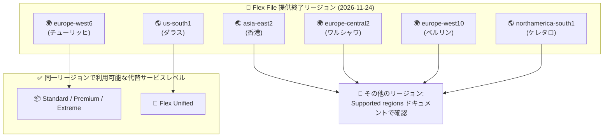

# Google Cloud NetApp Volumes: Flex File サービスレベルの提供リージョン縮小

**リリース日**: 2026-11-24

**サービス**: Google Cloud NetApp Volumes

**機能**: Flex File サービスレベルの提供リージョン縮小 (6 リージョンで提供終了)

**ステータス**: 提供終了 (Announcement)

📊 [このアップデートのインフォグラフィックを見る](https://takech9203.github.io/google-cloud-news-summary/20261124-netapp-volumes-flex-file-region-reduction.html)

## 概要

Google Cloud NetApp Volumes の **Flex File サービスレベル**が、以下の 6 リージョンで提供終了となりました。

- asia-east2 (香港)
- europe-central2 (ワルシャワ)
- europe-west6 (チューリッヒ)
- europe-west10 (ベルリン)
- northamerica-south1 (ケレタロ)
- us-south1 (ダラス)

一方、他のサービスレベルは引き続き提供されます。europe-west6 (チューリッヒ) では **Standard / Premium / Extreme** が、us-south1 (ダラス) では **Flex Unified** が利用可能です。

この発表は、Flex File サービスレベルの段階的な廃止 (フェーズアウト) の一環です。公式ドキュメントによると、Flex Unified サービスレベルの拡大に伴い Flex File は廃止が進められており、**2026 年 9 月 15 日以降、新規の Flex File ストレージプールは作成できなくなっています** (既存プールは引き続きサポート)。Flex File を利用中のユーザーは、後継となる Flex Unified サービスレベルへの移行を計画する必要があります。

**アップデート前の課題**

- Flex File サービスレベルは上記 6 リージョンを含む多くのリージョンで提供されており、リージョンごとの提供状況を意識する必要が比較的少なかった
- 2026 年 9 月 15 日以降は新規 Flex File プールの作成が既に停止されており、Flex File と Flex Unified が併存する過渡期にあった
- Flex File はブロックストレージ (iSCSI / NVMe/TCP)、デュアルプロトコル (SMB + NFS)、ONTAP モード、大容量プール/ボリュームなどに対応しておらず、機能面で後継の Flex Unified に劣っていた

**アップデート後の改善 (変更点)**

- 対象 6 リージョンで Flex File サービスレベルの提供が終了し、サービスレベルのポートフォリオが Flex Unified を中心とした構成へ整理が進んだ
- europe-west6 では Standard / Premium / Extreme、us-south1 では Flex Unified という代替サービスレベルが引き続き利用可能
- 移行先となる Flex Unified は、ブロックストレージ、デュアルプロトコル、ONTAP モード、シンクローン、大容量プール/ボリュームなど、Flex File にはない機能を提供する

## アーキテクチャ図



Flex File の提供が終了した 6 リージョンと、リリースノートで明記された同一リージョン内の代替サービスレベルの対応を示しています。代替が明記されていないリージョンは、公式の Supported regions ドキュメントで最新の提供状況を確認してください。

## サービスアップデートの詳細

### 主要な変更点

1. **Flex File サービスレベルの 6 リージョンでの提供終了**
   - asia-east2 (香港)、europe-central2 (ワルシャワ)、europe-west6 (チューリッヒ)、europe-west10 (ベルリン)、northamerica-south1 (ケレタロ)、us-south1 (ダラス) で Flex File が利用不可に
   - 他のサービスレベルの提供状況はリージョンにより異なる

2. **代替サービスレベルの継続提供**
   - europe-west6: Standard / Premium / Extreme が引き続き利用可能
   - us-south1: Flex Unified が引き続き利用可能

3. **Flex File フェーズアウトの背景**
   - Flex Unified サービスレベルの拡大に伴い、Flex File は段階的に廃止中
   - 2026 年 9 月 15 日以降、新規 Flex File ストレージプールは作成不可 (既存プールはサポート継続)
   - 移行支援が必要な場合はサポートチーム (flex-file-migration@google.com) への連絡が案内されている

### 影響リージョンと代替サービスレベルの対応表

| リージョン | 提供終了 | 同一リージョンの代替 (リリースノート記載) |
|-----------|---------|------------------------------------------|
| asia-east2 (香港) | Flex File | 記載なし (Supported regions を参照) |
| europe-central2 (ワルシャワ) | Flex File | 記載なし (Supported regions を参照) |
| europe-west6 (チューリッヒ) | Flex File | Standard / Premium / Extreme |
| europe-west10 (ベルリン) | Flex File | 記載なし (Supported regions を参照) |
| northamerica-south1 (ケレタロ) | Flex File | 記載なし (Supported regions を参照) |
| us-south1 (ダラス) | Flex File | Flex Unified |

## 技術仕様

### サービスレベルの比較 (公式ドキュメントより)

| 項目 | Flex Unified | Flex File (レガシー) | Standard | Premium | Extreme |
|------|-------------|---------------------|----------|---------|---------|
| スループット | 大容量ボリューム利用時、プールあたり最大 22 GiB/s 共有 | Zonal: プールあたり最大 5 GiB/s 共有 / Regional: 16 MiB/s per TiB | 16 MiB/s per TiB | 64 MiB/s per TiB (最大 30 GiBps) | 128 MiB/s per TiB (最大 30 GiBps) |
| プール容量 | 1〜425 TiB (大容量プールは最大 20 PiB) | 1〜200 TiB (カスタムパフォーマンス有効時 300 TiB) | 2〜200 TiB | 2 TiB〜10 PiB | 2 TiB〜10 PiB |
| プロトコル | NFSv3/v4.1/v4.2、SMB、iSCSI、NVMe/TCP | NFSv3/v4.1、SMB | NFSv3/v4.1、SMB、デュアル | NFSv3/v4.1、SMB、デュアル | NFSv3/v4.1、SMB、デュアル |
| 高可用性 | Zonal + Regional | Zonal / Regional | Zonal (ボリュームレプリケーション可) | Zonal (同左) | Zonal (同左) |
| SLA (稼働率) | Zonal 99.9% / Regional 99.99% | Zonal 99.9% / Regional 99.99% | 99.9% | 99.95% | 99.95% |

### Flex Unified と Flex File の機能差分 (移行ガイドより)

| 機能 | Flex Unified | Flex File (レガシー) |
|------|-------------|---------------------|
| ブロックストレージ (iSCSI / NVMe/TCP) | 対応 | 非対応 |
| デュアルプロトコルボリューム (SMB + NFS) | 対応 | 非対応 |
| 自動階層化 (Auto-tiering) | 対応 | 対応 |
| ONTAP 機能 (ONTAP モードプール) | 対応 | 非対応 |
| ONTAP 連携 (SnapMirror / FlexCache) | 対応 | 非対応 |
| ファイル単位リストア・クロスリージョンバックアップ | 対応 | 非対応 |
| プールレベルの共有 QoS | 対応 | 対応 |
| シンクローン | 対応 | 非対応 |
| 大容量プール / ボリューム | 対応 | 非対応 |
| リージョナル構成 | 対応 | 対応 |

## 移行方法 (Flex File から Flex Unified へ)

既存の Flex File ボリュームは、以下の 3 つの方法で Flex Unified サービスレベルへ移行できます。

### 移行ツールの選択

| ツール | ユースケース | 考慮事項 |
|--------|-------------|---------|
| ホストベースのデータコピー (Robocopy / NetApp XCP / rsync) | ディレクトリの整理・統合、通常ボリュームから大容量ボリュームへの移動 | マウント IP アドレスが変更される |
| バックアップ & リストア | 少数の小規模ボリュームの移行 | リストア速度は約 300 GiB/時、マウント IP アドレスが変更される |
| サポート支援レプリケーション (SnapMirror) | 少数の大規模ボリュームの移行 | スナップショットと SMB 権限を保持、最終増分更新後に即時カットオーバー可能、マウント IP アドレスが変更される |

### 移行時の主な注意点

- NFS エクスポート / SMB 共有の IP アドレスが変更される (SMB の NetBIOS 名はプレフィックスを保持しつつ新しい 5 文字のサフィックスが付く)
- Flex Unified のボリューム名ではハイフンが使用できない (レプリケーションではアンダースコアに置換)。Terraform などの自動化やモニタリング設定への影響に注意
- バックアップ & リストアでは既存スナップショットは移行されない (サポート支援レプリケーションでは移行される)
- 移行完了後に元のプールを削除するまで、元のプールの課金は継続する
- サポート支援レプリケーションのベースラインコピーは通常約 1 TiB/時 (高いカスタムパフォーマンス設定のプールでは最大 2.6 TiB/時)

## メリット

### ビジネス面

- **ポートフォリオの明確化**: サービスレベルが Flex Unified 中心に整理されることで、新規導入時のサービスレベル選定が単純化される
- **移行支援の提供**: 移行専用のサポート窓口 (flex-file-migration@google.com) とサポート支援レプリケーションが用意されており、計画的な移行が可能

### 技術面

- **後継サービスレベルの機能優位性**: 移行先の Flex Unified はブロックストレージ、デュアルプロトコル、ONTAP モード、シンクローン、大容量プールなど Flex File にない機能を提供
- **性能向上の余地**: Flex Unified は大容量ボリューム利用時にプールあたり最大 22 GiB/s のスループットに対応 (Flex File Zonal は最大 5 GiB/s)

## デメリット・制約事項

### 制限事項

- 対象 6 リージョンでは Flex File サービスレベルが利用できない
- asia-east2、europe-central2、europe-west10、northamerica-south1 については、リリースノート上で同一リージョン内の代替サービスレベルが明記されていない (最新の提供状況は Supported regions ドキュメントで要確認)
- 2026 年 9 月 15 日以降、全リージョンで新規 Flex File ストレージプールの作成は不可

### 考慮すべき点

- 移行時にマウント IP アドレスが必ず変更されるため、クライアント側の再マウントとメンテナンスウィンドウの計画が必要
- ボリューム名の命名規則変更 (ハイフン不可) により、IaC やモニタリングの修正が必要になる場合がある
- Assured Workloads での Flex Unified 利用や特定リージョンの要件がある場合は、Google Cloud セールスチームへの相談が案内されている

## ユースケース

### ユースケース 1: us-south1 で Flex File を利用中のワークロードの移行

**シナリオ**: us-south1 (ダラス) の既存 Flex File プールで NFS ファイル共有を運用している。同一リージョンで Flex Unified が利用できるため、リージョンを変えずに移行したい。

**推奨アプローチ**:
```text
1. us-south1 に Flex Unified ストレージプールを作成
2. ボリュームサイズと許容ダウンタイムに応じて移行ツールを選択
   - 大規模ボリューム: サポート支援レプリケーション (スナップショット保持)
   - 小規模ボリューム: バックアップ & リストア
3. メンテナンスウィンドウでカットオーバー (クライアントの再マウント)
4. 移行完了後、旧 Flex File プールを削除して課金を停止
```

**効果**: リージョンを維持したまま、ブロックストレージや大容量ボリュームなど Flex Unified の拡張機能も利用可能になる。

### ユースケース 2: europe-west6 でのサービスレベル再選定

**シナリオ**: europe-west6 (チューリッヒ) で NetApp Volumes の利用を計画しており、Flex File を想定していた。

**効果**: 同一リージョンで提供が継続される Standard / Premium / Extreme から、ワークロードのスループット要件 (16 / 64 / 128 MiB/s per TiB) に応じてサービスレベルを選定することで、europe-west6 での利用を継続できる。

## 料金

サービスレベルごとの料金目安は以下のとおりです (us-central1 リージョン、公式製品ページより)。実際の料金はリージョンにより異なるため、料金ページで確認してください。

| サービスレベル | 料金 ($ / GiB / 月) |
|---------------|--------------------:|
| Flex Unified (Zonal + Regional) | $0.105 (カスタムプロビジョニング) |
| Flex File Zonal | $0.105 (カスタムプロビジョニング) |
| Flex File Regional | $0.40 |
| Standard | $0.20 |
| Premium | $0.29 |
| Extreme | $0.39 |

なお、移行期間中は移行完了後に元のプールを削除するまで、元のプールの課金が継続する点に注意してください。

詳細: [NetApp Volumes の料金](https://cloud.google.com/netapp/volumes/pricing)

## 利用可能リージョン

- Flex File は asia-east2、europe-central2、europe-west6、europe-west10、northamerica-south1、us-south1 の 6 リージョンで提供終了
- europe-west6 では Standard / Premium / Extreme、us-south1 では Flex Unified が引き続き利用可能
- 各サービスレベルの最新の提供リージョンは [Supported regions](https://docs.cloud.google.com/netapp/volumes/docs/discover/service-levels#supported_regions) を参照

## 関連サービス・機能

- **Flex Unified サービスレベル**: Flex File の後継。ファイルとブロックの両ストレージを単一プラットフォームで提供し、ONTAP モードにも対応
- **NetApp Volumes バックアップ**: Standard / Premium / Extreme / Flex File / Flex Unified で利用可能。移行手段 (バックアップ & リストア) としても活用できる
- **SnapMirror レプリケーション**: サポート支援による大規模ボリューム移行で使用。スナップショットや SMB 権限を保持したまま移行可能

## 参考リンク

- 📊 [インフォグラフィック](https://takech9203.github.io/google-cloud-news-summary/20261124-netapp-volumes-flex-file-region-reduction.html)
- [公式リリースノート](https://docs.cloud.google.com/release-notes#November_24_2026)
- [サービスレベルと提供リージョン (Supported regions)](https://docs.cloud.google.com/netapp/volumes/docs/discover/service-levels#supported_regions)
- [Flex Unified への移行ガイド](https://docs.cloud.google.com/netapp/volumes/docs/get-started/migration-to-flex-unified)
- [料金ページ](https://cloud.google.com/netapp/volumes/pricing)

## まとめ

Flex File サービスレベルは 2026 年 9 月の新規プール作成停止に続き、今回 6 リージョンで提供終了となり、フェーズアウトが着実に進行しています。対象リージョンで Flex File を利用中、または利用を計画していた場合は、Supported regions ドキュメントで代替サービスレベルの提供状況を確認し、後継の Flex Unified への移行 (移行ツールの選定、IP アドレス変更やボリューム命名規則への対応を含む) を早めに計画することを推奨します。

---

**タグ**: NetApp Volumes, Flex File, Flex Unified, サービスレベル, リージョン提供終了, ストレージ, 移行
