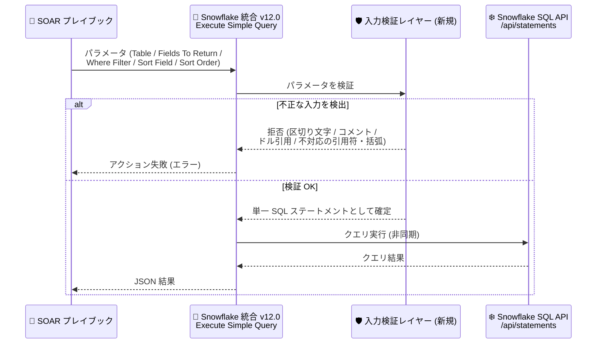

# Google SecOps Marketplace: Snowflake 統合 v12.0 — Execute Simple Query の SQL インジェクション対策 (入力検証強化)

**リリース日**: 2026-11-24

**サービス**: Google SecOps Marketplace (Response Integrations)

**機能**: Snowflake 統合 Version 12.0 — Execute Simple Query アクションの入力検証強化

**ステータス**: GA (Generally Available)

📊 [このアップデートのインフォグラフィックを見る](https://takech9203.github.io/google-cloud-news-summary/20261124-secops-marketplace-snowflake-v12.html)

## 概要

2026 年 11 月 24 日、Google SecOps Marketplace の **Snowflake 統合が Version 12.0 に更新**されました。今回の更新は新機能の追加ではなく、SOAR プレイブックから Snowflake に対してクエリを実行する **Execute Simple Query アクションのセキュリティ強化 (SQL インジェクション対策)** です。

具体的には、`Table`、`Fields To Return`、`Where Filter`、`Sort Field`、`Sort Order` の 5 つのパラメータに入力検証 (input validation) が追加され、**ステートメント区切り文字 (statement separator)、コメントマーカー、ドル引用文字列 (dollar-quoted string)、対応の取れていない引用符・括弧**を含む入力が拒否されるようになりました。あわせて、**1 回のリクエストで実行できる SQL ステートメントは 1 つに制限**されます。

SOAR の統合アクションは、アラートやケースに含まれる攻撃者由来のデータ (エンティティ値、プレースホルダ展開された文字列など) をパラメータとして受け取ることが多く、それらが SQL クエリの組み立てに使われる場合、SQL インジェクションの温床になり得ます。Snowflake はログイン履歴やクエリ履歴などのセキュリティ調査に有用なデータを保持しているため、SecOps から Snowflake を照会するプレイブックを運用している環境では、本バージョンへの早期アップデートを推奨します。

**アップデート前の課題**

- Execute Simple Query アクションは、`Table` や `Where Filter` などのパラメータ値をもとに SQL クエリを組み立てるが、パラメータに対する構文レベルの検証が行われていなかった
- プレイブックのプレースホルダ経由で攻撃者が影響を与え得る値 (アラート内のエンティティ値など) がパラメータに渡った場合、ステートメント区切り文字 (`;`) やコメントマーカーを使って意図しない SQL を注入・連結されるリスクがあった
- 1 回のリクエストに複数の SQL ステートメントが含まれることを防ぐ仕組みがなかった

**アップデート後の改善**

- `Table`、`Fields To Return`、`Where Filter`、`Sort Field`、`Sort Order` の各パラメータに入力検証が追加され、以下を含む入力が拒否されるようになった
  - ステートメント区切り文字
  - コメントマーカー
  - ドル引用文字列 (dollar-quoted string)
  - 対応の取れていない (unbalanced) 引用符や括弧
- 1 回のリクエストで実行できる SQL ステートメントが 1 つに制限され、クエリの連結による多段実行が防止された

## アーキテクチャ図

Version 12.0 では、プレイブックから渡されたパラメータが Snowflake SQL API に送られる前に入力検証レイヤーを通過するようになり、SQL インジェクションにつながる構文要素を含む入力はクエリ実行前に拒否されます。

## サービスアップデートの詳細

### 主要機能

1. **5 パラメータへの入力検証の追加**
   - 対象パラメータ: `Table`、`Fields To Return`、`Where Filter`、`Sort Field`、`Sort Order`
   - SQL インジェクションに悪用される代表的な構文要素を検出し、リクエストを拒否する

2. **拒否される入力パターン**
   - ステートメント区切り文字: 複数ステートメントの連結 (例: `... ; DROP TABLE ...` のような注入) を防止
   - コメントマーカー: クエリ後半を無効化してフィルタ条件を迂回する手口を防止
   - ドル引用文字列: Snowflake がサポートするドル引用 (`$$...$$`) を使ったエスケープ回避を防止
   - 対応の取れていない引用符・括弧: 文字列リテラルやサブクエリの構造を壊してクエリ構文を改変する手口を防止

3. **単一 SQL ステートメントへの制限**
   - Execute Simple Query の 1 回のリクエストで実行できる SQL ステートメントは 1 つのみに制限された

## 技術仕様

### Execute Simple Query アクションのパラメータ

| パラメータ | 必須 | 説明 | 今回の検証対象 |
|------|------|------|------|
| Database | 必須 | クエリ対象のデータベース名 | - |
| Table | 必須 | クエリ対象のテーブル名 | ✅ |
| Schema | 任意 | クエリ対象のスキーマ名 | - |
| Where Filter | 任意 | 結果をフィルタする WHERE 句 (`LIMIT`/`SORT` キーワードは使用不可、単一引用符のみサポート) | ✅ |
| Fields To Return | 任意 | 返すフィールドのカンマ区切りリスト (デフォルト: `*`) | ✅ |
| Sort Field | 任意 | ソートに使用するフィールド | ✅ |
| Sort Order | 任意 | ソート順 (`ASC` / `DESC`、デフォルト: `ASC`) | ✅ |
| Max Results To Return | 任意 | 1 回の実行で返す最大結果数 (デフォルト: 50) | - |

### 統合の接続仕様

| 項目 | 詳細 |
|------|------|
| 認証方式 | キーペア認証 (base64 エンコードした秘密鍵を使用) |
| 使用エンドポイント | `/api/statements?async=false` (接続テスト)、`/api/statements?async=true` (クエリ送信)、`/api/statements/QUERY_ID` (結果取得) |
| 実行方式 | 非同期 (大きな結果セットでも SecOps プラットフォームをブロックしない) |
| エンティティ連携 | Execute Simple Query は Google SecOps エンティティ上では動作しない |

## 設定方法

### 前提条件

1. Google SecOps (SOAR) 環境で Snowflake 統合を使用していること
2. Snowflake 側でキーペア認証用の秘密鍵が設定済みであること (SnowSQL で生成し base64 エンコード)

### 手順

#### ステップ 1: 統合バージョンの更新

Google SecOps の Content Hub (Marketplace) から Snowflake 統合を Version 12.0 に更新します。

#### ステップ 2: 既存プレイブックの動作確認

Execute Simple Query アクションを使用している既存のプレイブックについて、パラメータに今回拒否対象となる構文要素 (セミコロン、コメントマーカー、ドル引用、不対応の引用符・括弧) を含む値を渡していないか確認します。正当な用途でこれらを含む値を渡していた場合、更新後はアクションが失敗するため、パラメータの見直しが必要です。

## メリット

### ビジネス面

- **SOAR プラットフォーム経由のデータ侵害リスクの低減**: Snowflake に格納された業務データ・セキュリティデータへの不正クエリ実行の攻撃経路が塞がれ、コンプライアンス・監査面での安全性が向上
- **運用変更なしで適用可能**: 検証は統合内部で行われるため、正当なパラメータを使う既存プレイブックは原則そのまま動作する

### 技術面

- **多層防御の強化**: プレイブックのプレースホルダ展開で攻撃者由来の値が混入しても、クエリ実行前の検証レイヤーで遮断される
- **単一ステートメント制限**: ステートメント連結による多段攻撃 (データ抽出 + 改ざんの同時実行など) を構造的に防止

## デメリット・制約事項

### 考慮すべき点

- 今回拒否対象となる文字列 (セミコロン、コメント、ドル引用、不対応の引用符・括弧) を正当な用途で `Where Filter` などに含めていたプレイブックは、更新後にアクションが失敗する可能性がある
- `Where Filter` は従来から `LIMIT`/`SORT` キーワード不可・単一引用符のみサポートという制約があり、今回の検証強化と合わせてパラメータの書き方に注意が必要
- 自由度の高いクエリが必要な場合は Execute Custom Query アクションがあるが、SQL 文字列をそのまま渡す設計のため、信頼できない値の埋め込みは引き続き避けるべき

## ユースケース

### ユースケース 1: アラートエンティティを使った Snowflake 照会の安全化

**シナリオ**: フィッシングアラートの調査プレイブックで、アラートから抽出したユーザー名をプレースホルダとして `Where Filter` に埋め込み、Snowflake 上のログインイベントテーブルを照会している。

**効果**: 攻撃者がエンティティ値に SQL 構文 (例: `' OR 1=1 --`) を仕込んでも、コメントマーカーや不対応の引用符が検証で拒否され、意図しないデータ抽出やフィルタ迂回が防止される。

### ユースケース 2: SOC のセルフサービスクエリの統制

**シナリオ**: SOC アナリストが手動アクションとして Execute Simple Query を実行し、Snowflake 上の調査用データセットを照会する運用をしている。

**効果**: 入力ミスや意図的な複数ステートメントの実行 (照会に加えた更新・削除操作の混入など) が単一ステートメント制限により防止され、照会用途に限定した統制が利く。

## 関連サービス・機能

- **Execute Custom Query アクション (同統合)**: 任意の SQL を実行するアクション。`LIMIT` が自動付与されるが、クエリ文字列自体を渡す設計のため、今回の Simple Query のようなパラメータ単位の検証とは性質が異なる
- **Google SecOps Snowflake ログ取り込み (SNOWFLAKE パーサー)**: Snowflake の `LOGIN_HISTORY` / `QUERY_HISTORY` を Cloud Storage または Amazon S3 経由で SecOps に取り込む機能。統合アクションによる照会と組み合わせて Snowflake 環境の監視・調査が可能
- **Google SecOps SOAR プレイブック**: 本アクションの主な実行主体。プレースホルダ展開によりアラート由来の値がパラメータに入るため、今回の検証強化の恩恵を直接受ける

## 関連レポート

- [Google SecOps Marketplace: 4 統合のセキュリティ強化アップデート (2026-11-20)](./2026-11-20-google-secops-marketplace-integration-updates.md) — EmailV2 / SSH / Google Threat Intelligence / Salesforce に対する同様の入力検証・インジェクション対策。今回の Snowflake v12.0 は、この一連のマーケットプレイス統合ハードニングの流れに位置付けられる

## 参考リンク

- 📊 [インフォグラフィック](https://takech9203.github.io/google-cloud-news-summary/20261124-secops-marketplace-snowflake-v12.html)
- [公式リリースノート](https://docs.cloud.google.com/release-notes#November_24_2026)
- [Snowflake 統合ドキュメント (Integrate Snowflake with Google SecOps)](https://docs.cloud.google.com/chronicle/docs/soar/marketplace-integrations/snowflake)
- [Snowflake ログの取り込み](https://docs.cloud.google.com/chronicle/docs/ingestion/default-parsers/snowflake)

## まとめ

Snowflake 統合 v12.0 は、SOAR プレイブックから Snowflake へのクエリ実行経路における SQL インジェクション対策を統合レベルで組み込む防御的アップデートです。11 月 20 日の 4 統合 (EmailV2 / SSH / GTI / Salesforce) に続くマーケットプレイス統合の一連のハードニングであり、Execute Simple Query を使用している環境では、拒否対象の構文を含むパラメータがないことを確認のうえ、早期に v12.0 へ更新することを推奨します。

---

**タグ**: Google SecOps, SOAR, Marketplace, Snowflake, セキュリティ強化, SQL インジェクション対策, 入力検証, Response Integrations
