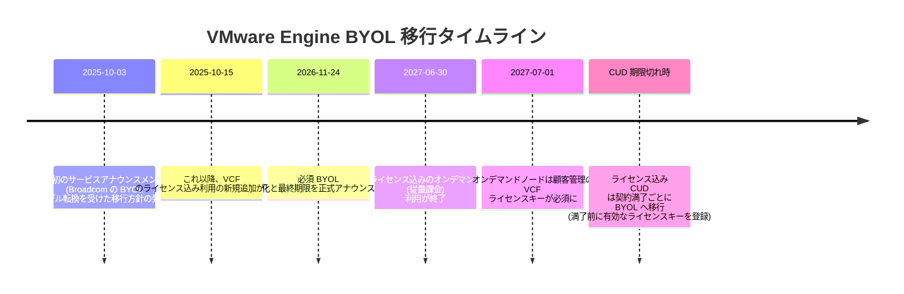

# Google Cloud VMware Engine: 2027 年 6 月 30 日をもって BYOL (Bring Your Own License) モデルへ完全移行

**リリース日**: 2026-11-24

**サービス**: Google Cloud VMware Engine

**機能**: VMware Cloud Foundation (VCF) ライセンスの必須 BYOL 化

**ステータス**: Announcement (重要なライセンスモデル変更)

📊 [このアップデートのインフォグラフィックを見る](https://takech9203.github.io/google-cloud-news-summary/20261124-vmware-engine-mandatory-byol.html)

## 概要

Google Cloud VMware Engine は、**2027 年 6 月 30 日をもって、必須の BYOL (Bring Your Own License) モデルへ移行**することが正式にアナウンスされました。これは 2025 年 10 月 3 日のサービスアナウンスメントに続くもので、Broadcom によるサブスクリプションベースの BYOL モデルへの転換 (Broadcom ブログ「VMware Cloud Foundation: Cloud on your terms」参照) を受けた変更です。2025 年 10 月 15 日以降、VMware Cloud Foundation (VCF) のライセンス込み (license-included) の利用を新規に追加することはすでにできなくなっています。

今回のアナウンスで明確化された要件は次の 2 点です。

1. **オンデマンド (従量課金) ノードを運用している場合**: **2027 年 7 月 1 日より前に**、有効な顧客管理の VCF ライセンスキーを提供する必要があります。
2. **ライセンス込みの確約利用割引 (CUD) を利用している場合**: **各 CUD の期限が切れるタイミングで**、有効な VCF ライセンスキーを提供する必要があります。ライセンスがバンドルされた既存の CUD は契約期間満了まで有効です。

VMware Engine を利用するすべての組織 (特にオンデマンドノードやライセンス込み CUD を運用中の組織) にとって、ライセンス調達・登録の計画を今から進めるべき重要な変更です。

**アップデート前の課題**

- 従来の VMware Engine は、ノード料金に VCF ライセンスが含まれる「ライセンス込み」モデルで利用でき、顧客が Broadcom から個別にライセンスを調達する必要がなかった
- Broadcom のライセンスモデル転換後も、既存のライセンス込み利用 (オンデマンドノード、既存 CUD) をいつまでにどう移行すべきかの最終期限が段階的にしか示されていなかった

**アップデート後の改善 (明確化された内容)**

- BYOL への移行期限が **2027 年 6 月 30 日** と明確に確定した
- オンデマンドノードは **2027 年 7 月 1 日より前** に顧客管理の VCF ライセンスキーの提供が必要と明確化された
- ライセンス込み CUD は **契約期間満了まで継続利用でき**、期限切れ時に BYOL へ移行すればよいことが明確化された
- ライセンスキーの登録・管理は Google Cloud コンソールの License Management ページで完結する仕組みが提供されている

## アーキテクチャ図



```mermaid
flowchart TD
    subgraph Before["🕐 Before: ライセンス込みモデル"]
        B1([👤 顧客]) -->|ノード利用料を支払い| B2["☁️ VMware Engine<br>(VCF ライセンス込み)"]
    end
    subgraph After["🕑 After: 必須 BYOL モデル (2027-07-01 以降)"]
        A1([👤 顧客]) -->|VCF サブスクリプション購入| A2["🏢 Broadcom<br>(ポータブル VCF ライセンス)"]
        A1 -->|ライセンスキー登録<br>(Cloud Billing アカウント単位)| A3["🔑 License Management<br>(Google Cloud コンソール)"]
        A3 -->|コア数のエンタイトルメントを適用| A4["☁️ VMware Engine<br>(インフラのみ Google が課金)"]
    end
    Before -.->|2027-06-30 で終了| After
```

上の図は BYOL 移行の主要な期限と、移行前後のライセンス調達フローの変化を示しています。移行後は Broadcom から調達したポータブル VCF ライセンスを Google Cloud コンソールに登録し、Cloud Billing アカウントに紐づく全プロジェクトのノードの CPU コア容量をカバーする形になります。

## サービスアップデートの詳細

### 主要なポイント

1. **2027 年 6 月 30 日で必須 BYOL モデルへ移行**
   - ライセンス込みのオンデマンド (従量課金) 利用は 2027 年 6 月 30 日で終了
   - 2025 年 10 月 15 日以降、VCF のライセンス込み利用の新規追加はすでに不可

2. **オンデマンド (従量課金) ノードへの影響**
   - 既存のオンデマンドノードを運用している場合、**2027 年 7 月 1 日より前**に有効な顧客管理の VCF ライセンスキーの提供が必須
   - 公式ドキュメントでは「2027 年 6 月 30 日までに BYOL オンボーディングを完了」と案内

3. **ライセンス込み CUD への影響**
   - ライセンスがバンドルされた既存の CUD は**契約期間満了まで有効**
   - **各 CUD の期限が切れる時点**で、サービス継続のために有効な VCF ライセンスキーの提供が必須
   - ライセンス切れを防ぐため、期限前に顧客管理の BYOL サブスクリプションへの移行が推奨される

4. **ライセンス管理のライフサイクル**
   - 継続的なライセンスカバレッジ維持のため、以下の 3 段階のサイクルが案内されている
     - **利用状況の監査**: 組織内の全 Cloud Billing アカウント ID をレビューし、ノード数、ノードファミリーごとのコア密度、vSAN 利用、ファイアウォール利用、アクティブな CUD の有効期限を把握
     - **ライセンス調達**: VMware Engine での総リソース消費に見合うポータブル VCF ライセンスを Broadcom から取得
     - **キー登録**: Google Cloud コンソールで VCF ライセンスキーを登録

## 技術仕様

### ライセンスキー登録の仕組み

| 項目 | 詳細 |
|------|------|
| 管理単位 | Cloud Billing アカウントレベル (プロジェクト単位ではない) |
| 適用範囲 | 同一 Billing アカウントに紐づく全プロジェクトのノードの CPU コア容量に適用 |
| 登録に必要な情報 | プロダクトタイプ、ライセンスキー文字列、コア数、有効開始日・終了日、Broadcom Site ID |
| 必要な API | Enterprise Purchasing API (`enterprisepurchasing.googleapis.com`) の有効化 |
| 必要な IAM ロール | `roles/enterprisepurchasing.admin` (追加・更新・サンセット) / `roles/enterprisepurchasing.viewer` (閲覧) |
| ライフサイクル操作 | キーの追加 / 更新 / サンセット (恒久的な退役)、ダッシュボードでのステータス確認 (Active / Sunsetted / Expired) |
| 注意点 | 登録時にコンプライアンス誓約 (Broadcom との契約に準拠している旨の確認) が必要。サンセットは取り消し不可 |

### ライセンス計算モデル

BYOL 要件は Cloud Billing アカウント ID ごとに計算され、クラスタ全体のアクティブなコア消費、既存 CUD、vSAN 利用、ファイアウォール利用、登録済み VCF エンタイトルメントが考慮されます。ライセンスオプションは 2 種類あります。

- **オプション 1 (VCF のみ)**: VCF コアライセンスのみでノード全体 (コンピュート + ストレージ) をカバー
- **オプション 2 (VCF + vSAN)**: ベースの CPU コアを VCF コアライセンスでカバーし、追加ストレージ要件をスタンドアロンの vSAN ライセンスで別途カバー

主なノードタイプのライセンス要件 (抜粋):

| ノードタイプ | オプション 1: VCF コアライセンス | オプション 2: VCF コア + vSAN |
|------|------|------|
| ve1-standard-72 | 36 VCF コア | 36 VCF コア (追加 vSAN 不要) |
| ve2-standard-64 | 32 VCF コア | 32 VCF コア (追加 vSAN 不要) |
| ve2-standard-128 | 64 VCF コア | 64 VCF コア (追加 vSAN 不要) |
| ve2-large-64 | 35 VCF コア | 32 VCF コア + 3 TiB vSAN |
| ve2-mega-64 | 47 VCF コア | 32 VCF コア + 15 TiB vSAN |
| ve2-mega-128 | 64 VCF コア | 64 VCF コア (追加 vSAN 不要) |
| ストレージ専用ノード (-so) | クラスタ内 HCI ノードのコアライセンスに準拠 | クラスタ内 HCI ノードタイプのオプション 2 に準拠 |

全ノードタイプの要件は [VCF license management](https://cloud.google.com/vmware-engine/docs/vcf-license-management) を参照してください。

### BYOL ライセンスの適用対象外

登録した BYOL エンタイトルメントはノードの CPU コア容量に適用されますが、以下には適用されません (これらは引き続き Google Cloud 側の課金対象)。

- 基盤となる Google Cloud インフラストラクチャの利用料
- ストレージおよびバックアップ
- IP アドレスおよびネットワーク下り (外向き) データ転送
- サポート対象 VCF コンポーネント以外のサードパーティアドオン

## 設定方法

### 前提条件

1. Broadcom (または正規リセラー) からポータブル VCF ライセンスを調達済みであること
2. Broadcom ポータルでライセンスキー属性 (プロダクトタイプ、キー文字列、コア数、有効期間、Broadcom Site ID) を確認できること
3. プロジェクトで Enterprise Purchasing API が有効で、`roles/enterprisepurchasing.admin` 相当の権限を持っていること

### 手順

#### ステップ 1: 利用状況の監査

組織内のすべての Cloud Billing アカウント ID をレビューし、以下を把握します。

- ノード数とノードファミリーごとのコア密度
- vSAN 利用、ファイアウォール利用
- アクティブな CUD の有効期限

#### ステップ 2: ライセンスキーの登録

```text
1. Google Cloud コンソールで「License Management」ページに移動
2. [Add License Key] をクリック
3. ライセンスキー文字列、プロダクト名、コア数、開始日・終了日、Broadcom Site ID を入力
4. コンプライアンス誓約のチェックボックスを選択して [Submit]
```

登録されたライセンス容量は、Billing アカウントに紐づく全プロジェクトに即時反映されます。コンソールは構文・入力形式を検証しますが、登録時に Broadcom システムとのリアルタイムのバックエンド検証は行われません。

## メリット

### ビジネス面

- **ライセンスのポータビリティ**: Broadcom から調達したポータブル VCF サブスクリプションを VMware Engine に持ち込めるため、既存の Broadcom 契約 (エンタープライズ契約など) を活用できる
- **移行期限の明確化**: 2027-06-30 / CUD 満了時という期限が確定したことで、ライセンス調達・予算計画を具体的に立てられる

### 技術面

- **一元的なライセンス管理**: Cloud Billing アカウント単位でキーを登録でき、紐づく全プロジェクトのコア容量に自動適用される
- **ダッシュボードでの可視化**: 登録済みキーの一覧、ステータス (Active / Sunsetted / Expired)、アクティブなコア容量を確認できる

## デメリット・制約事項

### 制限事項

- 2025 年 10 月 15 日以降、VCF のライセンス込み利用の新規追加は不可
- ライセンスキーのサンセット (退役) は恒久的で取り消し不可 (復元するにはキー文字列を新規エントリとして再登録)
- コンソールでは過去の有効期限を指定できない

### 考慮すべき点 (重要な期限とアクション)

- **オンデマンドノード運用中の場合**: 2027 年 7 月 1 日より前に有効な VCF ライセンスキーの登録が必須。Broadcom でのライセンス調達リードタイムを考慮し、早めの着手が必要
- **ライセンス込み CUD 利用中の場合**: 各 CUD の満了日を棚卸しし、満了前に BYOL サブスクリプションへの移行を完了させる必要がある
- **コンプライアンス違反時の影響が大きい**: アクティブな VCF エンタイトルメントが環境の全アクティブ CPU コアとストレージ容量を常時カバーしていない場合、VMware Engine Service Specific Terms の下で非準拠 (noncompliant) と判定され、以下の影響が生じ得る
  - サービスの中断
  - SLA の適用対象外化
  - 機能の喪失
  - 管理アプライアンスへのアクセス制限
  - サービス停止の可能性
- Broadcom ライセンスの期限が切れた場合、更新は Broadcom と直接行う必要がある

## ユースケース

### ユースケース 1: オンデマンドノードで運用中の環境の BYOL 移行計画

**シナリオ**: 従量課金のオンデマンドノードで VMware Engine 私設クラウドを運用しており、2027 年 7 月 1 日の期限までに BYOL へ移行する必要がある。

**実施例**:
```text
1. 全 Billing アカウントのノードタイプ・ノード数・コア数を棚卸し (例: ve2-standard-64 x 4 ノード = 128 VCF コア)
2. 必要コア数分のポータブル VCF ライセンスを Broadcom から調達
3. Google Cloud コンソールの License Management でキーを登録
4. ダッシュボードでアクティブなコア容量が実環境をカバーしていることを確認
```

**効果**: 期限前に移行を完了し、非準拠によるサービス中断・SLA 喪失のリスクを回避できる。

### ユースケース 2: ライセンス込み CUD の満了管理

**シナリオ**: 複数のライセンス込み CUD を異なる満了日で契約しており、順次 BYOL へ移行する必要がある。

**効果**: CUD ごとの満了日を監査し、満了前に該当分の VCF ライセンスキーを登録しておくことで、サービス継続性を維持しながら段階的に BYOL へ移行できる。

## 料金

BYOL モデルでは、VCF ライセンス費用は Broadcom (または正規リセラー) との契約に基づき顧客が直接支払い、Google Cloud は基盤インフラストラクチャ (ノード、ストレージ、ネットワークなど) の利用料を課金します。具体的なノード料金は公式料金ページを参照してください。

- [VMware Engine の料金](https://cloud.google.com/vmware-engine/pricing)

## 関連サービス・機能

- **Cloud Billing / 確約利用割引 (CUD)**: ライセンスキーは Cloud Billing アカウント単位で管理され、CUD の満了が BYOL 移行のトリガーとなる
- **Enterprise Purchasing API**: ライセンスキーの登録・管理に必要な API (`enterprisepurchasing.googleapis.com`)
- **IAM**: ライセンス管理には `roles/enterprisepurchasing.admin` / `roles/enterprisepurchasing.viewer` が必要
- **vSAN ライセンス (Broadcom)**: オプション 2 では追加ストレージ要件をスタンドアロン vSAN ライセンスでカバー可能

## 参考リンク

- 📊 [インフォグラフィック](https://takech9203.github.io/google-cloud-news-summary/20261124-vmware-engine-mandatory-byol.html)
- [公式リリースノート (2026-11-24)](https://docs.cloud.google.com/release-notes#November_24_2026)
- [サービスアナウンスメント (2026-11-24)](https://cloud.google.com/vmware-engine/docs/service-announcements#2026-11-24)
- [サービスアナウンスメント (2025-10-03)](https://cloud.google.com/vmware-engine/docs/service-announcements#2025-10-03)
- [VCF license management (ライセンス要件・計算モデル)](https://cloud.google.com/vmware-engine/docs/vcf-license-management)
- [Register and manage VCF BYOL license keys (キー登録手順)](https://cloud.google.com/vmware-engine/docs/license-management)
- [VMware Engine の料金](https://cloud.google.com/vmware-engine/pricing)

## まとめ

Google Cloud VMware Engine のライセンス込みモデルは 2027 年 6 月 30 日で終了し、以降は Broadcom から調達した VCF ライセンスの持ち込み (BYOL) が必須となります。オンデマンドノードを運用中の組織は 2027 年 7 月 1 日より前のライセンスキー登録が必須であり、ライセンス込み CUD を持つ組織は各 CUD の満了前に移行を完了する必要があります。非準拠時にはサービス中断や SLA 喪失など重大な影響があるため、利用状況の監査とライセンス調達計画に今すぐ着手することを強く推奨します。

---

**タグ**: #VMwareEngine #VCF #BYOL #ライセンス #Broadcom #CUD #Announcement
