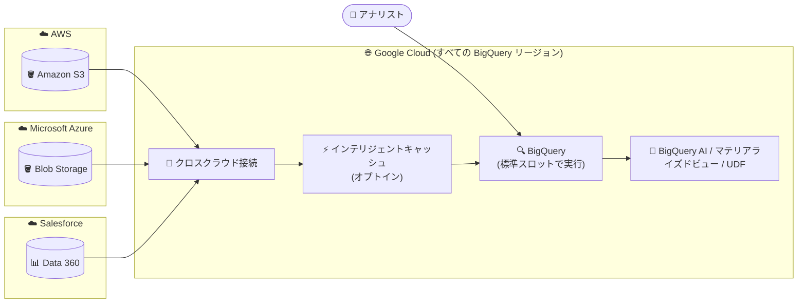

# BigQuery: クロスクラウド接続 (Cross-cloud connections) が GA

**リリース日**: 2026-11-25

**サービス**: BigQuery

**機能**: クロスクラウド接続 (Cross-cloud connections)

**ステータス**: GA (一般提供)

📊 [このアップデートのインフォグラフィックを見る](https://takech9203.github.io/google-cloud-news-summary/20261125-bigquery-cross-cloud-connections-ga.html)

## 概要

BigQuery のクロスクラウド接続 (Cross-cloud connections) が一般提供 (GA) になりました。クロスクラウド接続を使用すると、AWS (Amazon S3)、Microsoft Azure (Blob Storage)、Salesforce Data 360 のデータを、**すべての BigQuery リージョンから**クエリできます。これは BigQuery Omni を使用する従来の標準接続に代わる選択肢であり、標準接続よりも多くの BigQuery 機能を利用できる点が特徴です。

従来の BigQuery Omni による標準接続は、リモートリージョンに軽量なコンピュートワーカーをデプロイし、データを移動せずに他クラウドのデータをクエリ可能にする仕組みでした。これに対しクロスクラウド接続は、他クラウドのデータを BigQuery 側に取り込んでクエリする方式を採ることで、BigQuery AI、Gemini Enterprise Agent Platform、マテリアライズドビュー、ユーザー定義関数 (UDF) など、標準接続では利用できなかった機能に直接アクセスできます。

マルチクラウド環境でデータ分析基盤を運用している組織や、BigQuery Omni のリージョン制約・機能制約に課題を感じていた Solutions Architect、データエンジニアにとって重要なアップデートです。

**アップデート前の課題**

- BigQuery Omni の標準接続では、利用できるロケーションが限られた BigQuery Omni リージョン (例: `aws-us-east-1`、`azure-eastus2` など) に限定されていた
- Omni リージョンでは BigQuery ML ステートメント、JavaScript UDF、DML ステートメントなどが利用できず、Blob Storage ではマテリアライズドビューも未サポートだった
- Omni リージョンのクエリには別途スロット (コンピュート容量) の管理が必要で、既存の標準スロット予約と分離されていた

**アップデート後の改善**

- すべての BigQuery リージョンで接続を作成し、AWS・Azure・Salesforce Data 360 のデータをクエリできるようになった
- BigQuery AI、Gemini Enterprise Agent Platform、マテリアライズドビュー、UDF など、標準接続では利用できなかった機能に直接アクセスできるようになった
- クエリは標準のスロット予約・コミットメントを消費するため、別個のコンピュート容量管理が不要になった
- 接続単位でクロスクラウドキャッシュ (インテリジェントキャッシュ) をオプトインでき、リモートファイルを Google Cloud リージョン内にキャッシュして Egress コスト削減とクエリ高速化を実現できるようになった

## アーキテクチャ図



AWS・Azure・Salesforce Data 360 のデータが、クロスクラウド接続を経由して任意の BigQuery リージョンに取り込まれ、標準スロットでクエリされるデータフローを示しています。キャッシュを有効化すると、取得済みファイルブロックはローカルリージョンから再利用されます。

## サービスアップデートの詳細

### 主要機能

1. **すべての BigQuery リージョンからのクロスクラウドクエリ**
   - 接続を BigQuery Omni ロケーションではなく、標準の BigQuery ロケーション (例: `us-east4`、`asia-northeast1`) に作成する
   - データに物理的に近いリージョンを選択することで、コストとパフォーマンスを最適化できる (公式ドキュメントにリージョン推奨表あり)

2. **機能の一貫性 (Feature consistency)**
   - 他クラウドのデータを BigQuery に取り込むことで、BigQuery AI、Gemini Enterprise Agent Platform、マテリアライズドビュー、UDF など、標準接続 (BigQuery Omni) では利用できない機能に直接アクセスできる

3. **コスト効率 (Cost efficiency)**
   - クロスクラウド接続を使うワークロードは標準のスロット予約・コミットメントを消費するため、Omni リージョン用に別個のコンピュート容量を管理する必要がない

4. **インテリジェントキャッシュ (Intelligent caching)**
   - 接続でクロスクラウドキャッシュを有効化すると、取得したファイルブロックが接続の Google Cloud リージョン内にローカルキャッシュされる
   - 同じファイルブロックを対象とする後続クエリはリモートクラウドから再取得せずローカルキャッシュから読み取るため、クロスクラウド Egress コストの削減とクエリ高速化に寄与する
   - キャッシュの容量・保持・エビクションは Google が自動管理し、追加料金なしで利用できる
   - キャッシュ提供前に毎回リモートストレージとメタデータ・アクセス権限を検証するため、古いデータの読み取りや失効済み権限のバイパスは発生しない
   - デフォルトでは無効 (オプトイン)。同日に Lakehouse のクロスクラウドデータアクセス向けキャッシュも GA になっている

## 技術仕様

### 標準接続 (BigQuery Omni) との比較

| 項目 | 標準接続 (BigQuery Omni) | クロスクラウド接続 (今回 GA) |
|------|--------------------------|------------------------------|
| 接続のロケーション | BigQuery Omni リージョン (限定的) | すべての標準 BigQuery リージョン |
| 実行方式 | リモートリージョンにコンピュートワーカーをデプロイし、データ移動なしでクエリ | 他クラウドのデータを BigQuery に取り込んでクエリ |
| 利用可能機能 | BigQuery ML、JavaScript UDF、DML などに制限あり | BigQuery AI、Gemini Enterprise Agent Platform、マテリアライズドビュー、UDF などを直接利用可能 |
| コンピュート | Omni リージョンのスロットを別途管理 | 標準のスロット予約・コミットメントを消費 |
| キャッシュ | - | インテリジェントキャッシュをオプトイン可能 |

### 必要なロール

| 対象 | 必要なロール |
|------|--------------|
| Google Cloud | BigQuery 管理者 (`roles/bigquery.admin`) |
| AWS | AWS アカウントで IAM ポリシーとロールを作成できるロール |
| Azure | Microsoft Entra ID (Azure AD) でアプリ登録を管理し、ターゲット Azure アカウントで Storage Blob Data Reader などのロールを割り当てられるロール |

### リージョン推奨の例

データに物理的に近い BigQuery リージョンを選択することが推奨されています (抜粋)。

| ソースリージョン | 最も近い BigQuery リージョン |
|------------------|------------------------------|
| AWS us-east-1 | us-east4 |
| AWS ap-northeast-1 (東京) | asia-northeast1 |
| Azure East US | us-east4 |
| Azure Japan East | asia-northeast1 |

## 設定方法

### 前提条件

1. BigQuery 管理者 (`roles/bigquery.admin`) ロールが付与されていること
2. AWS の場合: BigQuery 用の IAM ポリシーと IAM ロールを作成済みであること
3. Azure の場合: Azure テナントにアプリケーションを作成し、ロールを割り当て済みであること

### 手順

#### ステップ 1: 接続の作成 (AWS の例)

```bash
bq mk --connection \
  --connection_type='AWS' \
  --location=LOCATION \
  --project_id=PROJECT_ID \
  --properties='{"accessRole":{"iamRoleId":"arn:aws:iam::AWS_ACCOUNT_ID:role/ROLE_NAME"},"crossCloudCacheOptions":{"enabled":true}}' \
  CONNECTION_ID
```

`LOCATION` には BigQuery Omni ロケーションではなく、標準の BigQuery ロケーション (例: `us-east4`) を指定します。`crossCloudCacheOptions.enabled` でクロスクラウドキャッシュを有効化できます (デフォルトは `false`)。

#### ステップ 2: サービスアカウント情報の確認と信頼ポリシーの追加

```bash
bq show --connection \
  --location=LOCATION \
  PROJECT_ID.LOCATION.CONNECTION_ID
```

表示されたサービスアカウント情報を使用して、AWS ロールに信頼ポリシーを追加します (Azure の場合はフェデレーション認証情報を追加)。

#### ステップ 3: 外部テーブルの作成とクエリ (Azure の例)

```sql
CREATE SCHEMA `my-project.azure_raw_data` OPTIONS (location = 'us-east4');

CREATE EXTERNAL TABLE `my-project.azure_raw_data.sales_parquet`
WITH CONNECTION `us-east4.my-azure-connection`
OPTIONS (
  format = 'PARQUET',
  uris = ['azure://mystorageaccount.blob.core.windows.net/mycontainer/sales/year=2025/*']
);
```

Salesforce Data 360 の場合は、リンクされたデータセットを BigQuery Omni ロケーションではなく標準の BigQuery ロケーションに作成します。新しいデータセットへクエリを移行した後は、レガシーのリンク済みデータセットや BigQuery Omni マテリアライズドビューを削除できます。

## メリット

### ビジネス面

- **マルチクラウドデータの活用範囲拡大**: Omni リージョンの制約を受けず、すべての BigQuery リージョンで AWS・Azure・Salesforce のデータを分析できる
- **コスト管理の簡素化**: 標準のスロット予約・コミットメントに統合され、Omni 用の別容量管理が不要になる
- **Egress コストの削減**: インテリジェントキャッシュにより、同一ファイルブロックへの繰り返しアクセスのクロスクラウド Egress を削減できる

### 技術面

- **BigQuery 機能のフル活用**: BigQuery AI、マテリアライズドビュー、UDF など、Omni 標準接続では使えなかった機能をクロスクラウドデータに適用できる
- **キャッシュの整合性保証**: キャッシュ提供前に毎回リモート側のメタデータと権限を検証するため、古いデータの読み取りや権限バイパスが発生しない
- **キャッシュ効果の可視化**: BigQuery の `JobStatistics2` の `objectStorageStats` (例: `cacheBytesRead`、`objectStorageBytesRead`) でキャッシュヒットと Egress 削減効果を確認できる

## デメリット・制約事項

### 制限事項

- クロスクラウドキャッシュはデフォルトで無効のため、利用には接続作成時または更新時のオプトインが必要
- キャッシュデータは Google のデフォルト暗号鍵で暗号化され、CMEK (顧客管理の暗号鍵) はクロスクラウドキャッシュでサポートされない。組織で `constraints/gcp.restrictNonCmekServices` を適用している場合、該当テーブルのキャッシュは自動的に無効化される (クエリ自体はリモート読み取りで実行される)

### 考慮すべき点

- キャッシュを有効化すると、リモートファイルのキャッシュコピーがクエリ実行先の Google Cloud リージョンに一時保存されるため、データレジデンシー・コンプライアンス要件 (例: EU のデータを us-east4 からクエリする場合) の確認が必要
- Egress 削減効果はクエリパターン、ソースファイルの変更頻度、キャッシュ保持状況に依存する
- Apache Iceberg カタログを扱う場合や、BigQuery 以外のエンジン (Apache Spark など) からのクエリが必要な場合は、borderless Lakehouse のクロスクラウドデータアクセス機能の利用が推奨されている

## ユースケース

### ユースケース 1: AWS S3 上のデータレイクへの BigQuery AI 適用

**シナリオ**: Amazon S3 に蓄積された Parquet 形式の販売データに対して、BigQuery AI 関数やマテリアライズドビューを適用したいが、BigQuery Omni 標準接続では機能制約があり実現できなかった。

**実装例**:
```sql
CREATE EXTERNAL TABLE `my-project.aws_data.sales`
WITH CONNECTION `asia-northeast1.my-aws-connection`
OPTIONS (
  format = 'PARQUET',
  uris = ['s3://my-bucket/sales/*']
);
```

**効果**: データ移行パイプラインを構築することなく、BigQuery の AI 機能・マテリアライズドビュー・UDF をクロスクラウドデータに適用できる。

### ユースケース 2: Salesforce Data 360 データの任意リージョンでの分析

**シナリオ**: Salesforce Data 360 のデータを、既存の BigQuery データセットと同じ標準リージョンで統合分析したい。

**効果**: リンクされたデータセットを標準 BigQuery ロケーションに作成することで、既存データと同一リージョンで分析でき、レガシーのリンク済みデータセットや Omni マテリアライズドビューを整理できる。

### ユースケース 3: 繰り返し参照される BI ダッシュボードの Egress コスト削減

**シナリオ**: Azure Blob Storage 上の同じデータを BI ダッシュボードが繰り返しクエリしており、クロスクラウド Egress コストが嵩んでいる。

**効果**: 接続でインテリジェントキャッシュを有効化すると、2 回目以降のクエリはローカルキャッシュから読み取られ、Egress コスト削減とクエリ高速化が期待できる。

## 料金

- クロスクラウド接続を使用するワークロードは、**標準のスロット予約・コミットメント**を消費します
- クロスクラウドのデータ転送 (Egress) には、リモートクラウドプロバイダ側の転送料金が適用されます
- インテリジェントキャッシュは**追加料金なし**で利用でき、Egress コストの削減に寄与します

詳細は [BigQuery の料金ページ](https://cloud.google.com/bigquery/pricing) を参照してください。

## 利用可能リージョン

リリースノートに記載のとおり、**すべての BigQuery リージョン**からクロスクラウド接続を利用できます。コストとパフォーマンスの最適化のため、ソースデータに物理的に近い BigQuery リージョンの選択が推奨されています (公式ドキュメントの [Region recommendations](https://docs.cloud.google.com/bigquery/docs/cross-cloud-connections#region_recommendations) を参照)。

## 関連サービス・機能

- **BigQuery Omni**: 従来の標準接続の実行基盤。リモートリージョンにコンピュートワーカーをデプロイし、データ移動なしでクエリする方式。クロスクラウド接続はその代替となる選択肢
- **Borderless Lakehouse (クロスクラウドデータアクセス)**: Apache Iceberg カタログ (AWS Glue、Databricks Unity Catalog、Snowflake Horizon Catalog など) や BigQuery 以外のエンジンが必要な場合の推奨機能。同日にクロスクラウドキャッシュも GA
- **Cross-Cloud Interconnect**: クロスクラウドのデータ転送をプライベートネットワーク経由にすることで、Egress コストの削減とレイテンシの安定化を実現するネットワークサービス
- **Salesforce Data 360**: リンクされたデータセットを介して BigQuery からクエリできる Salesforce のデータ基盤
- **Gemini Enterprise Agent Platform / BigQuery AI**: クロスクラウド接続で取り込んだデータに直接適用できる AI 機能

## 参考リンク

- 📊 [インフォグラフィック](https://takech9203.github.io/google-cloud-news-summary/20261125-bigquery-cross-cloud-connections-ga.html)
- [公式リリースノート](https://docs.cloud.google.com/release-notes#November_25_2026)
- [ドキュメント: Create cross-cloud connections](https://docs.cloud.google.com/bigquery/docs/cross-cloud-connections)
- [ドキュメント: About cross-cloud data access (Lakehouse)](https://docs.cloud.google.com/lakehouse/docs/about-cross-cloud-data-access)
- [ドキュメント: BigQuery Omni の概要](https://docs.cloud.google.com/bigquery/docs/omni-introduction)
- [料金ページ](https://cloud.google.com/bigquery/pricing)

## まとめ

クロスクラウド接続の GA により、AWS・Azure・Salesforce Data 360 のデータを、Omni リージョンの制約なしにすべての BigQuery リージョンからクエリでき、BigQuery AI やマテリアライズドビューなどのフル機能を適用できるようになりました。マルチクラウド環境で BigQuery Omni を利用中の場合は、機能要件・リージョン要件・コスト (標準スロットへの統合、インテリジェントキャッシュによる Egress 削減) を比較し、クロスクラウド接続への移行を検討することをおすすめします。

---

**タグ**: BigQuery, Cross-cloud, BigQuery Omni, AWS, Azure, Salesforce Data 360, マルチクラウド, GA
