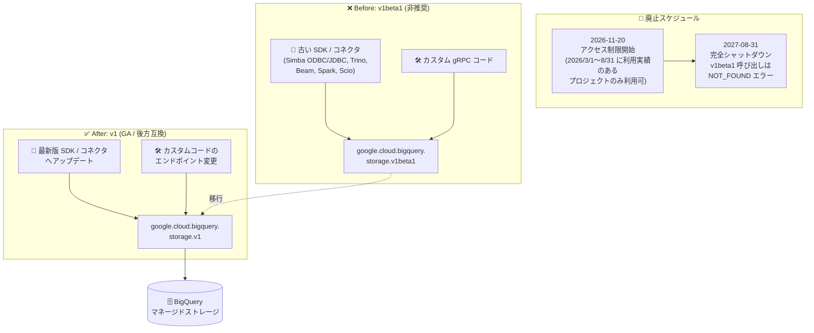

# BigQuery: Storage API v1beta1 の非推奨化と 2027 年 8 月 31 日のシャットダウン

**リリース日**: 2026-11-25

**サービス**: BigQuery

**機能**: BigQuery Storage API v1beta1 の非推奨化 (Deprecation)

**ステータス**: Deprecated (2027 年 8 月 31 日に完全シャットダウン予定)

📊 [このアップデートのインフォグラフィックを見る](https://takech9203.github.io/google-cloud-news-summary/20261125-bigquery-storage-api-v1beta1-deprecation.html)

## 概要

BigQuery Storage API の v1beta1 バージョンが正式に非推奨 (Deprecated) となり、2027 年 8 月 31 日に完全にシャットダウンされることが発表されました。シャットダウン後、v1beta1 エンドポイントへの呼び出しは `NOT_FOUND` エラーで失敗します。段階的な廃止プロセスとして、2026 年 11 月 20 日以降は、2026 年 3 月 1 日から 2026 年 8 月 31 日の間にアクティブな利用実績があったプロジェクトのみに v1beta1 へのアクセスが制限されています。

BigQuery Storage API は、gRPC ベースのプロトコルで BigQuery マネージドストレージに高速アクセスするための API であり、Spark BigQuery コネクタや Apache Beam BigQuery コネクタ、各種 ODBC/JDBC ドライバなど、多くのデータ処理ツールの内部で利用されています。v1beta1 のドキュメントでは以前から「新規コードは v1 API を使用すべき」とされていましたが、今回正式な廃止スケジュールが確定しました。

対象となるのは、v1beta1 を利用する古いバージョンの SDK・コネクタ・ドライバを使い続けているワークロード、および gRPC などで v1beta1 エンドポイントを直接呼び出すカスタムコードを持つユーザーです。サービス停止を防ぐため、GA 版の BigQuery Storage API v1 (後方互換) への移行が必要です。

**アップデート前の課題**

- v1beta1 は Beta 段階の API でありながら、古いコネクタやカスタムコードで利用され続けていた
- v1beta1 の `ReadRows` はレスポンスあたり最大 10 MiB という制限があった (v1 は最大 128 MB)
- v1beta1 は Arrow 0.14 以前の古いフォーマットに対応しており、新しい Arrow エコシステムとの整合性に課題があった

**アップデート後の改善 (v1 への移行による効果)**

- GA 版の v1 API は後方互換であり、安定したサポートとライフサイクルが保証される
- v1 は Read API に加えて Storage Write API (`AppendRows` 等) も同一バージョン系列で提供され、読み書き両方を統一的に扱える
- v1 はカラムプロジェクション、行フィルタ (`row_restriction`)、スナップショット一貫性、テーブルサンプリング、Avro/Arrow 両フォーマットなどの機能を GA 品質で利用できる

## アーキテクチャ図



v1beta1 を利用する SDK・コネクタ・カスタムコードを、2027 年 8 月 31 日のシャットダウン前に GA 版の v1 エンドポイントへ移行する流れを示しています。

## サービスアップデートの詳細

### 主要マイルストーン

| 日付 | イベント |
|------|---------|
| 2026 年 11 月 20 日 | v1beta1 へのアクセスが、2026 年 3 月 1 日〜2026 年 8 月 31 日にアクティブな利用実績を記録したプロジェクトのみに制限 |
| 2027 年 8 月 31 日 | v1beta1 が完全にシャットダウン。v1beta1 エンドポイントへの呼び出しは `NOT_FOUND` エラーで失敗 |

### 移行対象

1. **SDK・コネクタ・ドライバ利用者**
   - 以下のツールを最新バージョンへアップデートすることで v1 に移行できる
   - Simba ODBC/JDBC ドライバ、Google BigQuery ODBC/JDBC ドライバ
   - Trino BigQuery プラグイン
   - Apache Beam BigQuery コネクタ
   - Spark BigQuery コネクタ
   - Scio BigQuery プラグイン

2. **カスタムコード利用者**
   - gRPC などで v1beta1 を直接呼び出しているコードは、`google.cloud.bigquery.storage.v1` をターゲットにするよう変更が必要

3. **v1 は後方互換**
   - GA 版の BigQuery Storage API v1 は v1beta1 に対して後方互換であり、移行による機能喪失は想定されていない

## 技術仕様

### v1beta1 と v1 の比較

| 項目 | v1beta1 (非推奨) | v1 (GA) |
|------|------------------|---------|
| ステータス | Deprecated (2027-08-31 シャットダウン) | GA |
| 主な Read RPC | `CreateReadSession`, `ReadRows`, `SplitReadStream`, `BatchCreateReadSessionStreams`, `FinalizeStream` | `CreateReadSession`, `ReadRows`, `SplitReadStream` |
| Write API | なし | あり (Storage Write API: `AppendRows`, `FlushRows` など) |
| `ReadRows` レスポンス上限 | 最大 10 MiB / レスポンス | 最大 128 MB / レスポンス |
| 対応 Arrow バージョン | Arrow 0.14 以前 | Arrow 0.15 以降 |
| データフォーマット | Avro / Arrow | Avro / Arrow |
| セッション有効期限 | 作成から 6 時間 | 作成から 6 時間 |

### Storage Read API v1 の主要機能

| 機能 | 説明 |
|------|------|
| マルチストリーム | 1 つのセッション内で複数ストリームにより分散読み取りが可能。分散処理フレームワークとの親和性が高い |
| カラムプロジェクション | `selected_fields` で読み取るカラムのサブセットを指定し、効率的な読み取りを実現 |
| 行フィルタ | `row_restriction` で WHERE 句相当のサーバーサイドフィルタを適用 (最大 1 MB) |
| スナップショット一貫性 | セッション作成時点 (または指定した過去時点) のスナップショットに基づく一貫した読み取り |

### 制限事項 (v1 でも共通)

- 論理ビュー・マテリアライズドビューからの直接読み取りは不可 (クエリ結果テーブル経由で読み取る。Spark BigQuery コネクタなど一部コネクタはネイティブ対応)
- 外部テーブルの読み取りは非対応

## 移行方法

### 前提条件

1. 自プロジェクトで v1beta1 を呼び出しているワークロード (コネクタ、ドライバ、カスタムコード) を洗い出す
2. BigQuery AuditLogs や Cloud Monitoring の Consumed API メトリクスで、呼び出している API メソッドのバージョンを確認する

### 手順

#### ステップ 1: SDK・コネクタ・ドライバのアップデート

```bash
# 例: Spark BigQuery コネクタを最新版に差し替えてジョブを実行
gcloud dataproc jobs submit spark \
    --jars=gs://spark-lib/bigquery/spark-bigquery-with-dependencies_2.12-<最新バージョン>.jar \
    -- job args
```

Simba ODBC/JDBC、Google BigQuery ODBC/JDBC ドライバ、Trino BigQuery プラグイン、Apache Beam BigQuery コネクタ、Spark BigQuery コネクタ、Scio BigQuery プラグインを最新バージョンへ更新します。

#### ステップ 2: カスタムコードの移行

```java
// Before (v1beta1)
import com.google.cloud.bigquery.storage.v1beta1.*;

// After (v1)
import com.google.cloud.bigquery.storage.v1.BigQueryReadClient;
import com.google.cloud.bigquery.storage.v1.CreateReadSessionRequest;
import com.google.cloud.bigquery.storage.v1.ReadRowsRequest;
```

gRPC などで v1beta1 エンドポイントを直接呼び出しているコードは、`google.cloud.bigquery.storage.v1` をターゲットにするよう変更します。公式クライアントライブラリ (`cloud.google.com/go/bigquery/storage/apiv1` など) の利用が推奨されています。

#### ステップ 3: 移行後の検証

Cloud Monitoring の Metrics Explorer で「Consumed API - Request latencies」を `google.cloud.bigquery.storage.v1.BigQueryRead.ReadRows` でフィルタし、v1 への呼び出しが行われていることを確認します。BigQuery AuditLogs でも `serialized_response_bytes` や `scanned_bytes` フィールドで読み取り状況を監視できます。

## メリット

### ビジネス面

- **サービス停止リスクの回避**: 2027 年 8 月 31 日のシャットダウン前に移行することで、`NOT_FOUND` エラーによるパイプライン停止を防止できる
- **GA 版による安定運用**: Beta API への依存を解消し、GA の安定したサポートを受けられる

### 技術面

- **後方互換の移行パス**: v1 は v1beta1 と後方互換であり、多くの場合はコネクタ・ドライバのバージョンアップのみで移行が完了する
- **Read/Write の統合**: v1 系列では Storage Write API も提供されており、読み書き両方を同一バージョンで扱える
- **大きなレスポンスサイズ**: v1 の `ReadRows` はレスポンスあたり最大 128 MB に対応 (v1beta1 は 10 MiB)

## デメリット・制約事項

### 制限事項

- 2026 年 11 月 20 日以降、2026 年 3 月 1 日〜8 月 31 日に利用実績のないプロジェクトからは v1beta1 を新規に利用できない
- 2027 年 8 月 31 日以降、v1beta1 への呼び出しはすべて `NOT_FOUND` エラーで失敗する

### 考慮すべき点

- サードパーティ製ツール (Trino、Simba ドライバ等) に組み込まれた古いコネクタは見落としやすいため、依存関係の棚卸しが必要
- v1beta1 固有の RPC (`BatchCreateReadSessionStreams`、`FinalizeStream`) を利用しているカスタムコードは、v1 の API 設計 (セッション作成時の `max_stream_count` 指定や `SplitReadStream`) に合わせた見直しが必要
- v1 では Arrow 0.15 以降が前提となるため、v1beta1 + Arrow 0.14 以前の組み合わせで独自デシリアライズをしている場合はライブラリ更新も必要

## ユースケース

### ユースケース 1: Dataproc / Spark ジョブの移行

**シナリオ**: 古い Spark BigQuery コネクタを同梱した Dataproc クラスタで BigQuery テーブルを読み取っている。

**実装例**:
```bash
gcloud dataproc jobs submit spark \
    --jars=gs://spark-lib/bigquery/spark-bigquery-with-dependencies_2.12-<最新バージョン>.jar \
    -- job args
```

**効果**: コネクタの差し替えのみで v1 ベースの読み取りに移行でき、アプリケーションコードの変更は不要。

### ユースケース 2: BI ツール (ODBC/JDBC) 接続の移行

**シナリオ**: BI ツールから Simba ODBC/JDBC ドライバ経由で BigQuery に接続しており、ドライバが v1beta1 を利用している。

**効果**: ドライバを最新バージョンへ更新するだけで移行が完了し、2027 年 8 月 31 日以降も接続が継続できる。

## 料金

この非推奨化自体による料金変更はアナウンスされていません。Storage Read API の料金は BigQuery のデータ抽出料金に準じます。詳細は [BigQuery 料金ページ](https://cloud.google.com/bigquery/pricing#data-extraction-pricing-details)を参照してください。

なお、Managed Service for Apache Spark (サーバーレス) や BigQuery の Apache Spark ストアドプロシージャから発行される Storage Read API のストリーミング読み取りには追加料金はかかりません (リージョン間読み取りのネットワーク下り料金は別途適用)。

## 利用可能リージョン

Storage Read API (v1) は BigQuery と同じリージョンでサポートされます。詳細は [BigQuery のロケーション](https://docs.cloud.google.com/bigquery/docs/locations)を参照してください。

## 関連サービス・機能

- **Dataproc / Managed Service for Apache Spark**: Spark BigQuery コネクタが Storage Read API を利用して BigQuery テーブルを分散読み取りする。コネクタの最新化が移行手段となる
- **Dataflow (Apache Beam)**: Beam BigQuery コネクタが Storage API を利用。SDK バージョンアップで v1 へ移行
- **Trino**: Trino BigQuery プラグインが Storage API を利用。プラグインの更新が必要
- **BigQuery Storage Write API**: v1 系列で提供される書き込み API。ストリーミング取り込みの推奨手段
- **Cloud Monitoring / BigQuery AuditLogs**: `ReadRows` のレイテンシや読み取りバイト数の監視により、移行状況・利用状況を確認できる

## 参考リンク

- 📊 [インフォグラフィック](https://takech9203.github.io/google-cloud-news-summary/20261125-bigquery-storage-api-v1beta1-deprecation.html)
- [公式リリースノート](https://docs.cloud.google.com/release-notes#November_25_2026)
- [BigQuery Storage Read API の概要](https://docs.cloud.google.com/bigquery/docs/reference/storage)
- [BigQuery Storage API v1 RPC リファレンス](https://docs.cloud.google.com/bigquery/docs/reference/storage/rpc/google.cloud.bigquery.storage.v1)
- [BigQuery Storage API v1beta1 RPC リファレンス](https://docs.cloud.google.com/bigquery/docs/reference/storage/rpc/google.cloud.bigquery.storage.v1beta1)
- [BigQuery Storage API クライアントライブラリ](https://docs.cloud.google.com/bigquery/docs/reference/storage/libraries)
- [料金ページ](https://cloud.google.com/bigquery/pricing#data-extraction-pricing-details)

## まとめ

BigQuery Storage API v1beta1 は 2027 年 8 月 31 日に完全シャットダウンされ、以降の呼び出しは `NOT_FOUND` エラーで失敗します。多くのワークロードは Simba ODBC/JDBC ドライバ、Trino プラグイン、Beam/Spark/Scio コネクタなどの最新バージョンへのアップデートで移行が完了しますが、v1beta1 を直接呼び出すカスタムコードは `google.cloud.bigquery.storage.v1` への変更が必要です。シャットダウンまで猶予はありますが、依存関係の棚卸しと移行計画の策定を早期に開始することを推奨します。

---

**タグ**: BigQuery, Storage API, Deprecation, 移行, Storage Read API, gRPC
