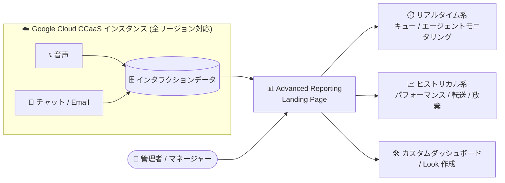

# Google Cloud Contact Center as a Service (CCaaS): 高度なレポート機能が全リージョンで利用可能に (+ 6.38 プレリリースノート公開・バグ修正)

**リリース日**: 2026-11-25

**サービス**: Google Cloud Contact Center as a Service (CCaaS)

**機能**: 高度なレポート機能 (Advanced reporting) の全リージョン提供、CCaaS 6.38 プレリリースノート公開、バグ修正

**ステータス**: Announcement / Fixed

📊 [このアップデートのインフォグラフィックを見る](https://takech9203.github.io/google-cloud-news-summary/20261125-ccaas-advanced-reporting-all-regions.html)

## 概要

Google Cloud CCaaS (旧 CCAI Platform) の高度なレポート機能 (Advanced reporting) のダッシュボードが、すべての Google Cloud CCaaS リージョンで利用可能になりました。高度なレポート機能は、コンタクトセンターのパフォーマンスを可視化する多数のダッシュボード群で、パフォーマンス概要、リアルタイムのキュー・エージェントモニタリング、転送分析、仮想エージェント分析、キャンペーン分析などを提供します。Advanced Reporting Landing Page からアクセスすると、カスタムダッシュボードの作成や Look の作成・リンクなど、高度な編集機能も利用できます。

あわせて、次期バージョンとなる CCaaS 6.38 のプレリリースノートが公開されました。また、本リリースではエージェントのチャット状態のスタック、待機エージェント不在時の高負荷コールによる不安定化、エージェントデスクトップのネットワーク飽和、長時間通話での文字起こし停止など、多数の不具合が修正されています。

本レポートは、コンタクトセンターの運用管理者、スーパーバイザー、および CCaaS を利用・検討している Solutions Architect を対象としています。

**アップデート前の課題**

- 高度なレポートダッシュボードは一部のリージョンでしか利用できず、リージョンによってはレガシーダッシュボードのみの運用となっていた
- 非アクティブで解除されたセッションを素早く再アクティブ化すると、エージェントがメッセージの送受信ができないまま「チャット割り当て済み」状態でスタックする問題があった
- 対応可能なエージェントがいないキューに大量のコールが流入すると、システムが不安定になりコールがドロップされる問題があった
- インスタンス全体のキュー更新が大量に発生すると、エージェントデスクトップで過剰なネットワークトラフィックと接続の飽和が発生していた
- 長時間の音声通話では、接続タイムアウトにより 60 分経過後に無音の参加者の文字起こしが停止する問題があった

**アップデート後の改善**

- 高度なレポートダッシュボードがすべての Google Cloud CCaaS リージョンで利用可能になり、どのリージョンのインスタンスでも同じ分析基盤を利用できるようになった
- 次期バージョン 6.38 の新機能をプレリリースノートで事前に確認できるようになった
- 上記のチャット状態スタック、高負荷時の不安定化、ネットワーク飽和、文字起こし停止などの不具合が修正され、プラットフォームの安定性と信頼性が向上した

## アーキテクチャ図

CCaaS インスタンスに蓄積された音声・デジタルチャネルのインタラクションデータを、Advanced Reporting Landing Page 経由でリアルタイム・ヒストリカルの各ダッシュボードやカスタムダッシュボードから分析できます。この仕組みがすべての CCaaS リージョンで利用可能になりました。

## サービスアップデートの詳細

### 主要なアップデート

1. **高度なレポート機能 (Advanced reporting) が全リージョンで利用可能に (Announcement)**
   - 高度なレポートダッシュボードが、すべての Google Cloud CCaaS リージョンで利用可能になった
   - Dashboard メニューから各ダッシュボードに素早くアクセスでき、Advanced Reporting Landing Page からはカスタムダッシュボード作成や Look の作成・リンクなどの高度な編集機能を利用できる
   - 提供されるダッシュボードには、パフォーマンス概要、リアルタイムチャネルパフォーマンス、キューモニタリング、エージェントモニタリング、接続中コール/チャットのステータス、チャネル/キューインターバル、転送、キューグループ、キューパフォーマンス、全インタラクション、放棄 (Abandons)、エージェントパフォーマンス/稼働状況/アクティビティタイムライン、仮想エージェント、メールパフォーマンス、キャンペーン、ボイスメールなどが含まれる

2. **CCaaS 6.38 プレリリースノートの公開 (Announcement)**
   - 次期バージョンとして予定されている CCaaS 6.38 のプレリリースノートが公開された
   - リリース時に提供が見込まれる新機能を事前に確認でき、アップデート計画や検証準備に活用できる

3. **バグ修正 (Fixed)**
   - 本リリースでは以下を含む多数の不具合が修正された (主な修正を抜粋):
   - 非アクティブで解除されたセッションの素早い再アクティブ化後、エージェントがメッセージを送受信できない「チャット割り当て済み」状態でスタックする問題を修正
   - 対応可能なエージェントがいないキューへの大量のコール流入により、システムが不安定になりコールがドロップされる問題を修正
   - インスタンス全体のキュー更新が大量に発生した際に、エージェントデスクトップで過剰なネットワークトラフィックと接続の飽和が発生する問題を修正
   - 長時間の音声通話で、接続タイムアウトにより 60 分経過後に無音の参加者の文字起こしが停止する問題を修正
   - このほか、仮想エージェント専用ターゲットへの自動リダイレクト転送の誤ルーティング、スキルベースカスケードキューのエラー、オーバーキャパシティ設定関連の不具合、チーム制限付きスーパーバイザーの閲覧権限、WhatsApp チャットでのバージ表示、ポータル認証エラー時のサインイン画面リダイレクトなど、多数の修正が含まれる (全リストは公式リリースノートを参照)

## 技術仕様

### 高度なレポート機能の利用要件

| 項目 | 詳細 |
|------|------|
| 有効化方法 | Google Cloud コンソールの CCAI Platform インスタンス詳細ページで「Edit > Configure extensions」から Advanced reporting 拡張機能を有効化 |
| 注意点 | 有効化すると高度なレポートダッシュボードが利用可能になり、レガシーダッシュボードは利用できなくなる。**一度有効化すると無効化できない** |
| アクセス方法 | Dashboard メニュー (閲覧・フィルタ変更) / Advanced Reporting Landing Page (カスタムダッシュボード作成などの高度な機能) |
| 日付範囲の制限 | ダッシュボードで指定できる日付範囲は最大 45 日 (例: Performance Overview Dashboard) |

### ロール別の権限

| ロール | 権限 |
|--------|------|
| Admin | すべてのダッシュボードの閲覧・編集が可能 |
| Manager Admin | すべてのダッシュボードの閲覧が可能 (編集不可) |
| Manager / Manager Team / Manager Data | 割り当てられたキューのダッシュボードの閲覧が可能 (編集不可) |
| Agent | ダッシュボードの閲覧・編集不可 |

## 設定方法

### 前提条件

1. Google Cloud プロジェクトに CCAI Platform (CCaaS) インスタンスが作成されていること
2. ダッシュボードの閲覧・編集に必要なロール (Admin など) が割り当てられていること

### 手順

#### ステップ 1: Advanced reporting 拡張機能を有効化する

1. Google Cloud コンソールでプロジェクトセレクタからインスタンスを含むプロジェクトを選択する
2. ナビゲーションメニューで「CCAI Platform」をクリックし、対象インスタンスを選択する
3. 「Edit > Configure extensions」をクリックする
4. 「Extensions」で「Advanced reporting」チェックボックスを選択し、「Save」をクリックする

**注意**: 有効化後はレガシーダッシュボードに戻せないため、事前に影響を確認してください。

#### ステップ 2: ダッシュボードを開く

- 閲覧のみ: CCAI Platform ポータルで「Dashboard」をクリックし、目的のダッシュボードを選択。必要に応じてフィルタを変更して「Update」をクリック
- 高度な機能 (カスタムダッシュボード作成など): 「Dashboard > Advanced Reporting」から Advanced Reporting Landing Page を開き、目的のダッシュボードを選択

## メリット

### ビジネス面

- **グローバルで統一された分析基盤**: どのリージョンにデプロイした CCaaS インスタンスでも同じ高度なレポートダッシュボードを利用でき、多拠点・多リージョン運用時のレポーティングを標準化できる
- **データドリブンな運用改善**: SLA 低下やキュー滞留の早期発見、エージェントパフォーマンス評価、キャンペーン効果測定など、意思決定に必要な情報を 1 か所で取得できる

### 技術面

- **リアルタイムとヒストリカルの両対応**: キュー・エージェントのリアルタイムモニタリングと、30 分インターバルでのトレンド分析・比較・リソース計画の両方に対応
- **カスタマイズ性**: Advanced Reporting Landing Page から、既存ダッシュボードのタイルをもとにしたカスタムダッシュボードや Look の作成が可能
- **安定性の向上**: 高負荷時のコール処理、エージェントデスクトップのネットワーク効率、長時間通話の文字起こしなど、多数の不具合修正によりプラットフォームの信頼性が向上

## デメリット・制約事項

### 制限事項

- Advanced reporting 拡張機能を有効化すると、レガシーダッシュボードは利用できなくなり、**一度有効化すると無効化できない**
- ダッシュボードで指定できる日付範囲は最大 45 日 (超過するとエラーになる)
- エージェントロールのユーザーはダッシュボードを閲覧できない

### 考慮すべき点

- レガシーダッシュボードを運用に組み込んでいる場合は、有効化前に高度なレポートダッシュボードへの移行計画を立てる必要がある
- ロールによって閲覧・編集範囲が異なるため、組織のレポーティング運用に合わせたロール設計が必要
- CCaaS 6.38 のプレリリースノートは「リリース時に提供が見込まれる機能」であり、内容は変更される可能性がある

## ユースケース

### ユースケース 1: 日本リージョンでのコンタクトセンター運用の可視化

**シナリオ**: asia-northeast1 (東京) にデプロイした CCaaS インスタンスで、キューの滞留状況やエージェントの稼働状況をリアルタイムに把握したい。

**実装例**: Advanced reporting 拡張機能を有効化し、Queue Monitoring / Agent Monitoring ダッシュボードでリアルタイム監視を行い、Channel Interval ダッシュボードで 30 分単位のトレンドを分析する。

**効果**: 全リージョン対応により、東京リージョンでも SLA 低下やキュー滞留をリアルタイムに検知し、ルーティングや人員配置の調整に迅速に反映できる。

### ユースケース 2: 多リージョン展開企業でのレポーティング標準化

**シナリオ**: 北米・欧州・アジアの複数リージョンに CCaaS インスタンスを展開しており、リージョンごとにダッシュボードの機能差があったため、統一された KPI レポートの作成が難しかった。

**効果**: すべてのリージョンで同一の高度なレポートダッシュボードが利用できるようになり、カスタムダッシュボードを含むレポーティング運用をグローバルで標準化できる。

## 料金

CCaaS インスタンスは月額課金で、インスタンスに割り当てられた課金モデル (同時エージェント数、ネームドエージェント数、エージェントのサインイン時間 (分) のいずれか) に基づいて課金されます。テレフォニー費用は従量課金です。最新の料金詳細は公式ドキュメント・営業窓口で確認してください。

## 利用可能リージョン

高度なレポート機能は、すべての CCAI Platform (CCaaS) リージョンで利用可能です。CCaaS がデプロイ可能な Google Cloud リージョンは以下のとおりです。

| エリア | リージョン |
|--------|-----------|
| Americas | northamerica-northeast1 (モントリオール)、northamerica-northeast2 (トロント)、us-central1 (アイオワ)、us-east1 (サウスカロライナ)、us-east4 (バージニア)、us-west1 (オレゴン)、southamerica-east1 (サンパウロ) |
| Europe | europe-west1 (ベルギー)、europe-west2 (ロンドン)、europe-west3 (フランクフルト)、europe-west4 (エームスハーフェン)、europe-west6 (チューリッヒ) |
| Middle East | me-west1 (テルアビブ) |
| Asia Pacific | asia-northeast1 (東京)、asia-northeast3 (ソウル)、asia-south1 (ムンバイ)、asia-southeast1 (シンガポール)、asia-southeast2 (ジャカルタ)、australia-southeast1 (シドニー) |

最新のリージョン一覧は [Google Cloud regions](https://cloud.google.com/contact-center/ccai-platform/docs/localities#regions) を参照してください。

## 関連サービス・機能

- **Looker**: 高度なレポートダッシュボードでは、Look の作成とダッシュボードへのリンク、タイルベースのカスタムダッシュボード作成など、Looker ベースの分析機能を利用できる
- **Dialogflow (仮想エージェント)**: Virtual Agent ダッシュボードで仮想エージェントのパフォーマンスを評価し、改善点を特定できる
- **Gemini Enterprise for Customer Experience**: CCaaS (CCAI Platform) は Google Cloud ネイティブな CCaaS プラットフォームとして、Agent Assist や Insights などの CX 向け AI 機能と連携する

## 参考リンク

- 📊 [インフォグラフィック](https://takech9203.github.io/google-cloud-news-summary/20261125-ccaas-advanced-reporting-all-regions.html)
- [公式リリースノート (2026 年 11 月 25 日)](https://docs.cloud.google.com/release-notes#November_25_2026)
- [Advanced reporting dashboards の概要](https://cloud.google.com/contact-center/ccai-platform/docs/dashboards-overview)
- [Google Cloud regions (CCaaS 利用可能リージョン)](https://cloud.google.com/contact-center/ccai-platform/docs/localities#regions)
- [CCAI Platform の利用開始 (インスタンスサイズ・課金モデル)](https://cloud.google.com/contact-center/ccai-platform/docs/get-started)

## まとめ

高度なレポートダッシュボードが全リージョンで利用可能になったことで、どのリージョンの CCaaS インスタンスでも統一された分析・レポーティング基盤を利用できるようになりました。レガシーダッシュボードを利用中の場合は、有効化後に戻せない点に注意しつつ、Advanced reporting 拡張機能への移行を計画することを推奨します。あわせて、安定性に関わる多数のバグ修正が含まれるため、6.38 プレリリースノートの確認と合わせてアップデート内容を把握しておきましょう。

---

**タグ**: #GoogleCloud #CCaaS #CCAIPlatform #ContactCenter #AdvancedReporting #Dashboards #Looker #リリースノート
