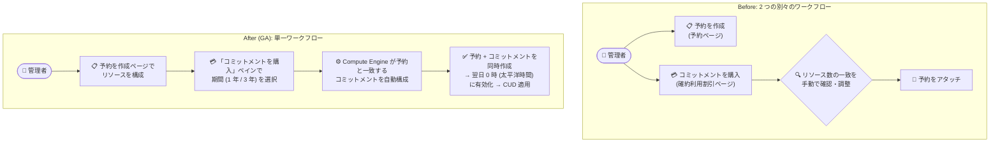

# Compute Engine: 予約作成時の確約利用割引 (CUD) 同時購入が GA

**リリース日**: 2026-11-25

**サービス**: Compute Engine

**機能**: オンデマンド予約作成時のハードウェアリソースベース コミットメント同時購入

**ステータス**: Generally Available (GA)

📊 [このアップデートのインフォグラフィックを見る](https://takech9203.github.io/google-cloud-news-summary/20261125-compute-engine-cud-purchase-with-reservation-ga.html)

## 概要

Google Cloud コンソールでオンデマンド予約 (on-demand reservation) を作成する際に、予約するリソースの数量とタイプに一致するハードウェアリソースベースのコミットメント (確約利用契約) を同時に購入・アタッチできる機能が一般提供 (GA) になりました。コミットメントが有効化されると、対象となるリソース使用量に基づいて確約利用割引 (CUD: Committed Use Discounts) が適用されます。

この機能により、「キャパシティの確保 (予約)」と「コスト削減 (CUD)」という 2 つの操作を、コンソールの「予約を作成」ページ内の単一のワークフローで完結できます。Compute Engine が予約の合計リソース (vCPU、メモリ、GPU、Local SSD ディスク) に一致するようにコミットメントのリソースを自動設定するため、手動でリソース数を揃える際の設定ミスを防げます。

対象ユーザーは、安定稼働するワークロード向けにゾーン内のキャパシティを確保しつつ、1 年または 3 年のコミットメントで割引を受けたいインフラ管理者・FinOps 担当者です。

**アップデート前の課題**

- 予約の作成とコミットメントの購入は別々のワークフローで、「確約利用割引」ページ (または gcloud CLI / REST) からコミットメントを購入し、予約を作成・アタッチする必要があった
- GPU やほとんどの Local SSD ディスクでは、コミットメントのリソース数と予約のリソース数を正確に一致させる必要があり、手動での整合性確認が必要だった
- 予約とコミットメントを別々に操作するため、予約したのにコミットメントのアタッチを忘れる、リソース量の不一致が発生する、といった運用上のリスクがあった

**アップデート後の改善**

- コンソールの「予約を作成」ページから、予約の作成とコミットメントの購入を 1 つのフローで同時に実行できるようになった
- Compute Engine がコミットメントの vCPU、メモリ、GPU、Local SSD ディスク (適用除外の local Titanium SSD を含む) を予約の合計リソースに自動的に一致させるため、リソース数の手動調整が不要になった
- VM プロパティの直接指定に加えて、インスタンステンプレートや既存 VM をベースにした予約でもコミットメントを同時購入できる
- コミットメント有効化後は、対象リソースの使用量に応じて CUD が自動的に適用される

## アーキテクチャ図

従来は予約とコミットメントを別々のページで作成しリソース数を手動で一致させる必要がありましたが、GA となった本機能では「予約を作成」ページの単一フローで両方を同時に作成でき、リソースの一致は Compute Engine が自動的に保証します。

## サービスアップデートの詳細

### 主要機能

1. **予約作成フローへのコミットメント購入の統合**
   - 「予約を作成」ページの「Maximize savings with a committed use discount」セクションから「Purchase a commitment」をクリックして、コミットメントを構成できる
   - 単一プロジェクト予約 (Local) と共有予約 (Shared) の両方に対応
   - VM プロパティの直接指定、インスタンステンプレート、既存 VM のいずれをベースにした予約でも利用可能

2. **リソースの自動マッチング**
   - Compute Engine がコミットメントの vCPU、メモリ、GPU、Local SSD ディスク (適用除外の local Titanium SSD ディスクを含む) を予約の合計リソースに完全一致するよう自動設定する
   - コミットメント構成 (per-VM / 合計) は読み取り専用のサマリーとして表示され、サポートされるマシンファミリーでは推定コストも確認できる

3. **ドラフトコミットメントと不一致検出**
   - 「Attach commitment」をクリックするとコミットメントはドラフトとして予約作成ページに保存され、「Create」をクリックするまで購入・課金は発生しない
   - ドラフト追加後にリージョン、マシンタイプ、vCPU、メモリ、VM 数、GPU、Local SSD を変更すると、インラインの不一致エラーが作成をブロックする。コミットメントカードの「Edit」で更新するか、「Remove」で削除して解決する

4. **コミットメントの条件設定**
   - プランは 1 年または 3 年を選択。開始日は翌日の午前 0 時 (米国・カナダ太平洋時間) に自動設定される
   - カスタム終了日の指定による期間延長や、期間終了時の自動更新 (Auto-renew) も設定可能

## 技術仕様

### 本ワークフローの仕様

| 項目 | 詳細 |
|------|------|
| 利用手段 | Google Cloud コンソールの「予約を作成」ページのみ (gcloud CLI / REST は非対応) |
| 対象予約 | 単一プロジェクトまたは共有のオンデマンド予約 |
| コミットメント種別 | ハードウェアリソースベースのコミットメント |
| アタッチ構成 | 新規予約 1 件に対して新規コミットメント 1 件のみ |
| リソースマッチング | vCPU、メモリ、GPU、Local SSD (local Titanium SSD 含む) を予約の合計リソースに自動一致 |
| 有効化タイミング | 購入の翌日午前 0 時 (米国・カナダ太平洋時間、UTC-8 / UTC-7)。それまでのステータスは PENDING (NOT_YET_ACTIVE) |
| 購入後のキャンセル | 不可 |

### 必要な権限

| 操作 | 必要な権限 |
|------|-----------|
| 予約の作成 | `compute.reservations.create` (プロジェクト) |
| コミットメントの購入 | `compute.commitments.create` (プロジェクト) |
| インスタンステンプレートの指定 | `compute.instanceTemplates.useReadOnly` (テンプレート) |

## 設定方法

### 前提条件

1. 予約の作成とコミットメントの購入は同一プロジェクト・同一リージョンで行う
2. 予約に GPU または Local SSD ディスクが含まれる場合は、自動削除 (Enable auto-delete) を無効にする
3. 共有予約の場合は、`compute.sharedReservationsOwnerProjects` 組織ポリシーでオーナープロジェクトを許可リストに登録し、各プロジェクトのクォータを確認する。コンシューマープロジェクトで CUD を受けるには、Cloud Billing アカウントで CUD 共有を有効にし、全コンシューマープロジェクトが同一の Cloud Billing アカウントに属している必要がある

### 手順

#### ステップ 1: 予約を構成する

1. Google Cloud コンソールで「予約」ページに移動し、「予約を作成」をクリック
2. 名前、リージョン、ゾーン、共有タイプ (Local / Shared) を設定
3. 「リソースの詳細」セクションで VM インスタンス数を入力し、マシンタイプの指定・インスタンステンプレート・既存 VM のいずれかで VM 構成を指定

#### ステップ 2: コミットメントを購入する

1. 「Maximize savings with a committed use discount」セクションで「Purchase a commitment」をクリック
2. コミットメント名を入力し、期間 (1 年 / 3 年) を選択。必要に応じてカスタム終了日や自動更新を設定
3. 読み取り専用のマシン構成・コミットメント構成サマリーで、VM あたりおよび合計の確約リソースと推定コストを確認
4. 「Attach commitment」をクリックしてドラフトとして保存

#### ステップ 3: 作成を確定する

1. 「Disclosures」セクションで料金、割引の適用条件、利用規約を確認
2. 同意のチェックボックスを選択して「Create」をクリック
3. 予約とコミットメントが同時に作成され、コミットメントは翌日午前 0 時 (太平洋時間) に有効化される。予約の詳細ページまたは「Linked commitment」列でアタッチ状況を確認できる

## メリット

### ビジネス面

- **コスト削減の確実な適用**: キャパシティ確保と同時に CUD を購入するため、予約リソースに割引を適用し忘れるリスクを低減できる
- **購入前のコスト可視化**: サポートされるマシンファミリーでは、購入確定前に推定コストをサマリーで確認できる

### 技術面

- **リソース不一致の防止**: GPU や Local SSD で求められる「コミットメントと予約のリソース数の完全一致」を Compute Engine が自動的に保証する
- **ワークフローの簡素化**: 従来 2 つのページにまたがっていた操作が単一フローに統合され、ドラフト保存と不一致検出により安全に構成を変更できる
- **柔軟な構成指定**: インスタンステンプレートや既存 VM をベースにした予約でも利用でき、既存環境の構成を流用しやすい

## デメリット・制約事項

### 制限事項

- このワークフローは Google Cloud コンソール限定で、gcloud CLI や REST API からは利用できない (プログラムからのアタッチは「確約利用割引」ページ相当のワークフローを使用)
- 新規予約 1 件に新規コミットメント 1 件のみアタッチ可能。既存予約のアタッチ、複数予約のアタッチ、予約と異なる vCPU / メモリ量のコミットメントには対応しない (その場合は「確約利用割引」ページから購入する)
- 共有コアマシンタイプなど、リソースベース CUD に対応しないマシン構成では「Purchase a commitment」ボタンが利用できない。拡張メモリを使用するカスタムマシンタイプにもコミットメントをアタッチできない
- A3 Mega、H4D、M4、M4N、X4、X5、Z4D など複数のコミットメントタイプを持つマシンシリーズや、Virtual Workstation GPU をアタッチした場合は、コミットメント不一致エラーで作成が失敗することがある (この場合は「確約利用割引」ページから購入する)

### 考慮すべき点

- コミットメントは購入後にキャンセルできず、使用の有無にかかわらず期間終了まで毎月課金される
- コミットメントは購入したプロジェクトとリージョンに紐づく。Compute Engine はコミットメントを購入したリージョンごとにプロジェクトへのリーエン (lien) を保持する
- 共有予約でコミットメントのプロジェクト外から CUD を受けるには、同一 Cloud Billing アカウント内のプロジェクトとのみ予約を共有し、CUD 共有を有効にする必要がある

## ユースケース

### ユースケース 1: 本番ワークロードのキャパシティ確保とコスト最適化の同時実行

**シナリオ**: 特定ゾーンで常時稼働する本番 VM 群 (例: n2-standard 系 20 台) のキャパシティを確実に確保しつつ、1 年コミットメントで割引を受けたい。

**実装例**: コンソールの「予約を作成」ページで VM 数とマシンタイプを指定し、「Purchase a commitment」で 1 年プランを選択して予約とコミットメントを同時作成する。

**効果**: ゾーン内のキャパシティ確保と CUD によるコスト削減が 1 回の操作で完了し、リソース量は自動一致するため設定ミスがない。

### ユースケース 2: 既存 VM 構成をベースにした予約 + コミットメント購入

**シナリオ**: すでに稼働中の VM と同じ構成でキャパシティを追加確保し、その分を長期コミットメントでカバーしたい。

**効果**: 「既存 VM を使用」で予約を構成すれば、マシンタイプや GPU 構成を手動転記することなく、一致するコミットメントを同時に購入できる。

## 料金

本機能自体に追加料金はなく、購入するコミットメントに対して通常のリソースベース CUD の料金体系が適用されます。

- コミットメントは期間中、リソースの使用有無にかかわらず毎月課金される
- 割引後の価格は、コミットメント有効化日のオンデマンド価格に基づいて算出され、期間終了まで固定される
- ハードウェアコミットメントの割引率の目安 (公式ドキュメントより):
  - vCPU / メモリ: ほとんどのマシンタイプで最大 55% オフ、一部 (メモリ最適化など) で最大 70% オフ
  - GPU: ほとんどの GPU タイプで最大 55% オフ、一部で最大 65% オフ
  - Local SSD ディスク: 最大 55% オフ
- 3 年プランは 1 年プランより高い割引率が適用される
- カスタムマシンタイプをコミットメントで利用する場合は、コミットメント価格に 5% のプレミアムが加算される

リージョン・リソースごとの 1 年 / 3 年コミットメント価格は [Compute Engine の料金ページ](https://cloud.google.com/products/compute/pricing)を参照してください。

## 関連サービス・機能

- **オンデマンド予約 (Reservations)**: 特定ゾーンでの Compute Engine リソースのキャパシティ確保機能。本アップデートの対象
- **確約利用割引 (CUD) ページ**: 既存予約のアタッチ、複数予約のアタッチ、予約と異なるリソース量でのコミットメント購入など、より柔軟な購入ワークフローを提供 (コンソール / gcloud CLI / REST)
- **CUD 共有 (CUD sharing)**: 同一 Cloud Billing アカウント内の全プロジェクトでリソースベース CUD をプールして適用する機能。2026 年 6 月 16 日以降に作成された Cloud Billing アカウントではデフォルトで有効
- **Vertex AI**: GPU VM の予約を Vertex AI のカスタムトレーニングジョブや予測ジョブから利用するよう共有設定が可能

## 参考リンク

- 📊 [インフォグラフィック](https://takech9203.github.io/google-cloud-news-summary/20261125-compute-engine-cud-purchase-with-reservation-ga.html)
- [公式リリースノート](https://docs.cloud.google.com/release-notes#November_25_2026)
- [ドキュメント: Purchase hardware commitments with attached reservations](https://cloud.google.com/compute/docs/committed-use-discounts/purchase-commitments-with-reservations#purchase-cud-while-creating-reservation)
- [ドキュメント: Resource-based committed use discounts](https://docs.cloud.google.com/compute/docs/instances/signing-up-committed-use-discounts)
- [ドキュメント: Committed use discounts overview](https://docs.cloud.google.com/compute/docs/instances/committed-use-discounts-overview)
- [料金ページ: Compute Engine pricing](https://cloud.google.com/products/compute/pricing)

## まとめ

予約作成とコミットメント購入が単一のコンソールワークフローに統合されたことで、キャパシティ確保とコスト最適化を同時かつ安全に実行できるようになりました。安定稼働するワークロードで予約を利用している場合は、新規予約作成時に本ワークフローでの CUD 同時購入を検討してください。ただしコンソール限定であり、複数予約のアタッチや A3 Mega / X4 など一部マシンシリーズでは従来の「確約利用割引」ページからの購入が必要な点に注意が必要です。

---

**タグ**: Compute Engine, CUD, 確約利用割引, 予約, Reservations, コスト最適化, GA
