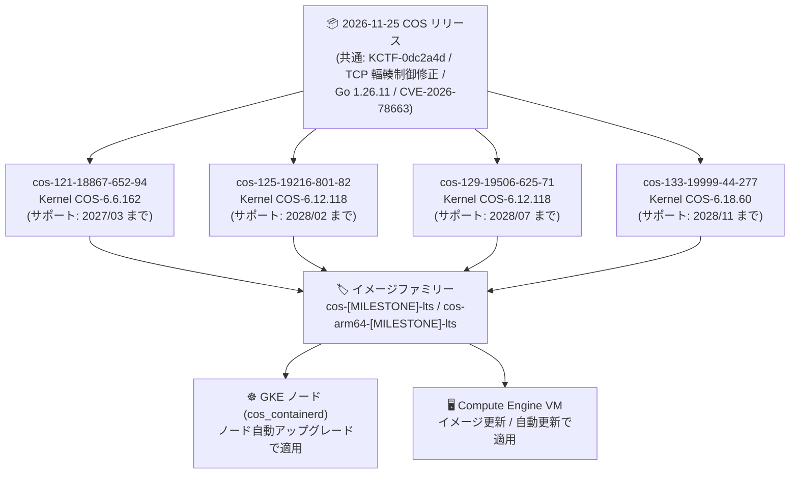

# Container-Optimized OS: 4 つの LTS マイルストーンで新イメージをリリース (TCP 輻輳制御の修正と多数の CVE 対応)

**リリース日**: 2026-11-25

**サービス**: Container-Optimized OS

**機能**: cos-125 / cos-129 / cos-121 / cos-133 イメージリリース

**ステータス**: GA (LTS リリース)

📊 [このアップデートのインフォグラフィックを見る](https://takech9203.github.io/google-cloud-news-summary/20261125-container-optimized-os-image-updates.html)

## 概要

2026 年 11 月 25 日、Container-Optimized OS (COS) のアクティブな 4 つの LTS マイルストーンすべてで新しいイメージがリリースされました。対象は `cos-125-19216-801-82`、`cos-129-19506-625-71`、`cos-121-18867-652-94`、`cos-133-19999-44-277` の 4 イメージで、カーネル更新、TCP 輻輳制御の不具合修正、および多数の CVE 修正を含む大規模なメンテナンスリリースです。

複数のマイルストーンに共通する修正として、**TCP 輻輳制御における整数オーバーフローの修正** (cos-125 / cos-121 / cos-133)、**Linux カーネルの KCTF-0dc2a4d 修正** (4 マイルストーンすべて)、**Go 1.26.11 へのアップグレードによる多数の Go 関連 CVE 修正** (cos-125 / cos-129 / cos-133)、**CVE-2026-78663 の各種コンポーネントでの修正** (cos-125 / cos-129 / cos-121) が含まれます。また、cos-125 と cos-129 では Linux カーネルが v6.12.118 に更新されました。

Container-Optimized OS は Google Kubernetes Engine (GKE) のノードイメージ (`cos_containerd`) や Compute Engine のコンテナワークロードで使用される、コンテナ実行に最適化されたセキュリティ重視の OS です。今回はアクティブな全 LTS マイルストーンが同日に更新されたため、どのマイルストーンを利用している場合でも更新対象となる、影響範囲の広いアップデートです。

**アップデート前の課題**

- 各 LTS マイルストーンの直前イメージには、TCP 輻輳制御の整数オーバーフロー問題が残っていた (cos-125 / cos-121 / cos-133)
- OpenSSH、containerd、cri-tools、glibc、Go ランタイム、各種 Google エージェント (google-guest-agent / google-osconfig-agent / node-problem-detector) などに多数の既知 CVE が未修正のまま残っていた
- Linux カーネルの脆弱性 (KCTF-0dc2a4d、CVE-2026-23240、CVE-2026-99320 など) が未修正だった

**アップデート後の改善**

- 4 つの LTS マイルストーンすべてで Linux カーネルの KCTF-0dc2a4d が修正され、カーネルレイヤーのセキュリティが向上した
- TCP 輻輳制御の整数オーバーフローが修正され (cos-125 / cos-121 / cos-133)、ネットワークスタックの安定性が改善された
- Go 1.26.11 への更新により、CVE-2026-97033 / CVE-2026-97040 をはじめとする多数の Go 関連 CVE が修正された (cos-125 / cos-129 / cos-133)
- CVE-2026-78663 が docker、containerd、cri-tools、cos-extensions、google-guest-agent、google-osconfig-agent、node-problem-detector など広範なコンポーネントで修正された (cos-125 / cos-129 / cos-121)

## アーキテクチャ図



アクティブな 4 つの LTS マイルストーンすべてに同日リリースが展開され、各イメージファミリーを経由して GKE ノードと Compute Engine VM に適用される構造を示しています。

## サービスアップデートの詳細

### 主要機能

1. **共通のセキュリティ・不具合修正**
   - TCP 輻輳制御における整数オーバーフローを修正 (cos-125 / cos-121 / cos-133)
   - Linux カーネルの KCTF-0dc2a4d を修正 (4 マイルストーンすべて)
   - dev-lang/go を 1.26.11 にアップグレードし、Go 関連の CVE を修正 (cos-125 / cos-129 / cos-133)
   - CVE-2026-78663 を複数コンポーネントで修正 (cos-125 / cos-129 / cos-121)

2. **カーネル更新**
   - cos-125 / cos-129: Linux カーネルを v6.12.118 に更新
   - cos-121: CVE-2026-23240 (KCTF-7bb0931) をカーネルで修正
   - cos-133: CVE-2026-99320 をカーネルで修正

3. **コンポーネント更新**
   - cos-gpu-installer を v2.8.0 に更新 (cos-125 / cos-129)
   - node-problem-detector 内の prometheus を v0.305.3 に更新し CVE-2026-42154 を修正 (cos-125 / cos-129)
   - cos-125: libuv 1.51.0-r1 (CVE-2024-24806)、tcpdump 4.99.4-r1 (CVE-2018-16301)、libpcap v1.10.7 (CVE-2026-0799)、libX11 / compose-tables 1.8.13 (CVE-2023-43787 / 43786 / 43785 / 3138) へ更新

4. **ランタイム sysctl の変更**
   - cos-129: `net.ipv4.udp_mem` の値を変更 (188034 250714 376068 → 188034 250715 376068)
   - cos-121: `net.ipv4.tcp_mem` / `net.ipv4.udp_mem` の値を変更

## 技術仕様

### リリース構成

| 項目 | cos-125-19216-801-82 | cos-129-19506-625-71 | cos-121-18867-652-94 | cos-133-19999-44-277 |
|------|---------------------|---------------------|---------------------|---------------------|
| マイルストーン | 125 (LTS) | 129 (LTS) | 121 (LTS) | 133 (LTS) |
| Kernel | COS-6.12.118 | COS-6.12.118 | COS-6.6.162 | COS-6.18.60 |
| Docker | v27.5.1 | v27.5.1 | v27.5.1 | v29.4.3 |
| Containerd | v2.2.7 | v2.3.7 | v2.0.10 | v2.4.1 |
| イメージファミリー | cos-125-lts | cos-129-lts | cos-121-lts | cos-133-lts |
| サポート終了 | 2028 年 2 月 | 2028 年 7 月 | 2027 年 3 月 | 2028 年 11 月 |

### セキュリティ修正の一覧 (cos-125-19216-801-82)

| 脆弱性 | 対象コンポーネント |
|-----|-------------------|
| CVE-2026-101918 | dev-python/pyjwt |
| CVE-2026-106555, CVE-2026-106553 | net-misc/openssh |
| CVE-2026-24051 | cri-tools |
| CVE-2026-39821, CVE-2026-116587 | containerd |
| CVE-2026-78663 | cos-extensions / cri-tools / google-guest-agent / node-problem-detector |
| GHSA-hrxh-6v49-42gf, CVE-2026-84304 | google-osconfig-agent |
| GHSA-hrxh-6v49-42gf | cni-plugins |
| KCTF-0dc2a4d | Linux kernel |
| CVE-2024-24806 | dev-libs/libuv (1.51.0-r1 へ更新) |
| CVE-2026-56857, CVE-2026-78660, CVE-2026-94448, CVE-2026-97030, CVE-2026-97033〜97043, CVE-2026-97054 | dev-lang/go (1.26.11 へ更新) |
| CVE-2026-42154 | prometheus (node-problem-detector 内、v0.305.3 へ更新) |
| CVE-2018-16301 | net-analyzer/tcpdump (4.99.4-r1 へ更新) |
| CVE-2026-0799 | net-libs/libpcap (v1.10.7 へ更新) |
| CVE-2023-43787, CVE-2023-43786, CVE-2023-43785, CVE-2023-3138 | x11-libs/libX11 / x11-misc/compose-tables (1.8.13 へ更新) |

### セキュリティ修正の一覧 (cos-129-19506-625-71)

| 脆弱性 | 対象コンポーネント |
|-----|-------------------|
| CVE-2026-102275 | dev-python/pyjwt |
| CVE-2026-15146 | net-misc/wget |
| CVE-2026-6368 | sys-libs/glibc |
| CVE-2026-78663 | docker / google-guest-agent / google-osconfig-agent / guest-agent / node-problem-detector |
| CVE-2026-97687 | dev-python/urllib3 |
| GHSA-hrxh-6v49-42gf | cos-extensions / cri-tools |
| KCTF-0dc2a4d | Linux kernel |
| CVE-2026-97040, CVE-2026-97034, CVE-2026-97033 | dev-lang/go (v1.26.11 へ更新) |
| CVE-2026-42154 | prometheus (node-problem-detector 内、v0.305.3 へ更新) |

### セキュリティ修正の一覧 (cos-121-18867-652-94)

| 脆弱性 | 対象コンポーネント |
|-----|-------------------|
| CVE-2026-102633 | dev-libs/expat |
| CVE-2026-23240 (KCTF-7bb0931) | Linux kernel |
| CVE-2026-24051 | cri-tools |
| CVE-2026-6368 | sys-libs/glibc |
| CVE-2026-78663 | containerd / cri-tools / docker |
| KCTF-0dc2a4d | Linux kernel |

### セキュリティ修正の一覧 (cos-133-19999-44-277)

| 脆弱性 | 対象コンポーネント |
|-----|-------------------|
| CVE-2026-106553, CVE-2026-106555 | net-misc/openssh |
| CVE-2026-84304 | google-guest-agent |
| CVE-2026-99320 | Linux kernel |
| GHSA-hrxh-6v49-42gf, CVE-2026-84304 | google-osconfig-agent |
| GHSA-hrxh-6v49-42gf | cri-tools |
| KCTF-0dc2a4d | Linux kernel |
| CVE-2026-97033, CVE-2026-97040 | dev-lang/go (v1.26.11 へ更新) |

### ランタイム sysctl の変更

| イメージ | パラメータ | 変更前 | 変更後 |
|---------|-----------|--------|--------|
| cos-129-19506-625-71 | net.ipv4.udp_mem | 188034 250714 376068 | 188034 250715 376068 |
| cos-121-18867-652-94 | net.ipv4.tcp_mem | 94044 125392 188088 | 94041 125391 188082 |
| cos-121-18867-652-94 | net.ipv4.udp_mem | 188088 250784 376176 | 188085 250783 376170 |

## 設定方法

### 前提条件

1. Container-Optimized OS を GKE ノードイメージまたは Compute Engine VM イメージとして使用していること
2. LTS マイルストーン 121 / 125 / 129 / 133 のいずれかのイメージを利用していること

### 手順

#### ステップ 1: 現在のイメージバージョンの確認

```bash
# Compute Engine インスタンスの OS バージョン確認 (インスタンス内で実行)
cat /etc/os-release

# GKE ノードプールのノードイメージ確認
gcloud container node-pools describe NODE_POOL_NAME \
  --cluster=CLUSTER_NAME \
  --location=LOCATION \
  --format="value(config.imageType)"
```

`/etc/os-release` の `VERSION_ID` がマイルストーン、`BUILD_ID` がビルド番号を示します。

#### ステップ 2: 新リリースの適用

```bash
# Compute Engine: 新しい COS イメージの確認 (例: cos-133-lts ファミリー)
gcloud compute images list --project cos-cloud \
  --filter="family~cos-1(21|25|29|33)-lts"

# Compute Engine: 自動更新を有効化する場合 (Milestone 117 以降はデフォルト無効)
gcloud compute instances add-metadata INSTANCE_NAME \
  --metadata cos-update-strategy=update_enabled
```

GKE ノードでは COS の自動更新機能は無効化されており、GKE のノード自動アップグレード機能で更新されます。

## メリット

### ビジネス面

- **セキュリティリスクの低減**: カーネル、コンテナランタイム、SSH、Go ランタイムなど広範なレイヤーの既知脆弱性が一括で修正され、コンテナ実行基盤全体の脆弱性リスクが低減される
- **コンプライアンス対応**: 脆弱性スキャンで検出される多数の CVE が解消され、脆弱性管理ポリシーやセキュリティ監査への対応が容易になる

### 技術面

- **全アクティブ LTS マイルストーンの同時更新**: 121 / 125 / 129 / 133 のどのマイルストーンを利用していても同日に修正が提供され、マイルストーン間の修正状況の差が生じにくい
- **ネットワークスタックの安定性向上**: TCP 輻輳制御の整数オーバーフロー修正により、ネットワーク処理の不具合リスクが低減される
- **共通修正の横展開**: KCTF-0dc2a4d (カーネル)、Go 1.26.11、CVE-2026-78663 などの共通修正が複数マイルストーンに展開され、一貫したセキュリティレベルを維持できる

## デメリット・制約事項

### 制限事項

- COS の自動更新は再起動するまで有効にならない (自動更新機能は強制再起動を行わない)
- Milestone 117 以降、COS イメージの自動更新機能はデフォルトで無効のため、スタンドアロン利用時は `cos-update-strategy` メタデータの設定またはイメージの差し替えが必要

### 考慮すべき点

- GKE ノードは GKE のノード自動アップグレードで更新されるため、新リリースが反映されるタイミングは GKE のリリースチャネルに依存する
- cos-129 / cos-121 では `net.ipv4.tcp_mem` / `net.ipv4.udp_mem` の sysctl デフォルト値が変更されているため、ネットワークバッファのチューニングを行っているワークロードは影響を確認すること
- カーネル更新 (cos-125 / cos-129 は v6.12.118) を含むため、カーネル更新に敏感な本番ワークロードでは事前検証を推奨
- 各 CVE の深刻度や影響範囲はリリースノートに記載がないため、必要に応じて NVD などの脆弱性データベースで確認すること

## ユースケース

### ユースケース 1: GKE ノードの脆弱性一括解消

**シナリオ**: セキュリティポリシーで既知 CVE の修正適用期限が定められている組織で、cos_containerd ノードに残る OpenSSH、containerd、Go ランタイムなどの CVE を解消したい。

**実装例**:
```bash
# 本リリースを含む GKE パッチバージョンへノードプールをアップグレード
gcloud container clusters upgrade CLUSTER_NAME \
  --location=LOCATION \
  --node-pool=NODE_POOL_NAME \
  --cluster-version=GKE_PATCH_VERSION
```

**効果**: ノード OS レイヤーの多数の CVE が解消され、脆弱性スキャンの指摘事項を大幅に低減できる。

### ユースケース 2: 複数マイルストーンを併用する Compute Engine 環境の一斉パッチ適用

**シナリオ**: 移行時期の違いから cos-121 と cos-133 など複数マイルストーンの COS VM が混在する環境で、共通のカーネル脆弱性 (KCTF-0dc2a4d) と TCP 輻輳制御の不具合を解消したい。

**効果**: 全アクティブ LTS マイルストーンで同日に修正版が提供されているため、マイルストーンごとに個別の対応時期を調整する必要がなく、一斉にイメージを更新して共通の修正を適用できる。

## 料金

Container-Optimized OS 自体のイメージ更新に伴う追加料金はありません。料金は実行する Compute Engine / GKE のリソースに依存します。

- [Compute Engine 料金](https://cloud.google.com/compute/pricing)
- [GKE 料金](https://cloud.google.com/kubernetes-engine/pricing)

## 関連サービス・機能

- **Google Kubernetes Engine (GKE)**: COS は GKE のデフォルトノードイメージ (`cos_containerd`)。Autopilot クラスタは常にこのイメージを使用し、ノード自動アップグレードで新リリースが適用される
- **Compute Engine**: コンテナ実行用 VM イメージとして COS を利用可能。cos-121-lts / cos-125-lts / cos-129-lts / cos-133-lts の各イメージファミリーで本リリースが提供される
- **Container-Optimized OS 自動更新**: スタンドアロン VM では `cos-update-strategy` メタデータで自動更新を制御できる (Milestone 117 以降はデフォルト無効)

## 参考リンク

- 📊 [インフォグラフィック](https://takech9203.github.io/google-cloud-news-summary/20261125-container-optimized-os-image-updates.html)
- [公式リリースノート (Google Cloud)](https://docs.cloud.google.com/release-notes#November_25_2026)
- [COS Milestone 121 リリースノート](https://docs.cloud.google.com/container-optimized-os/docs/release-notes/m121)
- [COS Milestone 125 リリースノート](https://docs.cloud.google.com/container-optimized-os/docs/release-notes/m125)
- [COS Milestone 129 リリースノート](https://docs.cloud.google.com/container-optimized-os/docs/release-notes/m129)
- [COS Milestone 133 リリースノート](https://docs.cloud.google.com/container-optimized-os/docs/release-notes/m133)
- [Container-Optimized OS ドキュメント](https://cloud.google.com/container-optimized-os/docs)
- [COS のバージョニングと LTS ライフサイクル](https://docs.cloud.google.com/container-optimized-os/docs/concepts/versioning)
- [関連レポート: cos-133 カーネル CVE 修正 (2026-11-20)](./2026-11-20-container-optimized-os-cos-133-kernel-cve-fixes.md)

## まとめ

本リリースは、Container-Optimized OS のアクティブな 4 つの LTS マイルストーン (121 / 125 / 129 / 133) を同日に更新し、TCP 輻輳制御の整数オーバーフロー修正、カーネル更新 (v6.12.118 ほか)、Go 1.26.11 への更新を含む多数の CVE 修正を展開する大規模なメンテナンスリリースです。どのマイルストーンを利用している場合でも更新対象となるため、GKE のノード自動アップグレードや Compute Engine のイメージ更新を通じて、早期に新イメージを適用することを推奨します。

---

**タグ**: Container-Optimized OS, GKE, Compute Engine, セキュリティ, CVE, LTS, Linux カーネル, Docker, Containerd
