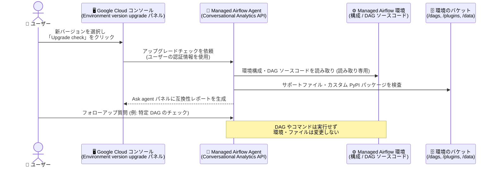

# Managed Service for Apache Airflow: Agentic アップグレードチェックの提供開始

**リリース日**: 2026-11-26

**サービス**: Managed Service for Apache Airflow (Managed Airflow / 旧 Cloud Composer)

**機能**: Agentic アップグレードチェック (Agentic upgrade check)

**ステータス**: 利用可能 (Feature)

📊 [このアップデートのインフォグラフィックを見る](https://takech9203.github.io/google-cloud-news-summary/20261126-managed-airflow-agentic-upgrade-check.html)

## 概要

Managed Service for Apache Airflow (Managed Airflow) で **Agentic アップグレードチェック** が利用可能になりました。環境をアップグレードする前に、Google Cloud コンソールからアップグレードチェックを実行し、選択した Airflow バージョンまたはビルド (イメージバージョン) で DAG を動作させるためにどのような変更が必要かを **Managed Airflow Agent** に問い合わせることができます。

このチェックは **読み取り専用の静的コード検査** に基づいて実行されます。対象は DAG のソースコード、環境のバケット内のサポートファイル (`/dags`、`/plugins`、`/data` フォルダ)、カスタム PyPI パッケージ、Airflow 構成オーバーライドです。環境や DAG ファイルを変更せず、DAG・シェルコマンド・Airflow CLI コマンドも実行しないため、環境を更新中 (updating) 状態にすることなく安全に互換性を評価できます。

対象ユーザーは、Managed Airflow 環境の Airflow バージョン/ビルドのアップグレードを計画しているデータエンジニアや運用チームです。Airflow のメジャー/マイナーバージョン更新時の DAG 互換性確認作業を大幅に効率化できます。Gen 3 と Gen 2 の両方のドキュメントで手順が提供されています。

**アップデート前の課題**

- アップグレード前に、新しい Airflow バージョンとすべてのプロバイダーパッケージ (Google Cloud 向け Airflow プロバイダーパッケージを含む) との DAG 互換性を利用者自身が確認する必要があった
- 非互換の変更があると DAG が動作しなくなる可能性があり、リリースノートやパッケージ変更点の調査、DAG コードのレビューを手動で行う負担が大きかった

**アップデート後の改善**

- コンソールのアップグレードパネルから「Upgrade check」をクリックするだけで、Managed Airflow Agent が DAG コードや環境構成を静的検査し、互換性レポートを自動生成するようになった
- レポートには互換性の判定、問題ごとのファイル名・説明・修正案が含まれ、アップグレード前に必要なコード変更を具体的に把握できるようになった
- Ask agent パネルで「特定の DAG だけチェックして」といったフォローアップの質問も可能になった

## アーキテクチャ図

Agentic アップグレードチェックの処理フローです。Managed Airflow Agent はユーザーのアカウント権限を使って環境構成とバケット内のファイルを読み取り専用で静的検査し、Ask agent パネルに互換性レポートを生成します。

## サービスアップデートの詳細

### 主要機能

1. **ターゲットバージョンを指定した DAG 互換性チェック**
   - Environment version upgrade パネルでアップグレード先の Airflow バージョンまたはビルドを選択し、「Upgrade check」をクリックすると Ask agent パネルが開き、Managed Airflow Agent が DAG を分析する
   - アップグレード操作自体は開始されず、環境は更新中状態にならない

2. **静的コード検査に基づく読み取り専用の分析**
   - 検査対象: DAG ソースコード、環境のバケット内のサポートファイル (`/dags`、`/plugins`、`/data`)、カスタム PyPI パッケージ、Airflow 構成オーバーライド
   - 環境や DAG ファイルを変更せず、DAG・シェルコマンド・Airflow CLI コマンドを実行しない

3. **構造化された互換性レポート**
   - 検査結果: 「互換性あり」「動作変更を伴う互換性あり」「コード変更が必要」のいずれかを提示
   - 互換性の問題一覧: 各指摘にファイル名、問題の説明、修正案を含む
   - 読み取れず未検証のまま残ったインポートモジュール・プラグイン・カスタム PyPI パッケージの一覧も提示

4. **Ask agent パネルでの対話的なフォローアップ**
   - レポート生成後、特定の DAG のチェックを依頼するなど、フォローアップの質問が可能

## 技術仕様

### 検査の特性

| 項目 | 詳細 |
|------|------|
| 実行場所 | Google Cloud コンソール (Environment version upgrade パネル) |
| 分析方式 | 静的コード検査 (DAG のパースや実行は行わない) |
| 検査対象 | DAG ソースコード、バケット内の `/dags`・`/plugins`・`/data`、カスタム PyPI パッケージ、Airflow 構成オーバーライド |
| 環境への影響 | なし (読み取り専用、環境は更新中状態にならない) |
| 対象世代 | Managed Airflow (Gen 3) / Managed Airflow (Gen 2) |
| 基盤 API | Conversational Analytics API (`geminidataanalytics.googleapis.com`) |

### 必要な権限

Managed Airflow Agent はユーザーアカウントの認証情報と Conversational Analytics API を使用します。Agentic アップグレードチェックの実行には、以下の権限が必要です。

| 権限 | 用途 |
|------|------|
| Conversational Analytics API の使用権限 | Managed Airflow Agent の実行 |
| `composer.environments.update` | コンソールで Environment version upgrade パネルを開く (チェック自体は読み取り専用) |
| `composer.environments.get` / `composer.dags.list` / `composer.dags.getSourceCode` | 環境構成と DAG ソースコードの読み取り |
| `storage.objects.list` / `storage.objects.get` (環境のバケットに対して) | `/dags`・`/plugins`・`/data` フォルダ内のサポートファイルの読み取り |

## 設定方法

### 前提条件

1. ユーザーアカウントに DAG ファイルへのアクセスとアップグレードチェックの実行を許可するロール・権限が付与されていること (上記「必要な権限」参照)
2. アップグレード先として選択可能な Airflow バージョンまたはビルドが存在すること

### 手順

#### ステップ 1: 環境のアップグレードパネルを開く

1. Google Cloud コンソールで **Environments** ページに移動する
2. 環境の一覧から対象環境の名前をクリックし、**Environment details** ページを開く
3. **Environment configuration** タブで **Image version** を探し、**Upgrade** をクリックする

#### ステップ 2: アップグレードチェックを実行する

1. **Environment version upgrade** パネルの **New version** リストで、アップグレード先の Airflow バージョンまたはビルドを選択する
2. **Agentic upgrade check** セクションで **Upgrade check** をクリックする
3. パネルが閉じ (アップグレードは開始されない)、**Ask agent** パネルが開いて Managed Airflow Agent が DAG を分析する

#### ステップ 3: レポートを確認して対応する

1. Ask agent パネルに生成された互換性レポートを確認する
2. 必要なコード変更を DAG ファイルに適用してから環境をアップグレードする
3. 必要に応じて、特定の DAG のチェックなどフォローアップの質問を行う

## メリット

### ビジネス面

- **アップグレードリスクの低減**: アップグレード後に DAG が停止するリスクを事前に把握でき、計画的なバージョン更新が可能になる
- **運用工数の削減**: リリースノートやプロバイダーパッケージの変更点を手動で突き合わせる調査作業を削減できる

### 技術面

- **安全な事前評価**: 読み取り専用で、DAG・コマンドの実行や環境の変更を一切行わないため、本番環境に対しても安全に実行できる
- **具体的な修正ガイダンス**: 指摘ごとにファイル名・説明・修正案が提示され、修正作業に直接着手できる
- **検査範囲の透明性**: 読み取れず未検証のまま残ったモジュール・プラグイン・パッケージが明示されるため、追加確認が必要な箇所を把握できる

## デメリット・制約事項

### 制限事項

- 評価は DAG のパースや実行ではなく静的コード検査に基づくため、実行時の互換性を保証するものではない。アップグレード前に DAG をテストして実行時互換性を確認する必要がある
- インポートされたモジュール、プラグイン、カスタム PyPI パッケージのうち読み取れないものは未検証のまま残る
- 実行は Google Cloud コンソールからのみ案内されている

### 考慮すべき点

- Managed Airflow Agent を実行する Conversational Analytics API には独自のデータレジデンシーポリシーがあり、会話が環境のロケーションとは異なるリージョンで処理される可能性がある
- Agent はユーザーアカウントの権限に依存するため、DAG ファイルへのアクセス権限などを事前に確認する必要がある

## ユースケース

### ユースケース 1: Airflow 2 系から Airflow 3 系へのメジャーアップグレード準備

**シナリオ**: Managed Airflow (Gen 3) 環境で Airflow 2 系を利用しており、Airflow 3 系ビルドへのアップグレードを計画している。DAG が多数あり、非互換な変更の影響範囲を手動で調査するのが困難。

**効果**: アップグレード先のバージョンを選択して Upgrade check を実行するだけで、コード変更が必要な DAG とその修正案が一覧化され、アップグレード準備の工数とリスクを大幅に削減できる。

### ユースケース 2: サポート期限が近い環境の定期的なビルド更新

**シナリオ**: 環境の Airflow ビルドがサポート終了日に近づいており、警告が表示されている。新しいビルドに更新したいが、プロバイダーパッケージのバージョン差分による影響が不明。

**効果**: 事前に互換性レポートで「互換性あり」「動作変更あり」「コード変更が必要」の判定を得てから更新を実施でき、更新後の DAG 停止を未然に防げる。

## 料金

このアップデート (Agentic アップグレードチェック) 自体の個別料金は、公式ドキュメント上では確認できませんでした。Managed Service for Apache Airflow の料金は消費ベース (vCPU/時間、GB/月、転送 GB/月) です。詳細は料金ページを参照してください。

- [Managed Service for Apache Airflow 料金ページ](https://cloud.google.com/composer/pricing)

## 関連サービス・機能

- **Managed Airflow Agent (Agentic capabilities)**: 本機能の実行主体。アップグレードチェックのほか、失敗した DAG 実行・タスクの根本原因調査 (Workflow failure investigation)、環境のメトリクス分析にも対応
- **Conversational Analytics API (`geminidataanalytics.googleapis.com`)**: コンソール上で Managed Airflow Agent を動作させる基盤 API
- **Managed Airflow MCP サーバー**: Gemini CLI や Claude などの外部開発エージェントから環境を操作できる JSON-RPC インターフェース。Agentic capabilities 群の一部
- **Cloud Storage (環境のバケット)**: 静的検査の対象となる `/dags`・`/plugins`・`/data` フォルダを格納
- **IAM (Identity and Access Management)**: Agent はユーザーアカウントの権限で動作するため、Composer 関連権限とバケットへの読み取り権限の管理が前提

## 参考リンク

- 📊 [インフォグラフィック](https://takech9203.github.io/google-cloud-news-summary/20261126-managed-airflow-agentic-upgrade-check.html)
- [公式リリースノート](https://docs.cloud.google.com/release-notes#November_26_2026)
- [ドキュメント: Check DAG compatibility with Managed Airflow Agent (Gen 3)](https://docs.cloud.google.com/composer/docs/composer-3/upgrade-environments#agentic-upgrade-check)
- [ドキュメント: Agentic capabilities overview](https://docs.cloud.google.com/composer/docs/composer-3/agentic-capabilities-overview)
- [ドキュメント: Managed Airflow Agent の権限](https://docs.cloud.google.com/composer/docs/composer-3/access-control#managed-airflow-agent-permissions)
- [料金ページ](https://cloud.google.com/composer/pricing)

## まとめ

Agentic アップグレードチェックにより、Managed Airflow 環境のアップグレード前に DAG の互換性を AI エージェントが静的検査し、必要なコード変更を具体的に提示してくれるようになりました。読み取り専用で環境に影響を与えないため、アップグレードを計画している環境ではまず Upgrade check を実行し、レポートの修正案を適用したうえで DAG の実行時テストを行ってからアップグレードすることを推奨します。

---

**タグ**: #ManagedAirflow #CloudComposer #ApacheAirflow #AgenticAI #ManagedAirflowAgent #DAG #アップグレード #GoogleCloud
