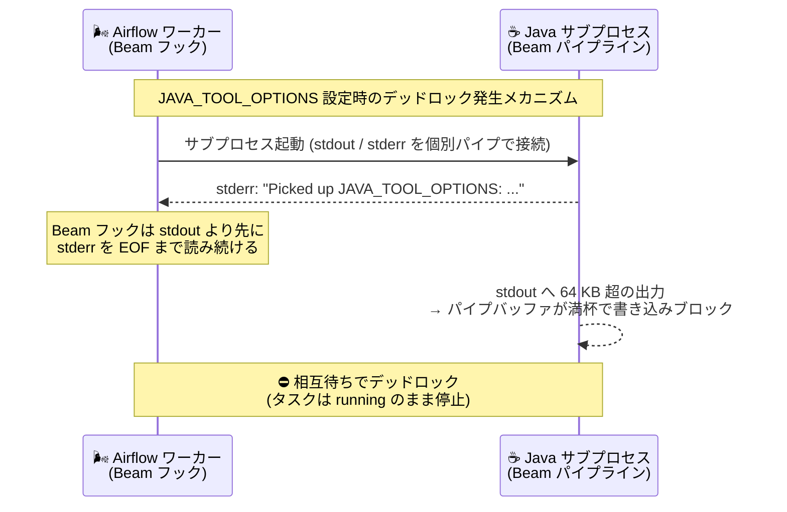
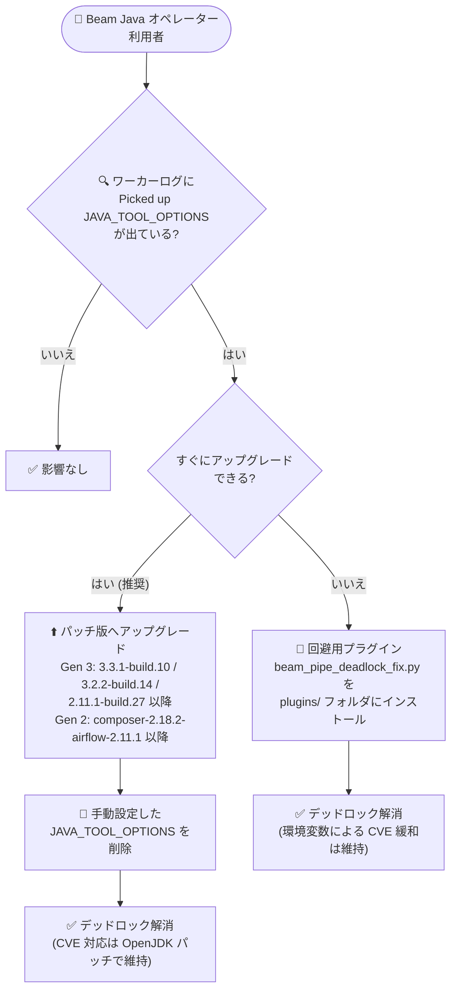

# Managed Service for Apache Airflow: Beam Java オペレーターが JAVA_TOOL_OPTIONS 設定時にデッドロックする既知の問題と解決策

**リリース日**: 2026-11-26

**サービス**: Managed Service for Apache Airflow (旧 Cloud Composer)

**機能**: Apache Beam Java オペレーターのデッドロック (既知の問題) と、パッチ版ビルドでの `JAVA_TOOL_OPTIONS` 自動設定の廃止、回避用プラグインの提供

**ステータス**: Issue (既知の問題 + 緩和策)

📊 [このアップデートのインフォグラフィックを見る](https://takech9203.github.io/google-cloud-news-summary/20261126-managed-airflow-beam-java-tool-options-deadlock.html)

## 概要

Managed Service for Apache Airflow (旧 Cloud Composer) で、**Apache Beam Java オペレーター (`BeamRunJavaPipelineOperator` および `DataflowCreateJavaJobOperator`) を使用する Airflow タスクが、CVE-2026-114938 の緩和策として Airflow ワーカーに `JAVA_TOOL_OPTIONS` 環境変数が設定されている場合に応答しなくなる、またはデッドロックする**という既知の問題が公開されました。これは、[11 月 19〜20 日に展開された CVE-2026-114938 対応](./2026-11-20-managed-airflow-cve-2026-114938-fixed-versions.md) (緩和用環境変数の自動設定を含む) の副作用にあたる問題です。

原因は、`JAVA_TOOL_OPTIONS` が設定されていると OpenJDK が起動時メッセージ (`Picked up JAVA_TOOL_OPTIONS: ...`) を stderr に出力する一方、`apache-airflow-providers-apache-beam` パッケージの Beam フックが **stdout を排出 (drain) する前に stderr を EOF まで読み切ろうとする**実装になっているためです。Java プロセスが stdout に 64 KB を超える出力を書き込むと、OS のパイプバッファが満杯になりタスクがデッドロックします。出力が少ない場合でも、タスクログのストリーミングと Dataflow ジョブ ID の検出がサブプロセス終了まで停止します。

対応として、**2026 年 11 月 25 日以降、パッチ適用済み OpenJDK 21 を含むビルドでは Managed Airflow が `JAVA_TOOL_OPTIONS` を自動設定しなくなりました** (Gen 3: composer-3-airflow-3.3.1-build.10 / 3.2.2-build.14 / 2.11.1-build.27 以降、Gen 2: composer-2.18.2-airflow-2.11.1 以降)。解決にはこれらのパッチ版へのアップグレード (+ 手動設定した環境変数の削除)、またはすぐにアップグレードできない場合は GitHub で公開されている回避用プラグイン `beam_pipe_deadlock_fix.py` のインストールが案内されています。

**アップデート前の課題 (問題の発生状況)**

- CVE-2026-114938 緩和のため `JAVA_TOOL_OPTIONS="-XX:+IgnoreUnrecognizedVMOptions -XX:UseAVX=2"` が自動または手動で設定された環境では、Beam Java オペレーターのタスクが実行中のまま無期限に停止 (デッドロック)、またはサブプロセス終了までログが流れない状態になっていた
- 影響を受けるのは、`JAVA_TOOL_OPTIONS` を手動設定した環境、2026 年 11 月 20 日より前にリリースされた Gen 3 ビルドで環境変数が自動設定された環境、および 11 月 20 日ビルド (3.3.1-build.10 / 3.2.2-build.14 / 2.11.1-build.27) を実行していても 2026 年 11 月 26 日より前に作成・更新された環境
- 未パッチ版で `JAVA_TOOL_OPTIONS` を空文字に設定したり削除したりすると、空でも OpenJDK は起動メッセージを stderr に出力し続けるうえ、CVE-2026-114938 の緩和も失われるため、安全な回避手段がなかった

**アップデート後の改善 (解決策の提供)**

- 2026 年 11 月 25 日以降、パッチ適用済み OpenJDK 21 を含むビルド (Gen 3: 3.3.1-build.10 / 3.2.2-build.14 / 2.11.1-build.27 以降、Gen 2: composer-2.18.2-airflow-2.11.1 以降) では `JAVA_TOOL_OPTIONS` が自動設定されなくなり、アップグレードによりデッドロックを根本的に回避できるようになった
- すぐにアップグレードできない環境向けに、回避用 Airflow プラグイン `beam_pipe_deadlock_fix.py` が GitHub で公開された。stderr を stdout にマージして単一のリーダーで両ストリームを排出することでデッドロックを防ぎつつ、CVE-2026-114938 の緩和 (環境変数) は維持される
- プラグインは DAG の変更や環境の再起動が不要で、環境のバケットの `plugins/` フォルダにアップロードするだけで適用できる

## アーキテクチャ図





1 つ目の図はデッドロックの発生メカニズム (Beam フックが stderr を先に読み切ろうとする間に、Java プロセスの stdout 書き込みがパイプバッファ満杯でブロックされる相互待ち) を示しています。2 つ目の図は、影響の有無の確認からパッチ版へのアップグレードまたは回避用プラグインの導入に至る解決パスの判断フローです。

## サービスアップデートの詳細

### 主要なポイント

1. **既知の問題: Beam Java オペレーターのデッドロック**
   - `BeamRunJavaPipelineOperator` と `DataflowCreateJavaJobOperator` を使用するタスクが、`JAVA_TOOL_OPTIONS` 設定時に応答しなくなる、またはデッドロックする
   - 原因は `apache-airflow-providers-apache-beam` パッケージの問題で、Beam フックが stdout を排出する前に stderr を EOF まで読む実装のため、OpenJDK の起動メッセージが stderr に出力される状況で Java プロセスが stdout に 64 KB を超えて書き込むとデッドロックする
   - 出力が 64 KB 以下でも、タスクログのストリーミングと Dataflow ジョブ ID の検出がサブプロセス終了まで停止する

2. **パッチ版ビルドでの `JAVA_TOOL_OPTIONS` 自動設定の廃止 (2026 年 11 月 25 日以降)**
   - パッチ適用済み OpenJDK 21 を含むビルドでは、Managed Airflow が `JAVA_TOOL_OPTIONS` を自動設定しなくなった
   - Gen 3: composer-3-airflow-3.3.1-build.10、composer-3-airflow-3.2.2-build.14、composer-3-airflow-2.11.1-build.27 およびそれ以降のビルド
   - Gen 2: composer-2.18.2-airflow-2.11.1 およびそれ以降のバージョン
   - OpenJDK 自体がパッチ済みのため、環境変数による緩和がなくても CVE-2026-114938 への対応は維持される

3. **解決策 1 (推奨): パッチ版へのアップグレード**
   - 上記のパッチ版バージョンへ環境をアップグレードし、手動で設定した `JAVA_TOOL_OPTIONS` 環境変数があれば削除する
   - 既に 11 月 20 日ビルドを実行していても、環境の作成・更新が 2026 年 11 月 26 日より前の場合 (またはワーカーのタスクログに `Picked up JAVA_TOOL_OPTIONS` が出続けている場合) は、環境の更新オペレーション (例: 環境変数の追加・更新) を実行すると、自動設定された `JAVA_TOOL_OPTIONS` がワーカーから削除される

4. **解決策 2 (アップグレードなしの回避策): `beam_pipe_deadlock_fix.py` プラグイン**
   - GitHub (GoogleCloudPlatform/python-docs-samples) で公開されている回避用 Airflow プラグインを、環境のバケットの `plugins/` フォルダにインストールする
   - プラグインは Beam フックの `run_beam_command` を置き換え、stderr を stdout にマージして単一のリーダーで両ストリームを排出することでデッドロックを防ぐ
   - `JAVA_TOOL_OPTIONS` による CVE-2026-114938 の緩和は有効なまま維持され、DAG の変更や環境の再起動も不要

5. **注意: 未パッチ版で環境変数を空にしたり削除したりしない**
   - `JAVA_TOOL_OPTIONS` を空文字に設定しても OpenJDK は起動メッセージを stderr に出力するため問題は解消しない
   - 未パッチ版で環境変数を削除すると CVE-2026-114938 の緩和が失われる

## 技術仕様

### デッドロックの発生条件とメカニズム

| 項目 | 詳細 |
|------|------|
| 影響を受けるオペレーター | `BeamRunJavaPipelineOperator`、`DataflowCreateJavaJobOperator` |
| トリガー | Airflow ワーカーに `JAVA_TOOL_OPTIONS` 環境変数が設定されている (自動・手動を問わない) |
| 根本原因 | `apache-airflow-providers-apache-beam` の Beam フックが stdout の排出前に stderr を EOF まで読む実装 |
| デッドロック条件 | OpenJDK が stderr に起動メッセージを出力し、かつ Java プロセスが stdout に 64 KB 超を書き込む |
| 64 KB 以下の場合の症状 | タスクログのストリーミングと Dataflow ジョブ ID の検出がサブプロセス終了まで停止 |
| 症状の確認方法 | ワーカーのタスクログ (`process_fd`) に `Picked up JAVA_TOOL_OPTIONS: -XX:+IgnoreUnrecognizedVMOptions -XX:UseAVX=2` の行がある |

### 影響を受ける環境

| 状況 | 影響 |
|------|------|
| `JAVA_TOOL_OPTIONS` を手動で環境変数に設定した環境 | 影響あり |
| 2026 年 11 月 20 日より前にリリースされた Gen 3 ビルド (環境の作成・更新時に自動設定) | 影響あり |
| composer-3-airflow-3.3.1-build.10 / 3.2.2-build.14 / 2.11.1-build.27 を実行中で、2026 年 11 月 26 日より前に作成・更新された環境 | 影響あり (環境の更新オペレーションで自動設定変数を削除可能) |
| 2026 年 11 月 25 日以降に自動設定が廃止されたパッチ版ビルドで作成・更新された環境 (手動設定なし) | 影響なし |

### `JAVA_TOOL_OPTIONS` を自動設定しなくなったバージョン (パッチ適用済み OpenJDK 21 を含む)

| 世代 | バージョン / ビルド |
|------|------|
| Gen 3 | composer-3-airflow-3.3.1-build.10 以降 |
| Gen 3 | composer-3-airflow-3.2.2-build.14 以降 |
| Gen 3 | composer-3-airflow-2.11.1-build.27 以降 |
| Gen 2 | composer-2.18.2-airflow-2.11.1 以降 |

### 回避用プラグイン `beam_pipe_deadlock_fix.py` の仕様

| 項目 | 詳細 |
|------|------|
| 動作 | `run_beam_command` を置き換え、`subprocess.Popen` で `stderr=subprocess.STDOUT` を指定して stderr を stdout にマージし、単一リーダーで排出 |
| 対応プロバイダー | provider 5.5〜6.0 の `check_job_status_callback`、6.0.1 以降の `is_dataflow_job_id_exist_callback`、6.3.2 以降の `check_job_id_by_name_callback` に対応 |
| 対応 Airflow | Airflow 3.1 以降 (Task SDK 経由) と Airflow 2.5〜3.0 (`airflow.plugins_manager` 経由) の両方で `AirflowPlugin` をインポート |
| 導入要件 | DAG の変更不要、環境の再起動不要 |
| 副作用 | プラグイン導入中は Beam サブプロセスの stderr 出力がタスクログに WARNING ではなく INFO レベルで記録される |
| クリーンアップ | 影響を受けないバージョンへのアップグレード後 (または `apache-airflow-providers-apache-beam` の上流修正を含むバージョンへの更新後) に `plugins/beam_pipe_deadlock_fix.py` を削除する |

## 設定方法

### 前提条件

1. Managed Airflow (Cloud Composer) 環境で Beam Java オペレーターを使用していること
2. 環境の更新、または環境のバケットの閲覧・変更が可能な IAM 権限を持っていること

### 手順

#### ステップ 1: 影響の有無を確認する

ワーカーのタスクログに以下の行が含まれるかを確認します。

```
Picked up JAVA_TOOL_OPTIONS: -XX:+IgnoreUnrecognizedVMOptions -XX:UseAVX=2
```

この行が出力されており、Beam Java オペレーターのタスクが running のまま停止する、またはログがサブプロセス終了まで流れない場合は、この既知の問題に該当します。

#### ステップ 2 (解決策 1・推奨): パッチ版へアップグレードし、手動設定の環境変数を削除する

```bash
# アップグレード可能なバージョンを確認
gcloud composer environments list-upgrades ENVIRONMENT_NAME \
  --location LOCATION

# パッチ版へアップグレード (Gen 2 の例)
gcloud composer environments update ENVIRONMENT_NAME \
  --location LOCATION \
  --image-version composer-2.18.2-airflow-2.11.1

# 手動で設定した JAVA_TOOL_OPTIONS を削除
gcloud composer environments update ENVIRONMENT_NAME \
  --location LOCATION \
  --remove-env-variables JAVA_TOOL_OPTIONS
```

既に 11 月 20 日ビルド (3.3.1-build.10 / 3.2.2-build.14 / 2.11.1-build.27) を実行中で 2026 年 11 月 26 日より前に作成・更新した環境では、環境変数の追加・更新などの環境更新オペレーションを 1 回実行すると、自動設定された `JAVA_TOOL_OPTIONS` がワーカーから削除されます。

**注意**: 未パッチ版では `JAVA_TOOL_OPTIONS` を空文字にしたり削除したりしないでください。空でも OpenJDK は起動メッセージを stderr に出力し、削除すると CVE-2026-114938 の緩和が失われます。

#### ステップ 3 (解決策 2・アップグレードできない場合): 回避用プラグインをインストールする

```bash
# GitHub からプラグインをダウンロード
curl -O https://raw.githubusercontent.com/GoogleCloudPlatform/python-docs-samples/main/composer/workflows/beam_pipe_deadlock_fix.py

# 環境のバケットの plugins/ フォルダにアップロード
gcloud composer environments storage plugins import \
  --environment ENVIRONMENT_NAME \
  --location LOCATION \
  --source beam_pipe_deadlock_fix.py
```

DAG の変更や環境の再起動は不要です。`JAVA_TOOL_OPTIONS` による CVE-2026-114938 の緩和は有効なまま維持されます。

#### ステップ 4: アップグレード後のクリーンアップ

影響を受けないバージョン (手動の `JAVA_TOOL_OPTIONS` オーバーライドなし)、または `apache-airflow-providers-apache-beam` の上流修正を含むバージョンへアップグレードした後は、プラグインを削除します。

```bash
gcloud composer environments storage plugins delete \
  --environment ENVIRONMENT_NAME \
  --location LOCATION \
  beam_pipe_deadlock_fix.py
```

## メリット

### ビジネス面

- **データパイプラインの停止リスクの解消**: Beam Java オペレーターを使うワークフローが無期限に停止する問題を解消でき、Dataflow を使った日次バッチなどの遅延・滞留を防げる
- **セキュリティと可用性の両立**: 回避用プラグインを使えば、CVE-2026-114938 の緩和を維持したままデッドロックを回避でき、セキュリティ対応とパイプラインの安定稼働を両立できる

### 技術面

- **根本対応と暫定対応の 2 つの解決パス**: パッチ版へのアップグレード (根本対応) と、`plugins/` フォルダへのファイル配置だけで済む回避用プラグイン (暫定対応) から選択できる
- **導入コストの低い回避策**: プラグインは DAG の変更も環境の再起動も不要で、provider の複数バージョン (5.5〜6.3.2+) と Airflow 2/3 の両方に対応している

## デメリット・制約事項

### 制限事項

- 回避用プラグインの導入中は、Beam サブプロセスの stderr 出力がタスクログに WARNING ではなく INFO レベルで記録される
- 未パッチ版では `JAVA_TOOL_OPTIONS` を空文字にしたり削除したりできない (問題が解消しないうえ、CVE-2026-114938 の緩和が失われる)
- Managed Airflow バージョンのダウングレードはできないため、アップグレードは計画的に実施する必要がある

### 考慮すべき点

- 11 月 20 日ビルド (3.3.1-build.10 / 3.2.2-build.14 / 2.11.1-build.27) を実行中でも、環境の作成・更新が 2026 年 11 月 26 日より前の場合は自動設定された `JAVA_TOOL_OPTIONS` が残っている可能性があるため、ワーカーのタスクログを確認し、必要に応じて環境の更新オペレーションを実行する
- パッチ版へのアップグレード後は、CVE-2026-114938 緩和のために手動設定した `JAVA_TOOL_OPTIONS` を忘れずに削除する
- 回避用プラグインは恒久対応ではないため、アップグレード完了後に `plugins/beam_pipe_deadlock_fix.py` を削除するクリーンアップまでを運用手順に含める

## ユースケース

### ユースケース 1: Dataflow ジョブを起動する日次バッチが突然停止した環境の復旧

**シナリオ**: `BeamRunJavaPipelineOperator` で Dataflow ジョブを起動する日次バッチが、CVE-2026-114938 緩和の環境変数設定後から running のまま進まなくなった。すぐに対応が必要だが、アップグレードのメンテナンスウィンドウは確保できていない。

**実装例**:
```bash
# 回避用プラグインを plugins/ フォルダへインストール (再起動不要)
gcloud composer environments storage plugins import \
  --environment example-environment \
  --location us-central1 \
  --source beam_pipe_deadlock_fix.py
```

**効果**: CVE-2026-114938 の緩和 (環境変数) を維持したままデッドロックを即座に回避でき、停止していたパイプラインを再開できる。後日パッチ版へアップグレードし、プラグインを削除して恒久対応に切り替える。

### ユースケース 2: パッチ版アップグレードによる恒久対応

**シナリオ**: CVE-2026-114938 対応で `JAVA_TOOL_OPTIONS` を手動設定した Gen 2 環境で Beam Java オペレーターを使用しており、デッドロックの再発リスクを根本的に排除したい。

**効果**: composer-2.18.2-airflow-2.11.1 以降へのアップグレードと手動設定した環境変数の削除により、パッチ適用済み OpenJDK 21 で CVE 対応を維持しつつ、`JAVA_TOOL_OPTIONS` 起因のデッドロック条件そのものを環境から除去できる。

## 関連サービス・機能

- **Dataflow / Apache Beam**: 影響を受けるオペレーター (`BeamRunJavaPipelineOperator`、`DataflowCreateJavaJobOperator`) は Java 製 Beam パイプラインや Dataflow ジョブの起動に使用される
- **apache-airflow-providers-apache-beam**: デッドロックの根本原因となる実装 (stdout 排出前の stderr 読み取り) を含むプロバイダーパッケージ。上流修正を含むバージョンが Managed Airflow に取り込まれた後は回避用プラグインを削除できる
- **Cloud Storage (環境のバケット)**: 回避用プラグインは環境のバケットの `plugins/` フォルダに配置してインストールする
- **Google Cloud セキュリティ速報 (CVE-2026-114938)**: 今回の問題の背景となった脆弱性。パッチ版ビルドには修正済み OpenJDK 21 が含まれる

## 参考リンク

- 📊 [インフォグラフィック](https://takech9203.github.io/google-cloud-news-summary/20261126-managed-airflow-beam-java-tool-options-deadlock.html)
- [公式リリースノート](https://docs.cloud.google.com/release-notes#November_26_2026)
- [Managed Airflow リリースノート (2026-11-20 の項)](https://docs.cloud.google.com/composer/docs/release-notes#November_20_2026)
- [既知の問題 (Gen 3): Apache Beam Java operators stop responding when JAVA_TOOL_OPTIONS is set](https://docs.cloud.google.com/composer/docs/composer-3/known-issues#apache-beam-java-tool-options-deadlock)
- [既知の問題 (Gen 2): Apache Beam Java operators stop responding when JAVA_TOOL_OPTIONS is set](https://docs.cloud.google.com/composer/docs/composer-2/known-issues#apache-beam-java-tool-options-deadlock)
- [回避用プラグイン beam_pipe_deadlock_fix.py (GitHub)](https://github.com/GoogleCloudPlatform/python-docs-samples/blob/main/composer/workflows/beam_pipe_deadlock_fix.py)
- [カスタムプラグインのインストール (Gen 3)](https://docs.cloud.google.com/composer/docs/composer-3/install-plugins)
- [関連レポート: CVE-2026-114938 修正版リリース (2026-11-20)](./2026-11-20-managed-airflow-cve-2026-114938-fixed-versions.md)

## まとめ

CVE-2026-114938 緩和のための `JAVA_TOOL_OPTIONS` 設定が、Beam Java オペレーターのタスクをデッドロックさせる副作用を持つことが既知の問題として公開されました。Beam Java オペレーターを使用している環境は、まずワーカーのタスクログで `Picked up JAVA_TOOL_OPTIONS` の有無を確認し、推奨対応であるパッチ版 (Gen 3: 3.3.1-build.10 / 3.2.2-build.14 / 2.11.1-build.27 以降、Gen 2: composer-2.18.2-airflow-2.11.1 以降) へのアップグレードと手動設定した環境変数の削除を計画してください。すぐにアップグレードできない場合は、CVE の緩和を維持したままデッドロックを回避できる `beam_pipe_deadlock_fix.py` プラグインの導入が有効です。

---

**タグ**: Managed Service for Apache Airflow, Cloud Composer, Apache Beam, Dataflow, 既知の問題, デッドロック, JAVA_TOOL_OPTIONS, CVE-2026-114938, Airflow プラグイン
