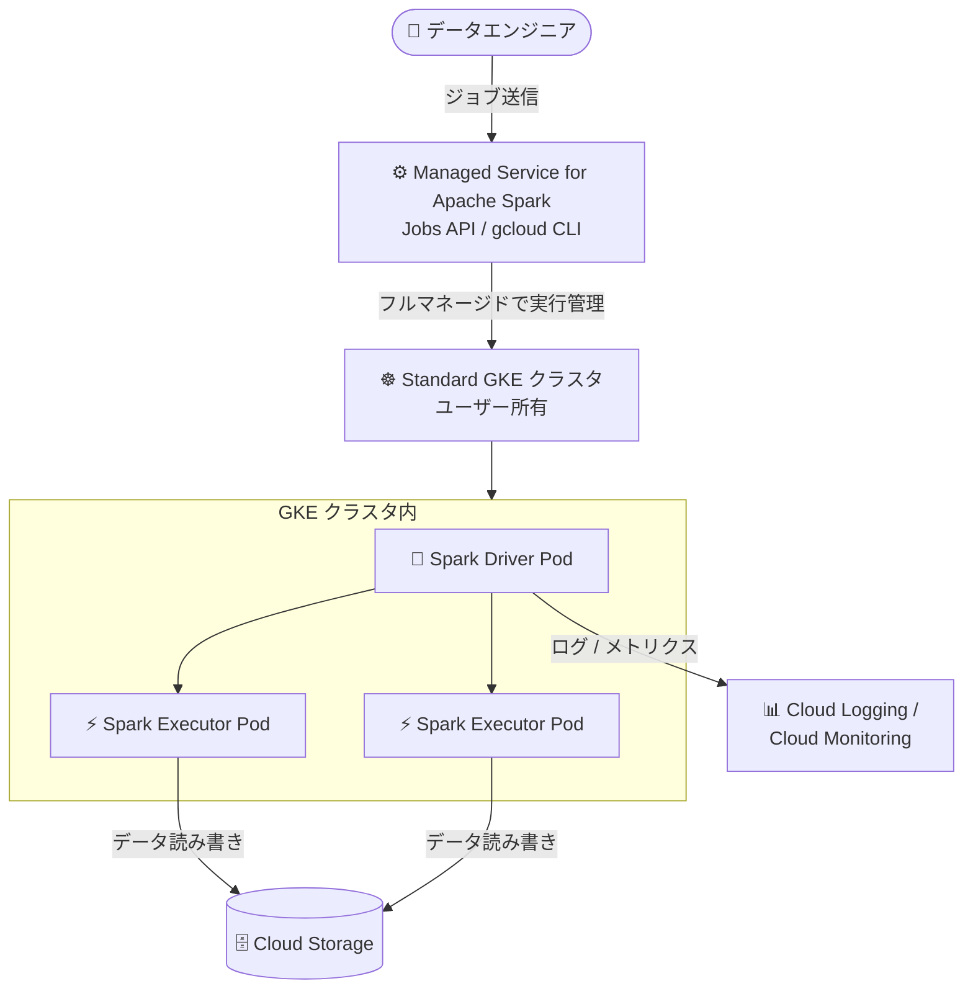

# Managed Service for Apache Spark: Managed Service for Apache Spark on GKE v2 (Private Preview)

**リリース日**: 2026-11-27

**サービス**: Managed Service for Apache Spark

**機能**: Managed Service for Apache Spark on GKE v2

**ステータス**: Private Preview

📊 [このアップデートのインフォグラフィックを見る](https://takech9203.github.io/google-cloud-news-summary/20261127-managed-spark-on-gke-v2-private-preview.html)

## 概要

Google Cloud は、次世代の「Managed Service for Apache Spark on GKE v2」を Private Preview として発表しました。フルマネージドな Apache Spark ワークロードを、ユーザー自身の Standard GKE クラスタ上でネイティブに実行できるようになります。Preview への参加には、`dataproc-previews@google.com` への連絡とプロジェクトの許可リスト (allowlist) 登録が必要です。

Managed Service for Apache Spark on GKE は、GKE クラスタ上に仮想クラスタをデプロイして Spark ジョブを Pod として実行する仕組みを提供してきました。既に GKE を標準のコンピューティング基盤として採用している組織が、Spark ワークロードを同じクラスタ上に統合し、リソース使用率の向上と運用の一元化を図れる点が特徴です。今回の v2 は、この GKE 統合を「次世代 (next-generation)」として刷新するものです。

対象ユーザーは、GKE 上でデータ処理基盤を統合したいプラットフォームエンジニアリングチームや、Kubernetes ネイティブな運用 (ノードプール管理、スケジューリング、モニタリング) と Spark のフルマネージド体験を両立させたいデータエンジニアリングチームです。

**アップデート前の課題**

従来の Managed Service for Apache Spark on GKE (v1 世代) には、公式ドキュメントで確認できる範囲で以下の制約がありました。

- Google Cloud コンソールからの仮想クラスタ作成がサポートされておらず、gcloud CLI または API での操作が必要だった
- サポートされる Spark エンジンは Spark 3.5 系 (最新コンポーネントは Spark 3.5.1 / Java 11 / Python 3.8.5) にとどまり、サーバーレス版と比べてランタイムの世代が古かった
- 仮想クラスタの作成時に専用のノードプールが GKE クラスタ内に作成される方式で、仮想クラスタを削除してもノードプールは残るなど、ライフサイクル管理に注意が必要だった

**アップデート後の改善**

- 次世代アーキテクチャにより、Standard GKE クラスタ上で Spark ワークロードを「ネイティブに」実行できるようになった
- Spark の実行環境・スケーリング・ジョブ管理は引き続き Google がフルマネージドで提供し、ユーザーはジョブの投入に集中できる
- 既存の Standard GKE クラスタをそのまま活用できるため、GKE に標準化した組織がインフラを二重管理する必要がない

※ v2 の詳細な技術仕様 (対応 Spark バージョン、API の変更点など) は Private Preview 段階のため一般公開されていません。上記はリリースノートで確認できた内容に基づきます。

## アーキテクチャ図



Managed Service for Apache Spark on GKE では、Spark のドライバーとエグゼキュータが GKE クラスタ上の Pod として実行され、Pod のスケジューリングは GKE が管理します。v2 ではこの統合が次世代アーキテクチャとして刷新され、Standard GKE クラスタ上でのネイティブ実行が可能になります。

## サービスアップデートの詳細

### 主要機能

1. **Standard GKE クラスタ上でのネイティブ実行**
   - ユーザーが所有する Standard GKE クラスタ上で、フルマネージドな Apache Spark ワークロードを直接実行できる
   - GKE をコンピューティング基盤として標準化している組織が、Spark ワークロードを同一基盤に統合可能

2. **フルマネージドな Spark 実行体験**
   - Spark の実行管理は Managed Service for Apache Spark が担い、ユーザーはジョブの開発と投入に集中できる
   - 従来の GKE 統合 (v1) と同様、専用の Spark クラスタ VM (マスター/ワーカー) を個別にプロビジョニングする必要がない

3. **Private Preview としての提供**
   - 利用にはプロジェクトの許可リスト登録が必要
   - 登録希望は `dataproc-previews@google.com` へ連絡する

### 参考: 従来の Managed Service for Apache Spark on GKE (v1) の仕組み

v2 の詳細仕様は未公開のため、比較の参考として現行世代の仕組みを記載します。

| 項目 | 内容 (v1 世代) |
|------|------|
| デプロイ単位 | GKE クラスタ上の「仮想クラスタ」(GKE Namespace で分離) |
| 実行形態 | Spark ジョブは GKE ノードプール上の Pod として実行 |
| 対応エンジン | Spark 3.5 系 (最新: 3.5-dataproc-28 = Spark 3.5.1) |
| 作成方法 | gcloud CLI / API (コンソールからの作成は非サポート) |
| 認証連携 | Workload Identity による Kubernetes SA と Google SA のバインド |
| ジョブ履歴 | Persistent History Server (PHS) と連携可能 |

## 設定方法

### 前提条件

1. Private Preview への参加 (プロジェクトの許可リスト登録) が必要
2. Standard モードの GKE クラスタ

### 手順

#### ステップ 1: Preview への登録

```text
dataproc-previews@google.com 宛にメールで連絡し、
対象プロジェクトの許可リスト登録を依頼する
```

v2 の具体的なセットアップ手順は Private Preview 参加者向けに提供されるため、一般公開ドキュメントはまだありません。現行世代 (v1) の手順は [クイックスタート](https://docs.cloud.google.com/managed-spark/docs/guides/dpgke/quickstarts/gke-quickstart-create-cluster) を参照してください。

## メリット

### ビジネス面

- **インフラの統合によるコスト効率**: GKE クラスタを Spark と他のワークロードで共有でき、リソース使用率を高められる
- **運用の一元化**: Kubernetes を中心としたプラットフォーム運用 (監視、セキュリティ、ガバナンス) に Spark ワークロードを組み込める

### 技術面

- **フルマネージドな Spark 実行**: Spark クラスタの構築・管理を Google に任せつつ、実行基盤には使い慣れた GKE を利用できる
- **Kubernetes ネイティブな統合**: Pod スケジューリングやノードプール管理など GKE の機能をそのまま活用できる

## デメリット・制約事項

### 制限事項

- Private Preview のため、プロジェクトの許可リスト登録 (メールでの申請) が必要
- Standard GKE クラスタが対象 (リリースノートで明示されているのは Standard モード)
- v2 の詳細仕様 (対応 Spark バージョン、API、リージョンなど) は一般公開されていない

### 考慮すべき点

- Private Preview 段階の機能であり、本番ワークロードへの適用は慎重に判断する必要がある
- GA までに仕様が変更される可能性がある

## ユースケース

### ユースケース 1: GKE 標準化組織での Spark ワークロード統合

**シナリオ**: 社内のアプリケーションをすべて GKE 上で運用している企業が、データパイプライン (Spark バッチ) だけ別のクラスタ基盤で運用しており、監視・セキュリティ運用が二重化している。

**効果**: Spark ワークロードを既存の Standard GKE クラスタに統合し、プラットフォーム運用を一元化。アイドルリソースの共有によりコスト効率も向上する。

### ユースケース 2: Kubernetes ネイティブなデータ基盤の構築

**シナリオ**: プラットフォームチームが Kubernetes ベースの社内データ基盤を構築しており、Spark の実行管理 (ドライバー/エグゼキュータのライフサイクル、スケーリング) は自前で運用したくない。

**効果**: Spark の実行管理をフルマネージドサービスに任せつつ、実行環境は自社の GKE クラスタ上に保持できるため、ガバナンス要件と運用負荷軽減を両立できる。

## 料金

v2 (Private Preview) の料金は公開されていません。参考として、Managed Service for Apache Spark の現行の料金体系は以下の通りです (GKE クラスタ自体のコンピューティングリソースは別途 GKE/Compute Engine の料金が発生します)。

| デプロイモデル | 料金 (参考) |
|--------|-----------------|
| サーバーレス (Standard) | $0.06 / DCU 時間〜 |
| サーバーレス (Premium) | $0.089 / DCU 時間〜 |
| クラスタ (管理手数料) | $0.01 / vCPU 時間〜 + 基盤リソース料金 |

詳細は [料金ページ](https://cloud.google.com/products/managed-service-for-apache-spark/pricing) を参照してください。

## 関連サービス・機能

- **Google Kubernetes Engine (GKE)**: v2 の実行基盤。Standard クラスタ上で Spark ワークロードがネイティブに実行される
- **Cloud Storage**: Spark ジョブの入出力データやアーティファクトのステージングに使用
- **BigQuery**: Spark との双方向連携 (BigQuery コネクタ) により、レイクハウス構成の処理エンジンとして利用可能
- **Cloud Logging / Cloud Monitoring**: Spark ジョブのログ・メトリクスの収集と監視
- **Workload Identity**: Kubernetes サービスアカウントと Google サービスアカウントの安全な紐付け (現行世代で使用)

## 参考リンク

- 📊 [インフォグラフィック](https://takech9203.github.io/google-cloud-news-summary/20261127-managed-spark-on-gke-v2-private-preview.html)
- [公式リリースノート](https://docs.cloud.google.com/release-notes#November_27_2026)
- [Managed Service for Apache Spark on GKE の概要 (現行世代)](https://docs.cloud.google.com/managed-spark/docs/concepts/gke-overview)
- [GKE クラスタ作成クイックスタート (現行世代)](https://docs.cloud.google.com/managed-spark/docs/guides/dpgke/quickstarts/gke-quickstart-create-cluster)
- [料金ページ](https://cloud.google.com/products/managed-service-for-apache-spark/pricing)

## まとめ

Managed Service for Apache Spark on GKE v2 は、GKE を標準基盤とする組織にとって、Spark ワークロードをフルマネージドのまま自社の Standard GKE クラスタに統合できる重要なアップデートです。現時点では Private Preview のため詳細仕様は未公開ですが、GKE 上でのデータ処理統合を検討しているチームは `dataproc-previews@google.com` から Preview に申し込み、早期評価を始めることを推奨します。

---

**タグ**: `Managed Service for Apache Spark`, `GKE`, `Apache Spark`, `Private Preview`, `データ処理`, `Kubernetes`
